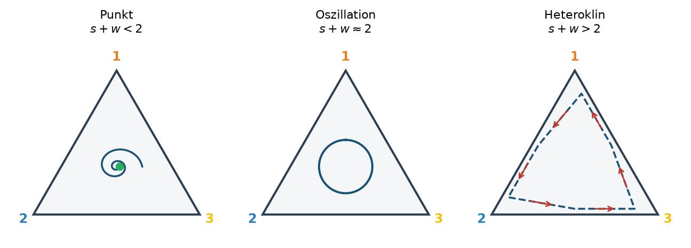
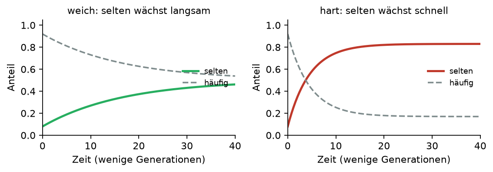
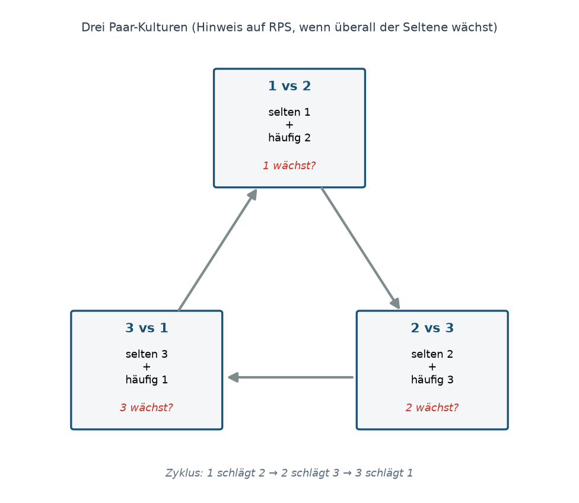

**Nicht für Studierende.** Teams bis 4 · Notebook (Quarto / Rmd / `checkpoint.R`)

## 1 · Check (keine Frage)

- [ ] Zwei Abbildungen mit **qualitativ verschiedenem** Muster
- [ ] In beiden bleiben alle drei Strategien sichtbar
- [ ] $s$ und $w$ (oder Matrix) genannt; $s > 1 > w$

Danach: Studierende sollen **ihre** gewählten $s$ und $w$ anschauen und $s+w$ ausrechnen.

## 2 · Frage: Welche Parameter → welches Muster?

**Was ihr ihnen sagen könnt:** Die Summe $s+w$ erklärt die Muster **grob**:

| $s+w$ | typisches Muster |
|-------|------------------|
| unter 2 | Punkt (Spirale nach innen) |
| nahe 2 | dauerhafte Oszillation |
| über 2 | Heteroklin (Drift zum Rand) |

Beispiele: $(1.2,\ 0.5)$ · $(1.35,\ 0.65)$ · $(1.40,\ 0.65)$

{width=95%}

**Paarweise Konkurrenz — Rolle von $s$ und $w$**

Nur zwei Typen. Treffen auf die eigene Strategie kostet $1$ (Baseline). Treffen auf die andere:

- Verlierer zahlt $s$ (also **mehr** als $1$) — Nachteil: $s-1$
- Gewinner zahlt $w$ (also **weniger** als $1$) — Vorteil: $1-w$

**Ausgewogen: $s+w = 2$.** Dann ist $s-1 = 1-w$: der eine verliert genau so viel, wie der andere gewinnt. Vorteil und Nachteil sind gleich gross → **stabiler Zyklus** (Oszillation).

**Weicher: $s+w < 2$.** Dann ist $s-1 < 1-w$: der Nachteil des Verlierers ist **kleiner** als der Vorteil des Gewinners. Der seltene Gewinner wächst eher **langsam** / die Anteile beruhigen sich → eher **Punkt**.

**Harter: $s+w > 2$.** Dann ist $s-1 > 1-w$: der Nachteil des Verlierers ist **grösser** als der Vorteil des Gewinners. Der seltene Gewinner wächst **schnell**, Dominanz wechselt heftig → eher **Heteroklin** (Bahn zum Rand).

{width=90%}

Kurz: Vergleich $s-1$ mit $1-w$ — das ist genau der Vergleich von $s+w$ mit $2$.

## 3 · Denkanstoss: Reicht ein kurzes Experiment?

Idee: drei Paar-Kulturen (1 vs 2, 2 vs 3, 3 vs 1). Start z. B. 90 % / 10 %. Nimmt der Seltene jeweils zu? (`show_two` im Notebook.)

{width=90%}

**Frage an die Gruppe:** Würde so ein Experiment reichen, um RPS zu vermuten — auch ohne lange Serie mit allen drei Typen?

Was man erwarten kann: Wenn in **allen drei** Paaren der Seltene wächst (zyklisch: 1 schlägt 2, 2 schlägt 3, 3 schlägt 1), ist das ein Hinweis. Es ist aber nur ein Hinweis — nicht der volle Langzeitverlauf mit drei Typen.
