```{r}
#| include: false
source("../slides-ggplot.R")
snps <- read.csv("data/hapmap_chb_chr1.csv")
snps$n <- snps$AA + snps$AB + snps$BB
snps$p <- (2 * snps$AA + snps$AB) / (2 * snps$n)

hwe_cols <- c(AA = "#2166ac", AB = "#1b9e77", BB = "#b2182b")
hwe_df <- function() {
  p <- seq(0, 1, length.out = 301)
  rbind(
    data.frame(p, f = p^2, gt = "AA"),
    data.frame(p, f = 2 * p * (1 - p), gt = "AB"),
    data.frame(p, f = (1 - p)^2, gt = "BB")
  )
}
hwe_kurven <- function(punkte = NULL, main = "") {
  p <- ggplot(hwe_df(), aes(p, f, colour = gt)) +
    geom_line(linewidth = 1.05) +
    scale_colour_manual(values = hwe_cols) +
    coord_cartesian(ylim = c(0, 1)) +
    labs(x = "Allelfrequenz p", y = "Genotypfrequenz", title = main) +
    theme_slide()
  if (is.null(punkte)) return(p)
  p + geom_point(
    data = punkte, aes(p, f, colour = gt),
    size = 1.35, inherit.aes = FALSE
  )
}
```

## Übersicht

**Woche 5** von 14 · **Do., 15. Okt. 2026, 08:15–10:00**

::::: columns
::: {.column width="52%"}
| Teil | Dauer | Was |
|------|-------|-----|
| Vorlesung | ~45 min | Farbmorphen → Vererbung → Hardy–Weinberg |
| Notebook | ~45 min | **Avocado-Genetik** · Blutgruppen · HWE |
:::
::: {.column width="38%"}
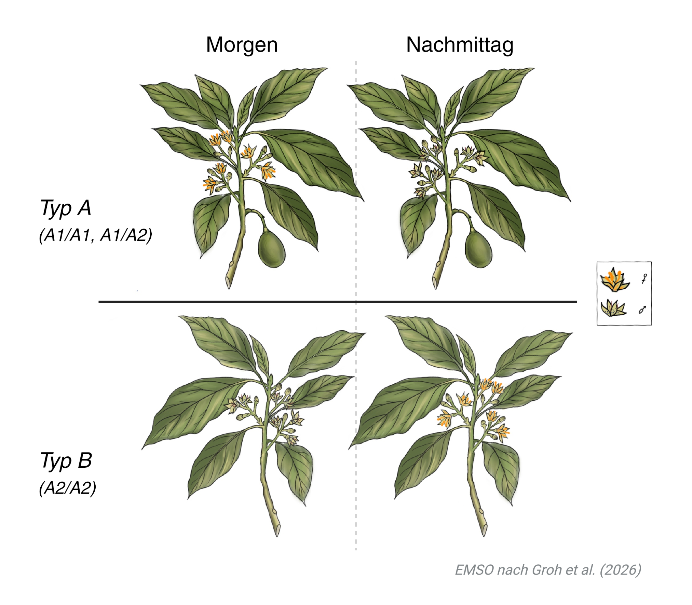{.overview-avo fig-alt="Avocado Bluetypen A und B"}

::: {.fig-credit}
Illustration: Emma Ochsner · nach Groh et al. (2026)
:::
:::
::: {.column width="10%"}
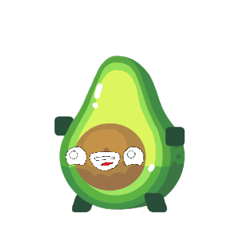{.bfu-avo fig-alt="Boomerang Fu Avocado Easter Egg"}
:::
:::::

::: aside
Pfeiltasten · **M** Menü · **E** PDF · **Esc** Übersicht · Easter Egg: *Boomerang Fu*
:::

## Lernziele

Nach heute können Sie …

1. erklären, warum drei Farbmorphen **einer** Art die Vererbung ins Spiel bringen,
2. beschreiben, welche genetische Grundlage hinter den Kehlfarben steckt,
3. Locus, Allel, Genotyp, Phänotyp und Allelfrequenz auseinanderhalten,
4. Hardy–Weinberg als **Erwartung ohne Selektion** lesen und echte Genotypdaten damit vergleichen,
5. eine Rechnung auf eine **ganze Datenspalte** anwenden statt auf eine Schleife.

## Heute

1. Warum aus Strategien Gene werden müssen
2. Was hinter den Kehlfarben steckt
3. Vererbung: Locus, Allel, Genotyp, Phänotyp
4. Hardy–Weinberg: die Erwartung ohne Selektion
5. Echte Genotypdaten mit dieser Erwartung vergleichen

::: aside
[Modul 2](../../docs/module-02-overview.html) · [Glossar](../../docs/glossary.html)
:::

# Teil 1 · Von Strategien zu Genen

## Woche 4: drei Strategien

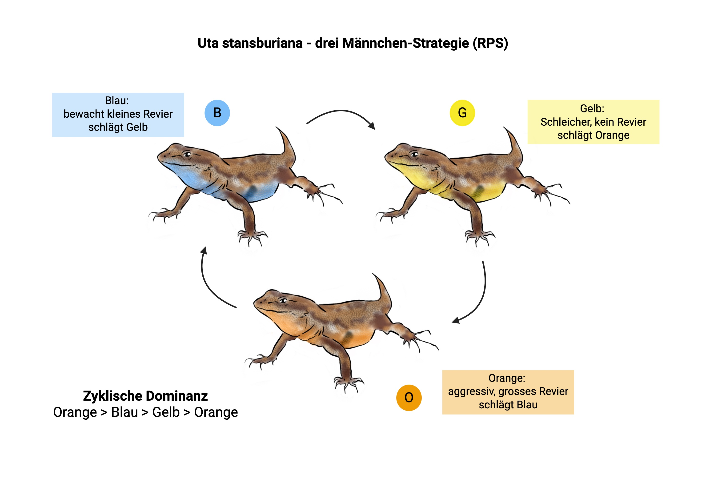{.lizard-rps fig-alt="Seitenfleckeneidechse drei Maennchen-Strategien"}

Orange schlägt Blau, Blau schlägt Gelb, Gelb schlägt Orange.  
Der Erfolg hing davon ab, **wie häufig** die anderen Morphen gerade sind.

::: aside
Illustration: Emma Ochsner · Sinervo & Lively (1996)
:::

## Was wir bisher beschrieben haben

Im Modell: Morphen als **Anteile** — Zeitreihe und Simplex wie im Checkpoint.

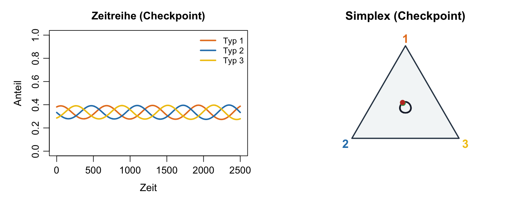{.checkpoint-recall fig-alt="Checkpoint Zeitreihe und Simplex"}

Das erzeugt den Zyklus. Es sagt aber nichts darüber, **wie** eine Eidechse orange wird.

## Der entscheidende Punkt

Die drei Morphen sind **keine drei Arten**. Sie gehören zu *Uta stansburiana*, leben nebeneinander und paaren sich miteinander.

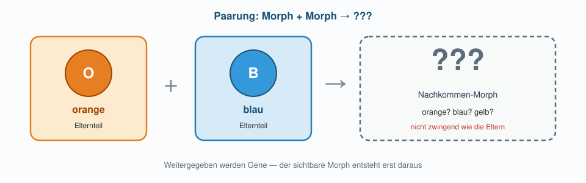{.mating-schematic fig-alt="Orange und blau paaren sich, Nachkommen-Morph unklar"}

Ein oranges Männchen hat also nicht zwingend orange Söhne. Weitergegeben werden **Gene** — und die mischen sich bei jeder Paarung neu.

## Die Frage dieser Woche

> Wenn die Strategien vererbt werden: Wie sieht eine Population ohne Selektion überhaupt aus?

Bevor wir sagen können, was Selektion tut (Woche 6), brauchen wir ein Bild davon, was **ohne** sie passiert. Genau das ist ein Nullmodell.

# Teil 2 · Was hinter den Kehlfarben steckt

## Die naheliegende Annahme

Drei Farben, also drei Allele an einem Locus — so wurde das System jahrzehntelang beschrieben.

| Genotyp | Phänotyp | Strategie |
|---------|----------|-----------|
| $oo$ | [Orange]{.morph-o} | aggressiv, grosses Revier |
| $bb$ | [Blau]{.morph-b} | bewacht kleines Revier |
| $yy$ | [Gelb]{.morph-y} | Schleicher, kein Revier |

Intuition: eine Farbe, ein Allel. Sparsam — aber stimmt das?

## Was die Genome zeigen

Corl et al. (2026): Genome vieler Männchen, Frage nach der Region hinter der Kehlfarbe.

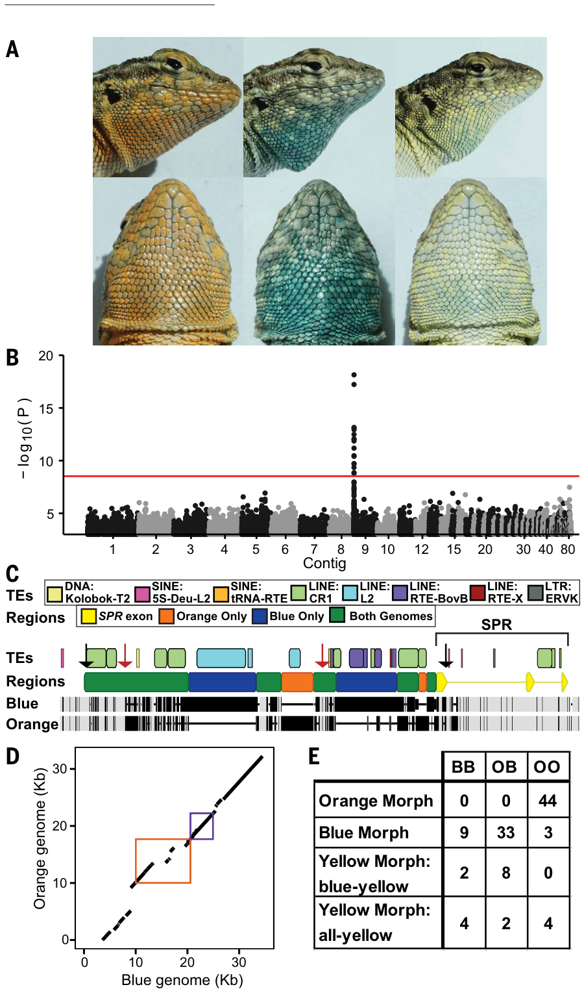{.corl-fig fig-alt="Corl et al. 2026 Figure 1 Morphen und SPR-Region"}

::: aside
Corl et al. (2026) *Science* · Fig. 1
:::

## Zwei Haplotypen statt drei Allele

Gefunden: **eine** Region — Regulatorregion von *SPR* — mit **zwei** Haplotypen ($O$, $B$).

| Genotyp | typischer Phänotyp |
|---------|-------------------|
| $OO$ | [Orange]{.morph-o} |
| $OB$ oder $BB$ | [Blau]{.morph-b} · manchmal [Gelb]{.morph-y} |

Die Daten liefern keine eigene Variante für Gelb.

## Woher kommt dann Gelb?

Gelbe Männchen tragen überwiegend **denselben** genetischen Hintergrund wie blaue.

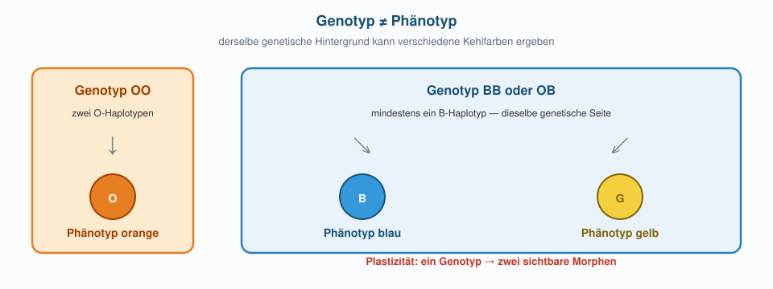{fig-alt="Genotyp ungleich Phaenotyp bei Uta" width="92%"}

Derselbe Genotyp, ein anderer Phänotyp — **Plastizität**.

## Takeaway

1. Ein sichtbarer Unterschied ist **nicht automatisch** ein genetischer Unterschied.
2. Die Zahl der Morphen ist nicht die Zahl der Allele.
3. Mit «zwei Allele plus Plastizität» bleibt der Polymorphismus in den Modellen eher erhalten als mit drei Allelen (Corl et al. 2026) — dazu Woche 6.

# Teil 3 · Vererbung

## Modell

- **ein Locus**
- **zwei Allele** ($A$, $a$ bzw. $O$, $B$)
- **diploide** Individuen (zwei Kopien pro Individuum)

| Begriff | Bedeutung | Beispiel *Uta* / allgemein |
|---------|-----------|----------------------------|
| **Locus** | Stelle oder Region im Genom | Regulatorregion von *SPR* |
| **Allel** | eine Variante an dieser Stelle | $O$ oder $B$ · $A$ oder $a$ |
| **Genotyp** | die **beiden** Kopien eines Individuums | $OO$, $OB$, $BB$ |
| **Phänotyp** | das **sichtbare** Merkmal | orange / blau / gelb Kehle |

Genotyp und Phänotyp sind **nicht** dasselbe — Gelb zeigt das.

## Allelfrequenz zählt Kopien

$p$ = Anteil von $A$ unter **allen** Kopien — nicht der Anteil der Individuen mit $AA$.

$$
p = \frac{2\,n_{AA} + n_{AB}}{2n}
$$

$AA$ steuert zwei $A$-Kopien bei, $AB$ eine, $BB$ keine. Nenner $2n$: $n$ Individuen, $2n$ Kopien.

## Ein Zahlenbeispiel

100 Individuen: 36 $AA$, 48 $AB$, 16 $BB$.

$$
p = \frac{2\cdot 36 + 48}{200} = 0.6
$$

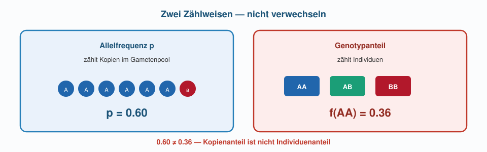{.allele-schematic fig-alt="Allelfrequenz versus Genotypanteil"}

::: {.big-contrast}
**$p = 0.60$** · Anteil der **Kopien**, die $A$ sind  
**$f(AA) = 0.36$** · Anteil der **Individuen**, die $AA$ sind  

Diese beiden Zahlen **nie** verwechseln.
:::

## Zufällige Paarung

Für Hardy–Weinberg brauchen wir: Partner finden sich **unabhängig** vom Genotyp an diesem Locus.

Dann ist jede Befruchtung so, als würden zwei Kopien zufällig aus einem grossen Gametenpool gezogen.

::: {.diskussion}
**Diskussion**

Kann man diese Annahme rechtfertigen — und wann eher nicht?
:::

## Zufällige Paarung — Antworten

::: {.diskussion}
**Diskussion**

Kann man diese Annahme rechtfertigen — und wann eher nicht?
:::

::::: columns
::: {.column width="48%"}
**Dafür** (oft plausibel)

- Locus betrifft kein Paarungsverhalten  
- grosse, durchmischte Population  
- Partnerwahl nach anderem Merkmal als diesem SNP  
:::
::: {.column width="48%"}
**Dagegen** (Annahme bricht)

- assortative Paarung nach Phänotyp  
- das Merkmal **selbst** steuert, wer sich trifft  
- Beispiel Pflanzen: **Blühzeit** / Dichogamie  
:::
:::::

Avocado (Notebook): Typ A und Typ B öffnen weibliche und männliche Blüten zu **verschiedenen** Tageszeiten — komplementär. Wer sich kreuzt, hängt am Blühtyp-Locus. Das ist **keine** zufällige Paarung an genau diesem Gen.

# Teil 4 · Hardy–Weinberg

## Vom Gametenpool zum Genotyp

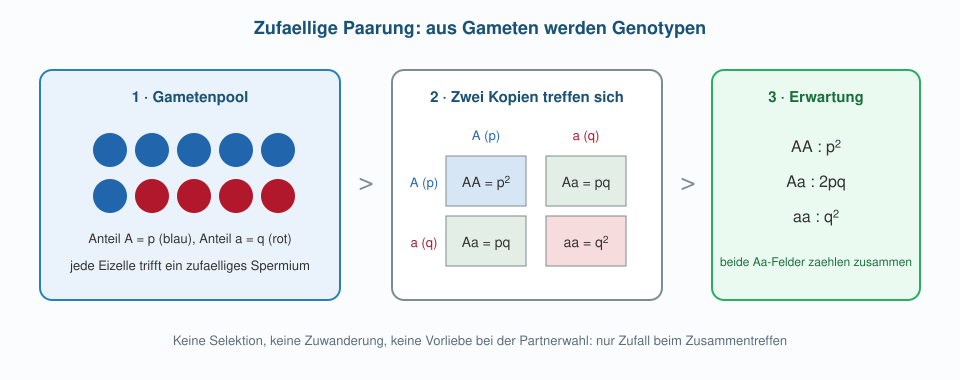{fig-alt="Gametenpool Punnett Quadrat Hardy-Weinberg" width="92%"}

## Die drei Erwartungswerte

Mit $q = 1 - p$:

$$
f(AA) = p^2, \qquad f(AB) = 2pq, \qquad f(BB) = q^2
$$

Der Faktor $2$ bei den Heterozygoten steht für die zwei Wege, sie zu bekommen: $A$ von der Mutter und $B$ vom Vater — oder umgekehrt.

## Die Erwartung als Kurve

```{r}
#| fig-height: 3.9
#| fig-width: 8
hwe_kurven(main = "Erwartete Genotypfrequenzen")
```

Heterozygote sind **nie** häufiger als die Hälfte: $2pq$ erreicht bei $p = 0.5$ sein Maximum von $0.5$.

## Fünf Annahmen

| Annahme | Verletzt, wenn … |
|---------|------------------|
| zufällige Paarung | Individuen sich bevorzugt mit bestimmten Genotypen paaren (**assortative Paarung**) |
| keine Selektion | Genotypen unterschiedlich überleben oder sich fortpflanzen |
| keine Migration | Individuen zwischen verschiedenen Habitaten migrieren |
| eine Population | Populationsstruktur ignoriert wird |
| sehr gross | Populationen klein sind und Zufall eine starke Rolle spielt |

Nicht jede Verletzung behandeln wir im Kurs — aber jede macht die Erwartung $p^2$, $2pq$, $q^2$ ungültig.

## Wozu ein Nullmodell gut ist

Hardy–Weinberg sagt nicht: «hier passiert nichts». Es sagt:

> So sähe die Population aus, wenn nur zufällige Paarung wirkt — ohne Selektion, ohne Zuwanderung, ohne Vermischung zweier Gruppen, in einer grossen Population.

Erst mit dieser Referenz ist eine Abweichung überhaupt interessant.

# Teil 5 · Daten, und was wir von ihnen erwarten

## HapMap: menschliche Variation

**HapMap** (International HapMap Project, ab ~2002): Katalog der **häufigen** genetischen Variation beim Menschen — SNPs und Allelfrequenzen in mehreren Populationen weltweit.

::::: columns
::: {.column width="42%"}
Für viele SNPs wurde ausgezählt, wie viele Personen $AA$, $AB$ oder $BB$ tragen — genau die Zählungen für Hardy–Weinberg.

Ein SNP: Stelle mit zwei Nukleotiden in der Population = einfachster Locus mit zwei Allelen.
:::
::: {.column width="58%"}
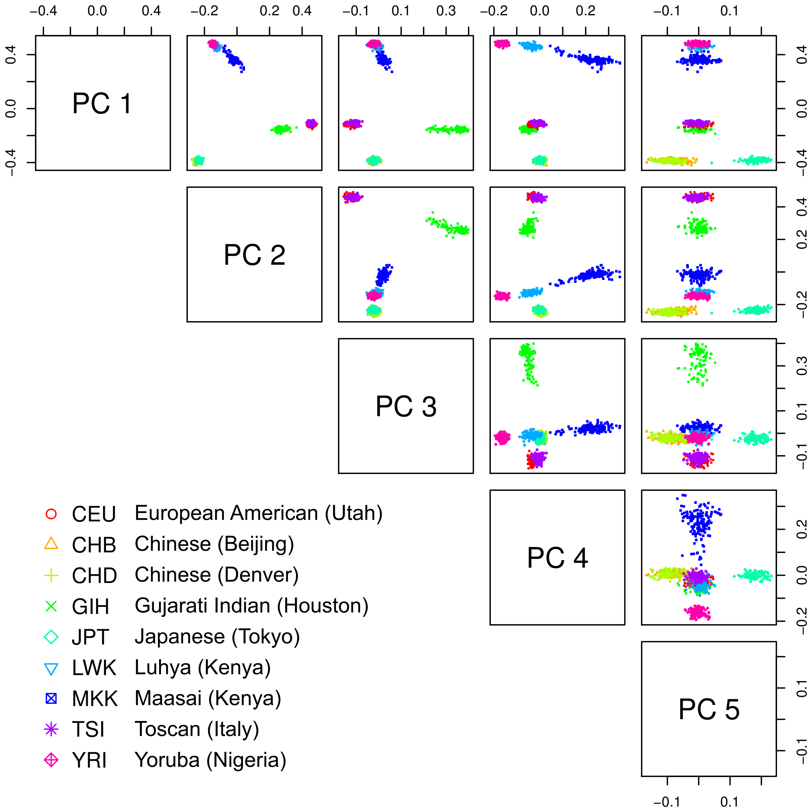{.hapmap-fig fig-alt="PCA der neun HapMap-Populationen"}

::: {.fig-credit}
PCA der HapMap-Populationen (u. a. **CHB** = Peking). Bouaziz et al. 2012 · CC BY 2.5
:::
:::
:::::

## Unser Ausschnitt: CHB

Wir nehmen einen kleinen Ausschnitt: **225 SNPs** auf Chromosom 1, je **84 Personen** aus Peking (**CHB**).

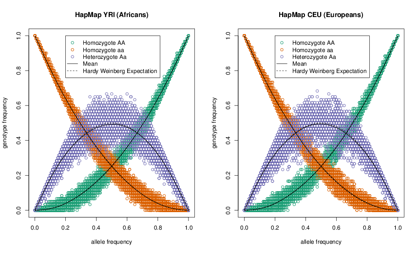{.hapmap-hwe fig-alt="HapMap SNPs und Hardy-Weinberg Kurven CEU und YRI"}

::: {.fig-credit}
Tausende HapMap-SNPs folgen den HWE-Kurven (hier CEU / YRI). Graham Coop · CC BY 3.0 · [Commons](https://commons.wikimedia.org/wiki/File:Demonstrating_Hardy-Weinberg_proportions_using_10,000_SNPs_from_the_HapMap_CEU_European_and_YRI_African_populations.png)
:::

Als Nächstes: dieselben Kurven mit **unseren** 225 CHB-SNPs.

## So sieht die Tabelle aus

```{r}
#| echo: true
snps <- read.csv("data/hapmap_chb_chr1.csv")
head(snps, 4)
```

Eine Zeile ist ein SNP, die Spalten sind Genotypzählungen. Keine Zeitreihe — eine Tabelle von Beobachtungen.

## 225 SNPs und die Erwartung

Punkte = beobachtete Genotypanteile · Linien = HWE

```{r}
#| echo: false
#| fig-height: 4.2
#| fig-width: 8.4
#| fig-align: center
#| classes: hwe-plot
snps$n <- snps$AA + snps$AB + snps$BB
snps$p <- (2 * snps$AA + snps$AB) / (2 * snps$n)
punkte <- rbind(
  data.frame(p = snps$p, f = snps$AA / snps$n, gt = "AA"),
  data.frame(p = snps$p, f = snps$AB / snps$n, gt = "AB"),
  data.frame(p = snps$p, f = snps$BB / snps$n, gt = "BB")
)
hwe_kurven(punkte, main = "")
```

## Was wir sehen

Die Punkte streuen um die Kurven, aber sie folgen ihnen.

```{r}
#| echo: true
mean(snps$AB / snps$n)              # beobachtet
mean(2 * snps$p * (1 - snps$p))     # erwartet unter HWE
```

Die beiden Mittelwerte liegen praktisch übereinander.

## Was `mean` macht

`snps$AB / snps$n` = **Vektor** mit 225 Heterozygoten-Anteilen (einer pro SNP).  
`mean(...)` = **Mittelwert** über alle SNPs — eine Zahl.

Dasselbe für die HWE-Erwartung $2p(1-p)$ an jedem SNP.

## Vorsicht mit dem Umkehrschluss

Gute Übereinstimmung heisst **nicht**: keine Evolution.

HWE stellt sich nach **einer** Generation zufälliger Paarung wieder ein. Selektion verschiebt $p$ zwischen den Generationen — die Genotypen können trotzdem nahe an der Erwartung liegen.

Ab Woche 6: **Veränderung von $p$**, nicht nur eine Momentaufnahme.

# Neu im Code · Rechnen auf ganzen Spalten

## Was wir bisher programmiert haben

In den Wochen 2 bis 4 hatten wir immer eine **Zeitreihe**: ein Zustand, der aus dem vorigen folgt.

```r
for (t in 1:T) {
  N[t + 1] <- next_N(N[t], r, K)
}
```

Die Schleife war nötig, weil Schritt $t+1$ auf Schritt $t$ **wartet**.

## Heute ist die Lage anders

Die 225 SNPs wissen nichts voneinander. Kein SNP wartet auf einen anderen — es ist 225 Mal **dieselbe Rechnung** auf verschiedenen Zahlen.

Dafür gibt es in R den kürzeren Weg: die Rechnung auf die **ganze Spalte** anwenden.

## Eine Zeile statt einer Schleife

```{r}
#| echo: true
snps$n <- snps$AA + snps$AB + snps$BB
snps$p <- (2 * snps$AA + snps$AB) / (2 * snps$n)
head(snps$p, 6)
```

`snps$AA` ist keine einzelne Zahl, sondern ein Vektor mit 225 Einträgen. R rechnet elementweise und gibt 225 Ergebnisse zurück.

## Dieselbe Rechnung, zwei Schreibweisen

::::: columns
::: {.column width="50%"}
**Schleife**

```r
p <- numeric(nrow(snps))
for (i in 1:nrow(snps)) {
  p[i] <- (2 * snps$AA[i] +
           snps$AB[i]) /
          (2 * snps$n[i])
}
```
:::
::: {.column width="50%"}
**Vektorisiert**

```r
p <- (2 * snps$AA +
      snps$AB) /
     (2 * snps$n)
```
:::
:::::

Beide liefern dasselbe. Die rechte Variante ist kürzer, schneller — und sie sagt, was gemeint ist: «für jeden SNP».

## Wann welche Form?

| Situation | Werkzeug |
|-----------|----------|
| Schritt $t+1$ braucht Schritt $t$ | `for`-Schleife |
| jede Zeile ist unabhängig | ganze Spalte auf einmal |

Zeitreihen bleiben Schleifen. Tabellen mit unabhängigen Beobachtungen nicht.

## Mini-Glossar R (heute)

| Konzept | Merksatz |
|---------|----------|
| `read.csv("data/...")` | Tabelle einlesen |
| `d$spalte` | eine Spalte herausgreifen |
| `d$neu <- ...` | neue Spalte anlegen |
| `head(d, 4)` | erste Zeilen ansehen |
| `nrow(d)` | Anzahl Zeilen |
| Spalte $\pm\,\times\,\div$ Spalte | elementweise für alle Zeilen |

## Programmierung ↔ Biologie

| Programmierung | Biologie |
|----------------|----------|
| Zeile einer Tabelle | ein SNP, eine Beobachtung |
| Spalte | eine gemessene Grösse über alle SNPs |
| Rechnung auf der Spalte | dieselbe Frage an jeden Locus |
| Punkte über einer Kurve | Daten im Vergleich zur Modellerwartung |

# Abschluss

## Take-home

1. Farbmorphen sind Varianten **einer** Art — damit zählt Vererbung, nicht nur Häufigkeit.
2. Hinter den Kehlfarben stehen zwei Haplotypen und Plastizität, nicht drei Allele (Corl et al. 2026).
3. $p$ zählt **Allelkopien**; $p^2$, $2pq$, $q^2$ sind die Genotypen, die daraus ohne Selektion folgen.
4. 225 reale SNPs liegen nahe an dieser Erwartung — ein Nullmodell, das trägt.
5. Unabhängige Zeilen rechnet man **spaltenweise**, nicht in einer Schleife.

## Notebook (~45 min)

**→ [Notebook Woche 5 öffnen](notebook.html)**

::::: columns
::: {.column width="28%"}
{.overview-avo fig-alt="Avocado Bluetypen"}

::: {.fig-credit}
Illustration: Emma Ochsner
:::
:::
::: {.column width="72%"}
**Avocado-Genetik** · Blühtypen A/B und Hardy–Weinberg  

**A** Genotypzählungen → relative Häufigkeiten → $p$  

**B** Populationen mit HWE vergleichen · Wahlund  

**C** Avocados: Züchtererwartung vs. Daten
:::
:::::

## Abschlussfragen

1. Warum steht im Nenner von $p$ die Zahl $2n$ und nicht $n$?
2. Eine Population hat 100 % Heterozygote. Ist das mit Hardy–Weinberg vereinbar?
3. Warum ist ein sichtbarer Unterschied zwischen Individuen nicht automatisch ein genetischer?
4. Wann brauchen Sie eine Schleife — und wann genügt eine Spaltenrechnung?

## Literatur

:::: {.lit}
1. **Corl, A., et al. (2026).** The genetics, evolution, and maintenance of a biological rock-paper-scissors game. *Science* 391: 69–74. [doi:10.1126/science.adw8265](https://doi.org/10.1126/science.adw8265) — genetische Grundlage der Kehlfarben.
2. **Sinervo, B., & Lively, C. M. (1996).** The rock–paper–scissors game and the evolution of alternative male strategies. *Nature* 380: 240–243. [doi:10.1038/380240a0](https://doi.org/10.1038/380240a0)
3. **Hardy, G. H. (1908).** Mendelian proportions in a mixed population. *Science* 28: 49–50.
4. **Weinberg, W. (1908).** Über den Nachweis der Vererbung beim Menschen. *Jahreshefte des Vereins für vaterländische Naturkunde in Württemberg* 64: 369–382.
5. **The International HapMap Consortium (2007).** A second generation human haplotype map of over 3.1 million SNPs. *Nature* 449: 851–861. [doi:10.1038/nature06258](https://doi.org/10.1038/nature06258) — Kursdaten `hapmap_chb_chr1.csv`.
::::

## Navigation

| | |
|---|---|
| Notebook | [Notebook Woche 5](notebook.html) |
| Zurück | [← Woche 4](../week-04/slides.html) |
| Weiter | [Woche 6 →](../week-06/slides.html) |
| Modul | [Modul 2](../../docs/module-02-overview.html) |
| PDF | Taste **E**, dann Drucken → Als PDF speichern |
