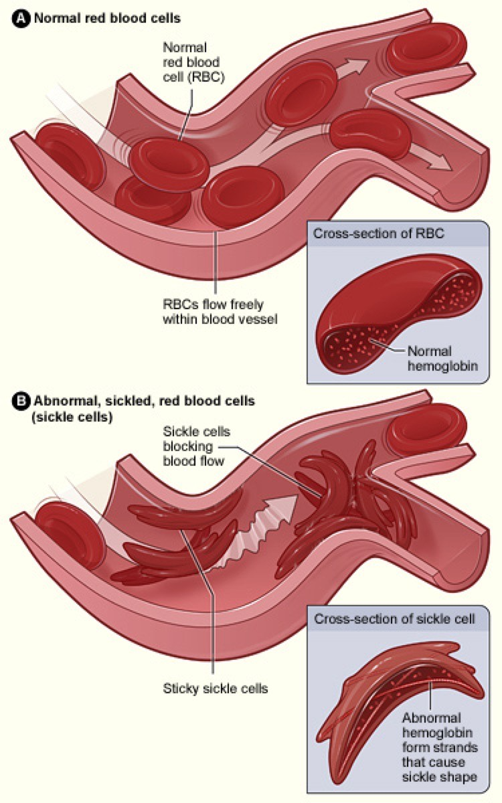
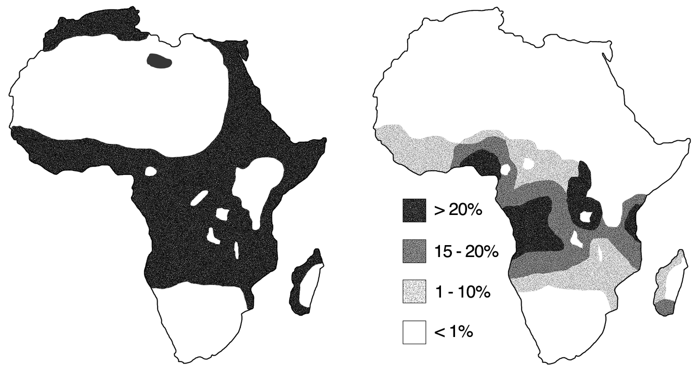
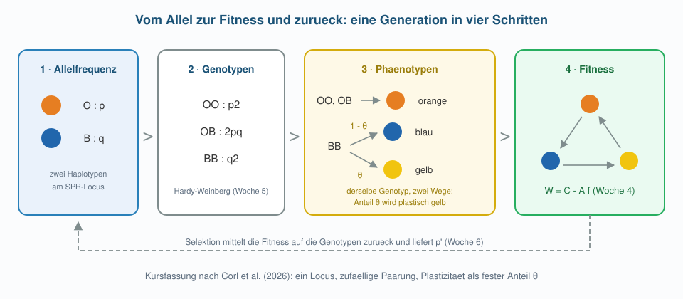

```{r}
#| include: false
source("../slides-ggplot.R")
sichel <- read.csv("data/sickle_nigeria.csv")
sichel$n <- sichel$AA + sichel$AS + sichel$SS
sichel$p <- (2 * sichel$AA + sichel$AS) / (2 * sichel$n)

erwartet <- function(zeile) {
  p <- zeile$p
  c(AA = p^2, AS = 2 * p * (1 - p), SS = (1 - p)^2) * zeile$n
}

hwe_vergleich <- function(neu, erw, main = "") {
  eine <- function(zeile, stadium) {
    beob <- c(AA = zeile$AA, AS = zeile$AS, SS = zeile$SS)
    erwt <- erwartet(zeile)
    data.frame(
      stadium = stadium,
      genotyp = factor(rep(c("AA", "AS", "SS"), 2), levels = c("AA", "AS", "SS")),
      art = factor(rep(c("beobachtet", "erwartet"), each = 3),
                   levels = c("beobachtet", "erwartet")),
      n = c(unname(beob), unname(erwt))
    )
  }
  df <- rbind(
    eine(neu, "Neugeborene"),
    eine(erw, "Erwachsene")
  )
  df$stadium <- factor(df$stadium, levels = c("Neugeborene", "Erwachsene"))
  ggplot(df, aes(stadium, n, fill = art)) +
    geom_col(position = position_dodge(width = 0.75), width = 0.7) +
    facet_wrap(~genotyp, scales = "free_y", nrow = 1) +
    scale_fill_manual(values = c(beobachtet = "#2166ac", erwartet = "#b2182b")) +
    labs(x = NULL, y = "Anzahl", title = main) +
    theme_slide() +
    theme(axis.text.x = element_text(angle = 25, hjust = 1, size = 11))
}

selektionsschritt <- function(p, w) {
  q <- 1 - p
  w_quer <- p^2 * w[1] + 2 * p * q * w[2] + q^2 * w[3]
  (p^2 * w[1] + p * q * w[2]) / w_quer
}

simuliere <- function(p0, w, generationen = 150) {
  p <- numeric(generationen + 1)
  p[1] <- p0
  for (t in seq_len(generationen)) p[t + 1] <- selektionsschritt(p[t], w)
  p
}

trajektorien <- function(w, starts = c(0.05, 0.3, 0.7, 0.95),
                         generationen = 150, main = "",
                         ylab = "Frequenz p von A") {
  farben <- c("#2166ac", "#1b9e77", "#d95f02", "#7570b3")
  df <- do.call(rbind, lapply(seq_along(starts), function(i) {
    data.frame(
      t = 0:generationen,
      p = simuliere(starts[i], w, generationen),
      start = paste0("p0 = ", starts[i])
    )
  }))
  ggplot(df, aes(t, p, colour = start)) +
    geom_hline(yintercept = c(0, 1), colour = "grey90", linewidth = 0.4) +
    geom_line(linewidth = 1.0) +
    scale_colour_manual(values = farben) +
    coord_cartesian(ylim = c(0, 1)) +
    labs(x = "Generation", y = ylab, title = main) +
    theme_slide()
}

make_rps_A <- function(s, w) {
  matrix(c(1, w, s,
           s, 1, w,
           w, s, 1), nrow = 3, byrow = TRUE)
}

morphen <- function(p, theta) {
  q <- 1 - p
  c(orange = p^2 + 2 * p * q, blau = (1 - theta) * q^2, gelb = theta * q^2)
}

corl_schritt <- function(p, theta, s = 1.2, w = 0.5, C = 2) {
  f   <- morphen(p, theta)
  W   <- C - as.vector(make_rps_A(s, w) %*% f)
  w_O <- W[1]
  w_B <- (1 - theta) * W[2] + theta * W[3]
  w_quer <- f[["orange"]] * w_O + (1 - p)^2 * w_B
  p * w_O / w_quer
}

corl <- function(p0, theta, generationen = 300, ...) {
  p <- numeric(generationen + 1)
  p[1] <- p0
  for (t in seq_len(generationen)) p[t + 1] <- corl_schritt(p[t], theta, ...)
  p
}

kehlfarben_bahnen <- function(theta, main = "", generationen = 300,
                              starts = c(0.10, 0.35, 0.65, 0.90)) {
  farben <- c("#2166ac", "#1b9e77", "#d95f02", "#7570b3")
  df <- do.call(rbind, lapply(seq_along(starts), function(i) {
    data.frame(
      t = 0:generationen,
      p = corl(starts[i], theta, generationen),
      start = paste0("p0 = ", starts[i])
    )
  }))
  ggplot(df, aes(t, p, colour = start)) +
    geom_hline(yintercept = c(0, 1), colour = "grey90", linewidth = 0.4) +
    geom_line(linewidth = 1.0) +
    scale_colour_manual(values = farben) +
    coord_cartesian(ylim = c(0, 1)) +
    labs(x = "Generation", y = "Frequenz p des O-Haplotyps", title = main) +
    theme_slide()
}

morph_cols <- c(orange = "#e67e22", blau = "#2980b9", gelb = "#f1c40f")

morph_flaechen <- function(theta_werte = seq(0, 0.75, by = 0.02),
                           generationen = 2000) {
  df <- do.call(rbind, lapply(theta_werte, function(th) {
    p_star <- tail(corl(0.5, th, generationen), 1)
    f <- morphen(p_star, th)
    data.frame(
      theta = th,
      morph = factor(c("orange", "blau", "gelb"),
                     levels = c("gelb", "blau", "orange")),
      anteil = unname(c(f[["orange"]], f[["blau"]], f[["gelb"]]))
    )
  }))
  ggplot(df, aes(theta, anteil, fill = morph)) +
    geom_area(position = "stack", colour = NA) +
    geom_vline(xintercept = c(0.286, 0.613), linetype = "dashed",
               colour = "#b2182b", linewidth = 0.8) +
    scale_fill_manual(values = morph_cols, name = NULL) +
    coord_cartesian(ylim = c(0, 1), xlim = range(theta_werte)) +
    labs(x = expression(theta), y = "Anteil im Gleichgewicht",
         title = "Morphen als Funktion der Plastizitaet") +
    theme_slide() +
    theme(legend.position = "right")
}

neu <- sichel[sichel$stadium == "Neugeborene", ]
erw <- sichel[sichel$stadium == "Erwachsene", ]
oe <- c(AA = erw$AA, AS = erw$AS, SS = erw$SS) / erwartet(erw)
w_sichel <- as.numeric(oe / max(oe))

delta_p_plot <- function(w, main = "") {
  p <- seq(0.01, 0.99, length.out = 200)
  dp <- sapply(p, function(pi) selektionsschritt(pi, w) - pi)
  p_hat <- p[which.min(abs(dp))]
  df <- data.frame(p = p, dp = dp)
  ggplot(df, aes(p, dp)) +
    geom_hline(yintercept = 0, colour = "grey70", linewidth = 0.5) +
    geom_vline(xintercept = p_hat, linetype = "dashed",
               colour = "#b2182b", linewidth = 0.8) +
    geom_line(colour = "#2166ac", linewidth = 1.1) +
    annotate("segment", x = 0.12, xend = 0.28, y = 0.02, yend = 0.02,
             arrow = arrow(length = unit(0.18, "cm")), colour = "#1b9e77") +
    annotate("text", x = 0.20, y = 0.035, label = "A selten: nimmt zu",
             size = 3.5, colour = "#1b9e77") +
    annotate("segment", x = 0.88, xend = 0.72, y = -0.02, yend = -0.02,
             arrow = arrow(length = unit(0.18, "cm")), colour = "#d95f02") +
    annotate("text", x = 0.80, y = -0.035, label = "A haeufig: nimmt ab",
             size = 3.5, colour = "#d95f02") +
    labs(x = expression(p), y = expression(p^"'" - p), title = main) +
    theme_slide()
}
```

## Übersicht

**Woche 6** von 14 · **Do., 22. Okt. 2026, 08:15–10:00**

| Teil | Dauer | Was |
|------|-------|-----|
| Vorlesung | ~45 min | Sichelzelle → Selektion → drei Regime → RPS-Wrap-up |
| Notebook | ~45 min | Geschichte: Fitness → Gene → Plastizität |

::: aside
Pfeiltasten · **M** Menü · **E** PDF · **Esc** Übersicht
:::

## Lernziele

Nach heute können Sie …

1. in Genotypzählungen eine Abweichung von Hardy–Weinberg als Spur von Selektion lesen,
2. eine Generation mit relativer Fitness modellieren und $p'$ berechnen,
3. gerichtete Selektion, Unterdominanz und Überdominanz an Trajektorien erkennen,
4. Überdominanz mit den Sichelzell-Daten vergleichen,
5. RPS mit drei Allelen und mit Plastizität vergleichen (Zyklen vs. Gleichgewicht).

## Heute

1. Sichelzelle: Abweichung von HWE
2. Modell: Selektion und Fitness
3. Drei Regime (Dominanz)
4. Überdominanz und die Daten
5. Wrap-up: RPS-Eidechsen (Notebook)

::: aside
[Modul 2](../../docs/module-02-overview.html) · [Glossar](../../docs/glossary.html)
:::

# Teil 1 · Sichelzelle: ein Befund

## Sichelzellanämie

::::: columns
::: {.column width="46%"}
{fig-alt="Sichelzellen im Blutausstrich" width="94%"}
:::
::: {.column width="54%"}
Eine Punktmutation im $\beta$-Globin-Gen (**HbS**) verändert das Hämoglobin.

Zwei Kopien (**SS**): schwere Erkrankung — historisch geringe Überlebenschance bis ins Erwachsenenalter.
:::
:::::

## Das Rätsel

Eine Variante, die homozygot oft tödlich ist, sollte selten sein.

In Teilen Afrikas, Indiens und des Mittelmeerraums ist sie **häufig**. Warum verschwindet sie nicht?

## Der Verdacht: Malaria

{fig-alt="Afrika: links Malaria, rechts HbS-Allelfrequenz" width="88%"}

Die Verbreitung von HbS deckt sich weitgehend mit der historischen Malaria-Endemie. Heterozygote (AS) sind bei Infektion besser geschützt (Allison 1954).

::: aside
Allison · [Commons](https://commons.wikimedia.org/wiki/File:Malaria_versus_sickle-cell_trait_distributions.png) · CC0
:::

## Die Stichprobe

Genotypzählungen in Nigeria — zwei Lebensstadien, dieselbe Region:

| | |
|---|---|
| Zeilen | **Neugeborene** und **Erwachsene** |
| Spalten | Anzahlen **AA**, **AS**, **SS** |
| Frage | Passen die Zählungen zur HWE-Erwartung aus Woche 5? |

## Die Tabelle — beobachtet

```{r}
#| echo: true
sichel[, c("stadium", "AA", "AS", "SS", "n")]
```

Das sind die **beobachteten** Zählungen. Als Nächstes: was wäre unter Hardy–Weinberg **erwartet**?

## Erwartet: die Rechnung

Aus $p$ der jeweiligen Zeile: Anteile $p^2$, $2pq$, $q^2$, mal Stichprobengrösse $n$.

```{r}
#| echo: true
erwartet <- function(zeile) {
  p <- zeile$p
  c(AA = p^2, AS = 2 * p * (1 - p), SS = (1 - p)^2) * zeile$n
}

neu <- sichel[sichel$stadium == "Neugeborene", ]
erw <- sichel[sichel$stadium == "Erwachsene", ]

# beobachtet
c(AA = neu$AA, AS = neu$AS, SS = neu$SS)
# erwartet (HWE)
round(erwartet(neu), 1)
```

## Erwachsene: beobachtet vs. erwartet

```{r}
#| echo: true
c(AA = erw$AA, AS = erw$AS, SS = erw$SS)   # beobachtet
round(erwartet(erw), 1)                   # erwartet (HWE)
```

Erwartet ~**188** SS, beobachtet **29**. Gleichzeitig mehr AS als erwartet.

## Beobachtet und erwartet im Plot

```{r}
#| fig-height: 3.5
#| fig-width: 8.2
hwe_vergleich(neu, erw, main = "Pro Genotyp: beobachtet (blau) und erwartet (rot)")
```

Neugeborene ≈ HWE. Erwachsene: vor allem **SS** fehlt.

## Was das bedeutet

Zwischen Geburt und Erwachsenenalter überleben Genotypen **unterschiedlich**.

Das ist die Signatur von **Selektion**. Ob die Abweichung «signifikant» ist: χ²-Test — mehr in Statistik für Naturwissenschaften / QuBi später.

Dazu brauchen wir ein **Modell**.

# Teil 2 · Selektion und Fitness

## Eine Generation

1. **Reproduktion** — zufällige Paarung
2. **Geburt** — Genotypen nach HWE: $p^2$, $2pq$, $q^2$ (Woche 5)
3. **Selektion** — Genotypen überleben unterschiedlich
4. **Neues $p$** — Allelfrequenz unter den Überlebenden

## Fitness

**Absolute Fitness** $W_g$: Nachkommen pro Elternteil (oder Überleben × Fruchtbarkeit).

**Relative Fitness** $w_g = W_g / \max W$ — der beste Genotyp bekommt $1$. Für $p'$ zählen nur **Verhältnisse**.

Heute: Fruchtbarkeit gleich → $w$ beschreibt relatives Überleben.

## Die Rekursion

Mit der **marginalen Fitness** $w_A$ von Allel $A$ gilt:

$$
p' = \frac{p\, w_A}{\bar w},
\qquad
\bar w = p\, w_A + q\, w_S.
$$

$A$ nimmt zu, wenn $w_A > \bar w$. Was steckt in $w_A$?

## Was ist $w_A$?

Ein Allel hat keine eigene Fitness — es sitzt in Genotypen. $w_A$ gewichtet die Genotyp-Fitness danach, **wie oft** eine zufällige $A$-Kopie in welchem Genotyp landet:

$$
w_A = p\, w_{AA} + q\, w_{AS}.
$$

| Partner des $A$ | Wahrscheinlichkeit | Genotyp | Beitrag |
|-----------------|--------------------|---------|---------|
| $A$ | $p$ | $AA$ | $p\, w_{AA}$ |
| $S$ | $q$ | $AS$ | $q\, w_{AS}$ |

Ebenso $w_S = p\, w_{AS} + q\, w_{SS}$.

## Ausgeschrieben

Setzt man $w_A$ ein, ist das dieselbe Formel wie mit Genotypen:

$$
p' = \frac{p\,(p\, w_{AA} + q\, w_{AS})}{\bar w}
= \frac{p^2 w_{AA} + pq\, w_{AS}}{\bar w}.
$$

Dieselbe Bauweise wie Woche 4: **Anteil × relativer Erfolg / Durchschnitt.**

## Im Code

```{r}
#| echo: true
selektionsschritt <- function(p, w) {
  q <- 1 - p
  w_A <- p * w[1] + q * w[2]          # marginale Fitness von A
  w_S <- p * w[2] + q * w[3]          # marginale Fitness von S
  w_quer <- p * w_A + q * w_S
  p * w_A / w_quer
}

selektionsschritt(0.5, w = c(0.88, 1, 0.14))
```

## Fitness aus den Erwachsenen

Unter «bei Geburt galt HWE»: relative Überlebensraten $\propto$ beobachtet/erwartet. Normierung → $w$:

```{r}
#| echo: true
oe <- c(AA = erw$AA, AS = erw$AS, SS = erw$SS) / erwartet(erw)
w <- round(oe / max(oe), 3)
w
```

O/E ist **kein** $W$ — nur der Schätzer für relative Fitness.

# Teil 3 · Drei Regime

## Was bestimmt den Ausgang?

Nicht die absoluten Zahlen, sondern die **Reihenfolge** der drei Fitnesswerte.

## Gerichtete Selektion

$w_{AA} > w_{AB} > w_{BB}$: das bessere Allel setzt sich durch.

```{r}
#| fig-height: 3.3
#| fig-width: 7.6
trajektorien(c(1.1, 1.05, 1), main = "Gerichtet: A verdraengt B")
```

Am Ende: **ein** Allel. Vielfalt verschwindet.

## Unterdominanz

$w_{AB}$ kleiner als beide Homozygoten.

```{r}
#| fig-height: 3.3
#| fig-width: 7.6
trajektorien(c(1.1, 0.9, 1.1), main = "Unterdominanz: der Start entscheidet")
```

Wer schon häufig ist, gewinnt. Auch hier bleibt ein Allel übrig.

## Überdominanz

$w_{AB}$ grösser als beide Homozygoten — wie bei der Sichelzelle.

```{r}
#| fig-height: 3.3
#| fig-width: 7.6
trajektorien(w_sichel, main = "Ueberdominanz: alle Wege enden innen")
```

Egal wo wir starten: $p$ landet **im Inneren**. Beide Allele bleiben.

## Geschützter Polymorphismus

```{r}
#| fig-height: 3.4
#| fig-width: 7.8
delta_p_plot(w_sichel, main = "Delta p unter Ueberdominanz")
```

Ist $A$ selten ($\Delta p > 0$): fast alle $A$ in Heterozygoten → $A$ nimmt zu.  
Ist $A$ häufig ($\Delta p < 0$): $S$ ist selten und wächst. Gestrichelt: Gleichgewicht.

## Zurück zur Sichelzelle

Genau dieses Regime ist HbS / Malaria: Heterozygote am fittesten.

Mit $w_{AA} = 1-s$, $w_{AS} = 1$, $w_{SS} = 1-t$:

$$
\hat p = \frac{t}{s+t}.
$$

Aus unseren Fitnesswerten: $s \approx 0.12$, $t \approx 0.86$ → $\hat p \approx 0.88$ — rund **12 % HbS**, wie in den Erwachsenendaten.

# Teil 4 · Abgleich mit den Sichelzell-Daten

## Vorhersage und Wirklichkeit

```{r}
#| echo: true
#| fig-height: 3.2
#| fig-width: 7.6
bahn <- simuliere(p0 = 0.5, w = w_sichel, generationen = 120)
plot(0:120, bahn, type = "l", lwd = 2.5, col = "#2166ac", ylim = c(0, 1),
     xlab = "Generation", ylab = "Frequenz p von A",
     main = "Ueberdominanz vs. beobachtetes p")
abline(h = erw$p, lty = 2, col = "#b2182b", lwd = 2)
```

Gestrichelt: beobachtete Allelfrequenz bei den Erwachsenen.

## Die Pointe

```{r}
#| echo: true
c(modell = round(tail(bahn, 1), 3), beobachtet = round(erw$p, 3))
```

Aus dem Fitnessvektor der Erwachsenen folgt ein Gleichgewicht — dort, wo die Population liegt. HbS bleibt, weil Heterozygote im Vorteil sind.

## Die Regel — und ihre Voraussetzung

> In **einer** Population, bei **zufälliger Paarung**, an **einem** Locus, mit **konstanter** Fitness: Vielfalt bleibt nur bei Überdominanz.

Fällt «konstante Fitness» weg, ändert sich die Aussage — wie bei den Kehlfarben.

# Teil 5 · Wrap-up: RPS-Eidechsen

## Anderer Mechanismus

Bisher: feste Zahlen $w_{AA}$, $w_{AB}$, $w_{BB}$.

Bei den Kehlfarben (Woche 4) hängt der Erfolg davon ab, **wie häufig** die anderen Morphen sind — häufigkeitsabhängige Fitness. Kein Heterozygotenvorteil nötig.

## Zwei Haplotypen, drei Farben

Corl et al. (2026): $O$ und $B$; Gelb entsteht plastisch aus $BB$ mit Anteil $\theta$.

{fig-alt="Kreislauf Allelfrequenz Genotyp Phaenotyp Fitness" width="90%"}

## Ohne und mit Plastizität

```{r}
#| fig-height: 3.0
#| fig-width: 7.6
kehlfarben_bahnen(theta = 0, main = "theta = 0") |
  kehlfarben_bahnen(theta = 0.5, main = "theta = 0.5")
```

Ohne Plastizität verschwindet $B$. Mit $\theta = 0.5$ bleiben beide Haplotypen.

## Wie viel Plastizität?

```{r}
#| fig-height: 3.4
#| fig-width: 7.8
morph_flaechen()
```

$x$: $\theta$. $y$: Morphanteile (Summe 1). Dazwischen ein Fenster, in dem alle drei Farben bleiben.

## Zwei Mechanismen

| | Überdominanz | Häufigkeitsabhängige Fitness |
|---|---|---|
| Fitness | feste Zahlen | hängt von den Häufigkeiten ab |
| Beispiel | Sichelzelle | Kehlfarben |
| Ergebnis | Vielfalt kann bleiben | Vielfalt kann bleiben |

Wer die Kehlfarben mit Überdominanz erklärt, nennt den falschen Mechanismus.

# Abschluss

## Take-home

1. Erwachsene weichen von HWE ab → Spur von Selektion (Sichelzelle).
2. Eine Generation: HWE → Selektion; $p' = p\,w_A/\bar w$ mit marginaler Fitness $w_A$.
3. Gerichtete Selektion und Unterdominanz beenden Vielfalt; Überdominanz erhält sie — und passt zu den Sichelzell-Daten.
4. Kehlfarben: anderer Mechanismus (häufigkeitsabhängig + Plastizität $\theta$).
5. Im Notebook: konstante Fitness → 3 Allele → Plastizität.

## Notebook (~45 min)

**→ [Notebook Woche 6 öffnen](notebook.html)** · [Rmd](notebook.Rmd) · [R](notebook.R)

**Auftrag:** drei kurze Teile

1. Konstante Fitness: $w_{Aa}$ wählen — was passiert mit $p$?
2. RPS mit 3 Allelen + Dominanz — Zyklen?
3. Zwei Haplotypen + $\theta$ — verschwinden die Zyklen?

## Abschlussfragen

1. Warum passen Neugeborene zur HWE-Erwartung, Erwachsene nicht?
2. Welche Fitnessordnung erhält Vielfalt — und warum passt das zur Sichelzelle?
3. Was unterscheidet Überdominanz von häufigkeitsabhängiger Fitness bei den Kehlfarben?
4. Welche Rolle spielt $\theta$ im Corl-Modell?

## Literatur

:::: {.lit}
1. **Allison, A. C. (1954).** Protection afforded by sickle-cell trait against subtertian malarial infection. *BMJ* 1: 290–294.
2. **Corl, A., et al. (2026).** The genetics, evolution, and maintenance of a biological rock-paper-scissors game. *Science* 391: 69–74. [doi:10.1126/science.adw8265](https://doi.org/10.1126/science.adw8265)
3. **Sinervo, B., & Lively, C. M. (1996).** The rock–paper–scissors game and the evolution of alternative male strategies. *Nature* 380: 240–243.

Kursdaten `sickle_nigeria.csv`: Lehrzahlen, siehe `data/README.md`.
::::

## Navigation

| | |
|---|---|
| Notebook | [Quarto](notebook.html) · [Rmd](notebook.Rmd) · [R](notebook.R) |
| Zurück | [← Woche 5](../week-05/slides.html) |
| Weiter | [Woche 7 →](../week-07/slides.html) |
| Modul | [Modul 2](../../docs/module-02-overview.html) |
| PDF | [slides.pdf](slides.pdf) · oder Taste **E**, dann Drucken |
