```{r}
#| include: false
source("../slides-ggplot.R")

# Wie im Notebook: Fitness (w_AA, w_Aa, w_aa), im See ist A besser, im Meer a
selektionsschritt <- function(p, w) {
  q <- 1 - p
  w_quer <- p^2 * w[1] + 2 * p * q * w[2] + q^2 * w[3]
  (p^2 * w[1] + p * q * w[2]) / w_quer
}

eine_generation <- function(p1, p2, s, m) {
  p1_s <- selektionsschritt(p1, c(1 + s, 1 + s / 2, 1))
  p2_s <- selektionsschritt(p2, c(1, 1 + s / 2, 1 + s))
  c((1 - m) * p1_s + m * p2_s,
    (1 - m) * p2_s + m * p1_s)
}

zwei_demen <- function(s, m, generationen = 250) {
  bahn <- matrix(NA_real_, generationen + 1, 2)
  bahn[1, ] <- c(0.5, 0.5)
  for (t in seq_len(generationen)) {
    bahn[t + 1, ] <- eine_generation(bahn[t, 1], bahn[t, 2], s, m)
  }
  data.frame(generation = 0:generationen, p1 = bahn[, 1], p2 = bahn[, 2])
}

zeige_demen <- function(sim, main) {
  long <- rbind(
    data.frame(generation = sim$generation, p = sim$p1, pop = "See"),
    data.frame(generation = sim$generation, p = sim$p2, pop = "Meer")
  )
  ggplot(long, aes(generation, p, colour = pop)) +
    geom_line(linewidth = 1.05) +
    scale_colour_manual(values = c(See = "#2166ac", Meer = "#b2182b")) +
    coord_cartesian(ylim = c(0, 1)) +
    labs(x = "Generation", y = "Frequenz von A", title = main) +
    theme_slide()
}

verhaeltnis_plot <- function(s_werte = c(0.02, 0.05, 0.10),
                             verhaeltnisse = c(0.1, 0.5),
                             generationen = 400) {
  df <- do.call(rbind, lapply(verhaeltnisse, function(r) {
    do.call(rbind, lapply(s_werte, function(s) {
      sim <- zwei_demen(s, r * s, generationen)
      data.frame(generation = sim$generation, d = sim$p1 - sim$p2,
                 s = paste("s =", s), ratio = paste("m/s =", r))
    }))
  }))
  ggplot(df, aes(generation, d, colour = ratio, linetype = s)) +
    geom_line(linewidth = 1.0) +
    scale_colour_manual(values = c("#2166ac", "#d95f02"), name = NULL) +
    scale_linetype_manual(values = c("dotted", "dashed", "solid"), name = NULL) +
    coord_cartesian(ylim = c(0, 1)) +
    labs(x = "Generation", y = "Unterschied p1 - p2") +
    theme_slide() +
    theme(legend.position = "right")
}

fst <- function(p1, p2) {
  pq <- (p1 + p2) / 2
  H_T <- 2 * pq * (1 - pq)
  H_S <- (2 * p1 * (1 - p1) + 2 * p2 * (1 - p2)) / 2
  (H_T - H_S) / H_T
}

het_plot <- function() {
  p <- seq(0, 1, length.out = 200)
  bsp <- data.frame(p = c(0.5, 0.9), H = 2 * c(0.5, 0.9) * (1 - c(0.5, 0.9)),
                    lab = c("p = 0.5: H = 0.50", "p = 0.9: H = 0.18"))
  ggplot(data.frame(p = p, H = 2 * p * (1 - p)), aes(p, H)) +
    geom_line(colour = "#2166ac", linewidth = 1.3) +
    geom_point(data = bsp, colour = "#b2182b", size = 3.5) +
    geom_text(data = bsp, aes(label = lab), colour = "#b2182b",
              vjust = -1.1, size = 5.5) +
    coord_cartesian(ylim = c(0, 0.6)) +
    labs(x = "Frequenz p von A", y = "H = 2p(1-p)") +
    theme_slide()
}

fst_skizze <- function() {
  paare <- list(c(0.5, 0.5), c(0.4, 0.6), c(0.1, 0.9))
  df <- do.call(rbind, lapply(paare, function(pp) {
    titel <- sprintf("p1 = %.1f, p2 = %.1f\nFST = %.2f", pp[1], pp[2],
                     fst(pp[1], pp[2]))
    data.frame(fall = titel,
               pop = rep(c("See", "Meer"), each = 2),
               allel = rep(c("A", "a"), 2),
               anteil = c(pp[1], 1 - pp[1], pp[2], 1 - pp[2]))
  }))
  df$fall <- factor(df$fall, levels = unique(df$fall))
  df$pop <- factor(df$pop, levels = c("See", "Meer"))
  ggplot(df, aes(pop, anteil, fill = allel)) +
    geom_col(width = 0.65) +
    facet_wrap(~fall, nrow = 1) +
    scale_fill_manual(values = c(A = "#2166ac", a = "#f4a582"), name = NULL) +
    labs(x = NULL, y = "Anteil") +
    theme_slide() +
    theme(legend.position = "right")
}
```

## Übersicht

**Woche 7** von 14 · **Do., 29. Okt. 2026, 08:15–10:00**

| Teil | Dauer | Was |
|------|-------|-----|
| Vorlesung | ~45 min | Stichling → Selektion gegen Genfluss → $m/s$ → Blick ins Genom |
| Notebook | ~45 min | Resistenz bei Stechmücken: $s$ und $m$ drehen |

::: aside
Pfeiltasten · **M** Menü · **E** PDF · **Esc** Übersicht
:::

## Lernziele

Nach heute können Sie …

1. eine Generation als «Selektion lokal, dann Mischung» beschreiben,
2. an Trajektorien erkennen, wann Genfluss lokale Unterschiede einebnet,
3. erklären, warum für das Ergebnis vor allem das Verhältnis $m/s$ zählt.
4. $F_{ST}$ aus zwei Allelfrequenzen berechnen und einen Genom-Scan lesen.

## Heute

1. Stichling: derselbe Fisch, zwei Welten
2. Modell: Selektion gegen Genfluss
3. Nur das Verhältnis zählt: $m/s$
4. Ein Blick ins Genom

::: aside
[Modul 2](../../docs/module-02-overview.html) · [Glossar](../../docs/glossary.html)
:::

# Teil 1 · Derselbe Fisch, zwei Welten

## Lokale Anpassung ist überall

:::::: {.anpassung-grid}
::: {.kachel}
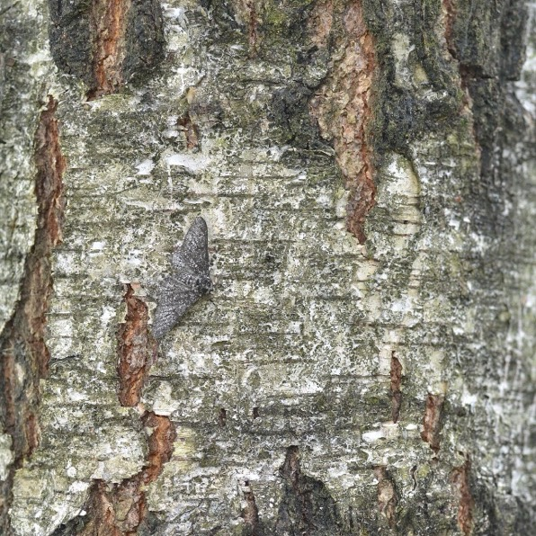{fig-alt="Getarnter Falter auf Birkenrinde"}
**Tarnung** — finden Sie den Falter?
:::
::: {.kachel}
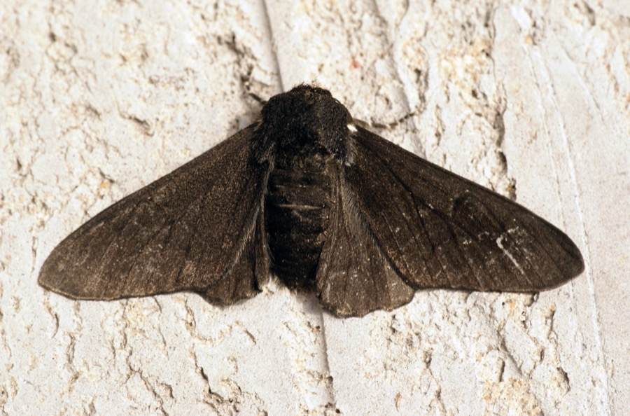{fig-alt="Schwarzer Birkenspanner"}
**Birkenspanner** — auf russigen Stämmen wurde die schwarze Form häufig
:::
::: {.kachel}
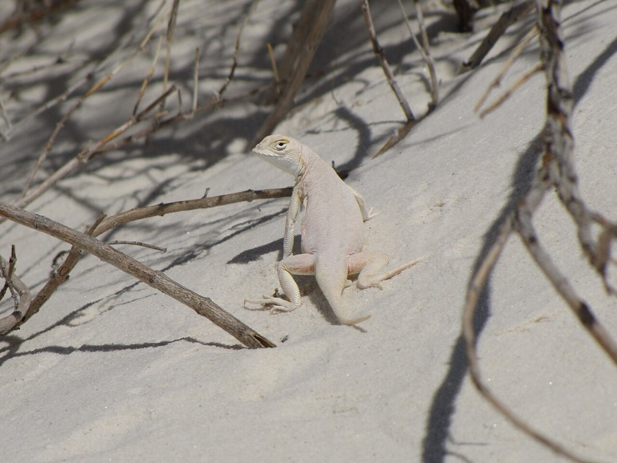{fig-alt="Gebleichte Eidechse auf weissem Sand"}
**White Sands** — helle Eidechsen auf weissem Gipssand
:::
::: {.kachel}
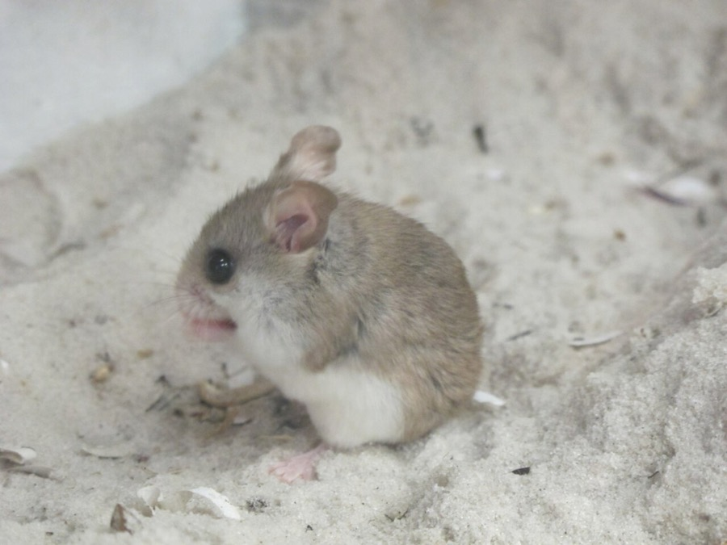{fig-alt="Helle Strandmaus im Duenensand"}
**Strandmäuse** — helles Fell in den Dünen, dunkles im Hinterland
:::
::: {.kachel}
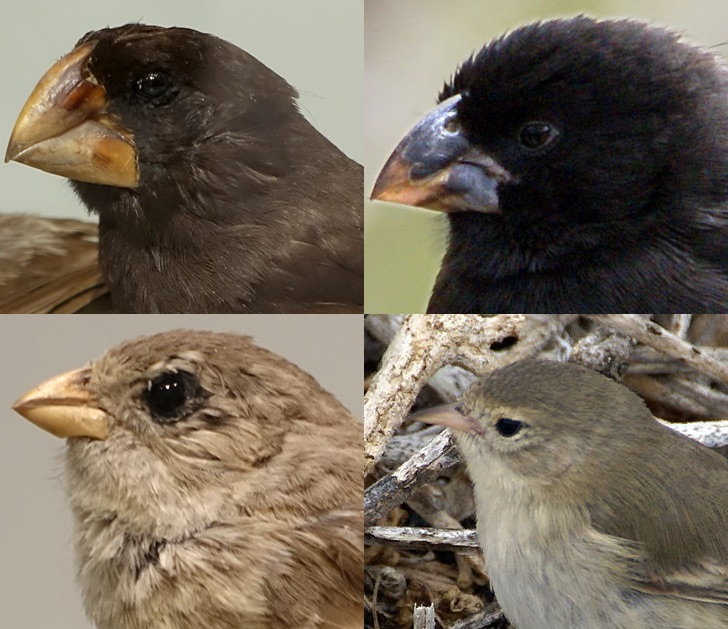{fig-alt="Vier Darwinfinken mit verschiedenen Schnaebeln"}
**Darwinfinken** — der Schnabel passt zur Nahrung der Insel
:::
::: {.kachel}
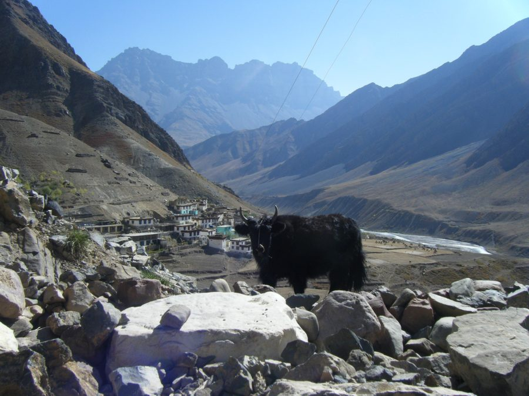{fig-alt="Hochland"}
**Hochland** — Leben auf 4000 m (Tibet, Woche 1)
:::
::::::

::: aside
Fotos: Wikimedia Commons (G. San Martin, B. Sale, NPS, USFWS, Kiwi Rex)
:::

## Dreistachlige Stichlinge

::::: columns
::: {.column width="52%"}
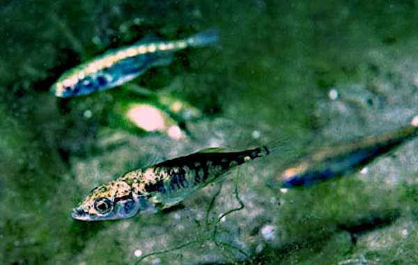{fig-alt="Dreistachliger Stichling" width="96%"}
:::
::: {.column width="48%"}
*Gasterosteus aculeatus* lebt im Meer und in Tausenden von Seen und Bächen der Nordhalbkugel.

Nach der letzten Eiszeit haben marine Fische immer wieder neu entstandene Süssgewässer besiedelt.
:::
:::::

## Zwei Formen desselben Fisches

::::: columns
::: {.column width="64%"}
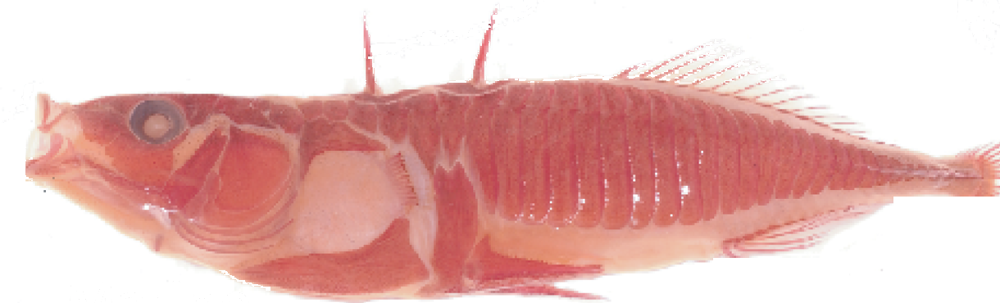{fig-alt="Angefaerbter Meer-Stichling mit vollstaendiger Reihe von Knochenplatten" width="100%"}
:::
::: {.column width="36%"}
**Meer**  
vollständige Reihe von Knochenplatten, kräftige Stacheln
:::
:::::

::::: columns
::: {.column width="64%"}
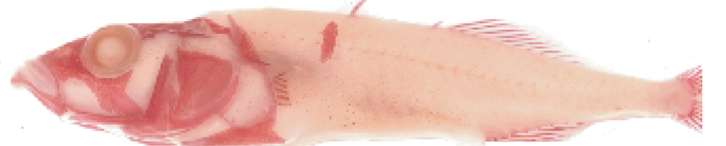{fig-alt="Angefaerbter See-Stichling mit fast keinen Knochenplatten" width="80%"}
:::
::: {.column width="36%"}
**See**  
kaum Platten, Stacheln oft zurückgebildet
:::
:::::

Rot angefärbt: Knochen. Die Panzerung schützt vor Raubfischen, kostet aber Kalzium und Wachstum. Im See — weniger Raubfische, kalkarmes Wasser — kehrt sich die Rechnung um.

::: aside
Colosimo et al. (2004) *PLoS Biology*, Fig. 1 (Ausschnitt) · [CC BY](https://doi.org/10.1371/journal.pbio.0020109)
:::

## Kreuzung statt Vermutung

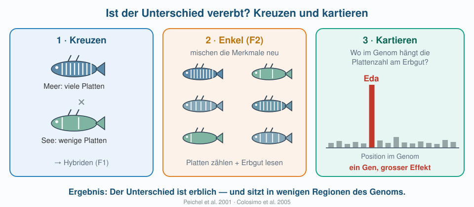{fig-alt="Meer und See kreuzen, Enkel zaehlen und Erbgut lesen, kartieren: ein Gen mit grossem Effekt" width="86%"}

::::: columns
::: {.column width="10%"}
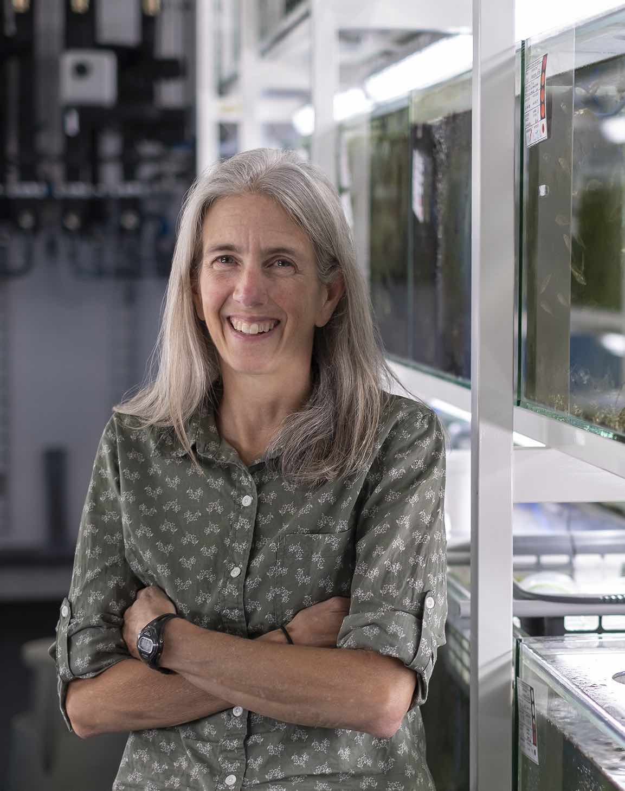{fig-alt="Catherine Katie Peichel" width="100%"}
:::
::: {.column width="90%"}
Plastisch oder vererbt? **Katie Peichel** (heute [Uni Bern](https://www.ee.iee.unibe.ch/index_eng.html)) et al. (2001) kreuzten Meer × See: Die Unterschiede werden **vererbt**.
:::
:::::

## Ein Gen für die Panzerung

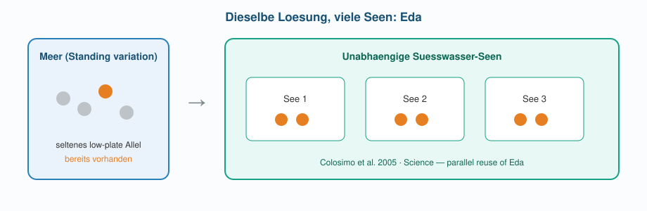{fig-alt="Eda parallel reuse" width="96%"}

Colosimo et al. (2005): In vielen unabhängig besiedelten Seen setzt sich **dasselbe** *Eda*-Allel durch. Es lag als seltene Variante bereits im Meer bereit.

## Gene finden, ohne sie zu kennen

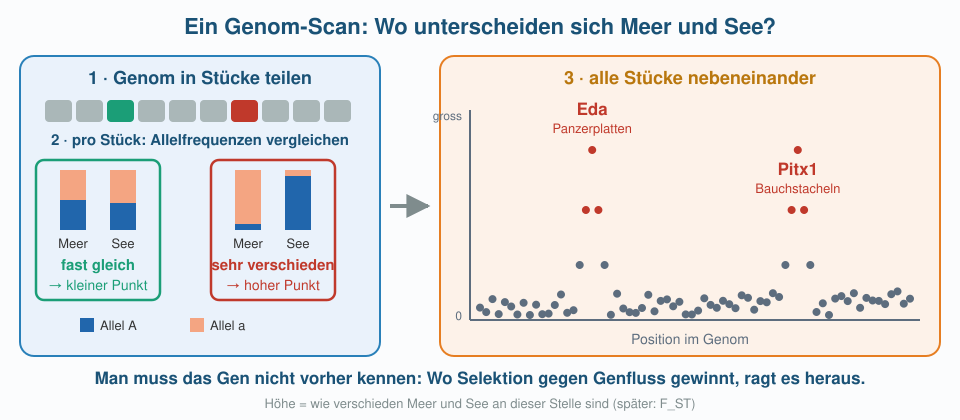{fig-alt="Genom in Stuecke teilen, Allelfrequenzen vergleichen, alle Stuecke nebeneinander: zwei Spitzen bei Eda und Pitx1" width="96%"}

Ein **Genom-Scan** vergleicht Meer- und Seefische an Tausenden Stellen. Die Spitzen zeigen, wo die lokale Anpassung im Erbgut sitzt: *Eda* (Panzerplatten) und *Pitx1* (Bauchstacheln am Becken).

## Was die Genome zeigen

Jones et al. (2012) haben Meer- und Seefische aus der ganzen Nordhalbkugel sequenziert:

- Der **Grossteil** des Genoms ist zwischen Meer und See **gleich**.
- Nur **wenige** Regionen sind stark verschieden — und in vielen unabhängigen Seen sind es **dieselben**.
- Darunter *Eda* und *Pitx1*: Im See haben Fische wiederholt dieselben Varianten.

Wie man so einen Scan misst und liest: Teil 4.

## Und trotzdem: Genfluss

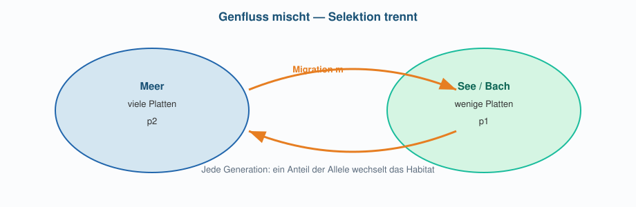{fig-alt="Genfluss zwischen Meer und See" width="92%"}

Meerfische wandern in Flussmündungen, Seefische werden ausgespült. Jede Generation mischt einen Teil der Allele wieder.

## Die Frage

:::: {.frage-box}
::: {.frage-icon}
{fig-alt="Frage" width="100%"}
:::
::: {.frage-text}
Wie können See und Meer **genetisch verschieden** bleiben, obwohl Fische **wandern**?
:::
::::

:::::: {.karten}
::: {.karte .karte-ok}
**Erblich**  
Kreuzungen: der Unterschied sitzt im Genom (*Eda*)
:::
::: {.karte .karte-ok}
**Genfluss**  
Fische wandern zwischen Meer und See
:::
::: {.karte .karte-frage}
**Beides zugleich?**  
Das klären wir jetzt mit einem Modell
:::
::::::

# Teil 2 · Selektion gegen Genfluss

## Zwei Frequenzen statt einer

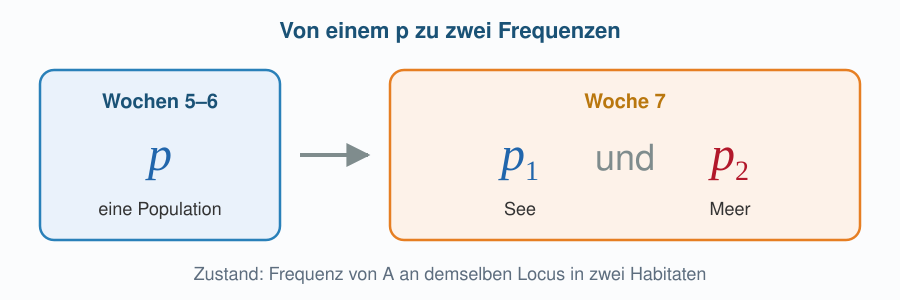{fig-alt="Zustand p1 und p2" width="90%"}

In Woche 6 hatten wir **eine** Population und **ein** $p$. Jetzt beschreiben zwei Zahlen den Zustand.

## Eine Generation in zwei Schritten

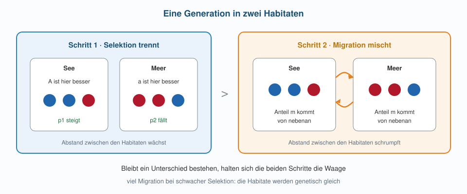{fig-alt="Selektion trennt Migration mischt" width="92%"}

$p_1$: Frequenz von $A$ im See. $p_2$: im Meer.

## Schritt 1 · Selektion, lokal

Jedes Habitat hat seine eigenen Fitnesswerte:

| Habitat | $w_{AA}$ | $w_{Aa}$ | $w_{aa}$ |
|---------|----------|----------|----------|
| See | $1+s$ | $1+s/2$ | $1$ |
| Meer | $1$ | $1+s/2$ | $1+s$ |

Wie in Woche 6: $p' = (p^2 w_{AA} + pq\,w_{Aa}) / \bar w$. Selektion zieht $p_1$ und $p_2$ **auseinander**.

## Schritt 2 · Migration

Ein Anteil $m$ stammt aus dem anderen Habitat:

$$
p_1' = (1-m)\,p_1 + m\,p_2
$$

Beispiel: $p_1 = 0.9$, $p_2 = 0.1$, $m = 0.05$ → $p_1' = 0.86$.

Migration zieht $p_1$ und $p_2$ **zusammen**.

## Zahlenbeispiel: eine Generation

Start: beide Habitate bei $p = 0.5$. Mit $s = 0.5$ und $m = 0.1$:

| | See ($p_1$) | Meer ($p_2$) |
|---|---|---|
| Start | 0.50 | 0.50 |
| nach Selektion | 0.55 | 0.45 |
| nach Migration | 0.54 | 0.46 |

Selektion hat einen Unterschied von $0.10$ erzeugt, Migration davon $0.02$ wieder weggenommen. Das wiederholt sich jede Generation.

## Wenig Genfluss

```{r}
#| fig-height: 3.5
#| fig-width: 7.8
zeige_demen(zwei_demen(s = 0.15, m = 0.02), "s = 0.15, m = 0.02")
```

Die Kurven trennen sich und bleiben getrennt: Selektion und Migration halten sich die Waage.

## Viel Genfluss

```{r}
#| fig-height: 3.5
#| fig-width: 7.8
zeige_demen(zwei_demen(s = 0.15, m = 0.30), "s = 0.15, m = 0.30")
```

Beide Habitate landen fast bei derselben Frequenz: Genfluss **ebnet** den Unterschied ein.

# Teil 3 · Nur das Verhältnis zählt

## Ein Tauziehen

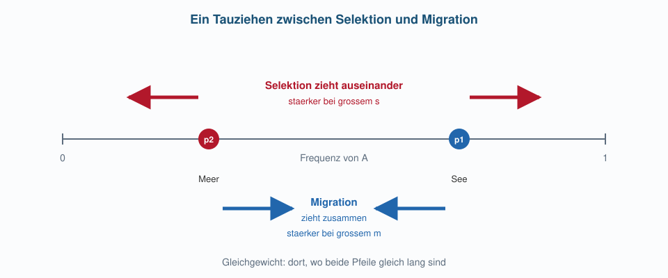{fig-alt="Selektion zieht auseinander, Migration zieht zusammen" width="96%"}

Verdoppelt man $s$ **und** $m$, werden beide Pfeile doppelt so lang. Das Tauziehen endet am selben Punkt — nur schneller.

## Gleiches $m/s$, gleiches Ergebnis

```{r}
#| fig-height: 3.5
#| fig-width: 8.6
verhaeltnis_plot()
```

Sechs Simulationen, aber nur **zwei** Endwerte: Es zählt nicht $s$ oder $m$ allein, sondern ihr **Verhältnis**. Schwache Selektion braucht nur länger.

## Faustregel

| $m/s$ | Was passiert |
|-------|--------------|
| deutlich kleiner als 1 | Selektion gewinnt: die Habitate bleiben verschieden |
| etwa 1 | Unterschied stark eingeebnet |
| deutlich grösser als 1 | Migration gewinnt: die Habitate werden fast gleich |

Starke Selektion verträgt viel Genfluss. Schwache Selektion wird schon von wenig Genfluss überspielt.

## Warum nur manche Gene?

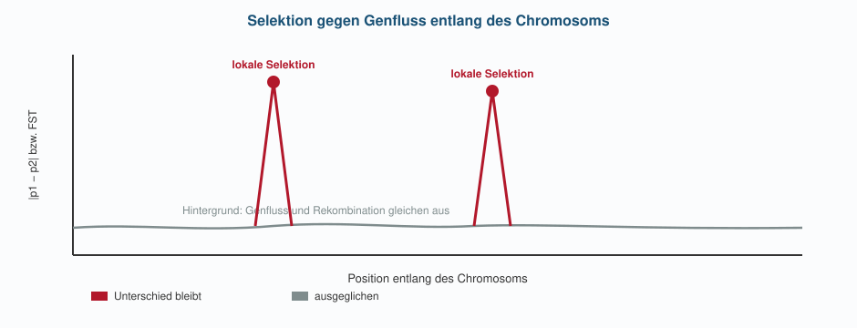{fig-alt="Selektion vs Genfluss entlang Chromosom" width="94%"}

Alle Gene erleben **denselben** Genfluss $m$, aber jedes hat sein eigenes $s$. Nur wo $m/s$ klein ist, bleibt ein Unterschied.

## Nachbarn reisen mit: Rekombination

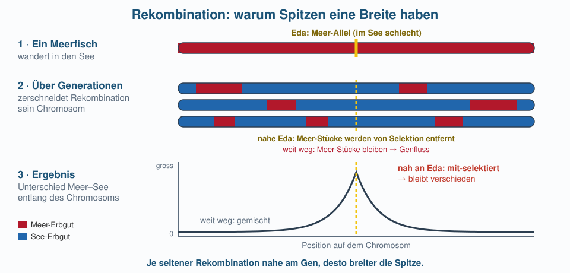{fig-alt="Ein Meer-Chromosom wird im See durch Rekombination zerschnitten; nahe Eda wird es entfernt, weit weg bleibt es" width="80%"}

Stellen **nahe** an einem selektierten Gen werden mit-selektiert. Weiter weg trennt **Rekombination** sie ab, und Genfluss mischt sie. Darum sieht man im Genom **Spitzen** mit einer Breite.

## Die Idee eines Genom-Scans

1. Die meisten Stellen im Genom sind **neutral**: Genfluss mischt sie, sie bilden einen tiefen **Hintergrund**.
2. Wo ein Gen unter lokaler Selektion steht, bleibt der Unterschied — **samt Nachbarschaft** (Rekombination).
3. Also: Unterschied an **jeder** Stelle messen und nach Spitzen suchen, die aus dem Hintergrund ragen.

Dafür brauchen wir **eine Zahl pro Stelle**, die sagt, wie verschieden zwei Populationen sind: $F_{ST}$.

# Teil 4 · Ein Blick ins Genom

## Heterozygotie: zwei Allele ziehen

::::: columns
::: {.column width="45%"}
Ziehen Sie zufällig **zwei** Allele aus einer Population. Wie wahrscheinlich sind sie **verschieden**?

- erst $A$, dann $a$: $p\,(1-p)$
- erst $a$, dann $A$: $(1-p)\,p$

$$
H = 2\,p\,(1-p)
$$

Das ist die **Heterozygotie** — wie in Woche 5 der Anteil $Aa$ unter Hardy–Weinberg.
:::
::: {.column width="55%"}
```{r}
#| fig-height: 4.2
#| fig-width: 5.4
het_plot()
```

$H$ ist gross, wenn beide Allele häufig sind, und klein, wenn eines fast fehlt.
:::
:::::

## Innerhalb oder zwischen?

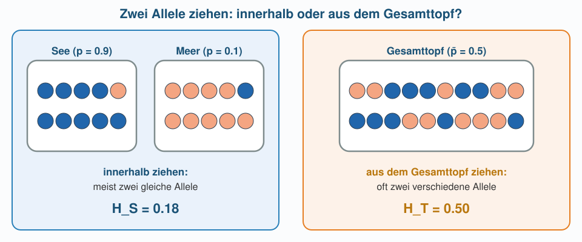{fig-alt="Links zwei Urnen See und Meer, innerhalb meist gleiche Allele; rechts Gesamttopf, oft verschiedene Allele" width="88%"}

Sind See und Meer verschieden, ziehen wir **innerhalb** einer Population öfter zwei gleiche Allele als im **Gesamttopf**: $H_S < H_T$.

## $F_{ST}$: die Definition

::::: columns
::: {.column width="55%"}
**Innerhalb** (Mittel über beide Populationen):

$$
H_S = \frac{2p_1(1-p_1) + 2p_2(1-p_2)}{2}
$$

**Gesamttopf** mit $\bar p = \tfrac{p_1+p_2}{2}$:

$$
H_T = 2\,\bar p\,(1-\bar p)
$$

$$
F_{ST} = \frac{H_T - H_S}{H_T}
$$
:::
::: {.column width="45%"}
In Worten: Um welchen **Anteil** sinkt die Chance auf zwei verschiedene Allele, wenn wir **innerhalb** statt im Gesamttopf ziehen?

- $F_{ST} = 0$: kein Unterschied — beide Populationen gleich.
- $F_{ST} = 1$: innerhalb immer gleich — jede Population hat nur ihr eigenes Allel.
:::
:::::

## Ein Beispiel durchgerechnet

See $p_1 = 0.1$, Meer $p_2 = 0.9$:

| Schritt | Rechnung | Wert |
|---|---|---|
| $H$ im See | $2 \cdot 0.1 \cdot 0.9$ | $0.18$ |
| $H$ im Meer | $2 \cdot 0.9 \cdot 0.1$ | $0.18$ |
| $H_S$ (Mittel) | | $0.18$ |
| $\bar p$ | $(0.1 + 0.9)/2$ | $0.5$ |
| $H_T$ | $2 \cdot 0.5 \cdot 0.5$ | $0.50$ |
| $F_{ST}$ | $(0.50 - 0.18)/0.50$ | $0.64$ |

Jede Population für sich ist wenig vielfältig, zusammen sehr: grosser Unterschied, grosses $F_{ST}$.

## Drei Fälle

```{r}
#| fig-height: 3.3
#| fig-width: 9
fst_skizze()
```

Je weiter $p_1$ und $p_2$ auseinanderliegen, desto grösser $F_{ST}$. Diese Zahl lässt sich für jede Stelle im Genom aus Daten schätzen.

## Ein echter Scan: Stichlinge in Alaska

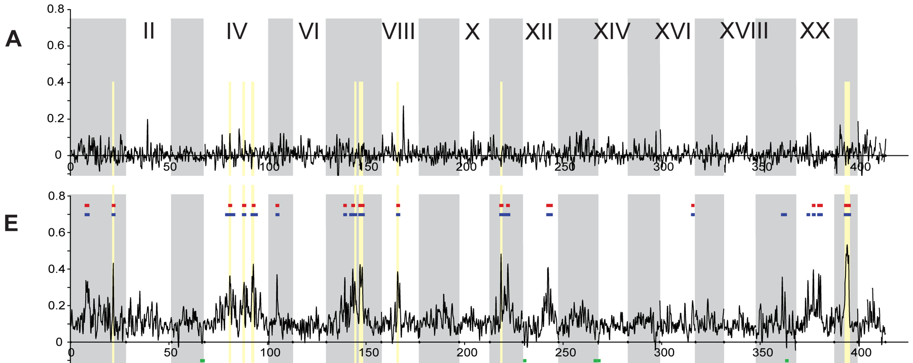{fig-alt="FST entlang des Stichling-Genoms: oben Meer gegen Meer flach, unten Meer gegen Suesswasser mit Spitzen" width="100%"}

$x$: Position im Genom (römische Zahlen = Chromosomen). $y$: $F_{ST}$ in Fenstern entlang des Genoms.  
**A**: zwei Meerpopulationen. **E**: Meer gegen Süsswasser.

::: aside
Hohenlohe et al. (2010) *PLoS Genetics*, Fig. 6 A und E · [CC BY 4.0](https://doi.org/10.1371/journal.pgen.1000862)
:::

## Was das Bild sagt

**Meer gegen Meer (A):** überall flach. Die Meerpopulationen tauschen viele Gene aus und leben im gleichen Habitat.

**Meer gegen Süsswasser (E):** der Hintergrund bleibt tief — Genfluss hält das Genom zusammen. Aber an einigen Stellen **ragt** $F_{ST}$ bis 0.5 heraus: Dort ist $m/s$ klein, Selektion hält stand.

Eine dieser Spitzen liegt auf Chromosom IV bei *Eda*, dem Gen für die Panzerplatten.

## Hinweis, kein Beweis

Eine Spitze ist ein **Kandidat** für lokale Anpassung — noch kein Nachweis:

- Irgendein Abschnitt ist immer der höchste, auch ganz ohne Selektion.
- Auch Zufall und Populationsgeschichte können Spitzen erzeugen.
- Beim Stichling kommt die Bestätigung aus Kreuzungen und Genfunktion (*Eda*, *Pitx1*).

Wie man Spitzen statistisch sauber testet: später im Studium.

## Dasselbe Bild: Tibet

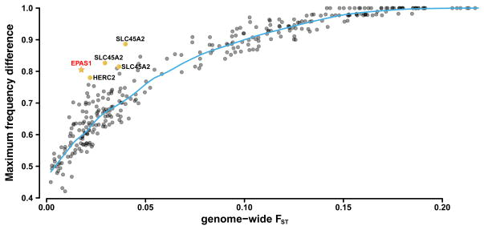{fig-alt="Huerta-Sanchez 2014 Abbildung 1" width="58%"}

Woche 1: **EPAS1** ragt bei Tibeter:innen aus dem Hintergrund heraus — wie *Eda* beim Stichling.

::: aside
Huerta-Sánchez et al. (2014), Abb. 1
:::

# Abschluss

## Take-home

1. Selektion zieht Habitate **auseinander**, Migration zieht sie **zusammen**.
2. Ob ein Unterschied bleibt, hängt vom Verhältnis $m/s$ ab.
3. Deshalb sind im Genom nur **wenige** Stellen stark verschieden.

## Dasselbe Prinzip: Stechmücken

::::: columns
::: {.column width="40%"}
{fig-alt="Stechmücke" width="100%"}
:::
::: {.column width="58%"}
Um Montpellier wurde in den 1990er Jahren gegen Stechmücken **Insektizid** gespritzt, im ländlichen Umland nicht.

- in der Stadt: **resistente** Mücken im Vorteil
- auf dem Land: Resistenz kostet etwas
- die Mücken fliegen hin und her

Wieder Selektion gegen Migration — das rechnen Sie im Notebook (Lenormand et al. 1999).
:::
:::::

## Ausblick · Checkpoint B

```{r}
#| fig-height: 3.0
#| fig-width: 8
xs <- seq(-8, 8, length.out = 200)
ggplot(data.frame(x = xs, p = 1 / (1 + exp(-xs))), aes(x, p)) +
  geom_vline(xintercept = 0, linetype = "dashed", colour = "grey60") +
  geom_line(colour = "#2166ac", linewidth = 1.2) +
  annotate("text", x = -5, y = 0.25, label = "Land: ohne Insektizid", size = 4) +
  annotate("text", x = 5, y = 0.75, label = "Stadt: mit Insektizid", size = 4) +
  coord_cartesian(ylim = c(0, 1)) +
  labs(x = "Position (km)", y = "Frequenz Resistenz") +
  theme_slide()
```

Statt zwei Habitaten eine **Strecke**: die Resistenz ändert sich allmählich — eine **Cline**. Nächste Woche: Was verrät ihre Form über Selektion und Migration?

## Notebook (~45 min)

**→ [Notebook Woche 7 öffnen](notebook.html)**

::::: columns
::: {.column width="20%"}
{fig-alt="Notebook" width="70%"}
:::
::: {.column width="80%"}
Resistenz gegen Insektizid bei Stechmücken um Montpellier (Lenormand et al. 1999).

**A1** Eine Generation: nimmt $p_R$ zu oder ab?  

**A2** Viele Generationen: erst $s$ drehen, dann $m$ — gibt es verschiedene Kombinationen mit demselben Muster?
:::
:::::

## Abschlussfragen

1. Was macht Selektion mit $p_1$ und $p_2$ — und was macht Migration?
2. Warum führen $s = 0.1, m = 0.01$ und $s = 0.02, m = 0.002$ zum selben Ergebnis?
3. Warum ist nur ein kleiner Teil des Genoms stark verschieden?

## Literatur

:::: {.lit}
1. **Peichel, C. L., et al. (2001).** The genetic architecture of divergence between threespine stickleback species. *Nature* 414: 901–905. [doi:10.1038/414901a](https://doi.org/10.1038/414901a)
2. **Colosimo, P. F., et al. (2004).** The genetic architecture of parallel armor plate reduction in threespine sticklebacks. *PLoS Biology* 2: e109. [doi:10.1371/journal.pbio.0020109](https://doi.org/10.1371/journal.pbio.0020109)
3. **Colosimo, P. F., et al. (2005).** Widespread parallel evolution in sticklebacks by repeated fixation of Ectodysplasin alleles. *Science* 307: 1928–1933. [doi:10.1126/science.1107239](https://doi.org/10.1126/science.1107239)
4. **Jones, F. C., et al. (2012).** The genomic basis of adaptive evolution in threespine sticklebacks. *Nature* 484: 55–61. [doi:10.1038/nature10944](https://doi.org/10.1038/nature10944)
5. **Huerta-Sánchez, E., et al. (2014).** Altitude adaptation in Tibetans caused by introgression of Denisovan-like DNA. *Nature* 512: 194–197. [doi:10.1038/nature13408](https://doi.org/10.1038/nature13408)
6. **Hohenlohe, P. A., et al. (2010).** Population genomics of parallel adaptation in threespine stickleback using sequenced RAD tags. *PLoS Genetics* 6: e1000862. [doi:10.1371/journal.pgen.1000862](https://doi.org/10.1371/journal.pgen.1000862)
7. **Chan, Y. F., et al. (2010).** Adaptive evolution of pelvic reduction in sticklebacks by recurrent deletion of a *Pitx1* enhancer. *Science* 327: 302–305. [doi:10.1126/science.1182213](https://doi.org/10.1126/science.1182213)
8. **Lenormand, T., Bourguet, D., Guillemaud, T., & Raymond, M. (1999).** Tracking the evolution of insecticide resistance in the mosquito *Culex pipiens*. *Nature* 400: 861–864. [doi:10.1038/23685](https://doi.org/10.1038/23685)

::::

## Navigation

| | |
|---|---|
| Notebook | [Notebook Woche 7](notebook.html) |
| Zurück | [← Woche 6](../week-06/slides.html) |
| Weiter | [Woche 8 →](../week-08/slides.html) |
| Modul | [Modul 2](../../docs/module-02-overview.html) |
| PDF | [slides.pdf](slides.pdf) · oder Taste **E**, dann Drucken |
