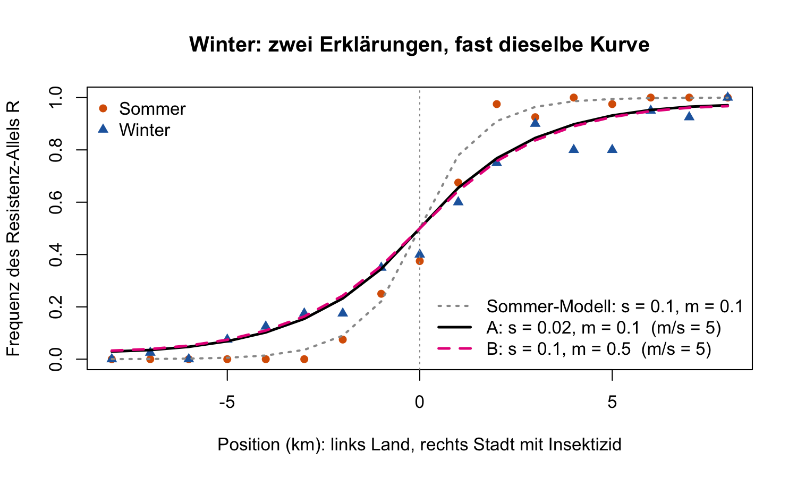

**Nicht für Studierende.** Teams bis 4 · Notebook (Quarto / Rmd / `notebook.R`) · Gespräch 1–2 Minuten pro Gruppe

**Kurz:** Die Winter-Cline ist **breiter**. Im Modell passt sowohl $s$ kleiner (0.02) als auch $m$ grösser (0.5). Beide Male ist $m/s \approx 5$, im Sommer ist $m/s = 1$. Die Daten allein entscheiden also nicht zwischen den beiden. Das Argument muss biologisch sein.

## 1 · Check (Bestanden?)

- [ ] **Eine Abbildung** gezeigt (Abbildung 1 oder ein Modellplot aus Teil 2)
- [ ] **F1:** Breite im Winter grösser, Zentrum etwa gleich
- [ ] **F2:** beide Versuche probiert; $s \approx 0.02$ **und** $m \approx 0.5$ passen
- [ ] **F3:** ein biologisches Argument, warum eher $s$ (oder begründet $m$)

Bestanden, wenn die Gruppe **was**, **welche Änderung** und **warum** in eigenen Worten sagen kann. Exakte Zahlen sind nicht nötig.

## 2 · Erwartete Antworten

**F1 — Abbildung 1.** Die Tabelle unter der Abbildung:

| | Zentrum (km) | Breite (km) |
|---|---|---|
| Sommer | 0.3 | 3.4 |
| Winter | 0.4 | 7.8 |

Das Zentrum bleibt an der Grenze, nur der Übergang wird etwa **doppelt so breit**.

{width=58%}

**F2 — Modell.** Der «Abstand zu den Winter-Daten» steht über jeder Abbildung (Sommer-Modell: 0.213).

| | $s$ | $m$ | $m/s$ | Abstand |
|---|---|---|---|---|
| Sommer | 0.1 | 0.1 | 1 | 0.213 |
| Winter, Versuch A | **0.02** | 0.1 | 5 | 0.053 |
| Winter, Versuch B | 0.1 | **0.5** | 5 | 0.051 |

Werte zwischen etwa $s$ = 0.015–0.025 bzw. $m$ = 0.4–0.6 sind genauso gut. Die beiden Modellkurven liegen praktisch **übereinander**:

{width=58%}

**Warum?** Wie in Woche 7 zählt nur das Verhältnis $m/s$. Ob man $s$ durch 5 teilt oder $m$ mit 5 multipliziert, gibt dieselbe Cline:

{width=58%}

**F3 — Biologie.** Die erwartete Antwort lautet: **$s$ ist im Winter kleiner.**

- Im Winter wird kaum oder gar nicht gespritzt. Damit fällt der Vorteil von R in der Stadt weg oder wird kleiner (*relaxed selection*).
- Die Kosten der Resistenz bleiben. Bei *Culex pipiens* überleben resistente Mücken den Winter sogar schlechter (Lenormand et al. 1999).
- $m$ grösser ist unplausibel: Im Winter fliegen die Mücken **weniger**, sie überwintern in Kellern und Höhlen.

Auch eine Gruppe, die $m$ wählt, kann bestehen, wenn sie es begründet und erkennt, dass das Modell beides erlaubt.

## 3 · Häufige Probleme

- **Beide Zahlen gleichzeitig geändert.** Nur eine Zahl pro Versuch, die andere bleibt 0.1.
- **Komma statt Punkt** (`0,02`) gibt eine Fehlermeldung. Richtig ist `0.02`.
- **«Abstand» falsch gelesen.** Kleiner heisst besser. Einen Wert unter etwa 0.06 können Sie als «passt» gelten lassen.
- **Keine Abbildung in `notebook.R`.** Die Abbildungen erscheinen im *Plots*-Fenster von RStudio. Den Code Zeile für Zeile ausführen, nicht mit *Source* ohne Echo.
- **Hilfsfunktionen-Block nicht ausgeführt** führt zu `could not find function`. Abschnitt 0 komplett ausführen.

## 4 · Nachfragen für schnelle Gruppen

- **Welchen Wert hat $m/s$ in Ihrer Tabelle?** Erwartet: Sommer 1, Winter in beiden Versuchen etwa 5.
- **Wie viel breiter wird die Cline?** Die Breite wächst ungefähr mit $\sqrt{m/s}$: $\sqrt{5} \approx 2.2$, und $7.8 / 3.4 \approx 2.3$.
- **Wie könnte man $s$ und $m$ getrennt messen?** $m$ direkt über Markierung und Wiederfang der Mücken, $s$ über Überleben resistenter und anfälliger Mücken mit und ohne Insektizid. Das Modell allein kann es nicht.
- **Warum bleibt das Zentrum an der Grenze?** Das Modell ist symmetrisch: Was R in der Stadt nützt, kostet es auf dem Land.

Die Daten sind Kursdaten (17 Stellen, 40 Allele pro Stelle), angelehnt an Lenormand et al. (1999).
