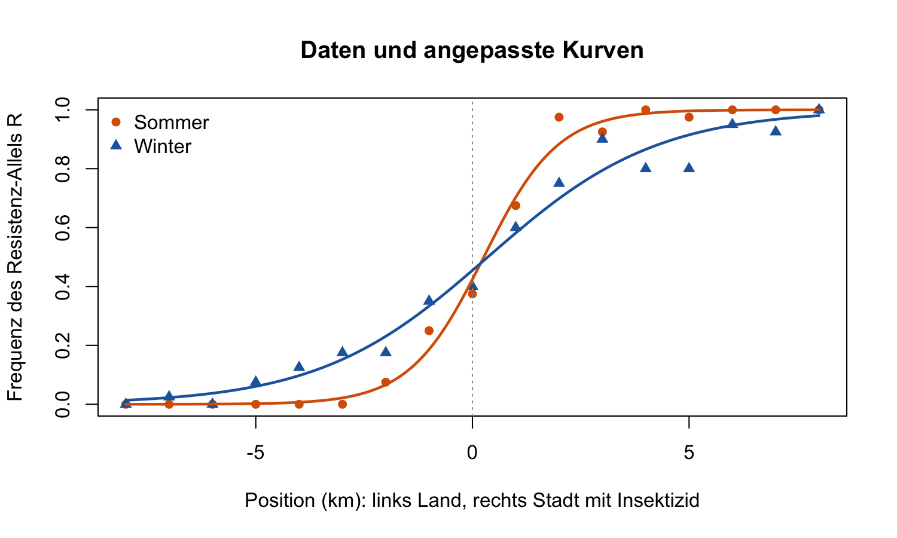
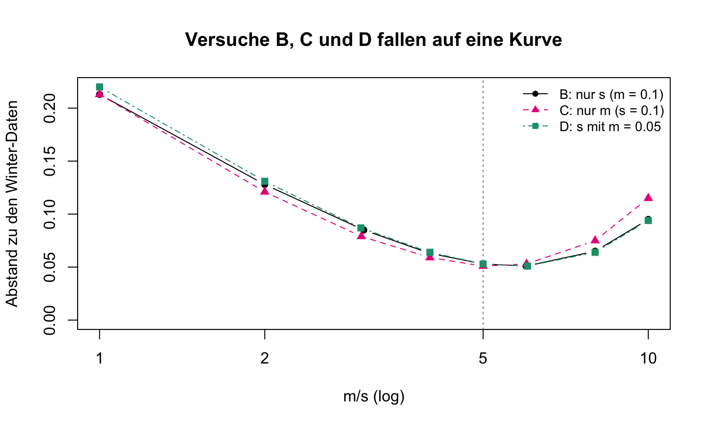
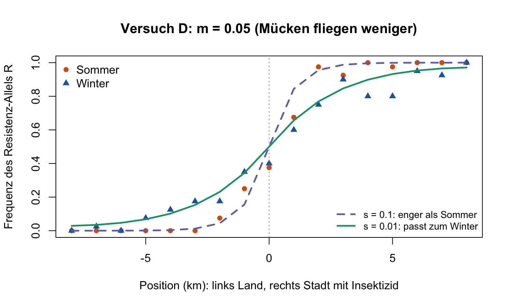

**Nicht für Studierende.** Teams bis 4 · Notebook (Quarto / Rmd / `notebook.R`) · Gespräch 1–2 Minuten pro Gruppe

**Kurz:** Die Winter-Cline ist **breiter**. Im Modell zählt nur $m/s$: Sommer $m/s = 1$, Winter $m/s \approx 5$. Ob $s$ kleiner oder $m$ grösser wird, können die Daten nicht entscheiden. Biologisch gilt: Im Winter fliegen die Mücken **weniger** ($m$ kleiner). Das allein würde die Cline **enger** machen. Damit sie trotzdem breiter wird, muss die **Selektion fast ganz wegfallen** ($s$ von 0.1 auf etwa 0.01): Im Winter wird kaum gespritzt.

## 1 · Check (Bestanden?)

- [ ] **Eine Abbildung** gezeigt (Abbildung 1 oder ein Modellplot aus Teil 2)
- [ ] **F1:** Breite im Winter grösser, Zentrum etwa gleich
- [ ] **F2:** Tabelle ausgefüllt; erkannt, dass es nur auf $m/s$ ankommt
- [ ] **F3:** mit $m = 0.05$ passt $s \approx 0.01$; Selektion im Winter fast weg, weil kaum gespritzt wird

Bestanden, wenn die Gruppe **was**, **welche Änderung** und **warum** in eigenen Worten sagen kann. Exakte Zahlen sind nicht nötig.

## 2 · Erwartete Antworten

**F1 — Abbildung 1.** Die Tabelle unter der Abbildung:

| | Zentrum (km) | Breite (km) |
|---|---|---|
| Sommer | 0.3 | 3.4 |
| Winter | 0.4 | 7.8 |

Das Zentrum bleibt an der Grenze, nur der Übergang wird etwa **doppelt so breit**.

{width=58%}

**F2 — Modell.** Über jeder Abbildung stehen die Abstände zum Sommer und zum Winter.

| | $s$ | $m$ | $m/s$ | Abstand |
|---|---|---|---|---|
| Sommer | 0.1 | 0.1 | 1 | Sommer 0.035 |
| Versuch A | 0.05 | 0.05 | 1 | Sommer 0.036 |
| Versuch A | 0.2 | 0.2 | 1 | Sommer 0.034 |
| Versuch B (Winter) | **0.02** | 0.1 | 5 | Winter 0.053 |
| Versuch C (Winter) | 0.1 | **0.5** | 5 | Winter 0.051 |

- **Versuch A:** Werden $s$ und $m$ gleich verändert, bleibt die Cline gleich und passt weiter zum Sommer.
- **Versuche B und C:** Beide passen zum Winter, und beide Male ist $m/s = 5$. Werte von etwa $s$ = 0.015–0.025 bzw. $m$ = 0.4–0.6 sind genauso gut.
- **Kernaussage:** Wie in Woche 7 zählt nur das **Verhältnis** $m/s$. Die Modellkurven liegen praktisch übereinander:

{width=58%}

{width=58%}

**F3 — Biologie (Versuch D).** Im Winter fliegen die Mücken weniger: $m = 0.05$.

1. Mit $s = 0.1$ wird die Cline **enger** als im Sommer ($m/s = 0.5$, Abstand zum Winter 0.308). Weniger Flug allein erklärt den Winter also **nicht**, er macht es sogar schlimmer.
2. Passend ist $s \approx 0.01$ (Abstand 0.053, wieder $m/s = 5$). Von der Selektion bleibt nur etwa **ein Zehntel**, sie ist de facto weg.
3. Warum: Im Winter wird kaum oder gar nicht gespritzt. Der Vorteil von R in der Stadt fällt weg, die Kosten der Resistenz bleiben eher noch (bei *Culex pipiens* überwintern resistente Mücken schlechter, Lenormand et al. 1999).

{width=58%}

Eine Gruppe, die in F2 «$m$ grösser» bevorzugt, sollte mit Versuch D merken, warum das nicht passt.

## 3 · Häufige Probleme

- **Falsche Zahl geändert.** In A beide gleich, in B nur $s$, in C nur $m$, in D nur $s$ (mit $m = 0.05$).
- **Komma statt Punkt** (`0,02`) gibt eine Fehlermeldung. Richtig ist `0.02`.
- **«Abstand» falsch gelesen.** Kleiner heisst besser. Bei A zählt der Abstand zum **Sommer**, bei B–D zum **Winter**. Einen Winter-Abstand unter etwa 0.06 können Sie als «passt» gelten lassen.
- **Keine Abbildung in `notebook.R`.** Die Abbildungen erscheinen im *Plots*-Fenster von RStudio. Den Code Zeile für Zeile ausführen, nicht mit *Source* ohne Echo.
- **Hilfsfunktionen-Block nicht ausgeführt** führt zu `could not find function`. Abschnitt 0 komplett ausführen.

## 4 · Nachfragen für schnelle Gruppen

- **Welchen Wert hat $m/s$ in Ihrer Tabelle?** Erwartet: Sommer und A 1, Winter (B, C, D) etwa 5.
- **Wenn $m$ im Winter auf ein Viertel fällt ($m = 0.025$), welches $s$ passt dann?** $s = 0.005$; die Selektion ist dann noch schwächer.
- **Wie viel breiter wird die Cline?** Die Breite wächst ungefähr mit $\sqrt{m/s}$: $\sqrt{5} \approx 2.2$, und $7.8 / 3.4 \approx 2.3$.
- **Wie könnte man $s$ und $m$ getrennt messen?** $m$ direkt über Markierung und Wiederfang der Mücken, $s$ über Überleben resistenter und anfälliger Mücken mit und ohne Insektizid. Das Modell allein kann es nicht.
- **Warum bleibt das Zentrum an der Grenze?** Das Modell ist symmetrisch: Was R in der Stadt nützt, kostet es auf dem Land.

Die Daten sind **für den Kurs erfunden** (17 Stellen, 40 Allele pro Stelle), angelehnt an Lenormand et al. (1999).
