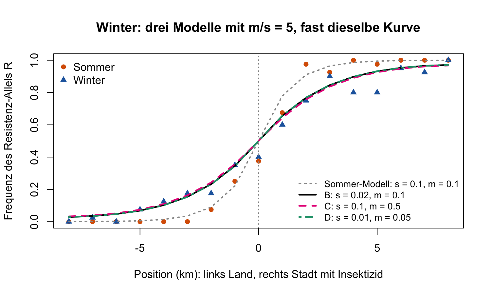

**Nicht für Studierende.** Ablauf im Notebook: Sommer anpassen → Winter anpassen (nur eine Zahl) → eine Frage (a–c). Teams bis 4 · Gespräch 1–2 Minuten pro Gruppe.

**Kurz:** Die Winter-Cline ist etwa doppelt so **breit**. Im Modell zählt nur $m/s$: Sommer $m/s \approx 1$, Winter $m/s \approx 5$. Ob $s$ kleiner oder $m$ grösser wird, können die Daten nicht entscheiden. Im Winter fliegen die Mücken aber **weniger** ($m$ eher kleiner). Also muss die **Selektion fast ganz wegfallen**: Im Winter wird kaum gespritzt.

## Bestanden, wenn die Gruppe …

- **eine Abbildung** zeigt,
- **a, b:** eine Sommer-Lösung und zwei Winter-Lösungen hat und sagt: breiter heisst $s$ kleiner **oder** $m$ grösser, beide Male $m/s$ etwa 5,
- **c:** begründet, dass es $s$ sein muss (Mücken fliegen weniger), und daraus schliesst: kaum Insektizid im Winter.

Exakte Zahlen sind nicht nötig; $m/s$ zwischen etwa 4 und 6 im Winter ist in Ordnung.

## Erwartete Werte

Start im Notebook: $s = 0.2$, $m = 0.05$, Abstand zum Sommer 0.093 (zu steil). Abstand unter 0.06 = passt.

| | $s$ | $m$ | $m/s$ | Abstand |
|---|---|---|---|---|
| **Sommer A** (nur $s$ geändert) | 0.05 | 0.05 | 1 | Sommer 0.036 |
| Winter von A, nur $s$ | **0.01** | 0.05 | 5 | Winter 0.053 |
| Winter von A, nur $m$ | 0.05 | **0.25** | 5 | Winter 0.052 |
| **Sommer B** (nur $m$ geändert) | 0.2 | 0.2 | 1 | Sommer 0.034 |
| Winter von B, nur $s$ | **0.04** | 0.2 | 5 | Winter 0.052 |
| Winter von B, nur $m$ | 0.2 | **1.0** | 5 | Winter 0.052 |

{width=55%}

**c — das biologische Argument.**

1. Mücken fliegen im Winter weniger, «$m$ grösser» ist also unplausibel (bei Lösung B wäre sogar $m = 1$ nötig).
2. Weniger Flug allein macht die Cline **enger**, nicht breiter.
3. Also muss $s$ stark sinken: Der Vorteil von R in der Stadt fällt weg, weil kaum gespritzt wird. Die Kosten der Resistenz bleiben (Lenormand et al. 1999).

## Häufige Probleme

- **Beide Zahlen gleichzeitig geändert:** immer von der Sommer-Lösung aus, nur eine Zahl.
- **Komma statt Punkt** (`0,02`): Fehlermeldung, richtig ist `0.02`.
- **Falscher Abstand gelesen:** Für den Sommer zählt der Abstand zum Sommer, für den Winter der zum Winter. Kleiner ist besser.
- **`could not find function`:** Abschnitt 0 (Hilfsfunktionen) nicht ausgeführt.

## Nachfragen für schnelle Gruppen

- **Wie viel breiter?** Breite wächst etwa mit $\sqrt{m/s}$: $\sqrt{5} \approx 2.2$, Daten $7.8 / 3.4 \approx 2.3$.
- **Wie misst man $s$ und $m$ getrennt?** $m$ mit Markieren und Wiederfangen, $s$ über Überleben von R- und r-Mücken mit und ohne Insektizid.

Die Daten sind **für den Kurs erfunden**, angelehnt an Lenormand et al. (1999).
