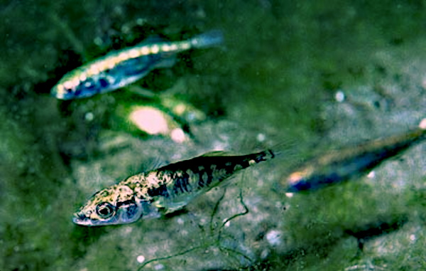

```{r}
#| include: false
source("../slides-ggplot.R")

selektion <- function(p, s) p * (1 + s) / (1 + p * s)

simuliere_bahn <- function(s, N, jahre = 4, zufall = TRUE) {
  p <- numeric(jahre + 1)
  p[1] <- 0.5
  for (t in seq_len(jahre)) {
    p_sel <- selektion(p[t], s)
    p[t + 1] <- if (zufall) rbinom(1, N, p_sel) / N else p_sel
  }
  data.frame(jahr = 0:jahre, p = p)
}

wolke <- function(s, N, n_bahnen = 100, seed = 9) {
  set.seed(seed)
  do.call(rbind, lapply(seq_len(n_bahnen), function(i)
    cbind(simuliere_bahn(s, N), id = i)))
}

teiche <- read.csv("data/pond-chrxi.csv")
names(teiche)[1:2] <- c("teich", "jahr")
teiche$teich <- factor(paste("Teich", teiche$teich), levels = c("Teich 2", "Teich 7", "Teich 14"))
teich_farben <- c("Teich 2" = "#e67e22", "Teich 7" = "#2980b9", "Teich 14" = "#1e8449")

zeige_wolke <- function(w, titel, ohne_zufall = NULL) {
  band <- aggregate(p ~ jahr, w, function(x) quantile(x, c(0.05, 0.95)))
  band <- data.frame(jahr = band$jahr, lo = band$p[, 1], hi = band$p[, 2])
  g <- ggplot() +
    geom_ribbon(data = band, aes(jahr, ymin = lo, ymax = hi),
                fill = "#d5d8dc", alpha = 0.8) +
    geom_line(data = w, aes(jahr, p, group = id),
              colour = "#95a5a6", linewidth = 0.25, alpha = 0.5)
  if (!is.null(ohne_zufall))
    g <- g + geom_line(data = ohne_zufall, aes(jahr, p),
                       colour = "#c0392b", linewidth = 1.2)
  g +
    geom_line(data = teiche, aes(jahr, p, colour = teich), linewidth = 1.1) +
    geom_point(data = teiche, aes(jahr, p, colour = teich, shape = teich), size = 2.6) +
    scale_colour_manual(values = teich_farben) +
    scale_shape_manual(values = c(16, 17, 15)) +
    coord_cartesian(ylim = c(0.3, 0.9)) +
    labs(x = "Jahr", y = "Frequenz Süsswasser-Inversion", title = titel) +
    theme_slide()
}
```

## Übersicht

**Woche 9** von 14 · **Do., 12. Nov. 2026, 08:15–10:00**

| Teil | Dauer | Was |
|------|-------|-----|
| Vorlesung | ~45 min | ein Teichexperiment · Zufall in R · Drift · die neutrale Wolke |
| Notebook | ~45 min | Zufallszahlen · Drift · eigene Wolken · welches $s$ passt? |

::: aside
Pfeiltasten · **M** Menü · **E** PDF · **Esc** Übersicht
:::

## Bis jetzt: kein Zufall

Wochen 5–8: Aus $p$ und $s$ folgte **genau ein** nächstes $p$.

Echte Populationen sind **endlich**. Wer wie viele Nachkommen hat, ist auch **Glück**.

Heute: Was ändert das — und wie erkennt man trotzdem Selektion?

# Ein Teichexperiment

## Stichlinge, wie in Woche 7

::::: columns
::: {.column width="50%"}
{fig-alt="Dreistachliger Stichling" width="100%"}
:::
::: {.column width="50%"}
Meer- und Süsswasser-Stichlinge unterscheiden sich an wenigen Stellen im Genom stark (Woche 7).

Darunter sind **Inversionen**: ein Stück Chromosom liegt umgedreht. Eine davon sitzt auf **Chromosom XI**.

Im Süsswasser ist meist die eine Orientierung häufig, im Meer die andere.
:::
:::::

::: aside
Foto: Wikimedia Commons, *Gasterosteus aculeatus* · Jones et al. (2012)
:::

## Das Experiment

Katie Peichel (Bern) und Dolph Schluter (UBC, Vancouver) fingen marine Stichlinge, die **heterozygot** sind: eine Meer- und eine **Süsswasser-Orientierung** von Chr XI.

Je etwa 25 dieser Fische kamen 2022 in **drei Versuchsteiche**. Jedes Jahr wird gezählt, wie häufig die Süsswasser-Orientierung ist.

Start: jeder Fisch hat eine Kopie von jeder Orientierung, also $p_0 = 0.5$.

## Drei Teiche

```{r}
#| fig-height: 3.5
#| fig-width: 8.4
#| out-width: 92%
ggplot(teiche, aes(jahr, p, colour = teich, shape = teich)) +
  geom_hline(yintercept = 0.5, colour = "#bdc3c7", linetype = "dashed") +
  geom_line(linewidth = 1.1) +
  geom_point(size = 2.8) +
  scale_colour_manual(values = teich_farben) +
  scale_shape_manual(values = c(16, 17, 15)) +
  coord_cartesian(ylim = c(0.3, 0.9)) +
  labs(x = "Jahr", y = "Frequenz Süsswasser-Inversion") +
  theme_slide()
```

Alle drei **steigen**, aber jeder Teich anders. Teich 7 hat sehr wenige Fische (kleine Stichproben) und kein Jahr 4.

## Die Frage

> Steigt die Süsswasser-Inversion, weil sie im Teich **im Vorteil** ist?
> Oder kann das auch **Zufall** sein?

Dafür müssen wir wissen, wie weit $p$ **ohne** Selektion laufen kann.

# Zufall

## Woher kommt der Zufall?

Auch ohne Selektion ist die nächste Generation nicht genau wie die alte:

- **Überleben:** Ob ein Fisch vom Reiher gefressen wird, hat mit seiner Inversion nichts zu tun.
- **Nachkommen:** Manche Fische haben viele Junge, andere keine.
- **Mendel:** Ein Heterozygoter gibt **eine** seiner zwei Kopien weiter, welche, entscheidet ein Münzwurf.

In einer kleinen Population mitteln sich diese Zufälle **nicht** heraus.

## Zufall in einer kleinen Population

```{r}
#| fig-height: 3.1
#| fig-width: 8.4
#| out-width: 92%
set.seed(4)
N_klein <- 10
gen <- list(c(rep(1, 5), rep(0, 5)))
for (t in 2:5) gen[[t]] <- sample(gen[[t - 1]], N_klein, replace = TRUE)
kugeln <- do.call(rbind, lapply(1:5, function(t)
  data.frame(generation = t - 1, platz = 1:N_klein, allel = sort(gen[[t]], decreasing = TRUE))))
anteil <- aggregate(allel ~ generation, kugeln, mean)
ggplot(kugeln, aes(platz, -generation)) +
  geom_point(aes(fill = factor(allel)), shape = 21, size = 8, colour = "grey30") +
  scale_fill_manual(values = c("0" = "white", "1" = "#2980b9"), guide = "none") +
  geom_text(data = anteil, aes(x = 11.5, y = -generation,
                               label = paste0("p = ", allel)), size = 5, hjust = 0) +
  scale_y_continuous(breaks = -(0:4), labels = paste("Generation", 0:4)) +
  coord_cartesian(xlim = c(0.5, 13)) +
  theme_void(base_size = 14) +
  theme(axis.text.y = element_text(hjust = 1))
```

10 Genkopien, **keine Selektion**. Jede Generation wird aus der vorherigen **zufällig gezogen**. $p$ wandert trotzdem: **genetische Drift**.

## Zufall im Computer: eine Münze

`sample` zieht zufällig aus einer Liste. Zehn Münzwürfe:

```{r}
#| echo: true
sample(c("Kopf", "Zahl"), size = 10, replace = TRUE)
sample(c("Kopf", "Zahl"), size = 10, replace = TRUE)
```

Zweimal derselbe Befehl, zweimal ein anderes Ergebnis.

## Pseudo-Zufall und `set.seed`

Ein Computer würfelt nicht. R **berechnet** Zahlen, die zufällig aussehen. Der Startwert der Rechnung heisst **Seed**.

```{r}
#| echo: true
set.seed(1)
sample(c("Kopf", "Zahl"), size = 10, replace = TRUE)
set.seed(1)
sample(c("Kopf", "Zahl"), size = 10, replace = TRUE)
```

Gleicher Seed, gleiche Zahlen: So kann jemand anders das Ergebnis **genau wiederholen**.

## Von Münzen zu Genkopien

Eine neue Generation mit $N = 250$ Genkopien. Jede ist mit Wahrscheinlichkeit $p = 0.5$ eine Süsswasser-Kopie: 250 Münzwürfe.

Uns interessiert nur, **wie viele** es sind. Das würfelt `rbinom` direkt:

```{r}
#| echo: true
set.seed(2)
rbinom(10, size = 250, prob = 0.5)
```

Zehn mögliche neue Generationen. Im Mittel 125, aber selten genau 125.

## Wie stark schwankt $p$?

```{r}
#| fig-height: 3.2
#| fig-width: 8.4
#| out-width: 92%
set.seed(5)
schwank <- do.call(rbind, lapply(c(25, 250, 2500), function(N)
  data.frame(N = paste("N =", N), p = rbinom(1000, N, 0.5) / N)))
schwank$N <- factor(schwank$N, levels = paste("N =", c(25, 250, 2500)))
ggplot(schwank, aes(p)) +
  geom_histogram(binwidth = 0.02, boundary = 0, fill = "#95a5a6", colour = "white") +
  geom_vline(xintercept = 0.5, colour = "#c0392b", linewidth = 1) +
  facet_wrap(~ N) +
  coord_cartesian(xlim = c(0.2, 0.8)) +
  labs(x = "Frequenz p in der neuen Generation", y = "Anzahl",
       title = "Je 1000 neue Generationen aus p = 0.5") +
  theme_slide()
```

Im Mittel bleibt $p = 0.5$: Zufall hat **keine Richtung**. Die Schwankung ist etwa $\sqrt{p(1-p)/N}$: zehnmal mehr Kopien, rund dreimal weniger Schwankung.

## Drift über viele Generationen

```{r}
#| fig-height: 3.2
#| fig-width: 8.4
#| out-width: 92%
set.seed(8)
drift <- do.call(rbind, lapply(1:8, function(i) {
  p <- numeric(61); p[1] <- 0.5
  for (t in 1:60) p[t + 1] <- rbinom(1, 25, p[t]) / 25
  data.frame(generation = 0:60, p = p, id = i)
}))
ggplot(drift, aes(generation, p, group = id)) +
  geom_line(colour = "#7f8c8d", linewidth = 0.8) +
  labs(x = "Generation", y = "Frequenz", title = "8 Bahnen ohne Selektion, N = 25") +
  theme_slide()
```

Jede Generation wird aus der **vorherigen** gezogen. Kleine Schritte summieren sich, bis $p$ bei 0 oder 1 hängen bleibt: Die Variante ist **verloren** oder **fixiert**.

## Zufall im Modell

Wie Woche 6: Selektion macht aus $p$ den Anteil $p'$.

Neu: Die nächste Generation hat $N$ Genkopien. Jede ist mit Wahrscheinlichkeit $p'$ eine Süsswasser-Kopie.

In R zieht das **eine** Zeile:

```r
p_strich <- selektion(p, s)               # 1. Selektion, ohne Zufall
p_neu    <- rbinom(1, N, p_strich) / N    # 2. Zufall: N Kopien ziehen
```

Selektion gibt die **Richtung**, Zufall das **Rauschen**. Für vier Jahre wiederholen wir das viermal: eine **Bahn**.

## Eine Bahn sagt wenig

```{r}
#| fig-height: 3.4
#| fig-width: 8.4
#| out-width: 92%
set.seed(3)
bahnen <- do.call(rbind, lapply(1:3, function(i) cbind(simuliere_bahn(0, 250), id = factor(i))))
ggplot(bahnen, aes(jahr, p, group = id)) +
  geom_hline(yintercept = 0.5, colour = "#bdc3c7", linetype = "dashed") +
  geom_line(colour = "#7f8c8d", linewidth = 1) +
  geom_point(colour = "#7f8c8d", size = 2) +
  coord_cartesian(ylim = c(0.3, 0.9)) +
  labs(x = "Jahr", y = "Frequenz", title = "Drei Bahnen ohne Selektion, N = 250") +
  theme_slide()
```

Gleicher Start, gleiches Modell, $s = 0$ — und jede Bahn ist anders.

## Viele Bahnen: die neutrale Wolke

```{r}
#| fig-height: 3.5
#| fig-width: 8.4
#| out-width: 92%
zeige_wolke(wolke(0, 250), "100 Bahnen ohne Selektion (s = 0, N = 250) und die Teiche")
```

Grau: wohin $p$ **ohne Selektion** in vier Jahren laufen kann. Alle Teiche liegen am Ende **darüber**, Teich 7 deutlich.

## Wolke mit Selektion

```{r}
#| fig-height: 3.5
#| fig-width: 8.4
#| out-width: 92%
zeige_wolke(wolke(0.2, 250, seed = 11),
            "100 Bahnen mit s = 0.2; rot: dasselbe ohne Zufall",
            ohne_zufall = simuliere_bahn(0.2, 250, zufall = FALSE))
```

Mit $s = 0.2$ liegen Teich 2 und 14 **in** der Wolke. Teich 7 liegt noch darüber, hat aber nur 10–43 untersuchte Kopien pro Jahr.

## Ein zweiter Zufall: die Stichprobe

Die Teich-Frequenzen sind **gemessen**. Untersucht wird nur ein Teil der Fische, auch das ist eine Ziehung:

```{r}
#| echo: true
set.seed(3)
rbinom(8, size = 20, prob = 0.6) / 20    # 10 Fische, wahre Frequenz 0.6
rbinom(8, size = 200, prob = 0.6) / 200  # 100 Fische
```

Mit 20 Kopien (wie oft in Teich 7) misst man leicht 0.5 oder 0.75, obwohl die wahre Frequenz 0.6 ist.

## Was das Bild sagt — und was nicht

- Zufall **allein** erklärt die Teiche schlecht.
- Selektion **plus** Zufall passt — und erklärt auch, warum die Teiche verschieden sind.
- Kleine Stichproben (Teich 7) sind selbst ein Zufall: Die gemessene Frequenz weicht von der wahren ab.
- Das ist **kein Beweis** und kein statistischer Test. Das Bild zeigt, was zu den Daten **passt**.

# Abschluss

## Take-home

1. In endlichen Populationen ändert sich $p$ auch **ohne** Selektion: **Drift**.
2. Eine simulierte Bahn sagt wenig. Viele Bahnen ergeben eine **Wolke**.
3. Daten **ausserhalb** der neutralen Wolke sprechen für Selektion.

## Notebook (~45 min)

**→ [Notebook Woche 9 öffnen](notebook.html)** · [Rmd](notebook.Rmd) · [R](notebook.R)

1. Zufallszahlen: Münzen, `set.seed`, `rbinom`
2. Wie stark schwankt $p$? Drift über viele Generationen
3. Selektion und Zufall zusammen, die neutrale Wolke
4. Welches $s$ passt zu den Teichen? Wie genau sind die Messungen?

## Ausblick · Woche 10

Heute startete die Inversion bei $p = 0.5$: viele Kopien.

Eine **neue** Mutation beginnt mit **einer** Kopie. Dann entscheidet der Zufall, ob sie überhaupt überlebt — auch wenn sie vorteilhaft ist.

## Literatur

:::: {.lit}
1. **Jones, F. C., et al. (2012).** The genomic basis of adaptive evolution in threespine sticklebacks. *Nature* 484: 55–61. [doi:10.1038/nature10944](https://doi.org/10.1038/nature10944)
2. **Barrett, R. D. H., Rogers, S. M., & Schluter, D. (2008).** Natural selection on a major armor gene in threespine stickleback. *Science* 322: 255–257. [doi:10.1126/science.1159978](https://doi.org/10.1126/science.1159978)

Teichdaten Chr XI: Katie Peichel (Bern) und Dolph Schluter (UBC), unveröffentlicht, mit freundlicher Genehmigung.
::::

## Navigation

| | |
|---|---|
| Notebook | [Quarto](notebook.html) · [Rmd](notebook.Rmd) · [R](notebook.R) |
| Zurück | [← Woche 8](../week-08/slides.html) |
| Weiter | [Woche 10 →](../week-10/slides.html) |
| Modul | [Modul 3](../../docs/module-03-overview.html) |
