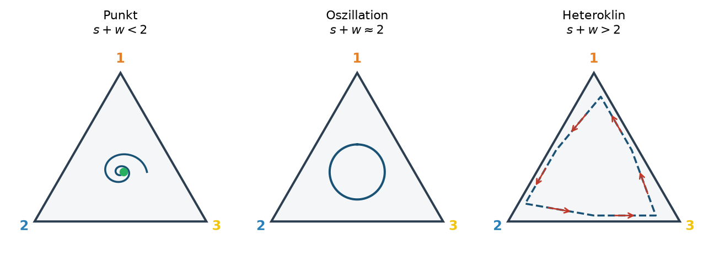

```{r}
#| include: false
source("../slides-ggplot.R")

selektion <- function(p, s) p * (1 + s) / (1 + p * s)

simuliere_bahn <- function(s, N, jahre = 4, zufall = TRUE) {
  p <- numeric(jahre + 1)
  p[1] <- 0.5
  for (t in seq_len(jahre)) {
    p_sel <- selektion(p[t], s)
    p[t + 1] <- if (zufall) rbinom(1, N, p_sel) / N else p_sel
  }
  data.frame(jahr = 0:jahre, p = p)
}

wolke <- function(s, N, n_bahnen = 100, seed = 9) {
  set.seed(seed)
  do.call(rbind, lapply(seq_len(n_bahnen), function(i)
    cbind(simuliere_bahn(s, N), id = i)))
}

teiche <- read.csv("data/pond-chrxi.csv")
names(teiche)[1:2] <- c("teich", "jahr")
teiche$teich <- factor(paste("Teich", teiche$teich), levels = c("Teich 2", "Teich 7", "Teich 14"))
teich_farben <- c("Teich 2" = "#e67e22", "Teich 7" = "#2980b9", "Teich 14" = "#1e8449")

# Farben für Genkopien: Süsswasser blau, Meer weiss; Erwartung rot
col_suess <- "#2980b9"
col_erw <- "#c0392b"

zeige_wolke <- function(w, titel, ohne_zufall = NULL) {
  band <- aggregate(p ~ jahr, w, function(x) quantile(x, c(0.025, 0.975)))
  band <- data.frame(jahr = band$jahr, lo = band$p[, 1], hi = band$p[, 2])
  g <- ggplot() +
    geom_ribbon(data = band, aes(jahr, ymin = lo, ymax = hi),
                fill = "#d5d8dc", alpha = 0.8) +
    geom_line(data = w, aes(jahr, p, group = id),
              colour = "#95a5a6", linewidth = 0.25, alpha = 0.5)
  if (!is.null(ohne_zufall))
    g <- g + geom_line(data = ohne_zufall, aes(jahr, p),
                       colour = col_erw, linewidth = 1.2, linetype = "dashed")
  g +
    geom_line(data = teiche, aes(jahr, p, colour = teich), linewidth = 1.1) +
    geom_point(data = teiche, aes(jahr, p, colour = teich, shape = teich), size = 2.6) +
    scale_colour_manual(values = teich_farben) +
    scale_shape_manual(values = c(16, 17, 15)) +
    coord_cartesian(ylim = c(0.3, 0.9)) +
    labs(x = "Jahr", y = "Frequenz Süsswasser-Inversion", title = titel) +
    theme_slide()
}

# Hülle: in jedem Jahr das 2.5- und das 97.5-Perzentil aller Bahnen
huelle <- function(s, N, n_bahnen = 1000, seed = 9) {
  b <- aggregate(p ~ jahr, wolke(s, N, n_bahnen, seed),
                 function(x) quantile(x, c(0.025, 0.975)))
  data.frame(jahr = b$jahr, lo = b$p[, 1], hi = b$p[, 2])
}

teich_schichten <- list(
  geom_line(data = teiche, aes(jahr, p, colour = teich), linewidth = 1.1),
  geom_point(data = teiche, aes(jahr, p, colour = teich, shape = teich), size = 2.6),
  scale_colour_manual(values = teich_farben),
  scale_shape_manual(values = c(16, 17, 15))
)

# Kreis als Pfad (für Genpool-Skizzen)
kreis <- function(r = 1, x0 = 0, y0 = 0, n = 200) {
  a <- seq(0, 2 * pi, length.out = n)
  data.frame(x = x0 + r * cos(a), y = y0 + r * sin(a))
}
```

## Übersicht

**Woche 9** von 14 · **Do., 12. Nov. 2026, 08:15–10:00**

| Teil | Dauer | Was |
|------|-------|-----|
| Vorlesung | ~50 min | ein Teichexperiment · Erwartung und Zufall · Zufall in R · die neutrale Wolke |
| Notebook | ~40 min | neutrales Allel und $N$ · die Teiche · Echsen mit endlichem $N$ |

::: aside
Pfeiltasten · **M** Menü · **E** PDF · **Esc** Übersicht
:::

## Bis jetzt: kein Zufall

Wochen 5–8: Aus $p$ und $s$ folgte **genau ein** nächstes $p$.

Echte Populationen sind **endlich**. Wer wie viele Nachkommen hat, ist auch **Glück**.

## Lernziele

Nach heute können Sie …

1. den **Verlauf** von $p$ in drei Teichen lesen,
2. das Modell aus Woche 6 als **Erwartung** lesen und Zufall **um** diese Erwartung herum einbauen,
3. begründen, warum eine neue Generation eine **Binomial-Ziehung** ist,
4. Zufall in R **ziehen** (`sample`, `set.seed`, `rbinom`),
5. die Teiche mit vielen simulierten Bahnen **ohne** Selektion vergleichen (der **neutralen Wolke**).

# Ein Teichexperiment

## Stichlinge, wie in Woche 7

::::: columns
::: {.column width="50%"}
{fig-alt="Dreistachliger Stichling" width="100%"}
:::
::: {.column width="50%"}
Meer- und Süsswasser-Stichlinge unterscheiden sich an wenigen Stellen im Genom stark.

Eine davon: eine **Inversion** auf **Chromosom XI**. Im Süsswasser ist meist die eine Orientierung häufig, im Meer die andere.
:::
:::::

::: aside
Foto: Wikimedia Commons, *Gasterosteus aculeatus* · Jones et al. (2012)
:::

## Ein Teich

{fig-alt="Süsswasserteich" width="100%"}

::: aside
Foto: Marius Roesti
:::

## Die Forscherin

::::: columns
::: {.column width="35%"}
{fig-alt="Katie Peichel" width="100%"}
:::
::: {.column width="65%"}
**Katie Peichel** (Universität Bern) und **Dolph Schluter** (UBC, Vancouver) fragen:

> Steht die Süsswasser-Orientierung im Süsswasser unter **Selektion**?

Statt nur Genome zu vergleichen, machen sie ein **Experiment**.
:::
:::::

::: aside
Foto: Universität Bern
:::

## Zwanzig Teiche in Vancouver

::::: columns
::: {.column width="52%"}
{fig-alt="UBC-Teichanlage von oben" width="100%"}
:::
::: {.column width="48%"}
- 20 Teiche, 25 m × 15 m
- flache Zone und 6 m Tiefe
- natürliches Futter
- **keine Fischräuber**
:::
:::::

::: aside
Satellitenbild: Folien Katie Peichel / Google
:::

## Schritt 1: marine Fische fangen

::::: columns
::: {.column width="50%"}
{fig-alt="Fang in der Oyster Lagoon" width="100%"}
:::
::: {.column width="50%"}
{fig-alt="Marine Stichlinge im Kescher" width="100%"}
:::
:::::

2022, **Oyster Lagoon** (Meer).

::: aside
Fotos: Peichel- und Schluter-Labore
:::

## Schritt 2: Heterozygote finden

::::: columns
::: {.column width="50%"}
{fig-alt="Becken mit Bechern, jeder Becher ein Fisch" width="100%"}
:::
::: {.column width="50%"}
{fig-alt="Notizen zu den Genotypen" width="100%"}
:::
:::::

**1152 Fische in 12 Tagen**, jeder in einem eigenen Becher. Ein Stück Flosse, eine **PCR**: Welche Orientierung trägt der Fisch?

::: aside
Fotos: Peichel- und Schluter-Labore. Gesucht wurde für drei Inversionen; wir schauen nur Chromosom XI an.
:::

## Warum $p_0 = 0.5$?

```{r}
#| fig-height: 2.6
#| fig-width: 8.4
#| out-width: 88%
fische <- expand.grid(fisch = 1:4, kopie = 1:2)
fische$orient <- ifelse(fische$kopie == 1, "Süsswasser", "Meer")
ggplot(fische, aes(fisch, -kopie * 0.35)) +
  geom_tile(aes(fill = orient), width = 0.75, height = 0.22, colour = "grey30") +
  scale_fill_manual(values = c("Süsswasser" = col_suess, "Meer" = "white")) +
  annotate("text", x = 1:4, y = -1.05, label = paste("Fisch", 1:4), size = 4.5) +
  annotate("text", x = 5.3, y = -0.52, size = 6, hjust = 0,
           label = "4 von 8 Kopien\np0 = 0.5") +
  coord_cartesian(xlim = c(0.5, 7), ylim = c(-1.2, 0)) +
  theme_void(base_size = 14) +
  theme(legend.position = "top", legend.title = element_blank())
```

In die Teiche kommen nur **Heterozygote**: eine Kopie jeder Orientierung. Etwa 25 pro Teich, die gefangenen Fische selbst.

## Schritt 3: ab in die Teiche

::::: columns
::: {.column width="50%"}
{fig-alt="Fische werden in den Teich gesetzt" width="100%"}
:::
::: {.column width="50%"}
{fig-alt="Schild Teich 2 Chromosom XI" width="100%"}
:::
:::::

Drei Teiche: 2, 7 und 14. Rechts das Schild an Teich 2.

::: aside
Fotos: Peichel- und Schluter-Labore
:::

## Schritt 4: jedes Frühjahr Proben

::::: columns
::: {.column width="50%"}
{fig-alt="Fang am Teichrand" width="100%"}
:::
::: {.column width="50%"}
{fig-alt="Proben werden genommen" width="100%"}
:::
:::::

Die Fische pflanzen sich im Teich fort. 2023 bis 2026 wird jedes Frühjahr eine Stichprobe genotypisiert: rund 15 000 PCRs.

::: aside
Fotos: Peichel- und Schluter-Labore
:::

## Das Experiment auf einen Blick

```{r}
#| fig-height: 2.3
#| fig-width: 8
#| out-width: 100%
schritte <- data.frame(
  x = c(1, 2.25, 3.5, 4.75),
  label = c("2022\nFang im Meer",
            "1152 Fische\nper PCR\ngenotypisiert",
            "je ~25 Heterozygote\nin Teich 2, 7, 14\np0 = 0.5",
            "2023 bis 2026\njedes Frühjahr\neine Stichprobe"))
ggplot(schritte, aes(x, 0)) +
  geom_segment(data = schritte[1:3, ], aes(x = x + 0.5, xend = x + 0.75, y = 0, yend = 0),
               arrow = arrow(length = unit(0.25, "cm")), colour = "grey40", linewidth = 0.8) +
  geom_label(aes(label = label), size = 4.6, label.padding = unit(0.45, "lines"),
             fill = "#eaf2fb", colour = "#1a5276", lineheight = 0.95) +
  coord_cartesian(xlim = c(0.45, 5.3), ylim = c(-0.6, 0.6)) +
  theme_void()
```

Gemessen wird $p$ = Anteil der **Süsswasser-Orientierung** unter allen untersuchten Kopien. Teich 2 und 14: 35–232 Fische pro Jahr, Teich 7 nur 7–36.

## Drei Teiche

```{r}
#| fig-height: 3.5
#| fig-width: 8.4
#| out-width: 92%
ggplot(teiche, aes(jahr, p, colour = teich, shape = teich)) +
  geom_hline(yintercept = 0.5, colour = "#bdc3c7", linetype = "dashed") +
  geom_line(linewidth = 1.1) +
  geom_point(size = 2.8) +
  scale_colour_manual(values = teich_farben) +
  scale_shape_manual(values = c(16, 17, 15)) +
  coord_cartesian(ylim = c(0.3, 0.9)) +
  labs(x = "Jahr", y = "Frequenz Süsswasser-Inversion") +
  theme_slide()
```

Gleicher Start, drei verschiedene **Verläufe** von $p$. Einen Verlauf nennen wir ab jetzt eine **Bahn**.

## Was fällt auf?

1. **Alle steigen.** Das erwartet man bei positiver Selektion.
2. **Trotzdem verschieden.** Mit den Modellen aus Woche 5–8 unmöglich: gleicher Start, gleiches $s$, gleiche Bahn.
3. **Warum?** Zufall in einer endlichen Population? Kleine Stichproben? Echte Unterschiede zwischen den Teichen?

## Die Frage

> Steigt die Süsswasser-Orientierung, weil sie im Teich **im Vorteil** ist?
> Oder kann das auch **Zufall** sein?

Dafür müssen wir wissen: Wie stark kann sich $p$ in vier Jahren **allein durch Zufall** verändern?

# Erwartung und Zufall

## Woher kommt der Zufall?

| Wo | Was ist Zufall? |
|---|---|
| **Überleben** | Ein Reiher erwischt zufällig mehr Fische einer Orientierung. |
| **Fortpflanzung** | Ein Fisch hat 50 Junge, ein anderer keines. |
| **Vererbung** | Welche Kopie ein Heterozygoter weitergibt: ein Münzwurf (Mendel). |

Keiner davon hat eine **Richtung**. Im Mittel bleibt $p$ gleich, aber es **schwankt**, umso stärker, je kleiner die Population.

## Zufall in einer kleinen Population

```{r}
#| fig-height: 3.1
#| fig-width: 8.4
#| out-width: 92%
set.seed(4)
N_klein <- 10
gen <- list(c(rep(1, 5), rep(0, 5)))
for (t in 2:5) gen[[t]] <- sample(gen[[t - 1]], N_klein, replace = TRUE)
kugeln <- do.call(rbind, lapply(1:5, function(t)
  data.frame(generation = t - 1, platz = 1:N_klein, allel = sort(gen[[t]], decreasing = TRUE))))
anteil <- aggregate(allel ~ generation, kugeln, mean)
ggplot(kugeln, aes(platz, -generation)) +
  geom_point(aes(fill = factor(allel)), shape = 21, size = 8, colour = "grey30") +
  scale_fill_manual(values = c("0" = "white", "1" = col_suess), guide = "none") +
  geom_text(data = anteil, aes(x = 11.5, y = -generation,
                               label = paste0("p = ", allel)), size = 5, hjust = 0) +
  scale_y_continuous(breaks = -(0:4), labels = paste("Generation", 0:4)) +
  coord_cartesian(xlim = c(0.5, 13)) +
  theme_void(base_size = 14) +
  theme(axis.text.y = element_text(hjust = 1))
```

10 Genkopien, **keine Selektion**. Jede Generation wird zufällig aus der vorherigen gezogen. $p$ ändert sich trotzdem: **genetische Drift**.

## Die Idee: Modell = Erwartung

```{r}
#| fig-height: 3.4
#| fig-width: 9
#| out-width: 96%
set.seed(12)
p_alt <- 0.5; p_erw <- 0.6; N_bsp <- 50
z <- as.data.frame(table(rbinom(3000, N_bsp, p_erw) / N_bsp))
z$p <- as.numeric(as.character(z$Var1))
z$breite <- z$Freq / max(z$Freq) * 0.55

skizze <- function(mit_zufall, titel) {
  g <- ggplot() +
    annotate("segment", x = 0, xend = 0.97, y = p_alt, yend = p_erw, colour = col_erw,
             linewidth = 1.1, arrow = arrow(length = unit(0.28, "cm")))
  if (mit_zufall)
    g <- g + geom_rect(data = z, aes(xmin = 1.03, xmax = 1.03 + breite,
                                     ymin = p - 0.008, ymax = p + 0.008), fill = "#95a5a6") +
      annotate("text", x = 1.35, y = 0.84, label = "mögliche neue p", size = 4.3, colour = "#5d6d7e")
  g +
    annotate("point", x = 0, y = p_alt, size = 4, colour = "#2c3e50") +
    annotate("point", x = 1, y = p_erw, size = 4, colour = col_erw) +
    annotate("text", x = 0, y = p_alt - 0.06, label = "p = 0.5", size = 4.5) +
    annotate("text", x = 0.95, y = p_erw + 0.06, label = "Erwartung p'", size = 4.5,
             colour = col_erw, hjust = 1) +
    scale_x_continuous(breaks = c(0, 1), labels = c("Generation t", "t + 1")) +
    coord_cartesian(xlim = c(-0.2, 1.7), ylim = c(0.3, 0.9)) +
    labs(x = NULL, y = "Frequenz", title = titel) +
    theme_slide()
}
skizze(FALSE, "Woche 6: genau ein nächstes p") +
  skizze(TRUE, "Heute: Zufall um die Erwartung")
```

Selektion bestimmt, **wohin** $p$ im Mittel geht. Der Zufall **streut** um diesen Wert.

## Eine Generation ist eine Ziehung

```{r}
#| fig-height: 2.9
#| fig-width: 8
#| out-width: 100%
gitter <- expand.grid(x = seq(-0.9, 0.9, by = 0.3), y = seq(-0.9, 0.9, by = 0.3))
gitter <- gitter[gitter$x^2 + gitter$y^2 < 0.85, ]
set.seed(3)
gitter$suess <- seq_len(nrow(gitter)) %in% sample(nrow(gitter), round(0.6 * nrow(gitter)))
neu <- data.frame(x = 3.5 + rep(0:4, 2) * 0.32, y = rep(c(0.2, -0.2), each = 5),
                  suess = c(TRUE, TRUE, FALSE, TRUE, TRUE, FALSE, TRUE, TRUE, FALSE, TRUE))
ggplot() +
  geom_path(data = kreis(1.1), aes(x, y), colour = "#2c3e50", linewidth = 0.8) +
  geom_point(data = gitter, aes(x, y, fill = suess), shape = 21, size = 5, colour = "grey30") +
  geom_point(data = neu, aes(x, y, fill = suess), shape = 21, size = 7, colour = "grey30") +
  scale_fill_manual(values = c("TRUE" = col_suess, "FALSE" = "white"), guide = "none") +
  annotate("segment", x = 1.35, xend = 3.1, y = 0, yend = 0, colour = "grey40",
           linewidth = 0.9, arrow = arrow(length = unit(0.3, "cm"))) +
  annotate("text", x = 2.22, y = 0.32, label = "N = 10 Mal ziehen", size = 5.5) +
  annotate("text", x = 0, y = -1.45, label = "Genpool nach Selektion: p' = 0.6", size = 5.5) +
  annotate("text", x = 4.14, y = -0.75, label = "neu: X = 7 von 10", size = 5.5) +
  coord_equal(xlim = c(-1.3, 5.3), ylim = c(-1.6, 1.15)) +
  theme_void()
```

- Jede neue Kopie stammt von einer **zufällig gezogenen** Kopie aus dem Genpool.
- Jede Ziehung ist **unabhängig** und ist mit Wahrscheinlichkeit $p'$ eine Süsswasser-Kopie.

## Warum binomial?

$N$ unabhängige Versuche, jeder mit derselben Wahrscheinlichkeit $p'$. Wir zählen die Treffer $X$.

Genau das beschreibt die **Binomialverteilung**:

$$
X \sim \mathrm{Binomial}(N,\ p')
$$

Annahmen: $N$ ist fix, die Generationen überlappen nicht, Kopien werden unabhängig gezogen.

Das ist das **Wright–Fisher-Modell**, das Standardmodell für Drift.

## Zufall im Computer

`sample` zieht zufällig aus einer Liste:

```{r}
#| echo: true
sample(c("Kopf", "Zahl"), size = 10, replace = TRUE)
sample(c("Kopf", "Zahl"), size = 10, replace = TRUE)
```

Zweimal derselbe Befehl, zweimal ein anderes Ergebnis.

## Pseudo-Zufall und `set.seed`

Ein Computer würfelt nicht: Er **berechnet** Zahlen, die zufällig aussehen. `set.seed` legt den Startwert fest:

```{r}
#| echo: true
set.seed(1); sample(c("Kopf", "Zahl"), size = 10, replace = TRUE)
set.seed(1); sample(c("Kopf", "Zahl"), size = 10, replace = TRUE)
```

Gleicher Seed, gleiche Zahlen. So lässt sich ein Ergebnis **genau wiederholen**.

## Von Münzen zu Genkopien: `rbinom`

250 Münzwürfe mit Wahrscheinlichkeit 0.6, und wir zählen nur die Treffer. Das macht `rbinom` in einem Schritt:

```{r}
#| echo: true
set.seed(2)
rbinom(10, size = 250, prob = 0.6)
```

Zehn mögliche neue Generationen. Im Mittel $250 \times 0.6 = 150$, aber selten genau 150.

## Erwartung und Streuung

```{r}
#| fig-height: 3.2
#| fig-width: 8.4
#| out-width: 92%
set.seed(5)
schwank <- do.call(rbind, lapply(c(25, 250, 2500), function(N)
  data.frame(N = paste("N =", N), p = rbinom(1000, N, 0.6) / N)))
schwank$N <- factor(schwank$N, levels = paste("N =", c(25, 250, 2500)))
ggplot(schwank, aes(p)) +
  geom_histogram(binwidth = 0.02, boundary = 0, fill = "#95a5a6", colour = "white") +
  geom_vline(xintercept = 0.6, colour = col_erw, linewidth = 1.1) +
  facet_wrap(~ N) +
  coord_cartesian(xlim = c(0.3, 0.9)) +
  labs(x = "p in der neuen Generation", y = "Anzahl",
       title = "Je 1000 Ziehungen; rot: Erwartung p' = 0.6") +
  theme_slide()
```

Der **Mittelwert** ist $p'$: das Modell. Die **Streuung** ist etwa $\sqrt{p'(1-p')/N}$. Zehnmal mehr Kopien, rund dreimal weniger Streuung.

## Ein Schritt in R

::::: columns
::: {.column width="45%"}
$$
p' = \frac{p\,(1+s)}{1+p\,s}
$$

$$
X \sim \mathrm{Binomial}(N,\ p')
$$

$$
p_{t+1} = X / N
$$
:::
::: {.column width="55%"}
```r
# 1. Erwartung: Selektion (Woche 6)
p_strich <- selektion(p, s)

# 2. Zufall: N Kopien ziehen
X <- rbinom(1, N, p_strich)

# 3. neue Frequenz
p_neu <- X / N
```
:::
:::::

Selektion gibt die **Richtung**, die Ziehung das **Rauschen**. Viermal wiederholt: **eine** mögliche Bahn.

## Drift über viele Generationen

```{r}
#| fig-height: 3.2
#| fig-width: 8.4
#| out-width: 92%
set.seed(8)
drift <- do.call(rbind, lapply(1:8, function(i) {
  p <- numeric(61); p[1] <- 0.5
  for (t in 1:60) p[t + 1] <- rbinom(1, 25, p[t]) / 25
  data.frame(generation = 0:60, p = p, id = i)
}))
ggplot(drift, aes(generation, p, group = id)) +
  geom_line(colour = "#7f8c8d", linewidth = 0.8) +
  geom_hline(yintercept = 0.5, colour = col_erw, linewidth = 1.1, linetype = "dashed") +
  annotate("label", x = 52, y = 0.5, label = "Erwartung: 0.5", colour = col_erw, size = 4.2) +
  labs(x = "Generation", y = "Frequenz", title = "8 Bahnen ohne Selektion, N = 25") +
  theme_slide()
```

Die Erwartung bleibt bei 0.5, die Bahnen nicht. Bei 0 oder 1 ist Schluss: Die Variante ist **verloren** oder **fixiert**.

## Woher das Modell kommt

| | |
|---|---|
| [Fisher (1922)](https://doi.org/10.1017/S0370164600023993) | erste Rechnung zum Zufall beim Vererben in endlichen Populationen |
| [Wright (1931)](https://doi.org/10.1093/genetics/16.2.97) | dieselbe Ziehung; wie stark Drift von $N$ abhängt |
| [Kimura (1955)](https://doi.org/10.1073/pnas.41.3.144) | eine Formel für die ganze Wolke (Diffusion) |
| [Moran (1958)](https://doi.org/10.1017/S0305004100033193) | Variante mit überlappenden Generationen |
| [Ewens (2004)](https://doi.org/10.1007/978-0-387-21822-9) | Lehrbuch zur Mathematik |

Heute nur die Idee, die Mathematik folgt später im Studium. Lesetipp zur Geschichte: [Charlesworth (2022)](https://doi.org/10.1093/genetics/iyac006).

# Die Teiche und der Zufall

## Eine Bahn sagt wenig

```{r}
#| fig-height: 3.4
#| fig-width: 8.4
#| out-width: 92%
set.seed(3)
bahnen <- do.call(rbind, lapply(1:3, function(i) cbind(simuliere_bahn(0, 250), id = factor(i))))
ggplot(bahnen, aes(jahr, p, group = id)) +
  geom_hline(yintercept = 0.5, colour = col_erw, linetype = "dashed") +
  geom_line(colour = "#7f8c8d", linewidth = 1) +
  geom_point(colour = "#7f8c8d", size = 2) +
  coord_cartesian(ylim = c(0.3, 0.9)) +
  labs(x = "Jahr", y = "Frequenz", title = "Drei Bahnen ohne Selektion, N = 250") +
  theme_slide()
```

Gleicher Start, gleiches Modell, $s = 0$, und jede Bahn ist anders.

## Viele Bahnen: die neutrale Wolke

```{r}
#| fig-height: 3.5
#| fig-width: 8.4
#| out-width: 92%
zeige_wolke(wolke(0, 250), "100 Bahnen ohne Selektion (s = 0, N = 250) und die Teiche")
```

Grau: Hier liegen in jedem Jahr 95 von 100 Bahnen **ohne Selektion**. Teich 7 liegt deutlich **darüber**, Teich 2 und 14 am Ende knapp.

## Von der Wolke zur Hülle

```{r}
#| fig-height: 3.4
#| fig-width: 9
#| out-width: 96%
w100 <- wolke(0, 250)
h0 <- huelle(0, 250)
links <- ggplot() +
  geom_ribbon(data = h0, aes(jahr, ymin = lo, ymax = hi), fill = "#d5d8dc", alpha = 0.8) +
  geom_line(data = w100, aes(jahr, p, group = id), colour = "#7f8c8d",
            linewidth = 0.25, alpha = 0.5) +
  coord_cartesian(ylim = c(0.3, 0.9)) +
  labs(x = "Jahr", y = "Frequenz", title = "100 Bahnen") +
  theme_slide()
rechts <- ggplot() +
  geom_ribbon(data = h0, aes(jahr, ymin = lo, ymax = hi), fill = "#d5d8dc") +
  geom_line(data = h0, aes(jahr, lo), colour = "#7f8c8d") +
  geom_line(data = h0, aes(jahr, hi), colour = "#7f8c8d") +
  annotate("text", x = 3.3, y = 0.5, label = "95 %", size = 5, colour = "#5d6d7e") +
  coord_cartesian(ylim = c(0.3, 0.9)) +
  labs(x = "Jahr", y = NULL, title = "nur die Hülle (aus 1000 Bahnen)") +
  theme_slide()
links + rechts
```

Für jedes Jahr: Zwischen welchen Werten liegen 95 % der Bahnen? Diese **Hülle** reicht für den Vergleich mit den Daten.

## Die Hülle hängt von $N$ ab

```{r}
#| fig-height: 3.5
#| fig-width: 8.4
#| out-width: 92%
hN <- do.call(rbind, lapply(c(25, 250, 2500), function(N)
  cbind(huelle(0, N), N = factor(paste("N =", N), levels = paste("N =", c(25, 250, 2500))))))
ggplot() +
  geom_ribbon(data = hN, aes(jahr, ymin = lo, ymax = hi, fill = N), alpha = 0.9) +
  scale_fill_manual(values = c("#eaecee", "#bfc9ca", "#7f8c8d"), name = NULL) +
  teich_schichten +
  coord_cartesian(ylim = c(0.1, 0.95)) +
  labs(x = "Jahr", y = "Frequenz Süsswasser-Inversion",
       title = "95-%-Hüllen ohne Selektion und die Teiche") +
  theme_slide() +
  guides(fill = guide_legend(order = 1), colour = guide_legend(order = 2),
         shape = guide_legend(order = 2))
```

Kleine Population, breite Hülle. Mit $N = 25$ reicht Zufall für fast alle Teichwerte. In jedem Teich leben aber **Hunderte** Fische.

## Wolke mit Selektion

```{r}
#| fig-height: 3.5
#| fig-width: 8.4
#| out-width: 92%
zeige_wolke(wolke(0.2, 250, seed = 11),
            "100 Bahnen mit s = 0.2; rot: Erwartung (Modell ohne Zufall)",
            ohne_zufall = simuliere_bahn(0.2, 250, zufall = FALSE))
```

Die Wolke liegt um die **Erwartung**. Teich 2 und 14 liegen **in** der Wolke, Teich 7 darüber, bei nur 7–36 Fischen pro Jahr.

## Zwei Hüllen, ein Bild

```{r}
#| fig-height: 3.5
#| fig-width: 8.4
#| out-width: 92%
h2 <- rbind(cbind(huelle(0, 250), modell = "ohne Selektion (s = 0)"),
            cbind(huelle(0.2, 250, seed = 11), modell = "mit Selektion (s = 0.2)"))
erw <- rbind(cbind(simuliere_bahn(0, 250, zufall = FALSE), modell = "ohne Selektion (s = 0)"),
             cbind(simuliere_bahn(0.2, 250, zufall = FALSE), modell = "mit Selektion (s = 0.2)"))
ggplot() +
  geom_ribbon(data = h2, aes(jahr, ymin = lo, ymax = hi, fill = modell), alpha = 0.35) +
  geom_line(data = erw[erw$modell == "ohne Selektion (s = 0)", ], aes(jahr, p),
            colour = "#5d6d7e", linewidth = 0.9, linetype = "dashed") +
  geom_line(data = erw[erw$modell == "mit Selektion (s = 0.2)", ], aes(jahr, p),
            colour = col_erw, linewidth = 0.9, linetype = "dashed") +
  scale_fill_manual(values = c("ohne Selektion (s = 0)" = "#7f8c8d",
                               "mit Selektion (s = 0.2)" = col_erw), name = NULL) +
  teich_schichten +
  coord_cartesian(ylim = c(0.3, 0.9)) +
  labs(x = "Jahr", y = "Frequenz Süsswasser-Inversion",
       title = "95-%-Hüllen, N = 250; gestrichelt: Erwartung") +
  theme_slide() +
  guides(fill = guide_legend(order = 1, nrow = 1), colour = "none", shape = "none")
```

Jede Hülle liegt um **ihre** Erwartung. Teich 2 und 14 passen besser zur roten Hülle, Teich 7 liegt über beiden.

## Ein zweiter Zufall: die Stichprobe

Auch die Messung ist eine Ziehung. Wahre Frequenz 0.6:

```{r}
#| echo: true
set.seed(3)
rbinom(8, size = 20, prob = 0.6) / 20    # 10 Fische = 20 Kopien
rbinom(8, size = 200, prob = 0.6) / 200  # 100 Fische = 200 Kopien
```

Mit 10 Fischen misst man leicht 0.5 oder 0.75. So lässt sich eine **beobachtete** Häufigkeit einordnen.

## Was das Bild sagt, und was nicht

- Zufall **allein** erklärt die Teiche schlecht.
- Selektion **plus** Zufall passt, auch dazu, dass die Teiche verschieden sind.
- Das ist **kein Beweis** und kein statistischer Test.

Peichel und Schluter schätzen mit einem diploiden Modell eine starke Selektion. Unser einfaches Modell passt dazu: Die Süsswasser-Orientierung ist im Teich **im Vorteil**.

# Abschluss

## Take-home

1. Das Modell aus Woche 6 gibt die **Erwartung**. Der Zufall streut um sie herum.
2. Eine neue Generation = $N$ unabhängige Ziehungen: **Binomial**$(N, p')$, in R `rbinom`.
3. Kleine $N$: starke Schwankung, **Drift**. Bei 0 oder 1 ist Schluss.
4. Viele Bahnen ergeben eine **Wolke**. Daten **ausserhalb** der neutralen Wolke sprechen für Selektion.
5. Auch die Stichprobe ist eine Ziehung.

## Erinnerung: das Echsen-Spiel

{width=90% fig-alt="Drei Dreiecke: Punkt, Oszillation, Heterokline"}

Auf der **Heterokline** wird jede Farbe abwechselnd häufig und dann fast null. Im Notebook: Was passiert, wenn «fast null» **null** wird?

## Notebook (~40 min)

**→ [Notebook Woche 9 öffnen](notebook.html)** · [Rmd](notebook.Rmd) · [R](notebook.R)

1. `rbinom` und `set.seed`: eine Verteilung anschauen
2. Neutrales Allel: grosse und kleine Population, dann zurück zu den Teichen
3. Echsen aus Woche 4 mit endlicher Population: Wann gehen Kehlfarben verloren?

## Abschlussfragen

1. Warum startet das Experiment bei $p = 0.5$?
2. Was ändert `set.seed` an einer Abbildung, und was nicht?
3. Warum ist die Zahl der Süsswasser-Kopien binomialverteilt? Welche Annahmen stecken darin?
4. Wo sitzt die Erwartung im Generationsschritt, und wo der Zufall?
5. Warum reicht **eine** neutrale Bahn nicht, um die Teiche zu beurteilen?
6. Warum schwankt Teich 7 stärker als Teich 2?

## Ausblick · Woche 10

Heute startete die Inversion bei $p = 0.5$: viele Kopien.

Eine **neue** Mutation beginnt mit **einer** Kopie. Dann entscheidet der Zufall, ob sie überhaupt überlebt, auch wenn sie vorteilhaft ist.

## Literatur

:::: {.lit}
1. **Peichel, C. L., et al. (2001).** The genetic architecture of divergence between threespine stickleback species. *Nature* 414: 901–905. [doi:10.1038/414901a](https://doi.org/10.1038/414901a)
1. **Jones, F. C., et al. (2012).** The genomic basis of adaptive evolution in threespine sticklebacks. *Nature* 484: 55–61. [doi:10.1038/nature10944](https://doi.org/10.1038/nature10944)
1. **Peichel, C. L., & Marques, D. A. (2017).** The genetic and molecular architecture of phenotypic diversity in sticklebacks. *Phil. Trans. R. Soc. B* 372: 20150486. [doi:10.1098/rstb.2015.0486](https://doi.org/10.1098/rstb.2015.0486)
1. **Barrett, R. D. H., Rogers, S. M., & Schluter, D. (2008).** Natural selection on a major armor gene in threespine stickleback. *Science* 322: 255–257. [doi:10.1126/science.1159978](https://doi.org/10.1126/science.1159978)
1. **Fisher, R. A. (1922).** On the dominance ratio. *Proc. R. Soc. Edinburgh* 42: 321–341. [doi:10.1017/S0370164600023993](https://doi.org/10.1017/S0370164600023993)
1. **Wright, S. (1931).** Evolution in Mendelian populations. *Genetics* 16: 97–159. [doi:10.1093/genetics/16.2.97](https://doi.org/10.1093/genetics/16.2.97)
1. **Kimura, M. (1955).** Solution of a process of random genetic drift with a continuous model. *PNAS* 41: 144–150. [doi:10.1073/pnas.41.3.144](https://doi.org/10.1073/pnas.41.3.144)
1. **Moran, P. A. P. (1958).** Random processes in genetics. *Math. Proc. Camb. Phil. Soc.* 54: 60–71. [doi:10.1017/S0305004100033193](https://doi.org/10.1017/S0305004100033193)
1. **Ewens, W. J. (2004).** *Mathematical Population Genetics I.* 2. Aufl. Springer. [doi:10.1007/978-0-387-21822-9](https://doi.org/10.1007/978-0-387-21822-9)
1. **Charlesworth, B. (2022).** Fisher's historic 1922 paper *On the dominance ratio*. *Genetics* 220: iyac006. [doi:10.1093/genetics/iyac006](https://doi.org/10.1093/genetics/iyac006)

Teichdaten Chr XI: Katie Peichel (Bern) und Dolph Schluter (UBC), unveröffentlicht, mit freundlicher Genehmigung. Fotos: Marius Roesti; Peichel- und Schluter-Labore; Universität Bern (Porträt).
::::

## Navigation

| | |
|---|---|
| Notebook | [Quarto](notebook.html) · [Rmd](notebook.Rmd) · [R](notebook.R) |
| Zurück | [← Woche 8](../week-08/slides.html) |
| Weiter | [Woche 10 →](../week-10/slides.html) |
| Modul | [Modul 3](../../docs/module-03-overview.html) |
