```{r}
#| include: false
source("../slides-ggplot.R")

selektion <- function(p, s) p * (1 + s) / (1 + p * s)

simuliere_bahn <- function(s, N, jahre = 4, zufall = TRUE) {
  p <- numeric(jahre + 1)
  p[1] <- 0.5
  for (t in seq_len(jahre)) {
    p_sel <- selektion(p[t], s)
    p[t + 1] <- if (zufall) rbinom(1, N, p_sel) / N else p_sel
  }
  data.frame(jahr = 0:jahre, p = p)
}

wolke <- function(s, N, n_bahnen = 100, seed = 9) {
  set.seed(seed)
  do.call(rbind, lapply(seq_len(n_bahnen), function(i)
    cbind(simuliere_bahn(s, N), id = i)))
}

teiche <- read.csv("data/pond-chrxi.csv")
names(teiche)[1:2] <- c("teich", "jahr")
teiche$teich <- factor(paste("Teich", teiche$teich), levels = c("Teich 2", "Teich 7", "Teich 14"))
teich_farben <- c("Teich 2" = "#e67e22", "Teich 7" = "#2980b9", "Teich 14" = "#1e8449")

zeige_wolke <- function(w, titel, ohne_zufall = NULL) {
  band <- aggregate(p ~ jahr, w, function(x) quantile(x, c(0.05, 0.95)))
  band <- data.frame(jahr = band$jahr, lo = band$p[, 1], hi = band$p[, 2])
  g <- ggplot() +
    geom_ribbon(data = band, aes(jahr, ymin = lo, ymax = hi),
                fill = "#d5d8dc", alpha = 0.8) +
    geom_line(data = w, aes(jahr, p, group = id),
              colour = "#95a5a6", linewidth = 0.25, alpha = 0.5)
  if (!is.null(ohne_zufall))
    g <- g + geom_line(data = ohne_zufall, aes(jahr, p),
                       colour = "#c0392b", linewidth = 1.2)
  g +
    geom_line(data = teiche, aes(jahr, p, colour = teich), linewidth = 1.1) +
    geom_point(data = teiche, aes(jahr, p, colour = teich, shape = teich), size = 2.6) +
    scale_colour_manual(values = teich_farben) +
    scale_shape_manual(values = c(16, 17, 15)) +
    coord_cartesian(ylim = c(0.3, 0.9)) +
    labs(x = "Jahr", y = "Frequenz Süsswasser-Inversion", title = titel) +
    theme_slide()
}
```

## Übersicht

**Woche 9** von 14 · **Do., 12. Nov. 2026, 08:15–10:00**

| Teil | Dauer | Was |
|------|-------|-----|
| Vorlesung | ~50 min | ein Teichexperiment · Zufall in R · Drift · die neutrale Wolke |
| Notebook | ~40 min | neutrales Allel und $N$ · die Teiche · Echsen mit endlichem $N$ |

::: aside
Pfeiltasten · **M** Menü · **E** PDF · **Esc** Übersicht
:::

## Bis jetzt: kein Zufall

Wochen 5–8: Aus $p$ und $s$ folgte **genau ein** nächstes $p$.

Echte Populationen sind **endlich**. Wer wie viele Nachkommen hat, ist auch **Glück**.

Heute: Was ändert das — und wie erkennt man trotzdem Selektion?

## Lernziele

Nach heute können Sie …

1. den **Verlauf** von $p$ in drei Teichen lesen: alle steigen, und trotzdem verschieden,
2. Zufallszahlen in R **ziehen** (`sample`, `set.seed`, `rbinom`),
3. Zufall in das Modell für die Allelfrequenz **einbauen**,
4. sagen, ob die Teiche zu vielen simulierten Bahnen **ohne** Selektion passen (der **neutralen Wolke**), und was eine Wolke mit $s > 0$ dazu sagt.

# Ein Teichexperiment

## Stichlinge, wie in Woche 7

::::: columns
::: {.column width="50%"}
{fig-alt="Dreistachliger Stichling" width="100%"}
:::
::: {.column width="50%"}
Meer- und Süsswasser-Stichlinge unterscheiden sich an wenigen Stellen im Genom stark (Woche 7).

Darunter sind **Inversionen**: ein Stück Chromosom liegt umgedreht. Eine davon sitzt auf **Chromosom XI**.

Im Süsswasser ist meist die eine Orientierung häufig, im Meer die andere.
:::
:::::

::: aside
Foto: Wikimedia Commons, *Gasterosteus aculeatus* · Jones et al. (2012)
:::

## Ein Teich

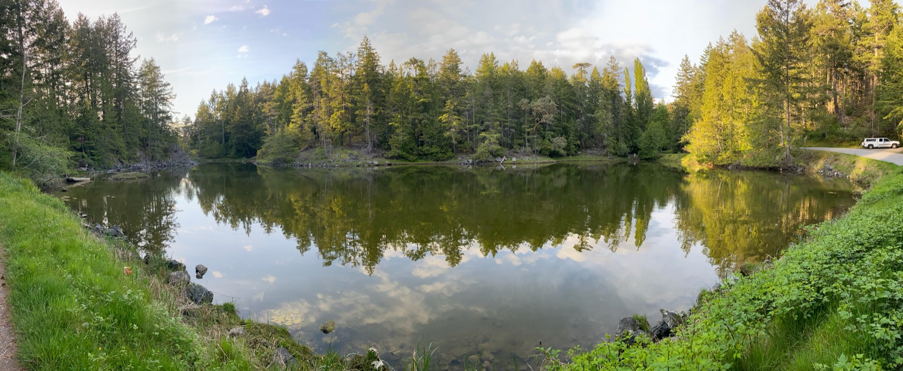{fig-alt="Süsswasserteich" width="100%"}

::: aside
Foto: Marius Roesti
:::

## Die Forscherin

::::: columns
::: {.column width="35%"}
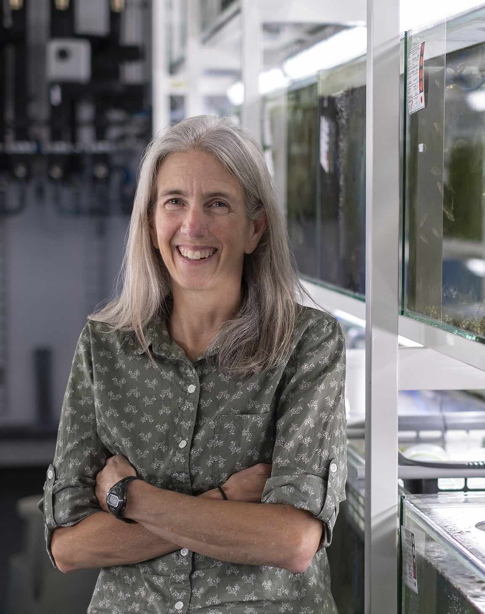{fig-alt="Katie Peichel" width="100%"}
:::
::: {.column width="65%"}
**Katie Peichel** (Universität Bern) erforscht, wie sich Stichlinge genetisch an Süsswasser anpassen.

Zusammen mit **Dolph Schluter** (UBC, Vancouver) fragt sie:

> Stehen die Süsswasser-Inversionen im Süsswasser unter **Selektion**?

Statt nur Genome zu vergleichen, machen sie ein **Experiment**.
:::
:::::

::: aside
Foto: Universität Bern
:::

## Zwanzig Teiche in Vancouver

::::: columns
::: {.column width="52%"}
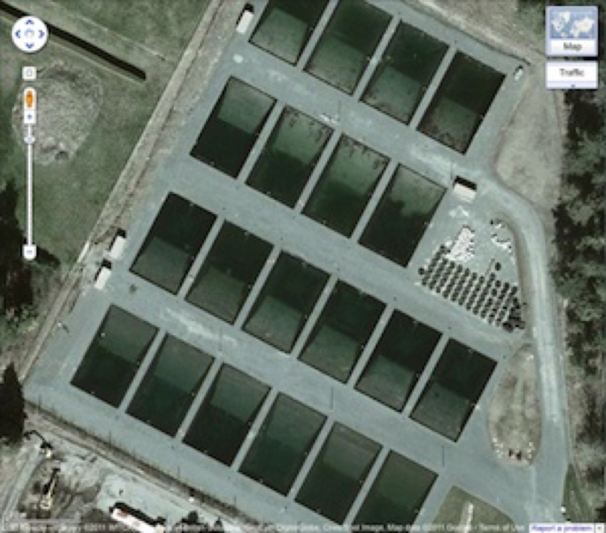{fig-alt="UBC-Teichanlage von oben" width="100%"}
:::
::: {.column width="48%"}
Versuchsteiche der UBC (Schluter-Labor):

- 20 Süsswasserteiche, 25 m × 15 m
- flache Zone und 6 m Tiefe
- natürliches Futter
- Wirbellose und Vögel, **keine Fischräuber**
:::
:::::

::: aside
Satellitenbild: Folien Katie Peichel / Google
:::

## Schritt 1: marine Fische fangen

::::: columns
::: {.column width="50%"}
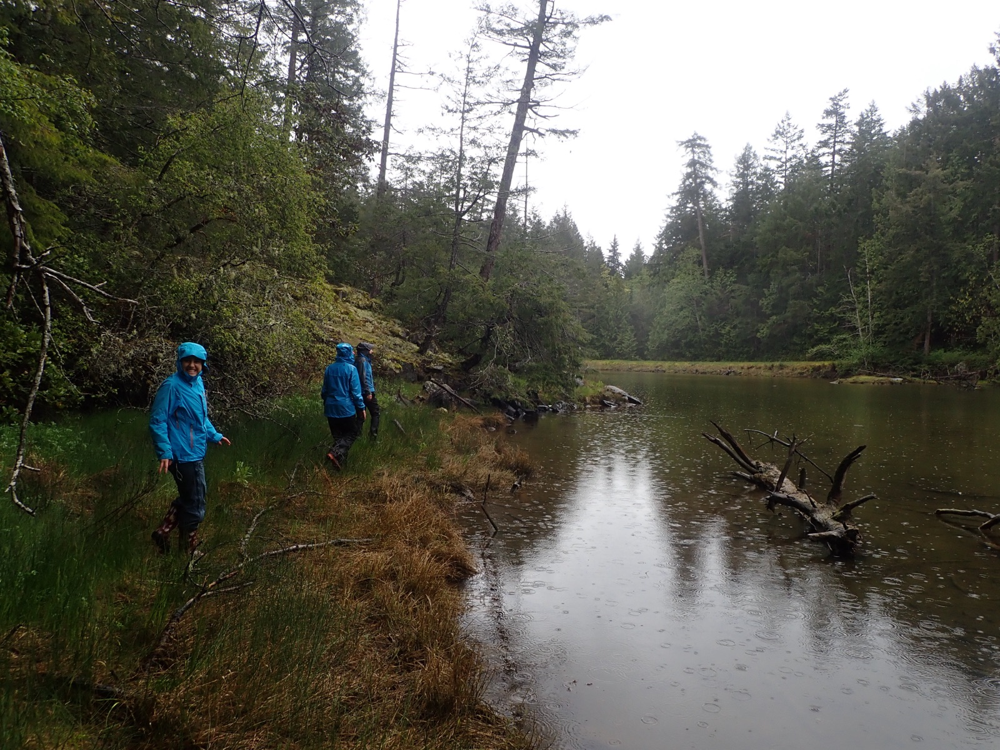{fig-alt="Fang in der Oyster Lagoon" width="100%"}
:::
::: {.column width="50%"}
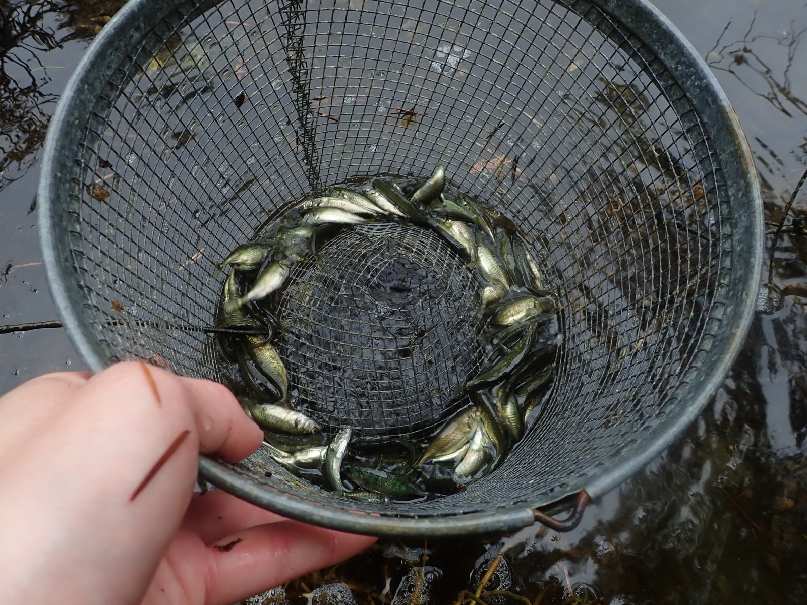{fig-alt="Marine Stichlinge im Kescher" width="100%"}
:::
:::::

2022 in der **Oyster Lagoon** (Meer): marine Stichlinge fangen.

::: aside
Fotos: Peichel- und Schluter-Labore
:::

## Schritt 2: Heterozygote finden

::::: columns
::: {.column width="50%"}
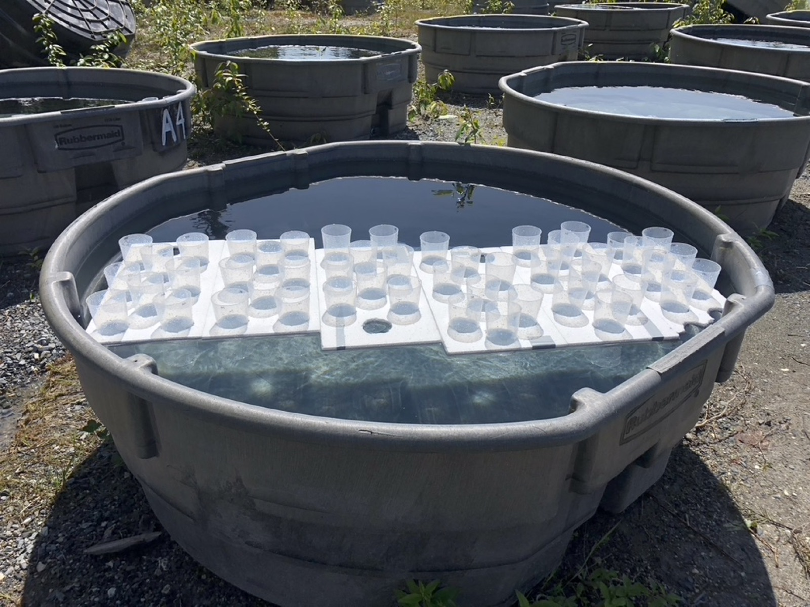{fig-alt="Becken mit Bechern, jeder Becher ein Fisch" width="100%"}
:::
::: {.column width="50%"}
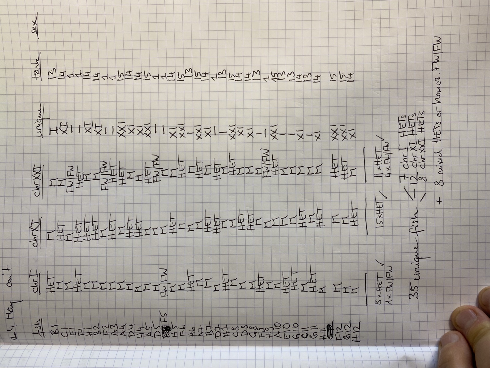{fig-alt="Notizen zu den Genotypen" width="100%"}
:::
:::::

An der UBC: **1152 Fische in 12 Tagen** genotypisiert. Jeder Fisch wird gemessen und gewogen, aus einem kleinen Stück Flosse wird per **PCR** die Orientierung bestimmt. Links: jeder Fisch in einem eigenen Becher.

Gesucht sind **Heterozygote**: Fische mit einer Meer- und einer Süsswasser-Orientierung. (Gesucht wurde für drei Inversionen; wir schauen nur Chromosom XI an.)

::: aside
Fotos: Peichel- und Schluter-Labore
:::

## Warum $p_0 = 0.5$?

In die Teiche kommen nur die gefundenen **Heterozygoten**, etwa 25 pro Teich. Es sind die gefangenen Fische selbst, keine Nachzucht aus dem Labor.

Ein Heterozygoter trägt **eine** Kopie jeder Orientierung, also startet jeder Teich bei

$$
p_0 = 0.5.
$$

Beide Orientierungen starten also gleich häufig.

## Schritt 3: ab in die Teiche

::::: columns
::: {.column width="50%"}
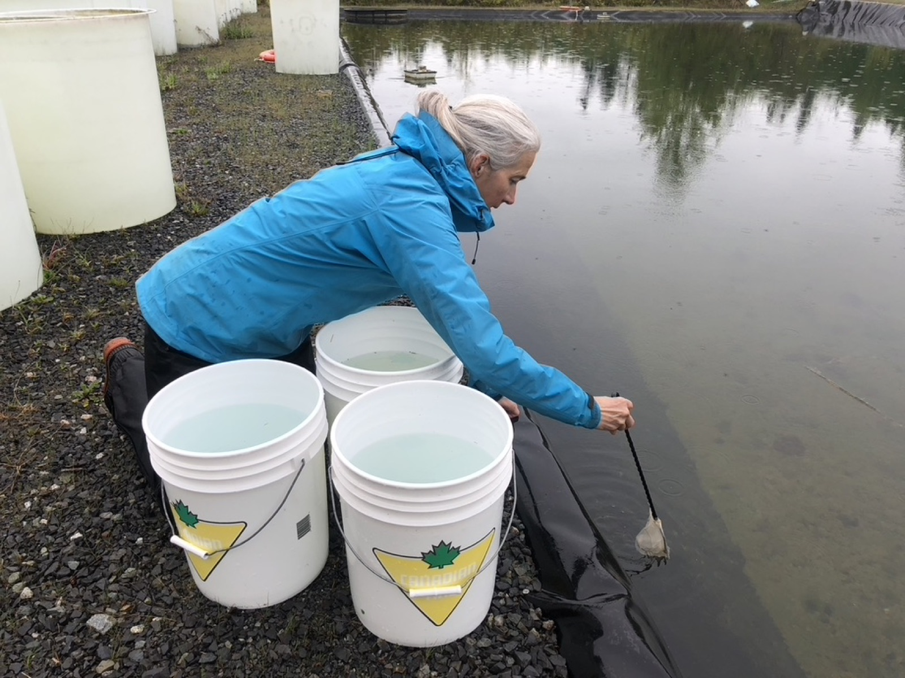{fig-alt="Fische werden in den Teich gesetzt" width="100%"}
:::
::: {.column width="50%"}
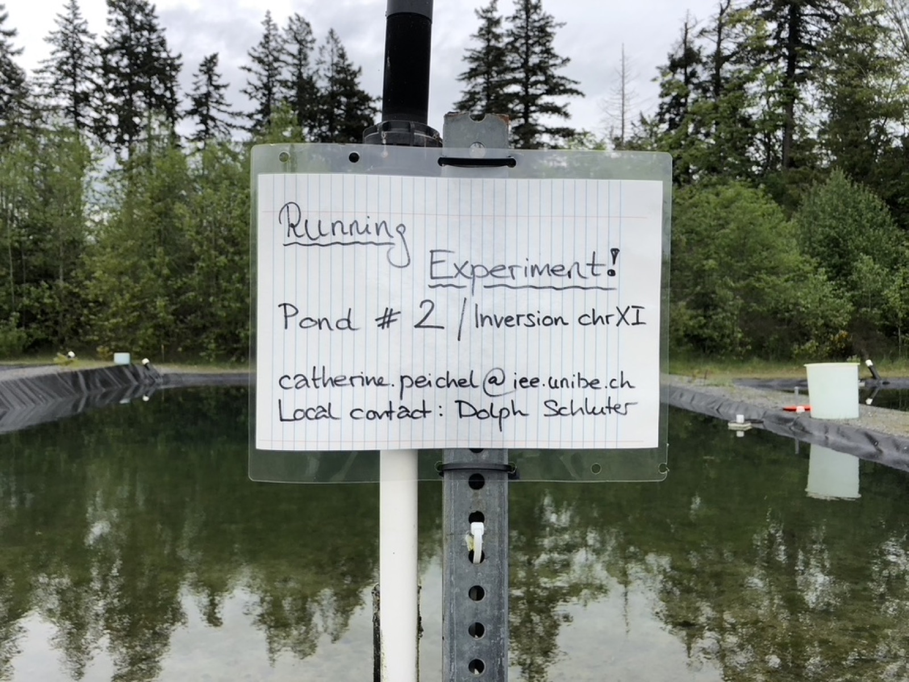{fig-alt="Schild Teich 2 Chromosom XI" width="100%"}
:::
:::::

Je etwa 25 Heterozygote in **drei Teiche** (2, 7, 14). Rechts: das Schild an Teich 2.

::: aside
Fotos: Peichel- und Schluter-Labore
:::

## Schritt 4: jedes Frühjahr Proben

::::: columns
::: {.column width="50%"}
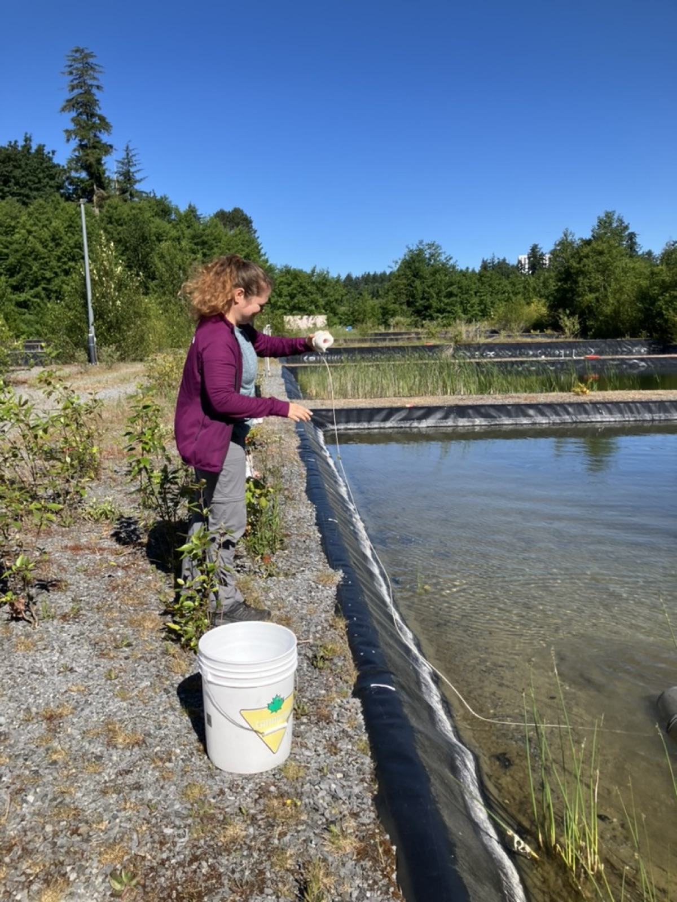{fig-alt="Fang am Teichrand" width="100%"}
:::
::: {.column width="50%"}
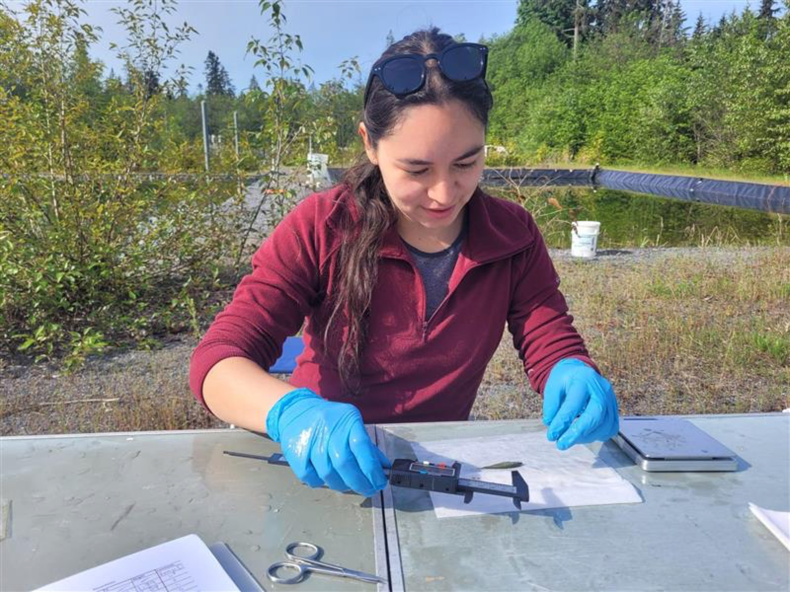{fig-alt="Proben werden genommen" width="100%"}
:::
:::::

Die ausgesetzten Fische pflanzen sich im Teich fort. Jedes Frühjahr (2023 bis 2026) wird eine Stichprobe gefangen: die 1., 2., 3. und 4. Generation im Teich. Jeder Fisch wird per PCR genotypisiert, insgesamt rund 15 000 PCRs.

::: aside
Fotos: Peichel- und Schluter-Labore
:::

## Was gezählt wird

Für jeden gefangenen Fisch: Welche Orientierung trägt er auf seinen **zwei** Chromosomen XI?

Daraus: $p$ = Anteil der **Süsswasser-Orientierung** unter allen untersuchten Kopien.

Untersuchte Fische pro Jahr: in Teich 2 und 14 zwischen 35 und 232, in Teich 7 nur 7 bis 36. Teich 7 hat kein Jahr 4.

Stichlinge sind diploid. Unser Modell bleibt **haploid** wie in Woche 6: $p$ ist dieselbe Frequenz, aber der Schritt von einer Generation zur nächsten ist vereinfacht.

## Drei Teiche

```{r}
#| fig-height: 3.5
#| fig-width: 8.4
#| out-width: 92%
ggplot(teiche, aes(jahr, p, colour = teich, shape = teich)) +
  geom_hline(yintercept = 0.5, colour = "#bdc3c7", linetype = "dashed") +
  geom_line(linewidth = 1.1) +
  geom_point(size = 2.8) +
  scale_colour_manual(values = teich_farben) +
  scale_shape_manual(values = c(16, 17, 15)) +
  coord_cartesian(ylim = c(0.3, 0.9)) +
  labs(x = "Jahr", y = "Frequenz Süsswasser-Inversion") +
  theme_slide()
```

Gleicher Start bei 0.5, vier Jahre später: drei verschiedene **Verläufe** von $p$. Einen solchen Verlauf nennen wir ab jetzt eine **Bahn**.

## Beobachtung 1: alle steigen

In **jedem** Teich liegt $p$ am Ende über 0.5.

Die Süsswasser-Orientierung wird häufiger, in allen drei Teichen in **dieselbe Richtung**.

Das erwartet man bei **positiver Selektion**.

## Beobachtung 2: trotzdem verschieden

Trotz gleichem Start:

- Teich 7 steigt steil.
- Teiche 2 und 14 steigen langsamer, mit einem kleinen Rückgang zwischendurch.

Gleiche Anfangsbedingungen, **drei Bahnen**. Mit den Modellen aus Woche 5–8 wäre das unmöglich: gleicher Start, gleiches $s$, gleiche Bahn.

## Beobachtung 3: warum verschieden?

Noch ohne Formel. Kandidaten:

- **Zufall** in einer endlichen Population (wer überlebt, wer Junge hat),
- **kleine Stichproben**: In Teich 7 wurden pro Jahr nur 7–36 Fische untersucht,
- echte Unterschiede zwischen den Teichen.

## Die Frage

> Steigt die Süsswasser-Inversion, weil sie im Teich **im Vorteil** ist?
> Oder kann das auch **Zufall** sein?

Dafür müssen wir wissen, wie stark sich $p$ in vier Jahren **allein durch Zufall** verändern kann, also **ohne** Selektion.

# Zufall

## Woher kommt der Zufall?

Ohne Selektion spielt die Inversion keine Rolle. Trotzdem trägt nicht jeder Fisch gleich viel zur nächsten Generation bei:

| Wo | Was ist Zufall? | Wie ändert das $p$? |
|---|---|---|
| **Überleben** | wer gefressen wird oder krank wird | Ein Reiher erwischt zufällig mehr Fische mit der Süsswasser-Orientierung. |
| **Fortpflanzung** | wer wie viele Junge hat | Ein Fisch hat 50 Junge, ein anderer keines. Seine Kopien sind dann häufiger. |
| **Vererbung** | welche Kopie ein Heterozygoter weitergibt | Bei jedem Jungen ein Münzwurf (Mendel). |

Keiner hat eine **Richtung**: Im Mittel bleibt $p$ gleich. Aber $p$ **schwankt**, umso stärker, je kleiner die Population ist. Erreicht $p$ dabei 0 oder 1, bleibt es dort.

## Zufall in einer kleinen Population

```{r}
#| fig-height: 3.1
#| fig-width: 8.4
#| out-width: 92%
set.seed(4)
N_klein <- 10
gen <- list(c(rep(1, 5), rep(0, 5)))
for (t in 2:5) gen[[t]] <- sample(gen[[t - 1]], N_klein, replace = TRUE)
kugeln <- do.call(rbind, lapply(1:5, function(t)
  data.frame(generation = t - 1, platz = 1:N_klein, allel = sort(gen[[t]], decreasing = TRUE))))
anteil <- aggregate(allel ~ generation, kugeln, mean)
ggplot(kugeln, aes(platz, -generation)) +
  geom_point(aes(fill = factor(allel)), shape = 21, size = 8, colour = "grey30") +
  scale_fill_manual(values = c("0" = "white", "1" = "#2980b9"), guide = "none") +
  geom_text(data = anteil, aes(x = 11.5, y = -generation,
                               label = paste0("p = ", allel)), size = 5, hjust = 0) +
  scale_y_continuous(breaks = -(0:4), labels = paste("Generation", 0:4)) +
  coord_cartesian(xlim = c(0.5, 13)) +
  theme_void(base_size = 14) +
  theme(axis.text.y = element_text(hjust = 1))
```

10 Genkopien, **keine Selektion**. Im Modell wird jede Generation einfach aus der vorherigen **zufällig gezogen**. $p$ ändert sich trotzdem, zufällig, von Generation zu Generation: **genetische Drift**.

## Zufall im Computer: eine Münze

`sample` zieht zufällig aus einer Liste. Zehn Münzwürfe:

```{r}
#| echo: true
sample(c("Kopf", "Zahl"), size = 10, replace = TRUE)
sample(c("Kopf", "Zahl"), size = 10, replace = TRUE)
```

Zweimal derselbe Befehl, zweimal ein anderes Ergebnis.

## Pseudo-Zufall und `set.seed`

Ein Computer würfelt nicht. R **berechnet** Zahlen, die zufällig aussehen. Der Startwert der Rechnung heisst **Seed**.

```{r}
#| echo: true
set.seed(1)
sample(c("Kopf", "Zahl"), size = 10, replace = TRUE)
set.seed(1)
sample(c("Kopf", "Zahl"), size = 10, replace = TRUE)
```

Gleicher Seed, gleiche Zahlen: So kann jemand anders das Ergebnis **genau wiederholen**.

## Von Münzen zu Genkopien

Eine neue Generation mit $N = 250$ Genkopien. Jede ist mit Wahrscheinlichkeit $p = 0.5$ eine Süsswasser-Kopie: 250 Münzwürfe.

Uns interessiert nur, **wie viele** es sind. Das würfelt `rbinom` direkt:

```{r}
#| echo: true
set.seed(2)
rbinom(10, size = 250, prob = 0.5)
```

Zehn mögliche neue Generationen. Im Mittel 125, aber selten genau 125.

## Wie stark schwankt $p$?

```{r}
#| fig-height: 3.2
#| fig-width: 8.4
#| out-width: 92%
set.seed(5)
schwank <- do.call(rbind, lapply(c(25, 250, 2500), function(N)
  data.frame(N = paste("N =", N), p = rbinom(1000, N, 0.5) / N)))
schwank$N <- factor(schwank$N, levels = paste("N =", c(25, 250, 2500)))
ggplot(schwank, aes(p)) +
  geom_histogram(binwidth = 0.02, boundary = 0, fill = "#95a5a6", colour = "white") +
  geom_vline(xintercept = 0.5, colour = "#c0392b", linewidth = 1) +
  facet_wrap(~ N) +
  coord_cartesian(xlim = c(0.2, 0.8)) +
  labs(x = "Frequenz p in der neuen Generation", y = "Anzahl",
       title = "Je 1000 neue Generationen aus p = 0.5") +
  theme_slide()
```

Im Mittel bleibt $p = 0.5$: Zufall hat **keine Richtung**. Die Schwankung ist etwa $\sqrt{p(1-p)/N}$: zehnmal mehr Kopien, rund dreimal weniger Schwankung.

## Drift über viele Generationen

```{r}
#| fig-height: 3.2
#| fig-width: 8.4
#| out-width: 92%
set.seed(8)
drift <- do.call(rbind, lapply(1:8, function(i) {
  p <- numeric(61); p[1] <- 0.5
  for (t in 1:60) p[t + 1] <- rbinom(1, 25, p[t]) / 25
  data.frame(generation = 0:60, p = p, id = i)
}))
ggplot(drift, aes(generation, p, group = id)) +
  geom_line(colour = "#7f8c8d", linewidth = 0.8) +
  labs(x = "Generation", y = "Frequenz", title = "8 Bahnen ohne Selektion, N = 25") +
  theme_slide()
```

Jede Generation wird aus der **vorherigen** gezogen. Die kleinen zufälligen Änderungen summieren sich. Erreicht $p$ den Wert 0 oder 1, bleibt es dort: Die Variante ist **verloren** oder **fixiert**.

## Zufall im Modell

Wie Woche 6: Selektion macht aus $p$ den Anteil $p'$.

Neu: Die nächste Generation hat $N$ Genkopien. Jede ist mit Wahrscheinlichkeit $p'$ eine Süsswasser-Kopie.

In R zieht das **eine** Zeile:

```r
p_strich <- selektion(p, s)               # 1. Selektion, ohne Zufall
p_neu    <- rbinom(1, N, p_strich) / N    # 2. Zufall: N Kopien ziehen
```

Selektion gibt die **Richtung**, Zufall das **Rauschen**. Für vier Jahre wiederholen wir das viermal und erhalten **eine** mögliche Bahn von $p$.

## Ein Schritt als Formel

$$
p' = \frac{p\,(1+s)}{1+p\,s}, \qquad
X \sim \mathrm{Binomial}(N,\ p'), \qquad
p_{t+1} = \frac{X}{N}
$$

- $p'$: erwarteter Anteil nach der Selektion (Woche 6),
- $X$: wie viele der $N$ neuen Kopien Süsswasser-Kopien sind, eine **Zufallszahl**,
- $p_{t+1}$: die neue Frequenz, **eine** mögliche Zukunft, kein Mittelwert.

$s = 0$: keine Selektion. $s = 0.2$: 20 % mehr Nachkommen im Mittel. Kurswert $N = 250$.

## Ohne Ziehung bleibt $p = 0.5$

```{r}
#| fig-height: 3.2
#| fig-width: 8.4
#| out-width: 92%
ggplot(simuliere_bahn(0, 250, zufall = FALSE), aes(jahr, p)) +
  geom_hline(yintercept = 0.5, colour = "#bdc3c7", linetype = "dashed") +
  geom_line(colour = "#2166ac", linewidth = 1.2) +
  geom_point(colour = "#2166ac", size = 2.4) +
  coord_cartesian(ylim = c(0.3, 0.9)) +
  labs(x = "Jahr", y = "Frequenz", title = "s = 0, ohne Zufall: p bleibt 0.5") +
  theme_slide()
```

Das ist Woche 6: Ohne Selektion ändert sich $p$ nicht. Damit sich $p$ zufällig ändert, braucht es die **Ziehung**.

## Eine Bahn sagt wenig

```{r}
#| fig-height: 3.4
#| fig-width: 8.4
#| out-width: 92%
set.seed(3)
bahnen <- do.call(rbind, lapply(1:3, function(i) cbind(simuliere_bahn(0, 250), id = factor(i))))
ggplot(bahnen, aes(jahr, p, group = id)) +
  geom_hline(yintercept = 0.5, colour = "#bdc3c7", linetype = "dashed") +
  geom_line(colour = "#7f8c8d", linewidth = 1) +
  geom_point(colour = "#7f8c8d", size = 2) +
  coord_cartesian(ylim = c(0.3, 0.9)) +
  labs(x = "Jahr", y = "Frequenz", title = "Drei Bahnen ohne Selektion, N = 250") +
  theme_slide()
```

Gleicher Start, gleiches Modell, $s = 0$ — und jede Bahn ist anders.

## Reicht Zufall für den Anstieg?

Wenn alles **neutral** ist ($s = 0$): Welche Werte kann $p$ nach vier Jahren allein durch Zufall erreichen?

Wir simulieren dafür 100 Bahnen ohne Selektion. Zusammen bilden sie eine **Wolke**.

- Liegen die Teiche **in** dieser Wolke: Zufall reicht als Erklärung.
- Liegen sie **ausserhalb**: Neutralität erklärt das Muster nicht.

Einen formellen Test mit $p$-Wert gibt es in der Statistikvorlesung. Heute reicht das Bild.

## Viele Bahnen: die neutrale Wolke

```{r}
#| fig-height: 3.5
#| fig-width: 8.4
#| out-width: 92%
zeige_wolke(wolke(0, 250), "100 Bahnen ohne Selektion (s = 0, N = 250) und die Teiche")
```

Grau: der Bereich, in dem 90 von 100 Bahnen **ohne Selektion** liegen. Nach vier Jahren liegen alle Teiche **darüber**, Teich 7 deutlich.

## Wolke mit Selektion

```{r}
#| fig-height: 3.5
#| fig-width: 8.4
#| out-width: 92%
zeige_wolke(wolke(0.2, 250, seed = 11),
            "100 Bahnen mit s = 0.2; rot: dasselbe ohne Zufall",
            ohne_zufall = simuliere_bahn(0.2, 250, zufall = FALSE))
```

Mit $s = 0.2$ liegen Teich 2 und 14 **in** der Wolke. Teich 7 liegt noch darüber, hat aber nur 7–36 untersuchte Fische pro Jahr.

## Ein zweiter Zufall: die Stichprobe

Die Teich-Frequenzen sind **gemessen**. Untersucht wird nur ein Teil der Fische, auch das ist eine Ziehung:

```{r}
#| echo: true
set.seed(3)
rbinom(8, size = 20, prob = 0.6) / 20    # 10 Fische = 20 Kopien, wahre Frequenz 0.6
rbinom(8, size = 200, prob = 0.6) / 200  # 100 Fische = 200 Kopien
```

Mit 10 Fischen (Teich 7 hatte im ersten Jahr nur 7) misst man leicht 0.5 oder 0.75, obwohl die wahre Frequenz 0.6 ist.

So lässt sich eine **beobachtete** Häufigkeit einordnen: Wie weit kann sie allein durch die Stichprobe danebenliegen?

## Und wenn nicht alle gleich leicht ins Netz gehen?

Gelbe *Uta*-Männchen sind Schleicher (Woche 5). Gehen sie seltener ins Netz, lässt sich auch das simulieren:

:::: columns
::: {.column width="45%"}
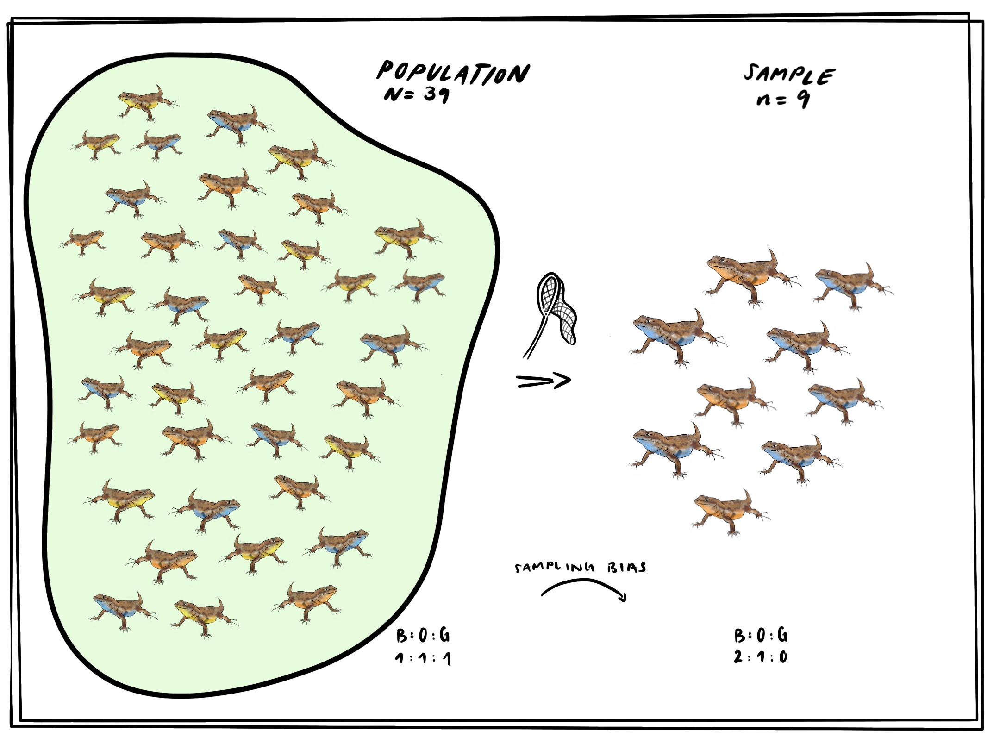{fig-alt="Echsen-Population 1 : 1 : 1; im Netz nur blaue und orange Männchen"}
:::
::: {.column width="55%"}
```{r}
#| echo: true
set.seed(4)
anteil  <- c(orange = 1, blau = 1, gelb = 1) / 3
fangbar <- c(1, 1, 0.3)   # Annahme
rmultinom(5, 9, anteil * fangbar)
```
:::
::::

Fünf Netze mit je 9 Echsen: Gelb fehlt oft. So prüft man, ob ein **Fangbias** eine Beobachtung erklären könnte.

::: aside
Illustration: Emma Ochsner
:::

## Was das Bild sagt — und was nicht

- Zufall **allein** erklärt die Teiche schlecht.
- Selektion **plus** Zufall passt — und erklärt auch, warum die Teiche verschieden sind.
- Kleine Stichproben (Teich 7) sind selbst ein Zufall: Die gemessene Frequenz weicht von der wahren ab.
- Das ist **kein Beweis** und kein statistischer Test. Das Bild zeigt, was zu den Daten **passt**.

## Konsistent, nicht bewiesen

Positive Selektion **kann** die drei Verläufe erklären.

Andere Werte für $s$ und $N$ oder mehr Biologie (diploid, schwankende Populationsgrösse) würden die Wolke verschieben.

Katie Peichel und Dolph Schluter schätzen mit einem diploiden Modell für Chr XI eine starke Selektion. Unser einfaches Modell kommt zum gleichen Schluss: Die Süsswasser-Orientierung ist im Teich **im Vorteil**.

# Abschluss

## Take-home

1. In endlichen Populationen ändert sich $p$ auch **ohne** Selektion: **Drift**.
2. Eine simulierte Bahn sagt wenig. Viele Bahnen ergeben eine **Wolke**.
3. Daten **ausserhalb** der neutralen Wolke sprechen für Selektion.
4. Auch die Stichprobe ist eine Ziehung, und auch sie lässt sich simulieren, mit oder ohne Fangbias.

## Notebook (~40 min)

**→ [Notebook Woche 9 öffnen](notebook.html)** · [Rmd](notebook.Rmd) · [R](notebook.R)

Dieselben Ziehungen wie in der Vorlesung: zuerst ohne Selektion, dann mit dem Echsen-Spiel aus Woche 4.

1. `rbinom` und `set.seed`: eine Verteilung anschauen
2. Neutrales Allel: grosse und kleine Population über viele Generationen, dann zurück zu den Teichen
3. Echsen aus Woche 4 mit endlicher Population: Wann gehen Kehlfarben verloren?

## Abschlussfragen

1. Warum startet das Experiment bei $p = 0.5$?
2. Was ändert `set.seed` an einer Abbildung, und was nicht?
3. Wo sitzt der Zufall im Generationsschritt, und wo sitzt $s$?
4. Warum reicht **eine** neutrale Bahn nicht, um die Teiche zu beurteilen?
5. Warum schwankt Teich 7 stärker als Teich 2?
6. Was unterscheidet «liegt ausserhalb der Wolke» von einem statistischen Test?
7. Wie würden Sie prüfen, ob ein Fangbias Emmas Netz mit 0 gelben Echsen erklären kann?

## Ausblick · Woche 10

Heute startete die Inversion bei $p = 0.5$: viele Kopien.

Eine **neue** Mutation beginnt mit **einer** Kopie. Dann entscheidet der Zufall, ob sie überhaupt überlebt — auch wenn sie vorteilhaft ist.

## Literatur

:::: {.lit}
1. **Peichel, C. L., et al. (2001).** The genetic architecture of divergence between threespine stickleback species. *Nature* 414: 901–905. [doi:10.1038/414901a](https://doi.org/10.1038/414901a)
1. **Jones, F. C., et al. (2012).** The genomic basis of adaptive evolution in threespine sticklebacks. *Nature* 484: 55–61. [doi:10.1038/nature10944](https://doi.org/10.1038/nature10944)
1. **Peichel, C. L., & Marques, D. A. (2017).** The genetic and molecular architecture of phenotypic diversity in sticklebacks. *Phil. Trans. R. Soc. B* 372: 20150486. [doi:10.1098/rstb.2015.0486](https://doi.org/10.1098/rstb.2015.0486)
1. **Barrett, R. D. H., Rogers, S. M., & Schluter, D. (2008).** Natural selection on a major armor gene in threespine stickleback. *Science* 322: 255–257. [doi:10.1126/science.1159978](https://doi.org/10.1126/science.1159978)

Teichdaten Chr XI: Katie Peichel (Bern) und Dolph Schluter (UBC), unveröffentlicht, mit freundlicher Genehmigung. Fotos: Marius Roesti; Peichel- und Schluter-Labore; Universität Bern (Porträt).
::::

## Navigation

| | |
|---|---|
| Notebook | [Quarto](notebook.html) · [Rmd](notebook.Rmd) · [R](notebook.R) |
| Zurück | [← Woche 8](../week-08/slides.html) |
| Weiter | [Woche 10 →](../week-10/slides.html) |
| Modul | [Modul 3](../../docs/module-03-overview.html) |
