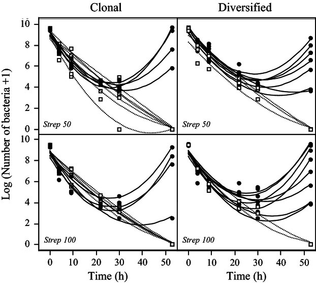
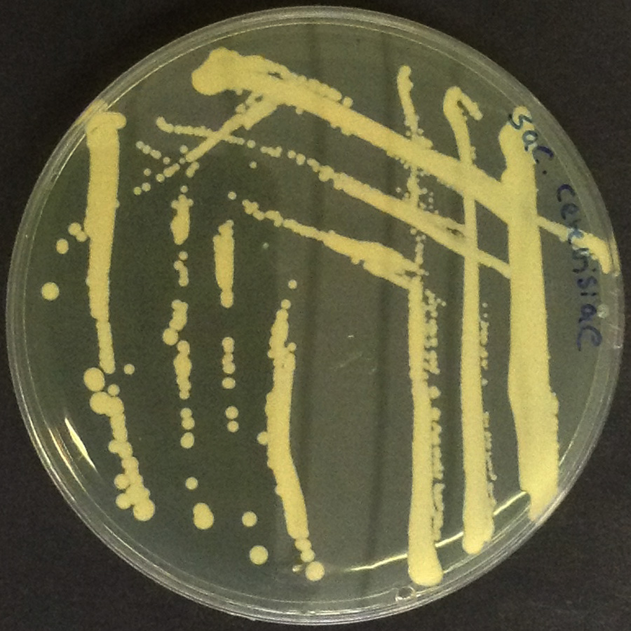
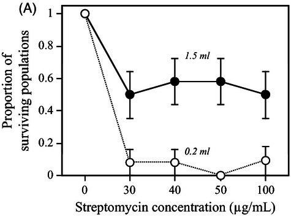

```{r}
#| include: false
source("../slides-ggplot.R")

# Eine Kopie: jede Kopie hat im Mittel 1 + s Nachkommen (Poisson)
linie <- function(s, generationen = 40) {
  n <- numeric(generationen + 1)
  n[1] <- 1
  for (t in seq_len(generationen)) n[t + 1] <- rpois(1, n[t] * (1 + s))
  n
}

schicksal <- function(s, grenze = 100) {
  n <- 1
  while (n > 0 && n < grenze) n <- rpois(1, n * (1 + s))
  as.numeric(n >= grenze)
}

# Rettung: Wildtyp schrumpft (1 - r), Mutanten wachsen (1 + s)
rettung_lauf <- function(N0, r, s, U = 1e-5, generationen = 120) {
  wt <- N0; mut <- 0
  N <- numeric(generationen + 1); N[1] <- N0
  for (t in seq_len(generationen)) {
    neu <- rbinom(1, wt, U)
    wt <- rpois(1, wt * (1 - r))
    mut <- min(rpois(1, mut * (1 + s)) + neu, 1e7)
    N[t + 1] <- wt + mut
  }
  data.frame(generation = 0:generationen, N = N)
}

rettung <- function(N0, r, s, U = 1e-5, grenze = 1000) {
  wt <- N0; mut <- 0
  repeat {
    neu <- rbinom(1, wt, U)
    wt <- rpois(1, wt * (1 - r))
    mut <- rpois(1, mut * (1 + s)) + neu
    if (mut >= grenze) return(1)
    if (wt + mut == 0) return(0)
  }
}

formel <- function(N0, r, s, U = 1e-5) 1 - exp(-2 * N0 * U * s / r)

col_empf <- "#e67e22"   # empfindlich / Wildtyp
col_res <- "#2166ac"    # resistent / Mutante
col_theo <- "#d95f02"   # Theorie
```

## Übersicht

**Woche 10** von 14 · **Do., 19. Nov. 2026, 08:15–10:00**

| Teil | Dauer | Was |
|------|-------|-----|
| Vorlesung | ~55 min | Verzweigungsprozess · ein Modell für Rettung · ein Programm · Tests · zwei Orte |
| Notebook | ~35 min | eine Kopie · Programm · viele Läufe · Bonus: zwei Orte |

::: aside
Pfeiltasten · **M** Menü · **E** PDF · **Esc** Übersicht
:::

## Lernziele

Nach heute können Sie …

1. erklären, was **evolutionäre Rettung** ist (U-Kurve),
2. mit einem **Verzweigungsprozess** herleiten, warum sich eine neue Mutation nur mit etwa $2s$ etabliert,
3. die Chance auf Rettung aus **Rückgang, Mutation und Etablierung** herleiten,
4. Rettung als **kleines Programm** simulieren,
5. **Vorhersagen** der Theorie mit Experimenten vergleichen,
6. stehende Variation und **Migration** einordnen.

# Gerettet oder ausgestorben?

## Die Umwelt ändert sich

| Was ändert sich? | Wie schnell? | Wer ist betroffen? |
|---|---|---|
| Antibiotikum im Körper | Stunden | Bakterien einer Infektion |
| Pestizid auf dem Feld | Wochen | Insekten, Unkräuter |
| neue Krankheit | Jahre | Tasmanische Teufel, Amphibien |
| Erwärmung, Trockenheit | Jahrzehnte | viele Arten |

Für viele Populationen heisst das zuerst: Sie **schrumpfen**. Jede Generation hat weniger Nachkommen als die vorherige.

## Was kann eine schrumpfende Population tun?

```{r}
#| fig-height: 3.2
#| fig-width: 8
#| out-width: 92%
wege <- data.frame(y = c(3, 2, 1, 0),
                   titel = c("ausweichen", "sich umstellen", "sich genetisch anpassen", "aussterben"),
                   was = c("an einen besseren Ort wandern", "Verhalten oder Körper ändern, ohne neue Gene (Plastizität)",
                           "Varianten, die besser zurechtkommen, werden häufiger", ""),
                   farbe = c("#7f8c8d", "#7f8c8d", col_res, "#c0392b"))
ggplot(wege) +
  annotate("point", x = 0, y = 1.5, size = 9, colour = col_empf) +
  annotate("text", x = 0, y = 0.85, label = "Population\nschrumpft", size = 4.6, lineheight = 0.9) +
  geom_segment(aes(x = 0.15, y = 1.5, xend = 1.1, yend = y), colour = "grey50",
               arrow = arrow(length = unit(0.22, "cm"))) +
  geom_text(aes(x = 1.2, y = y + 0.12, label = titel, colour = farbe), hjust = 0, size = 6.2, fontface = "bold") +
  geom_text(aes(x = 1.2, y = y - 0.25, label = was), hjust = 0, size = 4.8, colour = "grey30") +
  scale_colour_identity() +
  coord_cartesian(xlim = c(-0.3, 4.6), ylim = c(-0.4, 3.4)) +
  theme_void()
```

Heute geht es um den blauen Weg: **Evolution**, bevor die Population verschwindet.

## Ist Evolution schnell genug?

Darwin dachte an langsame Veränderung über sehr viele Generationen. Aber Evolution zählt in **Generationen**, die Umwelt in **Jahren**.

| Wer | eine Generation |
|---|---|
| Bakterien im Labor | weniger als eine Stunde |
| Hefe | wenige Stunden |
| Tasmanischer Teufel | etwa 2 Jahre |
| Elefant | Jahrzehnte |

Die Frage ist also ein **Wettlauf**: Wird die Population angepasst, bevor sie ausstirbt? Gelingt das, spricht man von **evolutionärer Rettung** (Gomulkiewicz & Holt 1995).

## Dieselbe Frage, entgegengesetzte Wünsche

:::: columns
::: {.column width="50%"}
{fig-alt="Pseudomonas fluorescens leuchtet unter UV-Licht auf einer Agarplatte" height="185px"}

**Bakterien unter Antibiotikum.** 2019 starben weltweit rund **1.27 Millionen** Menschen direkt an Infektionen mit resistenten Bakterien.

Wir wollen: **keine** Rettung.
:::
::: {.column width="50%"}
{fig-alt="Tasmanischer Teufel im Gras" height="185px"}

**Tasmanische Teufel** unter einem ansteckenden Krebs: über 80 % weniger Tiere in 20 Jahren.

Wir wollen: **Rettung**.
:::
::::

::: aside
Antimicrobial Resistance Collaborators (2022), *Lancet* · Epstein et al. (2016) · Fotos: Ninjatacoshell, CC BY-SA 3.0; JJ Harrison, CC BY-SA 3.0
:::

## Ein Experiment: dieselben Bakterien, zwei Ausgänge

:::: columns
::: {.column width="60%"}
{fig-alt="Originalabbildung: Zellzahl (log) über 53 Stunden für viele Populationen unter Streptomycin 50 und 100; durchgezogene Linien steigen wieder an, gestrichelte fallen auf null" style="max-height:440px"}
:::
::: {.column width="40%"}
*Pseudomonas* unter Streptomycin. Jede Linie: **eine** Population.

- Alle **schrumpfen**.
- Gestrichelt: **ausgestorben**.
- Durchgezogen: **U-Kurve**, gerettet.

Die geretteten sind am Ende fast alle **resistent**.
:::
::::

::: aside
Ramsayer, Kaltz & Hochberg (2013), Fig. 1, Ausschnitt (50 und 100 µg/mL), CC BY 3.0
:::

## Was in der U-Kurve steckt

```{r}
#| fig-height: 3.3
#| fig-width: 8.4
#| out-width: 90%
t <- 0:60
emp <- 1e6 * 0.85^t                                   # Empfindliche sterben
res <- ifelse(t >= 8, 1.25^(t - 8), NA)               # eine Resistente ab Stunde 8
ges <- emp + ifelse(is.na(res), 0, res)
u <- rbind(data.frame(t = t, N = emp, wer = "empfindlich"),
           data.frame(t = t, N = res, wer = "resistent"),
           data.frame(t = t, N = ges, wer = "alle zusammen"))
u$wer <- factor(u$wer, levels = c("alle zusammen", "empfindlich", "resistent"))
ggplot(u[!is.na(u$N) & u$N >= 1, ], aes(t, N, colour = wer, linewidth = wer)) +
  geom_line() +
  scale_y_log10(breaks = 10^(0:6), labels = c("1", "10", "100", "1000", "10^4", "10^5", "10^6")) +
  coord_cartesian(ylim = c(0.4, 2e6)) +
  scale_colour_manual(values = c("alle zusammen" = "grey15", empfindlich = col_empf, resistent = col_res), name = NULL) +
  scale_linewidth_manual(values = c("alle zusammen" = 2.2, empfindlich = 1, resistent = 1), guide = "none") +
  annotate("point", x = 8, y = 1, colour = col_res, size = 3) +
  annotate("text", x = 10, y = 1, label = "eine Mutante entsteht", hjust = 0, vjust = 1.2, size = 4.2, colour = col_res) +
  labs(x = "Zeit", y = "Zellen (log)") +
  theme_slide()
```

Die U-Kurve ist eine **Summe**: Empfindliche sterben, eine Resistente wächst. Ein **Wettlauf** zwischen Aussterben und Anpassung.

::: aside
Skizze. Die U-Kurve als Zeichen von Rettung: Gomulkiewicz & Holt (1995)
:::

## Die Frage

> Wovon hängt ab, ob eine schrumpfende Population **gerettet** wird?
> Und kann man das **vorhersagen**?

Heute: eine einfache Theorie, fünf Vorhersagen, und Experimente, die sie prüfen.

# Eine Kopie: Glück oder Pech?

## Zuerst: eine einzige Kopie

Letzte Woche startete die Inversion bei $p = 0.5$: viele Kopien.

Eine **neue Mutation** beginnt mit **einer** Kopie. Hat ihr Träger zufällig keine Nachkommen, ist sie weg.

Wie in Woche 9 entscheidet der Zufall, wer wie viele Nachkommen hat. Bei **einer** Kopie ist er übermächtig.

## Eine Kopie, zwanzig Mal

```{r}
#| fig-height: 3.5
#| fig-width: 8.4
#| out-width: 92%
set.seed(2)
linien <- do.call(rbind, lapply(1:20, function(i) {
  n <- linie(0.1)
  data.frame(generation = 0:40, n = n, id = i,
             ausgang = ifelse(n[41] > 0, "überlebt", "verloren"))
}))
n_weg <- sum(tapply(linien$ausgang, linien$id, `[`, 1) == "verloren")
ggplot(linien, aes(generation, n, group = id, colour = ausgang)) +
  geom_line(data = subset(linien, ausgang == "überlebt"), linewidth = 1) +
  geom_line(data = subset(linien, ausgang == "verloren"), linewidth = 0.8, alpha = 0.8) +
  scale_colour_manual(values = c("überlebt" = col_res, "verloren" = col_empf)) +
  coord_cartesian(ylim = c(0, 25)) +
  labs(x = "Generation", y = "Anzahl Kopien",
       title = paste0("s = 0.1: ", n_weg, " von 20 Mutationen gehen verloren")) +
  theme_slide()
```

Im Mittel 1.1 Nachkommen pro Kopie, und trotzdem sind die meisten bald **weg**. Selektion wirkt im Mittel, bei einer Kopie zählt **Glück**.

## Ein Stammbaum aus Zufall

```{r}
#| fig-height: 3.3
#| fig-width: 9
#| out-width: 94%
kn <- data.frame(id = c("o", "a", "b", "b1", "b2", "c1", "c2", "d1", "d2"),
                 g = c(0, 1, 1, 2, 2, 3, 3, 4, 4),
                 x = c(0, -2, 2, 1, 3, 0.4, 1.6, 1.1, 2.1),
                 lebt = c(TRUE, FALSE, TRUE, TRUE, FALSE, FALSE, TRUE, TRUE, TRUE))
ka <- data.frame(von = c("o", "o", "b", "b", "b1", "b1", "c2", "c2"),
                 zu  = c("a", "b", "b1", "b2", "c1", "c2", "d1", "d2"))
ka$x <- kn$x[match(ka$von, kn$id)]; ka$y <- -kn$g[match(ka$von, kn$id)]
ka$xend <- kn$x[match(ka$zu, kn$id)]; ka$yend <- -kn$g[match(ka$zu, kn$id)]
ende <- kn[!kn$lebt, ]
ggplot() +
  geom_segment(data = ka, aes(x, y, xend = xend, yend = yend), colour = "grey45", linewidth = 0.9) +
  geom_point(data = kn, aes(x, -g, fill = lebt), shape = 21, size = 7, colour = "grey30") +
  geom_text(data = ende, aes(x, -g - 0.42), label = "keine Nachkommen", size = 3.8, colour = col_empf) +
  scale_fill_manual(values = c("TRUE" = col_res, "FALSE" = "white"), guide = "none") +
  scale_y_continuous(breaks = -(0:4), labels = paste("Generation", 0:4)) +
  coord_cartesian(xlim = c(-3, 4), ylim = c(-4.6, 0.3)) +
  theme_void(base_size = 14) + theme(axis.text.y = element_text(hjust = 1))
```

Jede Kopie hat zufällig 0, 1, 2, … Nachkommen. Jede Tochter beginnt ihren **eigenen** Stammbaum: dasselbe Spiel, eine Generation später. Das heisst **Verzweigungsprozess**.

::: aside
Skizze. Galton & Watson (1875) fragten so, warum Familiennamen aussterben.
:::

## Ein Spielzeugmodell

Jede Kopie hat entweder **keine** oder **zwei** Nachkommen:

| Nachkommen | Wahrscheinlichkeit | bei $s = 0.1$ |
|---|---|---|
| 0 | $a$ | 0.45 |
| 2 | $1 - a$ | 0.55 |

Im Mittel $2(1 - a)$ Nachkommen. Das soll $1 + s$ sein, also

$$
a = \frac{1 - s}{2}.
$$

Bei $s = 0.1$: 45 % der Kopien haben **gar keine** Nachkommen, obwohl die Mutation im Vorteil ist.

## Die Idee: dasselbe Spiel noch einmal

Sei $q$ die Wahrscheinlichkeit, dass die Linie einer Kopie **irgendwann ausstirbt**.

Schauen wir nur auf die **erste** Generation:

- Mit Wahrscheinlichkeit $a$: keine Nachkommen. Die Linie ist sofort weg.
- Mit Wahrscheinlichkeit $1 - a$: zwei Töchter. Jede startet dasselbe Spiel, stirbt also mit Wahrscheinlichkeit $q$ aus. **Beide** sterben aus: $q \cdot q$.

$$
q = a + (1 - a)\, q^2
$$

Eine Gleichung, in der $q$ auf beiden Seiten steht. Der Trick: Die Tochter-Linien sind **gleich** wie die Mutter-Linie.

## Die rechte Seite als Funktion

::::: columns
::: {.column width="55%"}
```{r}
#| fig-height: 4.2
#| fig-width: 4.6
#| out-width: 100%
#| out-extra: 'style="max-height:450px"'
qq <- seq(0, 1, length.out = 200)
f01 <- function(q) 0.45 + 0.55 * q^2
punkte <- data.frame(q = c(0, 0.5, 1), f = f01(c(0, 0.5, 1)))
ggplot(data.frame(q = qq, f = f01(qq)), aes(q, f)) +
  geom_line(colour = col_res, linewidth = 1.3) +
  geom_point(data = punkte, size = 3.5, colour = col_res) +
  geom_text(data = punkte, aes(label = sprintf("%.2f", f)), hjust = 1.3, vjust = -0.4, size = 4.3) +
  coord_equal(xlim = c(0, 1), ylim = c(0, 1.05)) +
  labs(x = "q (Tochter-Linie stirbt aus)", y = "f(q) (Mutter-Linie stirbt aus)",
       title = "s = 0.1, also a = 0.45") +
  theme_slide()
```
:::
::: {.column width="45%"}
Die rechte Seite nennen wir $f(q) = a + (1-a)\,q^2$.

$f$ beantwortet: Sterben die Töchter mit Chance $q$ aus, wie oft stirbt dann die **Mutter**-Linie?

- $q = 0$: nur ohne Nachkommen, $f = a = 0.45$
- $q = 1$: sicher, $f = 1$
:::
:::::

::: aside
$f$ heisst **erzeugende Funktion** der Nachkommenzahl (PGF).
:::

## Gesucht: ein $q$, das zu sich selbst passt

::::: columns
::: {.column width="55%"}
```{r}
#| fig-height: 4.2
#| fig-width: 4.6
#| out-width: 100%
#| out-extra: 'style="max-height:450px"'
pgf <- rbind(data.frame(q = qq, f = 0.5 + 0.5 * qq^2, s = "s = 0"),
             data.frame(q = qq, f = f01(qq), s = "s = 0.1"))
ggplot(pgf, aes(q, f, colour = s)) +
  geom_abline(slope = 1, intercept = 0, linetype = "dashed", colour = "grey40") +
  geom_line(linewidth = 1.3) +
  annotate("point", x = c(1, 9 / 11), y = c(1, 9 / 11), size = 3.5,
           colour = c("grey30", col_res)) +
  annotate("text", x = 0.6, y = 0.9, label = "Fixpunkt\nq = 0.82", colour = col_res,
           size = 4.3, hjust = 1, lineheight = 0.9) +
  annotate("segment", x = 0.61, xend = 0.8, y = 0.88, yend = 0.83, colour = col_res,
           arrow = arrow(length = unit(0.18, "cm"))) +
  annotate("text", x = 0.93, y = 0.45, label = "Diagonale:\nf(q) = q", colour = "grey35",
           size = 3.9, lineheight = 0.9) +
  scale_colour_manual(values = c("s = 0" = "grey55", "s = 0.1" = col_res), name = NULL) +
  coord_equal(xlim = c(0, 1), ylim = c(0, 1)) +
  labs(x = "q (Tochter-Linie stirbt aus)", y = "f(q) (Mutter-Linie stirbt aus)") +
  theme_slide()
```
:::
::: {.column width="45%"}
Mutter und Töchter spielen **dasselbe** Spiel, also muss $f(q) = q$ sein.

Auf der **Diagonale** ist Ausgabe gleich Eingabe. Wo die Kurve sie trifft: ein **Fixpunkt**.

- $s = 0$: nur bei 1
- $s = 0.1$: auch bei 0.82, also $u = 0.18$
:::
:::::

## Die Gleichung lösen

$$
(1 - a)\, q^2 - q + a = 0
$$

$q = 1$ ist immer eine Lösung (einsetzen: $1 - a - 1 + a = 0$). Die zweite Lösung:

$$
q = \frac{a}{1 - a} = \frac{1 - s}{1 + s}
\qquad\Rightarrow\qquad
u = 1 - q = \frac{2s}{1 + s} \approx 2s
$$

Bei $s = 0.1$: $u = 0.182$, fast $2s = 0.2$.

Welche Lösung gilt? Ist $s \le 0$, ist die zweite grösser als 1, also keine Wahrscheinlichkeit: Eine **neutrale** neue Mutation geht sicher verloren. Ist $s > 0$, gilt die kleinere.

## Dieselbe Idee mit beliebig vielen Nachkommen

Hat eine Kopie $k$ Nachkommen, stirbt ihre Linie aus, wenn **alle** $k$ Tochter-Linien aussterben: $q^k$. Gemittelt über alle $k$:

$$
q = P(0) + P(1)\, q + P(2)\, q^2 + P(3)\, q^3 + \dots
$$

- **Spielzeugmodell:** nur $P(0) = a$ und $P(2) = 1 - a$. Das war unsere Gleichung.
- **Poisson** mit Mittelwert $1 + s$, wie `rpois` in der Simulation: Die Summe ergibt

$$
q = e^{-(1+s)(1-q)}
$$

## Zwei Kurven, fast derselbe Fixpunkt

::::: columns
::: {.column width="55%"}
```{r}
#| fig-height: 4.2
#| fig-width: 4.6
#| out-width: 100%
#| out-extra: 'style="max-height:450px"'
q_pois <- 1 - 0.1761341
pgf2 <- rbind(data.frame(q = qq, f = 0.45 + 0.55 * qq^2, wer = "0 oder 2 Nachkommen"),
              data.frame(q = qq, f = exp(-1.1 * (1 - qq)), wer = "Poisson (rpois)"))
ggplot(pgf2, aes(q, f, colour = wer)) +
  geom_abline(slope = 1, intercept = 0, linetype = "dashed", colour = "grey40") +
  geom_line(linewidth = 1.3) +
  annotate("point", x = c(9 / 11, q_pois), y = c(9 / 11, q_pois), size = 3,
           colour = c(col_res, col_empf)) +
  scale_colour_manual(values = c("0 oder 2 Nachkommen" = col_res, "Poisson (rpois)" = col_empf), name = NULL) +
  coord_equal(xlim = c(0, 1), ylim = c(0, 1)) +
  labs(x = "q", y = "f(q)", title = "s = 0.1") +
  theme_slide() + theme(legend.position = "bottom", legend.direction = "vertical")
```
:::
::: {.column width="45%"}
Andere Nachkommen, andere Kurve. Aber beide Kurven

- starten **über** der Diagonale (eine Linie kann sofort sterben),
- enden bei $(1, 1)$,
- haben dort fast dieselbe **Steigung**: den Mittelwert $1 + s$.

Darum schneiden sie die Diagonale fast am selben Ort: $u = 0.182$ gegen $0.176$.
:::
:::::

## Für kleines $s$: wieder $2s$

Mit $u = 1 - q$ heisst die Gleichung $1 - u = e^{-(1+s)\,u}$. Für kleine $x$ ist $e^{-x} \approx 1 - x + x^2/2$:

$$
1 - u \approx 1 - (1+s)\,u + \frac{(1+s)^2 u^2}{2}
\quad\Rightarrow\quad
u \approx \frac{2s}{(1+s)^2} \approx 2s
$$

| $s$ | 0.01 | 0.05 | 0.1 | 0.2 |
|---|---|---|---|---|
| Poisson, genau (numerisch) | 0.020 | 0.094 | 0.176 | 0.314 |
| Spielzeug $2s/(1+s)$ | 0.020 | 0.095 | 0.182 | 0.333 |
| Faustregel $2s$ | 0.02 | 0.10 | 0.20 | 0.40 |

Wie die Nachkommen verteilt sind, ändert wenig: Für kleines $s$ ist $u \approx 2s$.

::: aside
Haldane (1927). Allgemein: $u \approx 2s/\sigma^2$, mit $\sigma^2$ der Varianz der Nachkommenzahl (hier etwa 1)
:::

## Theorie und Simulation

```{r}
#| fig-height: 3.4
#| fig-width: 8.4
#| out-width: 88%
set.seed(2)
s_werte <- c(0.01, 0.02, 0.05, 0.1, 0.15, 0.2)
u_hat <- sapply(s_werte, function(s) mean(replicate(3000, schicksal(s))))
ggplot() +
  geom_abline(slope = 2, intercept = 0, colour = col_theo, linetype = "dashed", linewidth = 1) +
  geom_point(data = data.frame(s = s_werte, u = u_hat), aes(s, u), colour = col_res, size = 3) +
  annotate("text", x = 0.15, y = 0.36, label = "2s", colour = col_theo, size = 5) +
  coord_cartesian(xlim = c(0, 0.21), ylim = c(0, 0.42)) +
  labs(x = "Selektionsvorteil s", y = "Anteil etabliert",
       title = "Simulation (Punkte) und Faustregel 2s (Linie)") +
  theme_slide()
```

Die Simulation aus «Eine Kopie, zwanzig Mal» trifft die Rechnung. Bei $s = 0.1$ gehen rund **80 %** der neuen Mutationen verloren.

## Wenn der Zufall gewinnt: Expansionslast

:::: columns
::: {.column width="42%"}
{fig-alt="Versuchsaufbau: Kolonie wächst 72 Stunden auf Agar, Zellen von der Front werden auf eine neue Platte gesetzt; aneinandergereiht ergibt das eine lange Ausbreitung" style="max-height:330px"}
:::
::: {.column width="58%"}
{fig-alt="Koloniegrösse über 39 Tage: blaue Linien mit hoher Mutationsrate fallen, orange Linien mit niedriger Mutationsrate bleiben gleich" style="max-height:330px"}
:::
::::

An der Front gründen **wenige** Zellen den nächsten Rand: Der Zufall ist stark, auch **schädliche** Mutationen setzen sich durch. *E. coli*, 1650 Generationen: viele Mutationen (blau), Kolonien werden **kleiner**; wenige (orange), kaum.

::: aside
Bosshard et al. (2017), *Genetics* 207: 669–684, Fig. 1 B–C und Fig. 3 · Theorie: Peischl et al. (2013), *Mol. Ecol.*
:::

## Ein aktives Forschungsfeld

Setzt sich eine neue Mutation durch? Die Frage beschäftigt die Populationsgenetik seit rund 100 Jahren.

| | |
|---|---|
| Haldane (1927) | Verzweigungsprozess: $u \approx 2s$ |
| Kimura (1962) | Fixierung in **endlichen** Populationen, mit Drift wie in Woche 9 |
| Patwa & Wahl (2008) | Übersicht: Was ändert sich, wenn $N$ schwankt oder Generationen überlappen? |
| Uecker & Hermisson (2011) | Etablierung, wenn die Umwelt schwankt |

## Forschung in Bern

::: {.unibe}
**Populationsgenetik in Bern.** Wann setzt sich eine Mutation durch,

- wenn sich die Umwelt **verändert** ([Peischl & Kirkpatrick 2012](https://doi.org/10.1534/genetics.112.140756)),
- an der **Front** einer Ausbreitung, wo sich auch schädliche Mutationen anhäufen ([Peischl et al. 2013](https://doi.org/10.1111/mec.12524)),
- wenn sie nur **lokal** im Vorteil ist, und mit **Genfluss** ([Tomasini & Peischl 2018](https://doi.org/10.1534/genetics.118.301104), [2020](https://doi.org/10.1111/evo.14038)),
- als **Inversion** entlang eines Umweltgradienten, wie bei den Stichlingen aus Woche 9 ([Peischl & Strütt 2026, Preprint](https://doi.org/10.64898/2026.10.25.761641))?
:::

# Ein einfaches Modell für Rettung

## Die Idee in einem Bild

::::: columns
::: {.column width="55%"}
```{r}
#| fig-height: 3.6
#| fig-width: 5
#| out-width: 100%
#| out-extra: 'style="max-height:400px"'
gen <- 0:40
idee <- data.frame(t = gen, N = 5e4 * 0.9^gen)
idee$erfolg <- idee$N * 1e-5 * 0.2
ggplot(idee, aes(t, erfolg)) +
  geom_col(fill = col_res, width = 0.85) +
  annotate("label", x = 26, y = 0.07, size = 4.4, colour = "grey20",
           label = "Summe aller Balken:\nlambda = 1") +
  labs(x = "Generation", y = "erfolgreiche Mutanten (Mittel)",
       title = "N0 = 50 000, r = 0.1, U = 0.00001, s = 0.1") +
  theme_slide()
```
:::
::: {.column width="45%"}
1. Die Population **schrumpft**: $N_t = N_0 (1-r)^t$.
2. Pro Generation $N_t\, U$ neue Mutanten: **immer weniger**.
3. Jede etabliert sich mit etwa $2s$.
4. Alles **zusammenzählen**:

$$
\lambda = \sum_t N_t\, U\, 2s = \frac{2\,N_0\,U\,s}{r}
$$
:::
:::::

::: aside
$\lambda$: mittlere Zahl erfolgreicher Mutanten
:::

## Von $\lambda$ zur Wahrscheinlichkeit

::::: columns
::: {.column width="55%"}
```{r}
#| fig-height: 3.6
#| fig-width: 5
#| out-width: 100%
lam <- seq(0, 5, length.out = 200)
ggplot(data.frame(lam = lam, p = 1 - exp(-lam)), aes(lam, p)) +
  geom_line(colour = col_theo, linewidth = 1.3) +
  annotate("point", x = 1, y = 1 - exp(-1), size = 3.5, colour = col_res) +
  annotate("text", x = 1.2, y = 0.58, label = "lambda = 1: 63 %", hjust = 0, size = 4.6, colour = col_res) +
  coord_cartesian(ylim = c(0, 1)) +
  labs(x = "lambda", y = "P(Rettung)") +
  theme_slide()
```
:::
::: {.column width="45%"}
Gerettet ist die Population, wenn **mindestens eine** Mutante es schafft.

Die Chance, dass es **keine** schafft, ist $e^{-\lambda}$. Also

$$
P(\text{Rettung}) \approx 1 - e^{-2 N_0 U s / r}
$$

Mehr Individuen, mehr Mutation, grösserer Vorteil, langsamerer Rückgang: mehr Rettung.
:::
:::::

::: aside
Orr & Unckless (2008, 2014); Martin et al. (2013)
:::

# Wie man so ein Modell simuliert

## Das Rezept

```{r}
#| fig-height: 2.3
#| fig-width: 9.5
#| out-width: 100%
rz <- data.frame(x = 1:5,
                 kopf = c("1 Zustand", "2 Generation", "3 Schleife", "4 Abbruch", "5 Wiederholen"),
                 text = c("wie viele\nWildtypen, Mutanten?", "Mutanten und\nNachkommen ziehen", "Generation\nfür Generation",
                          "ausgestorben oder\ngerettet?", "viele Läufe,\nAnteil gerettet"))
ggplot(rz) +
  geom_segment(data = rz[1:4, ], aes(x = x + 0.42, xend = x + 0.58, y = 0, yend = 0),
               arrow = arrow(length = unit(0.2, "cm")), colour = "grey40") +
  geom_tile(aes(x, 0), width = 0.8, height = 1.3, fill = "#eaf2fb", colour = "#1a5276") +
  geom_text(aes(x, 0.35, label = kopf), size = 4.4, fontface = "bold", colour = "#1a5276") +
  geom_text(aes(x, -0.15, label = text), size = 3.8, lineheight = 0.9) +
  coord_cartesian(xlim = c(0.55, 5.45), ylim = c(-0.7, 0.7)) +
  theme_void()
```

So funktioniert fast jede Simulation in der Populationsgenetik. Der Zufall steckt nur in Schritt 2.

## Zufällige Nachkommen: `rpois`

```{r}
#| echo: true
set.seed(1)
rpois(8, 900)   # 1000 Wildtypen, r = 0.1: im Mittel 900 Nachkommen
rpois(8, 1.1)   # eine Mutante, s = 0.1: im Mittel 1.1 Nachkommen
```

Wie `rbinom` aus Woche 9, aber ohne festes $N$: Wie viele Nachkommen hat eine Gruppe? Bei 900 kaum Unterschied, bei 1.1 oft **0**: Hier geht die neue Mutation verloren.

## Das Programm

```r
N0 <- 30000; r <- 0.1; s <- 0.1; U <- 1e-5
wt  <- N0   # 1. Zustand: Wildtypen
mut <- 0    #             Mutanten

for (t in 1:150) {                          # 3. Schleife
  neu <- rbinom(1, wt, U)                   # 2. neue Mutanten
  wt  <- rpois(1, wt * (1 - r))             #    Wildtyp schrumpft
  mut <- rpois(1, mut * (1 + s)) + neu      #    Mutanten wachsen
}
```

Drei Zeilen pro Generation: **Mutation, Wildtyp, Mutanten**. Das schreiben Sie heute im Notebook.

## Ein Lauf

```{r}
#| fig-height: 3.3
#| fig-width: 8.4
#| out-width: 90%
set.seed(14)
wt <- numeric(151); mut <- numeric(151); wt[1] <- 3e4
for (t in 1:150) {
  neu <- rbinom(1, wt[t], 1e-5)
  wt[t + 1] <- rpois(1, wt[t] * 0.9)
  mut[t + 1] <- rpois(1, mut[t] * 1.1) + neu
}
lauf <- rbind(data.frame(t = 0:150, N = wt + mut, wer = "alle"),
              data.frame(t = 0:150, N = wt, wer = "Wildtyp"),
              data.frame(t = 0:150, N = mut, wer = "Mutanten"))
lauf$wer <- factor(lauf$wer, levels = c("alle", "Wildtyp", "Mutanten"))
ggplot(subset(lauf, N > 0), aes(t, N, colour = wer, linewidth = wer)) +
  geom_line() +
  scale_y_log10(breaks = 10^(0:6), labels = c("1", "10", "100", "1000", "10^4", "10^5", "10^6")) +
  scale_colour_manual(values = c(alle = "grey15", Wildtyp = col_empf, Mutanten = col_res), name = NULL) +
  scale_linewidth_manual(values = c(alle = 2, Wildtyp = 1, Mutanten = 1), guide = "none") +
  labs(x = "Generation", y = "Individuen (log)", title = "N0 = 30 000, r = 0.1, s = 0.1") +
  theme_slide()
```

Dasselbe Bild wie die U-Kurve der Bakterien, jetzt aus dem Programm.

## Viele Läufe, eine Wahrscheinlichkeit

```{r}
#| echo: true
ein_lauf <- function(N0, r, s, U = 1e-5) {
  wt <- N0; mut <- 0
  while (wt + mut > 0 && mut < 1000) {        # 4. Abbruch
    neu <- rbinom(1, wt, U)
    wt  <- rpois(1, wt * (1 - r))
    mut <- rpois(1, mut * (1 + s)) + neu
  }
  as.numeric(mut >= 1000)                     # 1 = gerettet
}
set.seed(1)
mean(replicate(200, ein_lauf(30000, 0.1, 0.1)))   # 5. wiederholen
1 - exp(-2 * 30000 * 1e-5 * 0.1 / 0.1)            # Formel
```

200 Läufe, 91 gerettet: 45.5 %. Die Formel sagt 45.1 %.

## Formel und Simulation

```{r}
#| fig-height: 3.4
#| fig-width: 8.4
#| out-width: 88%
set.seed(4)
N0_werte <- c(1e3, 3e3, 1e4, 3e4, 1e5, 3e5)
p_hat <- sapply(N0_werte, function(N0) mean(replicate(300, rettung(N0, 0.1, 0.1))))
N0_fein <- 10^seq(3, 5.5, length.out = 100)
ggplot() +
  geom_line(data = data.frame(N0 = N0_fein, p = formel(N0_fein, 0.1, 0.1)),
            aes(N0, p), colour = col_theo, linetype = "dashed", linewidth = 1) +
  geom_point(data = data.frame(N0 = N0_werte, p = p_hat), aes(N0, p), colour = col_res, size = 3) +
  scale_x_log10(breaks = c(1e3, 1e4, 1e5), labels = c("1000", "10 000", "100 000")) +
  coord_cartesian(ylim = c(0, 1)) +
  labs(x = "Startgrösse N0 (log)", y = "Anteil gerettet",
       title = "r = 0.1, s = 0.1, U = 0.00001: Simulation (Punkte) und Formel (Linie)") +
  theme_slide()
```

Die Formel trifft die Simulation. Rettung kippt in einem engen Bereich von «fast nie» zu «fast immer».

## Was das Modell weglässt

| Erweiterung | Was ändert sich? |
|---|---|
| Die Variante ist **schon da** (Anteil $f$) | zusätzlich $2 N_0 f s$ Chancen, ohne Warten |
| Resistenz **kostet** vor dem Stress | die Variante ist seltener da |
| Die Umwelt wird **langsam** schlechter | am Anfang kleines $r$: mehr Chancen |
| **Mehrere** Mutationen nötig | Rettung viel unwahrscheinlicher |
| **Mehrere Orte** mit Migration | hilft oder schadet, gleich mehr dazu |
| Paarung, Dichte, schwankende Umwelt | die Zahlen ändern sich, die Idee bleibt |

Stehende Variation zählt mehr als neue Mutationen, sobald $f > U/r$. Im Beispiel: schon eine Resistente unter 10 000.

::: aside
Orr & Unckless (2008); Martin et al. (2013); Uecker, Otto & Hermisson (2014)
:::

# Fünf Vorhersagen, fünf Tests

## Was die Theorie sagt

| | Vorhersage | Geprüft mit |
|---|---|---|
| 1 | Rettung zeigt sich als **U-Kurve**, und es gibt eine **Schwelle** in $N_0$ | Hefe unter Salz |
| 2 | **Grössere** Populationen werden öfter gerettet | *Pseudomonas*, kleine und grosse Röhrchen |
| 3 | Mehr **Variation** am Start, mehr Rettung | *Pseudomonas*, klonal oder vielfältig |
| 4 | **Langsamer** Wandel rettet öfter als plötzlicher | *E. coli*, steigende Dosis |
| 5 | **Genfluss** aus einer Zuflucht hilft, aber nicht zu viel | Hefe-Metapopulationen · Zwei-Orte-Modell |

: {tbl-colwidths="[6,56,38]"}

## 1 · U-Kurve und Schwelle: Hefe unter Salz

:::: columns
::: {.column width="62%"}
Bell & Gonzalez (2009): Hunderte Hefe-Populationen verschiedener Grösse, eine sonst tödliche Salzkonzentration.

- **U-Kurve**: Einbruch, dann Erholung, oft in 25 Generationen.
- Klare **Schwelle**: Nur genügend grosse Populationen werden gerettet.
:::
::: {.column width="38%"}
{fig-alt="Kolonien von Bäckerhefe auf einer Agarplatte"}
:::
::::

Die Schwelle lag dort, wo die Ausgangspopulation etwa **ein bis zwei** resistente Zellen enthielt (Bell 2013).

::: aside
Bell & Gonzalez (2009), *Ecology Letters* · Foto: *Saccharomyces cerevisiae*. A doubt, Wikimedia Commons, CC BY-SA 4.0
:::

## 2 · Grösse: *Pseudomonas* in zwei Volumen

:::: columns
::: {.column width="55%"}
{fig-alt="Originalabbildung: Anteil überlebender Populationen gegen Streptomycin-Konzentration; 1.5 mL um 0.5 bis 0.6, 0.2 mL unter 0.1"}
:::
::: {.column width="45%"}
Gleiche Bakterien, gleiches Antibiotikum, nur das **Volumen** ist anders: 1.5 mL oder 0.2 mL, also 7.5-mal mehr Zellen.

- gross: **25 von 48** gerettet
- klein: **3 von 47** gerettet

Bei jeder Dosis. Die Theorie sagt: $\lambda$ wächst mit $N_0$.
:::
::::

::: aside
Ramsayer, Kaltz & Hochberg (2013), Fig. 3A, Experiment 2, nach 86 Stunden, CC BY 3.0. x-Achse: Streptomycin (µg/mL)
:::

## 3 · Variation: klonal oder vielfältig

```{r}
#| fig-height: 2.9
#| fig-width: 6.5
#| out-width: 62%
pv <- data.frame(typ = factor(c("klonal\n(ein Genotyp)", "vielfältig\n(vorher diversifiziert)"),
                              levels = c("klonal\n(ein Genotyp)", "vielfältig\n(vorher diversifiziert)")),
                 mitte = c(0.4, 0.7), lo = c(0.4, 0.6), hi = c(0.4, 0.8))
ggplot(pv, aes(typ, mitte)) +
  geom_col(fill = col_res, width = 0.55) +
  geom_errorbar(data = pv[2, ], aes(ymin = lo, ymax = hi), width = 0.15, linewidth = 0.9) +
  geom_text(aes(y = hi, label = c("40 %", "60 bis 80 %")), vjust = -0.6, size = 5) +
  scale_y_continuous(limits = c(0, 1), labels = function(x) paste0(100 * x, " %")) +
  labs(x = NULL, y = "gerettet") +
  theme_slide()
```

Gleiche Grösse, nur die genetische Vielfalt am Start ist anders (in der Originalabbildung vorne: links gegen rechts). Mehr Varianten, mehr Rettung: Resistente können **schon da** sein.

::: aside
Ramsayer et al. (2013), Experiment 1, nach 53 Stunden, je 10 Populationen pro Dosis; der Bereich fasst die drei Dosen zusammen
:::

## Neue Mutation oder stehende Variation?

| | neue Mutation | stehende Variation |
|---|---|---|
| Start | **eine** Kopie | viele Kopien |
| Hürde | Lotterie, etwa $2s$ | kaum |
| Warten | bis sie entsteht | keines |
| Tempo | langsam | **schnell** |

Darum hilft Vielfalt am Start: Resistente müssen nicht erst entstehen und die Lotterie gewinnen.

## 4 · Tempo: *E. coli* unter steigender Dosis

```{r}
#| fig-height: 1.8
#| fig-width: 8
#| out-width: 62%
tr <- 0:20
rampe <- rbind(data.frame(t = tr, c = pmin(1, (tr > 0) * 1), weg = "plötzlich"),
               data.frame(t = tr, c = pmin(1, tr / 10), weg = "mittel"),
               data.frame(t = tr, c = tr / 20, weg = "langsam"))
rampe$weg <- factor(rampe$weg, levels = c("plötzlich", "mittel", "langsam"))
ggplot(rampe, aes(t, c, colour = weg)) +
  geom_line(linewidth = 1.4) +
  scale_colour_manual(values = c(plötzlich = "#c0392b", mittel = "#e67e22", langsam = "#27ae60"), name = NULL) +
  scale_y_continuous(breaks = c(0, 1), labels = c("0", "Maximum")) +
  labs(x = "Transfer", y = "Antibiotikum") +
  theme_slide() + theme(legend.position = "right")
```

Lindsey et al. (2013): 1255 Populationen *E. coli*, Rifampicin. Am Ende überall **dieselbe** Dosis, nur der Weg ist verschieden.

- **Langsamer** Wandel: mehr Populationen überleben. Theorie: kleineres $r$, mehr Chancen.
- Neu: Manche Kombinationen von Mutationen gibt es **nur** auf dem langsamen Weg.

::: aside
Skizze der drei Behandlungen. Lindsey, Gallie, Taylor & Kerr (2013), *Nature* 494: 463–467
:::

# Zwei Orte: hilft Migration?

## Die Umwelt wird nicht überall gleichzeitig schlecht

- Ein Antibiotikum erreicht nicht jedes Gewebe gleich gut.
- Ein Pestizid wird nicht auf jedem Feld gespritzt.
- Erwärmung trifft zuerst die tiefen, dann die hohen Lagen.

Oft gibt es eine **Zuflucht**: einen Ort, der erst später schlecht wird. Zwischen den Orten wandern Individuen. Hilft das der Rettung, oder schadet es?

## Ein Modell mit zwei Orten

```{r}
#| fig-height: 2.3
#| fig-width: 9
#| out-width: 88%
ggplot() +
  annotate("rect", xmin = 0, xmax = 3, ymin = 0, ymax = 2, fill = "#f5b7b1", colour = "grey30") +
  annotate("rect", xmin = 5, xmax = 8, ymin = 0, ymax = 2, fill = "#d5f5e3", colour = "grey30") +
  annotate("text", x = 1.5, y = 1.45, label = "Ort 1: schlecht ab t = 0", size = 5, fontface = "bold") +
  annotate("text", x = 1.5, y = 0.7, label = "Wildtyp schrumpft (r)\nMutante wächst (z)", size = 4.3) +
  annotate("text", x = 6.5, y = 1.45, label = "Ort 2: schlecht erst ab θ", size = 5, fontface = "bold") +
  annotate("text", x = 6.5, y = 0.7, label = "bis dahin: Zuflucht\nMutante hat Kosten (s)", size = 4.3) +
  annotate("segment", x = 3.15, xend = 4.85, y = 1.25, yend = 1.25, arrow = arrow(length = unit(0.25, "cm")), linewidth = 1, colour = col_res) +
  annotate("segment", x = 4.85, xend = 3.15, y = 0.75, yend = 0.75, arrow = arrow(length = unit(0.25, "cm")), linewidth = 1, colour = col_res) +
  annotate("text", x = 4, y = 1.6, label = "Migration m", colour = col_res, size = 4.5) +
  coord_equal() + theme_void()
```

Ort 1 wird sofort schlecht, die Zuflucht erst nach $\theta$ Generationen. Dazwischen wandern Individuen hin und her.

::: aside
Tomasini & Peischl (2020), *Evolution* 74: 1640–1653
:::

## Die Parameter

| Symbol | Bedeutung | Wert unten |
|---|---|---|
| $r$ | Rückgang des Wildtyps am schlechten Ort | 0.1 bzw. 0.2 |
| $z$ | Vorteil der Mutante am schlechten Ort | 0.1 bzw. 0.2 |
| $s$ | **Kosten** der Mutante in der Zuflucht | 0.02 oder 0.5 |
| $\theta$ | Generationen, bis auch die Zuflucht schlecht wird | 100 |
| $m$ | Anteil, der pro Generation den Ort wechselt | 0 bis 1 |

Die Zuflucht hat Platz für $K = 5000$ Individuen. Gerettet, sobald es irgendwo 500 Mutanten gibt.

## Eine Generation an zwei Orten

Dasselbe Rezept, nur sind `wt` und `mut` jetzt **Vektoren** mit zwei Einträgen. Dazu kommt Schritt 3: Migration.

```r
wt  <- rpois(2, wt * ifelse(schlecht, 1 - r, 1))         # 1. Wildtyp
neu <- rbinom(2, wt, U)                                   # 2. Mutation
mut <- rpois(2, mut * ifelse(schlecht, 1 + z, 1 - s)) + neu
weg_wt  <- rbinom(2, wt,  m / 2)                          # 3. Migration:
weg_mut <- rbinom(2, mut, m / 2)                          #    wer geht?
wt  <- wt  - weg_wt  + rev(weg_wt)                        #    und kommt
mut <- mut - weg_mut + rev(weg_mut)                       #    am anderen Ort an
```

`rev` dreht den Vektor um: Wer Ort 1 verlässt, kommt in Ort 2 an, und umgekehrt.

## Was die Simulation zeigt

```{r}
#| fig-height: 3.3
#| fig-width: 8.4
#| out-width: 90%
zwei_orte <- function(m, s, z, r, K = 5000, theta = 100, U = 2e-5, grenze = 500) {
  wt <- c(K, K); mut <- c(0, 0)
  for (t in 1:1000) {
    schlecht <- c(TRUE, t > theta)
    wt <- rpois(2, wt * ifelse(schlecht, 1 - r, 1))
    if (!schlecht[2]) wt[2] <- K
    neu <- rbinom(2, wt, U)
    mut <- rpois(2, mut * ifelse(schlecht, 1 + z, 1 - s)) + neu
    weg_wt <- rbinom(2, wt, m / 2); weg_mut <- rbinom(2, mut, m / 2)
    wt <- wt - weg_wt + rev(weg_wt); mut <- mut - weg_mut + rev(weg_mut)
    if (sum(mut) >= grenze) return(1)
    if (sum(wt) + sum(mut) == 0) return(0)
  }
  0
}
set.seed(1)
m_werte <- c(0, 0.01, 0.05, 0.1, 0.2, 0.4, 0.7, 1)
mig <- rbind(
  data.frame(m = m_werte, fall = "billige Mutante (s = 0.02)",
             p = sapply(m_werte, function(m) mean(replicate(200, zwei_orte(m, 0.02, 0.1, 0.1))))),
  data.frame(m = m_werte, fall = "teure Mutante (s = 0.5)",
             p = sapply(m_werte, function(m) mean(replicate(200, zwei_orte(m, 0.5, 0.2, 0.2))))))
mig$pos <- match(mig$m, m_werte)
ggplot(mig, aes(pos, p, colour = fall)) +
  geom_line(linewidth = 1.2) + geom_point(size = 2.8) +
  scale_x_continuous(breaks = seq_along(m_werte), labels = m_werte) +
  scale_colour_manual(values = c(col_res, col_empf), name = NULL) +
  coord_cartesian(ylim = c(0, 1)) +
  labs(x = "Migrationsrate m", y = "Anteil gerettet") +
  theme_slide()
```

Billige Mutante: **mehr Migration, mehr Rettung**. Teure Mutante: am besten bei **mittlerer** Migration, bei viel Migration bricht die Rettung ein.

::: aside
Je 200 Läufe pro Punkt. Dasselbe Programm ist im Notebook (Bonus F)
:::

## Zwei Kräfte

| | Migration **hilft** | Migration **schadet** |
|---|---|---|
| Was passiert | Die volle Zuflucht schickt laufend Individuen in den schlechten Ort. Dort entstehen mehr Mutanten. | Mutanten werden in die Zuflucht gespült und zahlen dort Kosten (*gene swamping*). |
| stark, wenn | Zuflucht lange da ($\theta$ gross), Stress hart ($r$ gross) | Kosten $s$ gross im Vergleich zum Vorteil $z$ |

: {tbl-colwidths="[16,42,42]"}

Genfluss hilft, wenn $\dfrac{s}{z} < r\,\theta$: Die Kosten sind klein im Vergleich dazu, wie hart und wie lange der Stress ist.

::: aside
Tomasini & Peischl (2020) · mehrere Orte allgemein: Uecker, Otto & Hermisson (2014)
:::

## 5 · Der Test: Hefe in Metapopulationen

```{r}
#| fig-height: 2.1
#| fig-width: 9.5
#| out-width: 92%
tt <- seq(0, 10, by = 0.05)
salz <- rbind(data.frame(t = tt, c = pmin(1, tt / 2), weg = "schnell"),
              data.frame(t = tt, c = pmin(1, tt / 5), weg = "mittel"),
              data.frame(t = tt, c = pmin(1, tt / 8), weg = "langsam"))
salz$c[salz$t >= 8.5] <- 1.8
salz$weg <- factor(salz$weg, levels = c("schnell", "mittel", "langsam"))
p_salz <- ggplot(salz, aes(t, c, colour = weg)) +
  geom_line(linewidth = 1.3) +
  annotate("text", x = 9.3, y = 1.95, label = "Schock", size = 4.2) +
  scale_colour_manual(values = c(schnell = "#c0392b", mittel = "#e67e22", langsam = "#27ae60"), name = NULL) +
  scale_x_continuous(breaks = NULL) + scale_y_continuous(breaks = NULL) +
  labs(x = "Zeit", y = "Salz", title = "1. Salz steigt, 2. plötzlicher Schock") +
  theme_slide() + theme(legend.position = "bottom")
gitter <- expand.grid(x = 1:4, y = 1:3)
pf <- rbind(
  data.frame(art = "getrennt", x = NA, y = NA, xend = NA, yend = NA),
  data.frame(art = "Nachbarn", x = c(1, 2, 3, 2, 3), y = c(2, 2, 2, 1, 3), xend = c(2, 3, 4, 2, 3), yend = c(2, 2, 2, 2, 2)),
  data.frame(art = "zufällig", x = c(1, 4, 2, 3), y = c(1, 3, 3, 1), xend = c(4, 2, 4, 1), yend = c(3, 1, 1, 2)))
pf$art <- factor(pf$art, levels = c("getrennt", "Nachbarn", "zufällig"))
pk <- do.call(rbind, lapply(levels(pf$art), function(a) cbind(gitter, art = a)))
pk$art <- factor(pk$art, levels = levels(pf$art))
p_netz <- ggplot() +
  geom_point(data = pk, aes(x, y), shape = 21, size = 4.5, fill = "#fdebd0", colour = "grey40") +
  geom_segment(data = na.omit(pf), aes(x, y, xend = xend, yend = yend),
               arrow = arrow(length = unit(0.1, "cm")), colour = col_res, linewidth = 0.6) +
  facet_wrap(~ art) + coord_equal(xlim = c(0.5, 4.5), ylim = c(0.5, 3.5)) +
  labs(title = "3 Arten von Austausch") +
  theme_void(base_size = 13) + theme(strip.text = element_text(face = "bold"))
p_salz + p_netz + plot_layout(widths = c(1.1, 1))
```

Bell & Gonzalez (2011): über 2000 Hefe-Populationen, betreut von einem Roboter. **3 Raten × 3 Arten von Austausch**, dann ein plötzlicher Salzschock.

- Am besten: **langsam** und Austausch mit **Nachbarn**.
- Ob der Schock überlebt wird, hängt von **beidem** ab.

::: aside
Skizze des Versuchsplans, Werte erfunden. Bell & Gonzalez (2011), *Science* 332: 1327–1330
:::

## Überblick: Modelle, Vorhersagen, Experimente

::: {.ueberblick}
| Modell | Vorhersage | Test | Ergebnis |
|---|---|---|---|
| Verzweigungsprozess | $u \approx 2s$ | Simulation | passt |
| Rettung aus neuer Mutation | U-Kurve, Schwelle in $N_0$ | Hefe unter Salz | Schwelle bei 1–2 resistenten Zellen |
| | grosses $N_0$ hilft | *Pseudomonas*, zwei Volumen | 52 % gegen 6 % gerettet |
| Stehende Variation | Vielfalt hilft | *Pseudomonas*, klonal oder vielfältig | 40 % gegen 60–80 % |
| Tempo | langsam hilft | *E. coli*, Rifampicin | mehr Überlebende |
| Zwei Orte | Genfluss hilft, zu viel schadet | Hefe-Metapopulationen | langsam und mit Nachbarn am besten |
:::

Die Richtungen stimmen. Quantitativ passen Martin et al. (2013) die Formel an Hefe- und *Pseudomonas*-Daten an. Offen bleibt die **Natur**: kleine, langlebige Arten.

::: aside
Modelle: Haldane (1927); Gomulkiewicz & Holt (1995); Orr & Unckless (2008, 2014); Uecker et al. (2014); Tomasini & Peischl (2020). Experimente: Bell & Gonzalez (2009, 2011); Ramsayer et al. (2013); Lindsey et al. (2013)
:::

# Abschluss

## Was das bedeutet

**Antibiotika und Pestizide:** riesiges $N_0$, oft stehende Variation. Rettung, also Resistenz, ist zu **erwarten**. Die Theorie sagt: Sie wird unwahrscheinlicher, wenn die Population klein ist und schnell schrumpft.

**Naturschutz:** kleines $N_0$, langsame Generationen. Evolution ist meist **zu langsam**. Die Theorie sagt: Was den Rückgang bremst oder Genfluss bringt, gibt ihr mehr Zeit.

**Tasmanische Teufel:** Varianten in Immungenen sind da und werden häufiger, aber die Population ist klein und schrumpft. Ob es reicht, ist **offen** (Epstein et al. 2016).

## Take-home

1. Verzweigungsprozess: Eine neue Mutation etabliert sich nur mit $u = 2s/(1+s) \approx 2s$.
2. Rettung ist ein **Wettlauf** gegen das Aussterben.
3. Immer weniger Mutanten pro Generation, jede mit $2s$, alles zusammengezählt: $P \approx 1 - e^{-2N_0Us/r}$.
4. Simulieren: Zustand, eine Generation, Schleife, Abbruch, viele Wiederholungen.
5. Die Vorhersagen sind im Labor **bestätigt**. Migration hilft, solange sie nicht zu stark ist.
6. Stehende Variation geht viel **schneller** als eine neue Mutation.

## Notebook (~35 min)

**→ [Notebook Woche 10 öffnen](notebook.html)** · [Rmd](notebook.Rmd) · [R](notebook.R)

1. Einzelne Mutationen verfolgen und die Etablierung schätzen
2. **Das Programm** für Rettung selbst laufen lassen, Zeile für Zeile
3. Viele Läufe: Rettung für verschiedene $N_0$ und $r$, Vergleich mit der Formel
4. Bonus: Rettung mit zwei Orten

## Ausblick · Woche 11

**Checkpoint C:** Ein Szenario zur Rettung, ein paar Simulationen, **eine Frage**, wie in Checkpoint B.

## Literatur

:::: {.lit}
1. **Antimicrobial Resistance Collaborators (2022).** Global burden of bacterial antimicrobial resistance in 2019: a systematic analysis. *Lancet* 399: 629–655. [doi:10.1016/S0140-6736(21)02724-0](https://doi.org/10.1016/S0140-6736(21)02724-0)
1. **Bell, G. (2013).** Evolutionary rescue and the limits of adaptation. *Phil. Trans. R. Soc. B* 368: 20120080. [doi:10.1098/rstb.2012.0080](https://doi.org/10.1098/rstb.2012.0080)
1. **Bell, G. & Gonzalez, A. (2009).** Evolutionary rescue can prevent extinction following environmental change. *Ecology Letters* 12: 942–948. [doi:10.1111/j.1461-0248.2009.01350.x](https://doi.org/10.1111/j.1461-0248.2009.01350.x)
1. **Bell, G. & Gonzalez, A. (2011).** Adaptation and evolutionary rescue in metapopulations experiencing environmental deterioration. *Science* 332: 1327–1330. [doi:10.1126/science.1203105](https://doi.org/10.1126/science.1203105)
1. **Bosshard, L., Dupanloup, I., Tenaillon, O., Bruggmann, R., Ackermann, M., Peischl, S. & Excoffier, L. (2017).** Accumulation of deleterious mutations during bacterial range expansions. *Genetics* 207: 669–684. [doi:10.1534/genetics.117.300144](https://doi.org/10.1534/genetics.117.300144)
1. **Epstein, B., et al. (2016).** Rapid evolutionary response to a transmissible cancer in Tasmanian devils. *Nature Communications* 7: 12684. [doi:10.1038/ncomms12684](https://doi.org/10.1038/ncomms12684)
1. **Gomulkiewicz, R. & Holt, R. D. (1995).** When does evolution by natural selection prevent extinction? *Evolution* 49: 201–207. [doi:10.1111/j.1558-5646.1995.tb05971.x](https://doi.org/10.1111/j.1558-5646.1995.tb05971.x)
1. **Haldane, J. B. S. (1927).** A mathematical theory of natural and artificial selection, Part V. *Proc. Camb. Philos. Soc.* 23: 838–844.
1. **Kimura, M. (1962).** On the probability of fixation of mutant genes in a population. *Genetics* 47: 713–719. [doi:10.1093/genetics/47.6.713](https://doi.org/10.1093/genetics/47.6.713)
1. **Lindsey, H. A., Gallie, J., Taylor, S. & Kerr, B. (2013).** Evolutionary rescue from extinction is contingent on a lower rate of environmental change. *Nature* 494: 463–467. [doi:10.1038/nature11879](https://doi.org/10.1038/nature11879)
::::

## Literatur (Fortsetzung)

:::: {.lit}
1. **Martin, G., Aguilée, R., Ramsayer, J., Kaltz, O. & Ronce, O. (2013).** The probability of evolutionary rescue: towards a quantitative comparison between theory and evolution experiments. *Phil. Trans. R. Soc. B* 368: 20120088. [doi:10.1098/rstb.2012.0088](https://doi.org/10.1098/rstb.2012.0088)
1. **Orr, H. A. & Unckless, R. L. (2008).** Population extinction and the genetics of adaptation. *American Naturalist* 172: 160–169. [doi:10.1086/589460](https://doi.org/10.1086/589460)
1. **Orr, H. A. & Unckless, R. L. (2014).** The population genetics of evolutionary rescue. *PLoS Genet.* 10: e1004551. [doi:10.1371/journal.pgen.1004551](https://doi.org/10.1371/journal.pgen.1004551)
1. **Patwa, Z. & Wahl, L. M. (2008).** The fixation probability of beneficial mutations. *J. R. Soc. Interface* 5: 1279–1289. [doi:10.1098/rsif.2008.0248](https://doi.org/10.1098/rsif.2008.0248)
1. **Peischl, S. & Kirkpatrick, M. (2012).** Establishment of new mutations in changing environments. *Genetics* 191: 895–906. [doi:10.1534/genetics.112.140756](https://doi.org/10.1534/genetics.112.140756)
1. **Peischl, S., Dupanloup, I., Kirkpatrick, M. & Excoffier, L. (2013).** On the accumulation of deleterious mutations during range expansions. *Molecular Ecology* 22: 5972–5982. [doi:10.1111/mec.12524](https://doi.org/10.1111/mec.12524)
1. **Peischl, S. & Strütt, S. (2026).** Environmental gradients and the establishment of chromosomal inversions. *bioRxiv*, Preprint. [doi:10.64898/2026.10.25.761641](https://doi.org/10.64898/2026.10.25.761641)
1. **Ramsayer, J., Kaltz, O. & Hochberg, M. E. (2013).** Evolutionary rescue in populations of *Pseudomonas fluorescens* across an antibiotic gradient. *Evolutionary Applications* 6: 608–616. [doi:10.1111/eva.12046](https://doi.org/10.1111/eva.12046)
1. **Tomasini, M. & Peischl, S. (2018).** Establishment of locally adapted mutations under divergent selection. *Genetics* 209: 885–895. [doi:10.1534/genetics.118.301104](https://doi.org/10.1534/genetics.118.301104)
1. **Tomasini, M. & Peischl, S. (2020).** When does gene flow facilitate evolutionary rescue? *Evolution* 74: 1640–1653. [doi:10.1111/evo.14038](https://doi.org/10.1111/evo.14038)
1. **Uecker, H. & Hermisson, J. (2011).** On the fixation process of a beneficial mutation in a variable environment. *Genetics* 188: 915–930. [doi:10.1534/genetics.110.124297](https://doi.org/10.1534/genetics.110.124297)
1. **Uecker, H., Otto, S. P. & Hermisson, J. (2014).** Evolutionary rescue in structured populations. *American Naturalist* 183: E17–E35. [doi:10.1086/673914](https://doi.org/10.1086/673914)
1. **Watson, H. W. & Galton, F. (1875).** On the probability of the extinction of families. *J. Anthropol. Inst.* 4: 138–144. [doi:10.2307/2841222](https://doi.org/10.2307/2841222)
::::

## Navigation

| | |
|---|---|
| Notebook | [Quarto](notebook.html) · [Rmd](notebook.Rmd) · [R](notebook.R) |
| Zurück | [← Woche 9](../week-09/slides.html) |
| Weiter | [Woche 11 →](../week-11/slides.html) |
| Modul | [Modul 3](../../docs/module-03-overview.html) |
