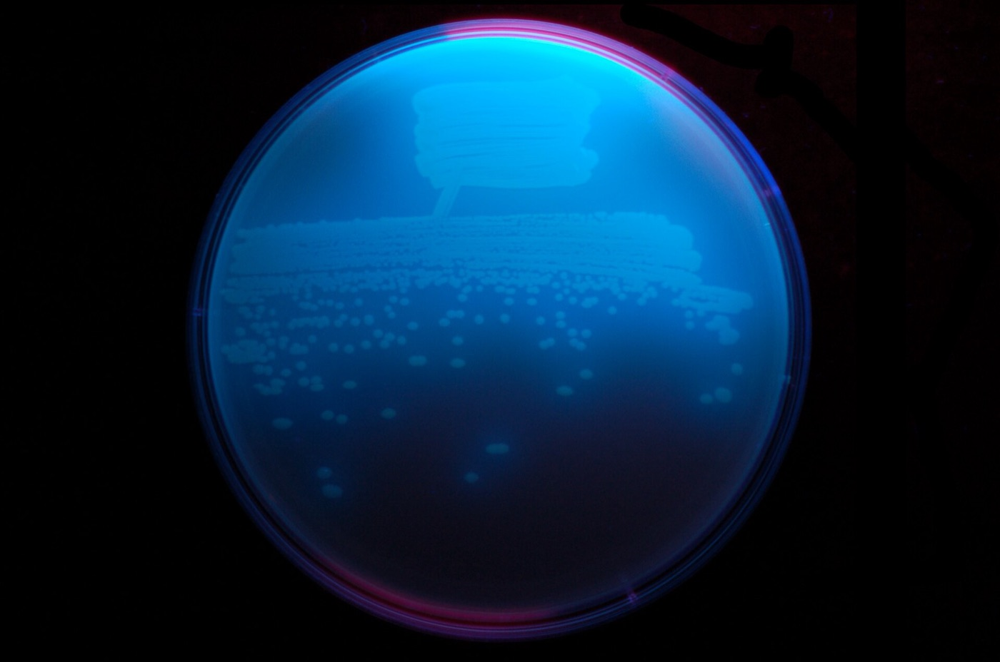
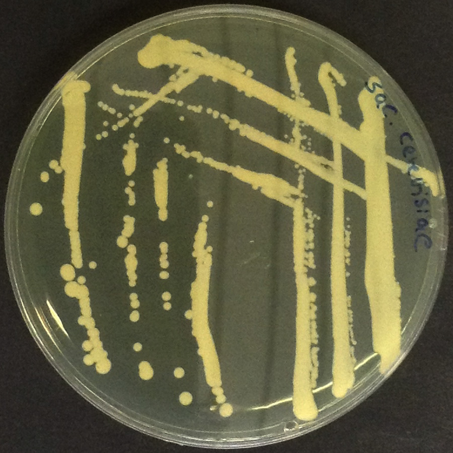
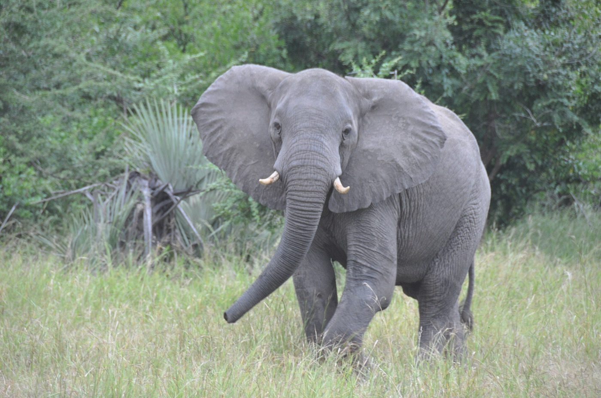
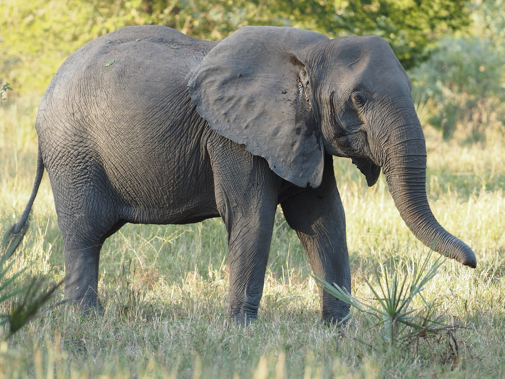
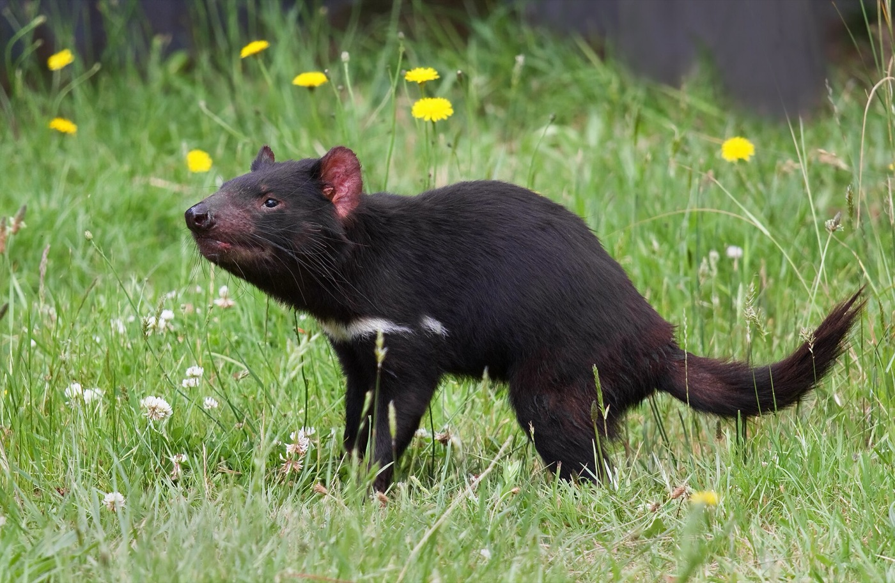
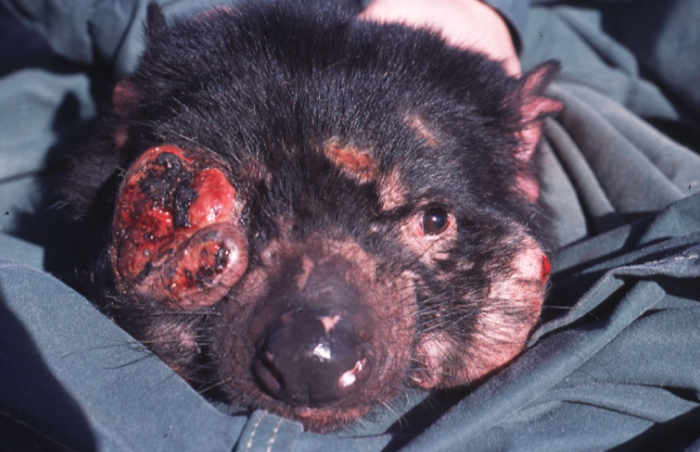
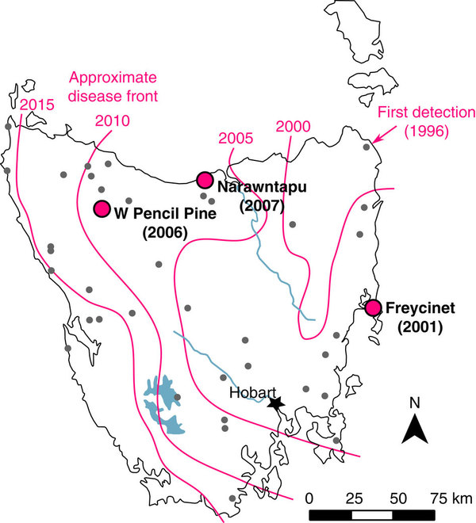

```{r}
#| include: false
source("../slides-ggplot.R")

# Eine Kopie: jede Kopie hat im Mittel 1 + s Nachkommen (Poisson)
linie <- function(s, generationen = 40) {
  n <- numeric(generationen + 1)
  n[1] <- 1
  for (t in seq_len(generationen)) n[t + 1] <- rpois(1, n[t] * (1 + s))
  n
}

schicksal <- function(s, grenze = 100) {
  n <- 1
  while (n > 0 && n < grenze) n <- rpois(1, n * (1 + s))
  as.numeric(n >= grenze)
}

# Rettung: Wildtyp schrumpft (1 - r), Mutanten wachsen (1 + s)
rettung_lauf <- function(N0, r, s, U = 1e-5, generationen = 120) {
  wt <- N0; mut <- 0
  N <- numeric(generationen + 1); N[1] <- N0
  for (t in seq_len(generationen)) {
    neu <- rbinom(1, wt, U)
    wt <- rpois(1, wt * (1 - r))
    mut <- min(rpois(1, mut * (1 + s)) + neu, 1e7)
    N[t + 1] <- wt + mut
  }
  data.frame(generation = 0:generationen, N = N)
}

rettung <- function(N0, r, s, U = 1e-5, grenze = 1000) {
  wt <- N0; mut <- 0
  repeat {
    neu <- rbinom(1, wt, U)
    wt <- rpois(1, wt * (1 - r))
    mut <- rpois(1, mut * (1 + s)) + neu
    if (mut >= grenze) return(1)
    if (wt + mut == 0) return(0)
  }
}

formel <- function(N0, r, s, U = 1e-5) 1 - exp(-2 * N0 * U * s / r)
```

## Übersicht

**Woche 10** von 14 · **Do., 19. Nov. 2026, 08:15–10:00**

| Teil | Dauer | Was |
|------|-------|-----|
| Vorlesung | ~55 min | Antibiotika · neue Mutation · Rettung · Tempo und Migration · Elefanten · Teufel |
| Notebook | ~35 min | Schicksal einer Kopie · Rettung simulieren · Bonus: Elefanten |

::: aside
Pfeiltasten · **M** Menü · **E** PDF · **Esc** Übersicht
:::

## Lernziele

Nach heute können Sie …

1. beschreiben, wie Bakterien unter Antibiotikum **gerettet** werden oder aussterben (U-Kurve),
2. sagen, warum eine neue vorteilhafte Mutation meist **verloren** geht (etwa $2s$),
3. erklären, wovon **evolutionäre Rettung** abhängt: $N_0$, $U$, $s$, $r$,
4. sagen, warum **langsame** Veränderung und **Genfluss** aus einer Zuflucht Rettung oft erleichtern,
5. stehende Variation und **neue** Mutation unterscheiden: Elefanten und Tasmanische Teufel.

# Bakterien unter Antibiotikum

## Eine Infektion wird behandelt

Ein Antibiotikum tötet empfindliche Bakterien. Die Population **schrumpft**.

Zwei Ausgänge sind möglich:

- Alle sterben: Die Infektion ist vorbei.
- Eine **resistente** Mutante ist schon da oder entsteht, bevor alle tot sind. Sie wächst, und die Population erholt sich.

Für die Patientin ist das zweite schlecht. Für die Bakterien ist es **evolutionäre Rettung**.

## Im Labor: *Pseudomonas* und Streptomycin

:::: columns
::: {.column width="62%"}
Ramsayer et al. (2013) setzten Hunderte Populationen von *Pseudomonas fluorescens* dem Antibiotikum Streptomycin aus und zählten über die Zeit die Zellen.

- Alle Populationen **schrumpften** zuerst.
- Manche starben aus, zwischen Stunde 30 und 53.
- Andere schrumpften 20 bis 30 Stunden lang und **wuchsen dann wieder**: eine **U-Kurve**.
:::
::: {.column width="38%"}
{fig-alt="Pseudomonas fluorescens leuchtet unter UV-Licht auf einer Agarplatte"}
:::
::::

Am Ende waren 96.8 % der geretteten Populationen **resistent**. Von den ausgestorbenen waren 96.4 % bis zuletzt empfindlich.

::: aside
Foto: *P. fluorescens* unter UV-Licht. Ninjatacoshell, Wikimedia Commons, CC BY-SA 3.0
:::

## Was in der U-Kurve steckt

```{r}
#| fig-height: 3.5
#| fig-width: 8.4
#| out-width: 90%
t <- 0:60
emp <- 1e6 * 0.85^t                                   # Empfindliche sterben
res <- ifelse(t >= 8, 1.25^(t - 8), NA)               # eine Resistente ab Stunde 8
ges <- emp + ifelse(is.na(res), 0, res)
u <- rbind(data.frame(t = t, N = emp, wer = "empfindlich"),
           data.frame(t = t, N = res, wer = "resistent"),
           data.frame(t = t, N = ges, wer = "alle zusammen"))
u$wer <- factor(u$wer, levels = c("alle zusammen", "empfindlich", "resistent"))
ggplot(u[!is.na(u$N) & u$N >= 1, ], aes(t, N, colour = wer, linewidth = wer)) +
  geom_line() +
  scale_y_log10(breaks = 10^(0:6), labels = c("1", "10", "100", "1000", "10^4", "10^5", "10^6")) +
  coord_cartesian(ylim = c(0.4, 2e6)) +
  scale_colour_manual(values = c("alle zusammen" = "grey15", empfindlich = "#e67e22", resistent = "#2166ac"), name = NULL) +
  scale_linewidth_manual(values = c("alle zusammen" = 2.2, empfindlich = 1, resistent = 1), guide = "none") +
  annotate("point", x = 8, y = 1, colour = "#2166ac", size = 3) +
  annotate("text", x = 10, y = 1, label = "eine Mutante entsteht", hjust = 0, vjust = 1.2, size = 4.2, colour = "#2166ac") +
  labs(x = "Zeit", y = "Zellen (log)") +
  theme_slide()
```

Die U-Kurve ist die **Summe** von zwei Gruppen: Empfindliche sterben, eine Resistente wächst. Gerettet ist die Population, wenn die Resistenten schnell genug da sind.

::: aside
Skizze, keine Messdaten
:::

## Grosse Populationen werden öfter gerettet

```{r}
#| fig-height: 2.8
#| fig-width: 6.5
#| out-width: 60%
pf <- data.frame(groesse = factor(c("klein (0.2 mL)", "gross (1.5 mL)"),
                                  levels = c("klein (0.2 mL)", "gross (1.5 mL)")),
                 gerettet = c(3, 25), total = c(47, 48))
ggplot(pf, aes(groesse, gerettet / total)) +
  geom_col(fill = "#2166ac", width = 0.55) +
  geom_text(aes(label = paste(gerettet, "von", total)), vjust = -0.5, size = 5) +
  scale_y_continuous(limits = c(0, 0.65), labels = function(x) paste0(100 * x, " %")) +
  labs(x = "Populationsgrösse (Volumen)", y = "gerettet") +
  theme_slide()
```

Gleiches Antibiotikum, gleiche Bakterien. Der Unterschied ist die **Grösse**. Warum? Dafür brauchen wir ein Modell.

::: aside
Ramsayer, Kaltz & Hochberg (2013), Experiment 2, nach 86 Stunden
:::

## Letzte Woche: viele Kopien

Im Teich startete die Inversion bei $p = 0.5$: Jeder Fisch trug eine Kopie.

Zufall liess die Teiche verschieden laufen, aber **keiner verlor** die Inversion.

Eine **neue Mutation** beginnt anders: mit **einer einzigen Kopie**.

# Eine neue Mutation

## Eine Kopie, zwanzig Mal

```{r}
#| fig-height: 3.5
#| fig-width: 8.4
#| out-width: 92%
set.seed(2)
linien <- do.call(rbind, lapply(1:20, function(i) {
  n <- linie(0.1)
  data.frame(generation = 0:40, n = n, id = i,
             ausgang = ifelse(n[41] > 0, "überlebt", "verloren"))
}))
n_weg <- sum(tapply(linien$ausgang, linien$id, `[`, 1) == "verloren")
ggplot(linien, aes(generation, n, group = id, colour = ausgang)) +
  geom_line(data = subset(linien, ausgang == "überlebt"), linewidth = 1) +
  geom_line(data = subset(linien, ausgang == "verloren"), linewidth = 0.8, alpha = 0.8) +
  scale_colour_manual(values = c("überlebt" = "#2166ac", "verloren" = "#e67e22")) +
  coord_cartesian(ylim = c(0, 25)) +
  labs(x = "Generation", y = "Anzahl Kopien",
       title = paste0("s = 0.1: ", n_weg, " von 20 Mutationen gehen verloren")) +
  theme_slide()
```

Jede Kopie hat im Mittel 1.1 Nachkommen. Trotzdem sind die meisten Linien nach wenigen Generationen **weg**.

## Warum?

Am Anfang gibt es nur **eine** Kopie. Hat ihr Träger zufällig keine Nachkommen, ist die Mutation verloren.

Selektion wirkt im **Mittel**. Bei einer Kopie zählt vor allem **Glück**.

Erst wenn es viele Kopien gibt, setzt sich der Vorteil durch: Die Mutation hat sich **etabliert**.

## Wie oft etabliert sie sich?

```{r}
#| fig-height: 3.4
#| fig-width: 8.4
#| out-width: 88%
set.seed(2)
s_werte <- c(0.01, 0.02, 0.05, 0.1, 0.15, 0.2)
u_hat <- sapply(s_werte, function(s) mean(replicate(3000, schicksal(s))))
ggplot() +
  geom_abline(slope = 2, intercept = 0, colour = "#d95f02", linetype = "dashed", linewidth = 1) +
  geom_point(data = data.frame(s = s_werte, u = u_hat), aes(s, u),
             colour = "#2166ac", size = 3) +
  annotate("text", x = 0.15, y = 0.36, label = "2s", colour = "#d95f02", size = 5) +
  coord_cartesian(xlim = c(0, 0.21), ylim = c(0, 0.42)) +
  labs(x = "Selektionsvorteil s", y = "Anteil etabliert",
       title = "Simulation (Punkte) und Faustregel 2s (Linie)") +
  theme_slide()
```

Faustregel (Haldane 1927): Eine neue vorteilhafte Mutation etabliert sich mit Wahrscheinlichkeit **etwa $2s$**. Bei $s = 0.1$ gehen also rund **80 %** verloren.

# Evolutionäre Rettung

## Wenn die Umwelt plötzlich schlecht wird

Antibiotikum, Pestizid, Hitze, Salz: Die Population **schrumpft** jede Generation um einen Anteil $r$.

Ohne Anpassung stirbt sie aus.

Retten kann sie nur eine **resistente Mutation**, die sich **etabliert, bevor** die Population verschwunden ist: **evolutionäre Rettung**.

## Zwei Ausgänge

```{r}
#| fig-height: 3.5
#| fig-width: 8.4
#| out-width: 92%
set.seed(8)
laeufe <- do.call(rbind, lapply(1:12, function(i) cbind(rettung_lauf(3e4, 0.1, 0.1), id = i)))
gerettet <- aggregate(N ~ id, laeufe, function(x) tail(x, 1) > 0)
laeufe$ausgang <- ifelse(gerettet$N[laeufe$id], "gerettet", "ausgestorben")
ggplot(laeufe, aes(generation, pmax(N, 1), group = id, colour = ausgang)) +
  geom_line(linewidth = 0.9) +
  scale_y_log10(breaks = 10^(0:6), labels = c("1", "10", "100", "1000", "10^4", "10^5", "10^6")) +
  scale_colour_manual(values = c(gerettet = "#2166ac", ausgestorben = "#bdbdbd")) +
  coord_cartesian(ylim = c(1, 1e6)) +
  labs(x = "Generation", y = "Populationsgrösse (log)",
       title = "Start: 30 000 Individuen, Rückgang r = 0.1, resistente Mutante s = 0.1") +
  theme_slide()
```

Grau: ausgestorben. Blau: Eine Mutante hat sich rechtzeitig etabliert — die Population erholt sich (**U-Kurve**).

## Wovon hängt Rettung ab?

| Zutat | Wirkung | mehr Rettung, wenn … |
|---|---|---|
| Startgrösse $N_0$ | mehr Individuen, mehr Mutationen | $N_0$ **gross** |
| Mutationsrate $U$ | mehr resistente Mutanten | $U$ **gross** |
| Vorteil $s$ | Etablierung ≈ $2s$ | $s$ **gross** |
| Rückgang $r$ | weniger Zeit bis zum Aussterben | $r$ **klein** |

Zusammen (Orr & Unckless 2014):

$$
P(\text{Rettung}) \approx 1 - e^{-2 N_0 U s / r}
$$

## Grosse Populationen werden gerettet

```{r}
#| fig-height: 3.4
#| fig-width: 8.4
#| out-width: 88%
set.seed(4)
N0_werte <- c(1e3, 3e3, 1e4, 3e4, 1e5, 3e5)
p_hat <- sapply(N0_werte, function(N0) mean(replicate(300, rettung(N0, 0.1, 0.1))))
N0_fein <- 10^seq(3, 5.5, length.out = 100)
ggplot() +
  geom_line(data = data.frame(N0 = N0_fein, p = formel(N0_fein, 0.1, 0.1)),
            aes(N0, p), colour = "#d95f02", linetype = "dashed", linewidth = 1) +
  geom_point(data = data.frame(N0 = N0_werte, p = p_hat), aes(N0, p),
             colour = "#2166ac", size = 3) +
  scale_x_log10(breaks = c(1e3, 1e4, 1e5), labels = c("1000", "10 000", "100 000")) +
  coord_cartesian(ylim = c(0, 1)) +
  labs(x = "Startgrösse N0 (log)", y = "Anteil gerettet",
       title = "r = 0.1, s = 0.1, U = 0.00001: Simulation und Formel") +
  theme_slide()
```

Zwischen 1000 und 100 000 Individuen kippt die Rettung von «fast nie» zu «fast immer». Das passt zu *Pseudomonas*: kleine Röhrchen 3 von 47, grosse 25 von 48.

## Im Labor: Hefe unter Salz

:::: columns
::: {.column width="65%"}
Bell & Gonzalez (2009) setzten viele Hefe-Populationen verschiedener Grösse einem Salzgehalt aus, bei dem sie normalerweise sterben.

- Viele Populationen starben aus.
- Manche erholten sich nach einem Einbruch: **U-Kurve**, wie im Modell.
- **Grössere** Populationen wurden häufiger gerettet.
:::
::: {.column width="35%"}
{fig-alt="Kolonien von Bäckerhefe auf einer Agarplatte"}
:::
::::

::: aside
Foto: *Saccharomyces cerevisiae*. A doubt, Wikimedia Commons, CC BY-SA 4.0
:::

# Wie schnell, und wo?

## Schnell oder langsam?

```{r}
#| fig-height: 2.1
#| fig-width: 8
#| out-width: 70%
tr <- 0:20
rampe <- rbind(data.frame(t = tr, c = pmin(1, (tr > 0) * 1), weg = "plötzlich"),
               data.frame(t = tr, c = pmin(1, tr / 10), weg = "mittel"),
               data.frame(t = tr, c = tr / 20, weg = "langsam"))
rampe$weg <- factor(rampe$weg, levels = c("plötzlich", "mittel", "langsam"))
ggplot(rampe, aes(t, c, colour = weg)) +
  geom_line(linewidth = 1.4) +
  scale_colour_manual(values = c(plötzlich = "#c0392b", mittel = "#e67e22", langsam = "#27ae60"), name = NULL) +
  scale_y_continuous(breaks = c(0, 1), labels = c("0", "Maximum")) +
  labs(x = "Transfer", y = "Antibiotikum") +
  theme_slide() + theme(legend.position = "right")
```

Lindsey et al. (2013): 1255 Populationen *E. coli*, Antibiotikum Rifampicin. Am Ende überall **dieselbe** Konzentration, nur der Weg ist verschieden.

Je **langsamer** es schlechter wird, desto mehr Populationen überleben. Manche Resistenz-Kombinationen sind nur auf dem langsamen Weg erreichbar.

::: aside
Skizze der drei Behandlungen. Lindsey, Gallie, Taylor & Kerr (2013), *Nature* 494: 463–467
:::

## Hefe in vielen kleinen Populationen

```{r}
#| fig-height: 1.9
#| fig-width: 9.5
#| out-width: 80%
gitter <- expand.grid(x = 1:5, y = 1:3)
pfeile <- rbind(
  data.frame(art = "getrennt", x = NA, y = NA, xend = NA, yend = NA),
  data.frame(art = "lokal", x = c(1, 2, 3, 4, 2, 3), y = c(2, 2, 2, 2, 1, 3), xend = c(2, 3, 4, 5, 2, 3), yend = c(2, 2, 2, 2, 2, 2)),
  data.frame(art = "global", x = c(1, 5, 2, 4), y = c(1, 3, 3, 1), xend = c(4, 2, 5, 1), yend = c(3, 1, 2, 2)))
pfeile$art <- factor(pfeile$art, levels = c("getrennt", "lokal", "global"))
punkte <- do.call(rbind, lapply(levels(pfeile$art), function(a) cbind(gitter, art = a)))
punkte$art <- factor(punkte$art, levels = levels(pfeile$art))
ggplot() +
  geom_point(data = punkte, aes(x, y), shape = 21, size = 7, fill = "#fdebd0", colour = "grey40") +
  geom_segment(data = na.omit(pfeile), aes(x, y, xend = xend, yend = yend),
               arrow = arrow(length = unit(0.12, "cm")), colour = "#2166ac", linewidth = 0.7) +
  facet_wrap(~ art) + coord_equal(xlim = c(0.5, 5.5), ylim = c(0.5, 3.5)) +
  theme_void(base_size = 15) + theme(strip.text = element_text(face = "bold"))
```

Bell & Gonzalez (2011): über 2000 Hefe-Populationen, von einem Roboter betreut. Das Salz steigt langsam, mittel oder schnell. Austausch: keiner, mit **Nachbarn** oder **zufällig**.

Am besten: **langsame** Verschlechterung und Austausch mit **Nachbarn**. Auch ob ein späterer Salzschock überlebt wird, hängt von beidem ab.

::: aside
Skizze der drei Verbindungen. Bell & Gonzalez (2011), *Science* 332: 1327–1330
:::

## Ein Modell mit zwei Orten

```{r}
#| fig-height: 2.3
#| fig-width: 9
#| out-width: 88%
ggplot() +
  annotate("rect", xmin = 0, xmax = 3, ymin = 0, ymax = 2, fill = "#f5b7b1", colour = "grey30") +
  annotate("rect", xmin = 5, xmax = 8, ymin = 0, ymax = 2, fill = "#d5f5e3", colour = "grey30") +
  annotate("text", x = 1.5, y = 1.45, label = "Ort 1: schlecht ab t = 0", size = 5, fontface = "bold") +
  annotate("text", x = 1.5, y = 0.7, label = "Wildtyp schrumpft (r)\nMutante wächst (z)", size = 4.3) +
  annotate("text", x = 6.5, y = 1.45, label = "Ort 2: schlecht erst ab θ", size = 5, fontface = "bold") +
  annotate("text", x = 6.5, y = 0.7, label = "bis dahin: Zuflucht\nMutante hat Kosten (s)", size = 4.3) +
  annotate("segment", x = 3.15, xend = 4.85, y = 1.25, yend = 1.25, arrow = arrow(length = unit(0.25, "cm")), linewidth = 1, colour = "#2166ac") +
  annotate("segment", x = 4.85, xend = 3.15, y = 0.75, yend = 0.75, arrow = arrow(length = unit(0.25, "cm")), linewidth = 1, colour = "#2166ac") +
  annotate("text", x = 4, y = 1.6, label = "Migration m", colour = "#2166ac", size = 4.5) +
  coord_equal() + theme_void()
```

Tomasini & Peischl (2020): Zwei Orte tauschen Individuen aus. Ort 1 wird zuerst schlecht, Ort 2 erst später. Hilft der Austausch der Rettung, oder schadet er?

::: aside
Tomasini & Peischl (2020), *Evolution* 74: 1640–1653
:::

## Wann hilft Genfluss?

- **Hilft:** Die Zuflucht schickt laufend Individuen nach Ort 1. Dort entstehen mehr Mutationen, und Mutanten aus der Zuflucht wandern dorthin, wo sie im Vorteil sind.
- **Schadet:** Zu viel Austausch spült Mutanten in die Zuflucht, wo sie Kosten haben (*gene swamping*).

Genfluss hilft, wenn $\dfrac{s}{z} < r\,\theta$:

Die Kosten der Mutante sind klein im Vergleich zum Nutzen, die Umwelt ist hart ($r$), die Zuflucht bleibt lange ($\theta$). Oft ist eine **mittlere** Migrationsrate am besten.

## Weitere Modelle

| Modell | Frage |
|---|---|
| Gomulkiewicz & Holt (1995) | Wann rettet Selektion eine schrumpfende Population? Die U-Kurve |
| Orr & Unckless (2008, 2014) | Rettung aus neuer Mutation oder aus stehender Variation |
| Martin et al. (2013) | Passen die Formeln zu Experimenten mit Hefe und *Pseudomonas*? |
| Uecker, Otto & Hermisson (2014) | Rettung in Populationen mit mehreren Orten. Oft hilft mittlere Migration |
| Tomasini & Peischl (2020) | Wann hilft Genfluss aus einer Zuflucht? |

Gemeinsam: **Wie viele** Individuen, **wie schnell** die Umwelt schlechter wird, **woher** die Variation kommt, und **wo** die Population lebt.

# Wenn die Variante schon da ist

## Gorongosa, Mosambik

:::: columns
::: {.column width="56%"}
- Bürgerkrieg in Mosambik, **1977 bis 1992**.
- Bewaffnete Gruppen wildern Elefanten, für **Elfenbein**.
- Vor dem Krieg: über **2500** Elefanten im Nationalpark. Danach: etwa **200**.

Gejagt werden Tiere **mit** Stosszähnen.
:::
::: {.column width="44%"}
{fig-alt="Elefant mit kurzen Stosszähnen in Gorongosa" height="165px"}

{fig-alt="Elefant in Gorongosa, keine Stosszähne zu sehen" height="165px"}
:::
::::

::: aside
Campbell-Staton et al. (2021), *Science* 374: 483–487 · Fotos aus Gorongosa: oben mit Stosszähnen (USAID, gemeinfrei), unten keine zu sehen (Judy Gallagher, Flickr, CC BY 2.0)
:::

## Weibchen ohne Stosszähne

```{r}
#| fig-height: 3.2
#| fig-width: 7.5
#| out-width: 75%
ele <- data.frame(
  wann = factor(c("vor dem Krieg\n(n = 52)", "nach dem Krieg\n(n = 108)", "Töchter, nach dem\nKrieg geboren"),
                levels = c("vor dem Krieg\n(n = 52)", "nach dem Krieg\n(n = 108)", "Töchter, nach dem\nKrieg geboren")),
  anteil = c(0.185, 0.509, 0.33))
ggplot(ele, aes(wann, anteil)) +
  geom_col(fill = "#a04000", width = 0.6) +
  geom_text(aes(label = paste0(round(100 * anteil, 1), " %")), vjust = -0.4, size = 5) +
  scale_y_continuous(limits = c(0, 0.62), labels = function(x) paste0(100 * x, " %")) +
  labs(x = NULL, y = "Anteil ohne Stosszähne") +
  theme_slide()
```

Ein kleiner Teil der Weibchen hatte schon immer keine Stosszähne. Nach dem Krieg ist es **die Hälfte**.

::: aside
Weibchen im Gorongosa-Nationalpark. Campbell-Staton et al. (2021)
:::

## Wilderei als Filter

```{r}
#| fig-height: 3.4
#| fig-width: 9
#| out-width: 92%
set.seed(5)
vorher <- data.frame(id = 1:100, x = (0:99) %% 10, y = (0:99) %/% 10,
                     typ = c(rep("ohne Stosszähne", 18), rep("mit Stosszähnen", 82)))
vorher$typ <- sample(vorher$typ)
ueberlebt <- c(sample(which(vorher$typ == "ohne Stosszähne"), 9),
               sample(which(vorher$typ == "mit Stosszähnen"), 8))
vorher$zeit <- "vor dem Krieg: 100 Weibchen"
nachher <- vorher; nachher$zeit <- "nach dem Krieg: 17 überleben"
nachher$typ[-ueberlebt] <- "getötet"
el <- rbind(vorher, nachher)
el$zeit <- factor(el$zeit, levels = unique(el$zeit))
ggplot(el, aes(x, -y, colour = typ, shape = typ)) +
  geom_point(size = 4.2, stroke = 1.2) +
  scale_colour_manual(values = c("ohne Stosszähne" = "#a04000", "mit Stosszähnen" = "#95a5a6", "getötet" = "#d5d8dc"), name = NULL) +
  scale_shape_manual(values = c("ohne Stosszähne" = 16, "mit Stosszähnen" = 16, "getötet" = 4), name = NULL) +
  facet_wrap(~ zeit) + coord_equal() +
  theme_void(base_size = 15) + theme(legend.position = "bottom")
```

Vorher 18 von 100 ohne Stosszähne. Wilderer töten Tiere **mit** Stosszähnen viel öfter. Von 17 Überlebenden haben 9 keine: über die Hälfte.

::: aside
Skizze mit gerundeten Zahlen: Überleben 50 % ohne, 10 % mit Stosszähnen (fünfmal so oft)
:::

## Ein Mini-Modell: ein Selektionsschritt

Wer keine Stosszähne hat, ist für Wilderer uninteressant. Mit Modellen schätzen die Autoren: Stosszahnlose Weibchen hatten eine etwa **fünfmal** höhere Chance, den Krieg zu überleben.

Probe mit der Rechnung aus Woche 6 ($p' = p\,w/\bar w$), hier für den Anteil $p$ stosszahnloser Weibchen. Überleben sie $w = 5$-mal eher:

$$
p' = \frac{w\,p}{w\,p + (1 - p)} = \frac{5 \cdot 0.185}{5 \cdot 0.185 + 0.815} \approx 0.53
$$

Beobachtet: 0.509. Ein einziger Selektionsschritt, **innerhalb einer** Elefantengeneration.

## Ein Allel auf dem X-Chromosom

- Im Park sind **keine** Männchen ohne Stosszähne bekannt.
- Vermutung der Autoren: ein **dominantes** Allel auf dem **X-Chromosom**. Weibchen mit einer Kopie haben keine Stosszähne. Männchen mit dem Allel sterben vermutlich vor der Geburt.
- Dazu passt: Die Nachkommen stosszahnloser Mütter sind zu **65.7 %** weiblich.
- Kandidatengene: **AMELX** (auf dem X, Zahnschmelz) und **MEP1a**, beide an der Zahnbildung beteiligt.

Der Vorteil hat also einen **Preis**.

## Neue Mutation oder stehende Variation?

**Nicht ganz Rettung.** Die Elefanten erholten sich vor allem, weil der Krieg und die Wilderei endeten.

Aber der Vergleich mit dem Modell zeigt etwas Wichtiges:

- Eine **neue** Mutation startet mit einer Kopie und muss die Lotterie (etwa $2s$) gewinnen.
- Die Stosszahnlosigkeit war **schon da**, bei 18.5 % der Weibchen: **stehende Variation**. Viele Kopien, kein Warten.

Darum ging es so schnell: ein Schritt, nicht viele Generationen.

# Tasmanische Teufel

## Gesund und krank

:::: columns
::: {.column width="55%"}
{fig-alt="Gesunder Tasmanischer Teufel im Gras"}
:::
::: {.column width="45%"}
{fig-alt="Tasmanischer Teufel mit Gesichtstumor"}
:::
::::

Links ein gesunder Tasmanischer Teufel. Rechts ein Teufel mit dem ansteckenden Gesichtstumor (DFTD).

::: aside
Fotos: JJ Harrison, Wikimedia Commons, CC BY-SA 3.0 · Menna Jones, Wikimedia Commons, CC BY 2.5
:::

## Ein ansteckender Krebs

- Der **Tasmanische Teufel** ist das grösste noch lebende Raubbeuteltier.
- 1996 wird im Nordosten Tasmaniens ein **Gesichtstumor** entdeckt (DFTD). Die Krebszellen selbst werden übertragen, durch **Bisse** bei Kämpfen.
- Die Krankheit endet fast immer tödlich.
- In weniger als 20 Jahren: über **80 %** weniger Teufel, örtlich über 90 %. Modelle sagten das **Aussterben** voraus.

Doch dort, wo die Krankheit am längsten ist, gibt es noch Teufel.

::: aside
Epstein et al. (2016), *Nature Communications* 7: 12684
:::

## Evolution in vier bis sechs Generationen

:::: columns
::: {.column width="60%"}
Erbgut von 294 Teufeln aus drei Gebieten, **vor** und **nach** Ankunft der Krankheit:

- Überall ändern sich dieselben **zwei** Regionen im Genom.
- Dort liegen Gene für **Immunsystem** und **Krebsrisiko** (beim Menschen).
- Geschätzter Vorteil: 16 bis 38 %, sehr unsicher.
- In **4 bis 6** Generationen (je etwa 2 Jahre).
:::
::: {.column width="40%"}
{fig-alt="Karte Tasmaniens mit der Ausbreitungsfront der Krankheit und den drei Probengebieten"}
:::
::::

::: aside
Epstein et al. (2016). Karte: Ausbreitung ab 1996, Probengebiete mit Jahr der Ankunft (Fig. 1, CC BY 4.0)
:::

## Ein Kandidat für Rettung

Alle Zutaten aus dem Modell sind da:

| Zutat | Teufel |
|---|---|
| Rückgang $r$ | Krebs tötet, die Population schrumpft stark |
| Variation | Varianten in Immungenen, schon vorhanden |
| Vorteil $s$ | geschätzt 0.16 bis 0.38, unsicher |
| Startgrösse $N_0$ | klein, und sie wird kleiner |

Ob es für Rettung reicht, ist **offen**. Die Autoren schreiben vorsichtig: Die Teufel entwickeln *möglicherweise* Resistenz.

## Was das bedeutet

**Antibiotika und Pestizide:** Riesige Populationen von Bakterien oder Schädlingen werden fast immer gerettet. Resistenz ist zu erwarten.

**Naturschutz:** Kleine, schrumpfende Populationen von bedrohten Arten werden selten gerettet. Für sie ist Evolution meist **zu langsam**.

**Elefanten und Teufel:** Ist eine passende Variante **schon da**, kann Selektion in wenigen Generationen viel ändern. Ob das eine kleine Population rettet, ist offen.

# Abschluss

## Take-home

1. Eine neue vorteilhafte Mutation geht meist verloren. Sie etabliert sich nur mit Wahrscheinlichkeit **etwa $2s$**.
2. Evolutionäre Rettung: Eine Mutante muss sich etablieren, **bevor** die Population ausstirbt.
3. Grosses $N_0$, $U$, $s$ und langsamer Rückgang $r$ machen Rettung wahrscheinlich.
4. Langsame Veränderung und Austausch mit einer Zuflucht helfen oft, zu viel Austausch kann schaden.
5. Ist die Variante **schon da** (stehende Variation: Elefanten, Teufel), geht Anpassung viel schneller als mit einer neuen Mutation.

## Notebook (~35 min)

**→ [Notebook Woche 10 öffnen](notebook.html)** · [Rmd](notebook.Rmd) · [R](notebook.R)

Sie verfolgen einzelne Mutationen, schätzen die Etablierung und simulieren Rettung für verschiedene $N_0$ und $r$. Bonus: Wie viel besser mussten stosszahnlose Elefanten überleben? Und: Rettung mit zwei Orten, wann hilft Migration?

## Ausblick · Woche 11

**Checkpoint C:** Ein Szenario zur Rettung, ein paar Simulationen, **eine Frage** — wie in Checkpoint B.

## Literatur

:::: {.lit}
1. **Bell, G. & Gonzalez, A. (2009).** Evolutionary rescue can prevent extinction following environmental change. *Ecology Letters* 12: 942–948. [doi:10.1111/j.1461-0248.2009.01350.x](https://doi.org/10.1111/j.1461-0248.2009.01350.x)
2. **Bell, G. & Gonzalez, A. (2011).** Adaptation and evolutionary rescue in metapopulations experiencing environmental deterioration. *Science* 332: 1327–1330. [doi:10.1126/science.1203105](https://doi.org/10.1126/science.1203105)
3. **Campbell-Staton, S. C., Arnold, B. J., Gonçalves, D., Granli, P., Poole, J., Long, R. A. & Pringle, R. M. (2021).** Ivory poaching and the rapid evolution of tusklessness in African elephants. *Science* 374: 483–487. [doi:10.1126/science.abe7389](https://doi.org/10.1126/science.abe7389)
4. **Epstein, B., Jones, M., Hamede, R., Hendricks, S., McCallum, H., Murchison, E. P., Schönfeld, B., Wiench, C., Hohenlohe, P. & Storfer, A. (2016).** Rapid evolutionary response to a transmissible cancer in Tasmanian devils. *Nature Communications* 7: 12684. [doi:10.1038/ncomms12684](https://doi.org/10.1038/ncomms12684)
5. **Gomulkiewicz, R. & Holt, R. D. (1995).** When does evolution by natural selection prevent extinction? *Evolution* 49: 201–207. [doi:10.1111/j.1558-5646.1995.tb05971.x](https://doi.org/10.1111/j.1558-5646.1995.tb05971.x)
6. **Haldane, J. B. S. (1927).** A mathematical theory of natural and artificial selection, Part V. *Proc. Camb. Philos. Soc.* 23: 838–844.
7. **Lindsey, H. A., Gallie, J., Taylor, S. & Kerr, B. (2013).** Evolutionary rescue from extinction is contingent on a lower rate of environmental change. *Nature* 494: 463–467. [doi:10.1038/nature11879](https://doi.org/10.1038/nature11879)
8. **Martin, G., Aguilée, R., Ramsayer, J., Kaltz, O. & Ronce, O. (2013).** The probability of evolutionary rescue: towards a quantitative comparison between theory and evolution experiments. *Phil. Trans. R. Soc. B* 368: 20120088. [doi:10.1098/rstb.2012.0088](https://doi.org/10.1098/rstb.2012.0088)
9. **Orr, H. A. & Unckless, R. L. (2008).** Population extinction and the genetics of adaptation. *American Naturalist* 172: 160–169. [doi:10.1086/589460](https://doi.org/10.1086/589460)
10. **Orr, H. A. & Unckless, R. L. (2014).** The population genetics of evolutionary rescue. *PLoS Genet.* 10: e1004551. [doi:10.1371/journal.pgen.1004551](https://doi.org/10.1371/journal.pgen.1004551)
11. **Peischl, S. & Kirkpatrick, M. (2012).** Establishment of new mutations in changing environments. *Genetics* 191: 895–906. [doi:10.1534/genetics.112.140756](https://doi.org/10.1534/genetics.112.140756)
12. **Ramsayer, J., Kaltz, O. & Hochberg, M. E. (2013).** Evolutionary rescue in populations of *Pseudomonas fluorescens* across an antibiotic gradient. *Evolutionary Applications* 6: 608–616. [doi:10.1111/eva.12046](https://doi.org/10.1111/eva.12046)
13. **Tomasini, M. & Peischl, S. (2020).** When does gene flow facilitate evolutionary rescue? *Evolution* 74: 1640–1653. [doi:10.1111/evo.14038](https://doi.org/10.1111/evo.14038)
14. **Uecker, H., Otto, S. P. & Hermisson, J. (2014).** Evolutionary rescue in structured populations. *American Naturalist* 183: E17–E35. [doi:10.1086/673914](https://doi.org/10.1086/673914)
::::

## Navigation

| | |
|---|---|
| Notebook | [Quarto](notebook.html) · [Rmd](notebook.Rmd) · [R](notebook.R) |
| Zurück | [← Woche 9](../week-09/slides.html) |
| Weiter | [Woche 11 →](../week-11/slides.html) |
| Modul | [Modul 3](../../docs/module-03-overview.html) |
