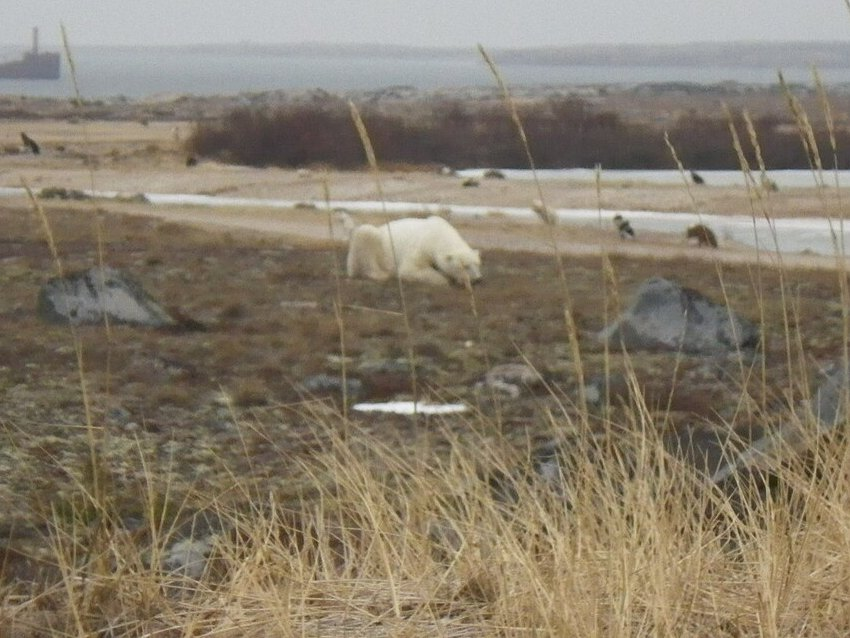
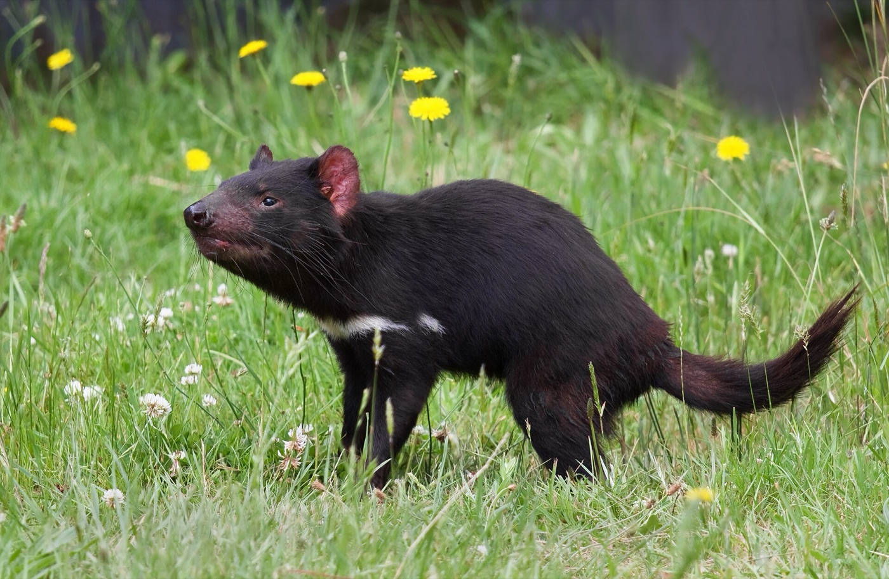
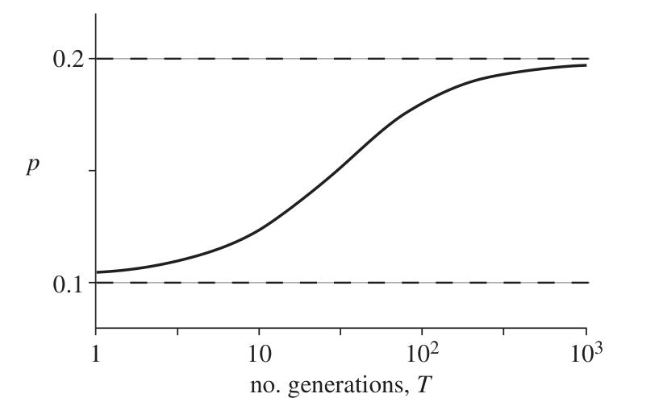
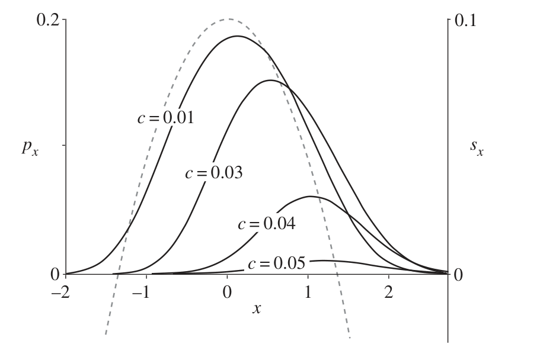
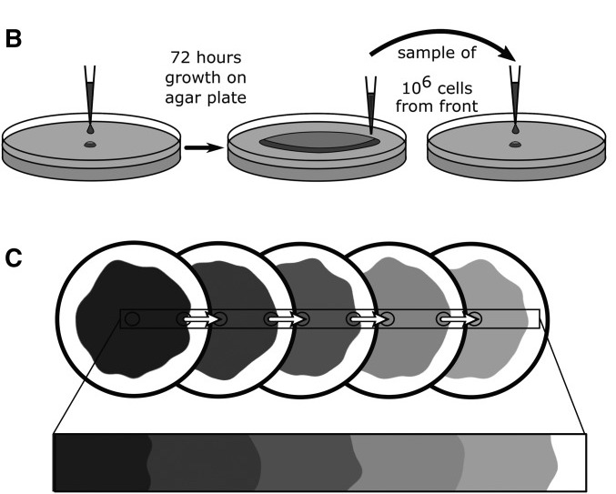
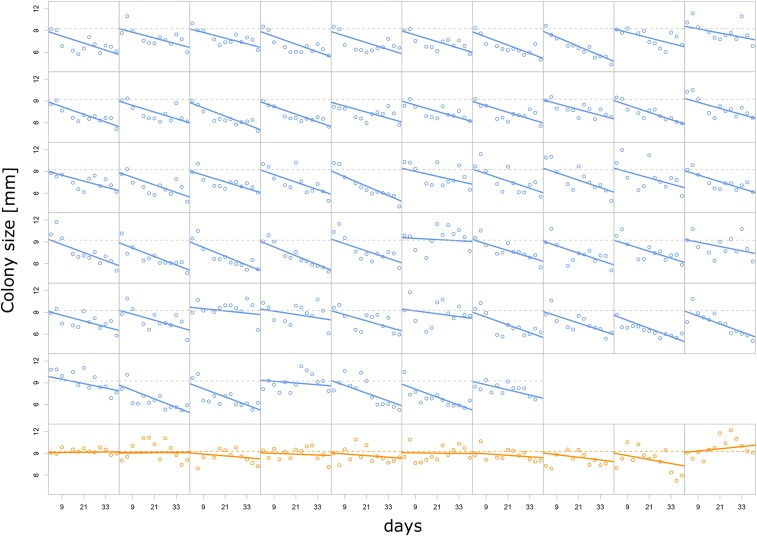
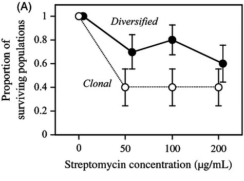
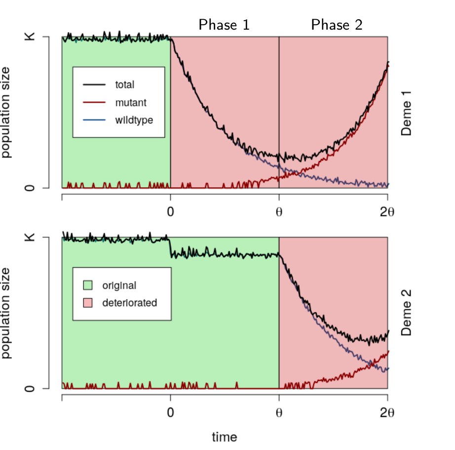
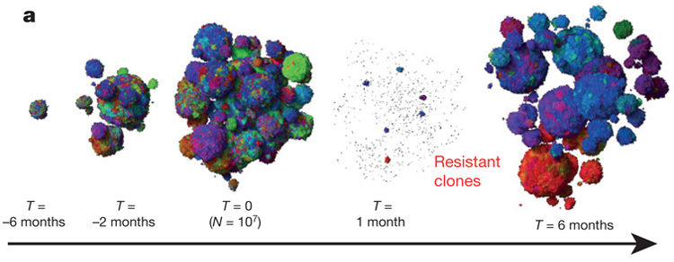

```{r}
#| include: false
source("../slides-ggplot.R")

# Eine Kopie: jede Kopie hat im Mittel 1 + s Nachkommen (Poisson)
linie <- function(s, generationen = 40) {
  n <- numeric(generationen + 1)
  n[1] <- 1
  for (t in seq_len(generationen)) n[t + 1] <- rpois(1, n[t] * (1 + s))
  n
}

schicksal <- function(s, grenze = 100) {
  n <- 1
  while (n > 0 && n < grenze) n <- rpois(1, n * (1 + s))
  as.numeric(n >= grenze)
}

# Rettung: Wildtyp schrumpft (1 - r), Mutanten wachsen (1 + s)
rettung_lauf <- function(N0, r, s, U = 1e-5, generationen = 120) {
  wt <- N0; mut <- 0
  N <- numeric(generationen + 1); N[1] <- N0
  for (t in seq_len(generationen)) {
    neu <- rbinom(1, wt, U)
    wt <- rpois(1, wt * (1 - r))
    mut <- min(rpois(1, mut * (1 + s)) + neu, 1e7)
    N[t + 1] <- wt + mut
  }
  data.frame(generation = 0:generationen, N = N)
}

rettung <- function(N0, r, s, U = 1e-5, grenze = 1000) {
  wt <- N0; mut <- 0
  repeat {
    neu <- rbinom(1, wt, U)
    wt <- rpois(1, wt * (1 - r))
    mut <- rpois(1, mut * (1 + s)) + neu
    if (mut >= grenze) return(1)
    if (wt + mut == 0) return(0)
  }
}

formel <- function(N0, r, s, U = 1e-5) 1 - exp(-2 * N0 * U * s / r)

# Spielzeugmodell: jede Kopie hat 0 oder 2 Nachkommen
eine_linie <- function(s) {
  a <- (1 - s) / 2
  n <- 1
  while (n > 0 && n < 100) n <- 2 * rbinom(1, n, 1 - a)
  as.numeric(n >= 100)
}

# Ein Stammbaum im Spielzeugmodell, mit Koordinaten zum Zeichnen
baum <- function(s, gen_max = 8) {
  a <- (1 - s) / 2
  kn <- data.frame(id = 1, gen = 0, eltern = NA)
  aktiv <- 1; letzte <- 1
  for (g in seq_len(gen_max)) {
    kinder <- c()
    for (k in aktiv) if (runif(1) > a) {
      ids <- letzte + 1:2; letzte <- letzte + 2
      kn <- rbind(kn, data.frame(id = ids, gen = g, eltern = k))
      kinder <- c(kinder, ids)
    }
    aktiv <- kinder
    if (length(aktiv) == 0) break
  }
  x <- rep(NA, nrow(kn)); blatt <- 0
  setze <- function(i) {
    k <- kn$id[!is.na(kn$eltern) & kn$eltern == i]
    if (length(k) == 0) { blatt <<- blatt + 1; x[i] <<- blatt }
    else { for (j in k) setze(j); x[i] <<- mean(x[k]) }
  }
  setze(1)
  kn$x <- (x - 1) / max(1, blatt - 1)
  kn$lebt <- length(aktiv) > 0
  kn
}

col_empf <- "#e67e22"   # empfindlich / Wildtyp
col_res <- "#2166ac"    # resistent / Mutante
col_theo <- "#d95f02"   # Theorie
```

## Übersicht

**Woche 10** von 14 · **Do., 19. Nov. 2026, 08:15–10:00**

| Teil | Dauer | Was |
|------|-------|-----|
| Vorlesung | ~55 min | Verzweigungsprozess · ein Modell für Rettung · ein Programm · Tests · zwei Orte |
| Notebook | ~35 min | Verzweigungsprozess Schritt für Schritt · Programm für Rettung · viele Läufe · Bonus: zwei Orte |

::: aside
Pfeiltasten · **M** Menü · **E** PDF · **Esc** Übersicht
:::

## Bis jetzt: von vielen Kopien zu einer

```{r}
#| fig-height: 3.4
#| fig-width: 10
#| out-width: 100%
wf_bahn <- function(p0, s = 0.1, N = 200, gen = 80, zufall = TRUE) {
  p <- numeric(gen + 1); p[1] <- p0
  for (t in seq_len(gen)) {
    p_sel <- p[t] * (1 + s) / (1 + p[t] * s)           # Erwartung (Woche 6)
    p[t + 1] <- if (zufall) rbinom(1, N, p_sel) / N else p_sel   # Zufall (Woche 9)
  }
  p
}
set.seed(4)
fall <- c("Wochen 5–8: unendlich viele Individuen", "Woche 9: N = 200, Start bei p = 0.5", "Heute: N = 200, eine einzige Kopie")
bahnen <- rbind(
  data.frame(gen = 0:80, p = wf_bahn(0.5, zufall = FALSE), id = 1, fall = fall[1]),
  do.call(rbind, lapply(1:20, function(i) data.frame(gen = 0:80, p = wf_bahn(0.5), id = i, fall = fall[2]))),
  do.call(rbind, lapply(1:20, function(i) data.frame(gen = 0:80, p = wf_bahn(1 / 200), id = i, fall = fall[3]))))
bahnen$fall <- factor(bahnen$fall, levels = fall)
weg <- sum(bahnen$p[bahnen$fall == fall[3] & bahnen$gen == 80] == 0)
bahnen$ende <- ave(bahnen$p, bahnen$fall, bahnen$id, FUN = function(x) x[length(x)] > 0)
ggplot(bahnen, aes(gen, p, group = id, colour = factor(ende))) +
  geom_line(linewidth = 0.8, alpha = 0.85) +
  geom_text(data = data.frame(fall = factor(fall[3], levels = fall), gen = 18, p = 0.8,
                              lab = paste(weg, "von 20\nverloren")),
            aes(gen, p, label = lab), inherit.aes = FALSE, size = 4.6, colour = col_empf, lineheight = 0.9) +
  facet_wrap(~ fall) +
  scale_colour_manual(values = c("1" = col_res, "0" = col_empf), guide = "none") +
  coord_cartesian(ylim = c(0, 1)) +
  labs(x = "Generation", y = "Häufigkeit p") +
  theme_slide() + theme(strip.text = element_text(size = 11.5, face = "bold"))
```

Dasselbe Modell, Selektion $s = 0.1$. Ohne Zufall **eine** Bahn. Mit Zufall eine **Wolke** um die Erwartung. Mit **einer** Kopie entscheidet der Zufall, ob es überhaupt losgeht.

## Lernziele

Nach heute können Sie …

1. erklären, was **evolutionäre Rettung** ist (U-Kurve),
2. einen **Verzweigungsprozess** simulieren und erklären, warum sich eine neue Mutation nur mit etwa $2s$ etabliert,
3. die Chance auf Rettung aus **Rückgang, Mutation und Etablierung** herleiten,
4. Rettung als **kleines Programm** simulieren,
5. **Vorhersagen** der Theorie mit Experimenten vergleichen,
6. stehende Variation und **Migration** einordnen.

## Heute

1. Gerettet oder ausgestorben? Die U-Kurve
2. Eine neue Mutation: Wie oft setzt sie sich durch?
3. Ein Modell für Rettung, als Formel und als Simulation
4. Fünf Vorhersagen, im Labor geprüft, die letzte mit einem Modell für zwei Orte

::: aside
[Modul 3](../../docs/module-03-overview.html) · [Glossar](../../docs/glossary.html)
:::

# Gerettet oder ausgestorben?

## Das Klima ändert sich, die Arten reagieren

:::: columns
::: {.column width="40%"}
{fig-alt="Eisbär liegt an Land im Gras, im Hintergrund eine Bucht" style="max-height:330px"}
:::
::: {.column width="60%"}
- **1700 Arten**: Verbreitung im Mittel **6 km pro Jahrzehnt** Richtung Pole, Frühling **2.3 Tage pro Jahrzehnt** früher.
- Neuere Daten: **17 km pro Jahrzehnt** Richtung Pole, **11 m** bergauf.
- Am stärksten schrumpfen **polare Arten und Bergarten**: kaum Platz zum Ausweichen. Hier gibt es die ersten Arten, die wegen des Klimawandels ausgestorben sind.
:::
::::

::: aside
Parmesan & Yohe (2003), *Nature* 421: 37–42 · Chen et al. (2011), *Science* 333: 1024–1026 · Parmesan (2006), *Annu. Rev. Ecol. Evol. Syst.* 37: 637–669 · Foto: Eisbär an Land, Martin Lopatka, CC BY-SA 2.0
:::

## Was kann eine schrumpfende Population tun?

```{r}
#| fig-height: 3.2
#| fig-width: 8
#| out-width: 92%
wege <- data.frame(y = c(3, 2, 1, 0),
                   titel = c("ausweichen", "sich umstellen", "sich genetisch anpassen", "aussterben"),
                   was = c("an einen besseren Ort wandern", "Verhalten oder Körper ändern, ohne neue Gene (Plastizität)",
                           "Varianten, die besser zurechtkommen, werden häufiger", ""),
                   farbe = c("#7f8c8d", "#7f8c8d", col_res, "#c0392b"))
ggplot(wege) +
  annotate("point", x = 0, y = 1.5, size = 9, colour = col_empf) +
  annotate("text", x = 0, y = 0.85, label = "Population\nschrumpft", size = 4.6, lineheight = 0.9) +
  geom_segment(aes(x = 0.15, y = 1.5, xend = 1.1, yend = y), colour = "grey50",
               arrow = arrow(length = unit(0.22, "cm"))) +
  geom_text(aes(x = 1.2, y = y + 0.12, label = titel, colour = farbe), hjust = 0, size = 6.2, fontface = "bold") +
  geom_text(aes(x = 1.2, y = y - 0.25, label = was), hjust = 0, size = 4.8, colour = "grey30") +
  scale_colour_identity() +
  coord_cartesian(xlim = c(-0.3, 4.6), ylim = c(-0.4, 3.4)) +
  theme_void()
```

Ausweichen sehen wir überall, wo Platz ist. Heute geht es um den blauen Weg: **Evolution**, bevor die Population verschwindet.

## Ist Evolution schnell genug?

```{r}
#| fig-height: 2.9
#| fig-width: 9.5
#| out-width: 92%
h <- 1; tag <- 24; jahr <- 365 * 24
uhr <- data.frame(
  zeile = c(rep("Die Umwelt ändert sich in …", 4), rep("Eine Generation dauert …", 4)),
  zeit = c(6 * h, 3 * 7 * tag, 3 * jahr, 30 * jahr, 0.5 * h, 3 * h, 2 * jahr, 25 * jahr),
  was = c("Antibiotikum", "Pestizid", "neue Krankheit", "Erwärmung",
          "Bakterien", "Hefe", "Tasm. Teufel", "Elefant"))
uhr$zeile <- factor(uhr$zeile, levels = c("Eine Generation dauert …", "Die Umwelt ändert sich in …"))
ggplot(uhr, aes(zeit, zeile, colour = zeile)) +
  geom_vline(xintercept = c(h, tag, 7 * tag, jahr, 10 * jahr), colour = "grey88") +
  geom_point(size = 6) +
  geom_text(aes(label = was, vjust = ifelse(was == "Erwärmung", 2.3, -1.3)), size = 4.6, colour = "grey15") +
  scale_x_log10(breaks = c(h, tag, 7 * tag, jahr, 10 * jahr),
                labels = c("1 Stunde", "1 Tag", "1 Woche", "1 Jahr", "10 Jahre")) +
  scale_colour_manual(values = c(col_res, "#c0392b"), guide = "none") +
  coord_cartesian(xlim = c(0.25, 80 * jahr)) +
  labs(x = NULL, y = NULL) +
  theme_slide() + theme(panel.grid = element_blank(), axis.text.y = element_text(size = 14, face = "bold"))
```

Oben: Wie schnell ändert sich die Umwelt? Unten: Wie lange dauert eine Generation? Bakterien haben während einer Behandlung viele Generationen, Elefanten während Jahrzehnten Erwärmung kaum eine. Gewinnt die Anpassung: **evolutionäre Rettung**.

::: aside
Grössenordnungen, Skizze · Begriff: Gomulkiewicz & Holt (1995) · Genetische Anpassung an Wärme ist beobachtet, aber es gibt bisher wenig Hinweise, dass sie ganze Arten schützt (Parmesan 2006)
:::

## Theater und Stück

> Hutchinson famously referred to ‘the ecological theater and the evolutionary play’ to emphasize that natural selection occurs in an environmental context. But, the metaphor works equally well if ‘ecological’ and ‘evolutionary’ are transposed: evolution provides the phenotypic setting that determines how the demographic processes of survival and extinction unfold.

Oft trennen wir: Ökologie in **Jahren** (wer überlebt, wie gross ist die Population), Evolution in **vielen Generationen**. Bei der Rettung laufen beide auf **derselben Zeitskala**: Während die Population schrumpft, ändern sich die Genhäufigkeiten. Dann können wir sie nicht mehr getrennt betrachten.

::: aside
Kirkpatrick & Peischl (2013), *Phil. Trans. R. Soc. B* 368: 20120082 · Hutchinson (1965)
:::

## Dieselbe Frage, entgegengesetzte Wünsche

:::: columns
::: {.column width="50%"}
{fig-alt="Pseudomonas fluorescens leuchtet unter UV-Licht auf einer Agarplatte" height="185px"}

**Bakterien unter Antibiotikum.** 2019 starben weltweit rund **1.27 Millionen** Menschen direkt an Infektionen mit resistenten Bakterien.

Wir wollen: **keine** Rettung.
:::
::: {.column width="50%"}
{fig-alt="Tasmanischer Teufel im Gras" height="185px"}

**Tasmanische Teufel** unter einem ansteckenden Krebs: über 80 % weniger Tiere in 20 Jahren.

Wir wollen: **Rettung**.
:::
::::

::: aside
Antimicrobial Resistance Collaborators (2022), *Lancet* · Epstein et al. (2016) · Fotos: Ninjatacoshell, CC BY-SA 3.0; JJ Harrison, CC BY-SA 3.0
:::

## Ein Experiment: dieselben Bakterien, zwei Ausgänge

:::: columns
::: {.column width="60%"}
{fig-alt="Originalabbildung: Zellzahl (log) über 53 Stunden für viele Populationen unter Streptomycin 50 und 100; durchgezogene Linien steigen wieder an, gestrichelte fallen auf null" style="max-height:440px"}
:::
::: {.column width="40%"}
*Pseudomonas* unter Streptomycin. Jede Linie: **eine** Population.

- Alle **schrumpfen**.
- Gestrichelt: **ausgestorben**.
- Durchgezogen: **U-Kurve**, gerettet.

Die geretteten sind am Ende fast alle **resistent**.
:::
::::

::: aside
Ramsayer, Kaltz & Hochberg (2013), Fig. 1, Ausschnitt (50 und 100 µg/mL), CC BY 3.0
:::

## Was in der U-Kurve steckt

```{r}
#| fig-height: 3.3
#| fig-width: 8.4
#| out-width: 90%
t <- 0:60
emp <- 1e6 * 0.85^t                                   # Empfindliche sterben
res <- ifelse(t >= 8, 1.25^(t - 8), NA)               # eine Resistente ab Stunde 8
ges <- emp + ifelse(is.na(res), 0, res)
u <- rbind(data.frame(t = t, N = emp, wer = "empfindlich"),
           data.frame(t = t, N = res, wer = "resistent"),
           data.frame(t = t, N = ges, wer = "alle zusammen"))
u$wer <- factor(u$wer, levels = c("alle zusammen", "empfindlich", "resistent"))
ggplot(u[!is.na(u$N) & u$N >= 1, ], aes(t, N, colour = wer, linewidth = wer)) +
  geom_line() +
  scale_y_log10(breaks = 10^(0:6), labels = c("1", "10", "100", "1000", "10^4", "10^5", "10^6")) +
  coord_cartesian(ylim = c(0.4, 2e6)) +
  scale_colour_manual(values = c("alle zusammen" = "grey15", empfindlich = col_empf, resistent = col_res), name = NULL) +
  scale_linewidth_manual(values = c("alle zusammen" = 2.2, empfindlich = 1, resistent = 1), guide = "none") +
  annotate("point", x = 8, y = 1, colour = col_res, size = 3) +
  annotate("text", x = 10, y = 1, label = "eine Mutante entsteht", hjust = 0, vjust = 1.2, size = 4.2, colour = col_res) +
  labs(x = "Zeit", y = "Zellen (log)") +
  theme_slide()
```

Die U-Kurve ist eine **Summe**: Empfindliche sterben, eine Resistente wächst. Ein **Wettlauf** zwischen Aussterben und Anpassung.

::: aside
Skizze. Die U-Kurve als Zeichen von Rettung: Gomulkiewicz & Holt (1995)
:::

## Die Frage

> Wovon hängt ab, ob eine schrumpfende Population **gerettet** wird?
> Und kann man das **vorhersagen**?

Heute: eine einfache Theorie, fünf Vorhersagen, und Experimente, die sie prüfen.

# Eine neue Mutation: Wie oft setzt sie sich durch?

## Eine Kopie, zwanzig Mal

```{r}
#| fig-height: 3.5
#| fig-width: 8.4
#| out-width: 92%
set.seed(2)
linien <- do.call(rbind, lapply(1:20, function(i) {
  n <- linie(0.1)
  data.frame(generation = 0:40, n = n, id = i,
             ausgang = ifelse(n[41] > 0, "überlebt", "verloren"))
}))
n_weg <- sum(tapply(linien$ausgang, linien$id, `[`, 1) == "verloren")
ggplot(linien, aes(generation, n, group = id, colour = ausgang)) +
  geom_line(data = subset(linien, ausgang == "überlebt"), linewidth = 1) +
  geom_line(data = subset(linien, ausgang == "verloren"), linewidth = 0.8, alpha = 0.8) +
  scale_colour_manual(values = c("überlebt" = col_res, "verloren" = col_empf)) +
  coord_cartesian(ylim = c(0, 25)) +
  labs(x = "Generation", y = "Anzahl Kopien",
       title = paste0("s = 0.1: ", n_weg, " von 20 Mutationen gehen verloren")) +
  theme_slide()
```

Jede startet mit **einer** Kopie, im Mittel 1.1 Nachkommen. Trotzdem sind die meisten bald **weg**: Selektion wirkt im Mittel, bei einer Kopie entscheidet der **Zufall**.

## Ein Spielzeugmodell

Jede Kopie hat entweder **keine** oder **zwei** Nachkommen:

| Nachkommen | Wahrscheinlichkeit | bei $s = 0.1$ |
|---|---|---|
| 0 | $a$ | 0.45 |
| 2 | $1 - a$ | 0.55 |

Im Mittel $2(1 - a)$ Nachkommen. Das soll $1 + s$ sein, also

$$
a = \frac{1 - s}{2}.
$$

Bei $s = 0.1$: 45 % der Kopien haben **gar keine** Nachkommen, obwohl die Mutation im Vorteil ist.

## Im Computer: eine Münze pro Kopie

Jede Kopie wirft eine Münze: mit Chance $1 - a$ zwei Nachkommen, sonst keine. Wie viele von $n$ Kopien gewinnen? Das ist `rbinom` aus Woche 9.

```{r}
#| echo: true
s <- 0.1
a <- (1 - s) / 2               # Chance auf keine Nachkommen: 0.45
set.seed(3)
n <- 10                        # 10 Kopien
2 * rbinom(1, n, 1 - a)        # Gewinner mal 2 = Kopien in der nächsten Generation
```

Eine Zeile ist **eine Generation**. Jetzt wiederholen wir sie.

## Eine Linie, Generation für Generation

```{r}
#| echo: true
set.seed(10)
n <- 1                                  # eine neue Mutation
verlauf <- n
while (n > 0 && n < 100) {              # bis verloren oder etabliert
  n <- 2 * rbinom(1, n, 1 - a)
  verlauf <- c(verlauf, n)
}
verlauf
```

Lange nur **2** Kopien: Haben beide keine Nachkommen, ist die Mutation weg. Hier hat sie es geschafft. `while` heisst «solange». Ab 100 Kopien: **etabliert**, bei 0: **verloren**.

## Zwölf Stammbäume

```{r}
#| fig-height: 3.6
#| fig-width: 9.5
#| out-width: 100%
set.seed(112)
baeume <- do.call(rbind, lapply(1:12, function(i) cbind(baum(0.1), nr = i)))
kanten <- merge(baeume, baeume[, c("id", "nr", "gen", "x")],
                by.x = c("eltern", "nr"), by.y = c("id", "nr"), suffixes = c("", "_e"))
ausgang <- tapply(baeume$lebt, baeume$nr, `[`, 1)
kanten$lebt <- ausgang[kanten$nr]
ggplot() +
  geom_segment(data = kanten, aes(x = x_e, y = -gen_e, xend = x, yend = -gen,
                                  colour = lebt), linewidth = 0.6) +
  geom_point(data = subset(baeume, gen == 0), aes(x, -gen, colour = lebt), size = 2.5) +
  scale_colour_manual(values = c("TRUE" = col_res, "FALSE" = col_empf),
                      labels = c("TRUE" = "nach 8 Generationen noch da", "FALSE" = "ausgestorben"),
                      name = NULL) +
  facet_wrap(~ nr, nrow = 2) +
  coord_cartesian(ylim = c(-8.3, 0.3)) +
  theme_void(base_size = 15) +
  theme(strip.text = element_blank(), legend.position = "bottom",
        panel.background = element_rect(fill = "grey97", colour = NA))
```

Jede Tochter startet einen **eigenen** Baum: ein **Verzweigungsprozess**. Die meisten sterben bald aus, die anderen wachsen schnell.

::: aside
Spielzeugmodell, $s = 0.1$, Generation 0 bis 8 · Galton & Watson (1875): Warum sterben Familiennamen aus?
:::

## Viele Linien: der Anteil nähert sich $2s$

```{r}
#| fig-height: 3.6
#| fig-width: 8.4
#| out-width: 90%
set.seed(5)
lauf_s <- c(0.05, 0.1, 0.2)
laeufe <- do.call(rbind, lapply(lauf_s, function(s) {
  e <- replicate(4000, eine_linie(s))
  data.frame(lauf = seq_along(e), anteil = cumsum(e) / seq_along(e), s = paste("s =", s))
}))
farben_s <- c("s = 0.05" = "#7fb3d5", "s = 0.1" = col_res, "s = 0.2" = "#0b2e59")
ggplot(laeufe, aes(lauf, anteil, colour = s)) +
  geom_hline(aes(yintercept = 2 * as.numeric(sub("s = ", "", s)), colour = s),
             linetype = "dashed", linewidth = 0.9) +
  geom_line(linewidth = 1.1) +
  annotate("label", x = 4350, y = 2 * lauf_s, label = paste("2s =", 2 * lauf_s),
           size = 4.5, colour = farben_s, label.size = 0, fill = "white") +
  scale_colour_manual(values = farben_s, name = NULL) +
  scale_x_continuous(breaks = c(0, 1000, 2000, 3000, 4000)) +
  coord_cartesian(xlim = c(0, 4700), ylim = c(0, 0.5)) +
  labs(x = "Anzahl simulierter Mutationen", y = "Anteil etabliert, bisher") +
  theme_slide()
```

Nach ein paar hundert Läufen beruhigt sich der Anteil bei etwa $2s$ (bei grossem $s$ etwas darunter). Woher kommt diese einfache Zahl?

## Warum gerade $2s$? Dasselbe Spiel noch einmal

Sei $q$ die Wahrscheinlichkeit, dass die Linie einer Kopie **irgendwann ausstirbt**.

Schauen wir nur auf die **erste** Generation:

- Mit Wahrscheinlichkeit $a$: keine Nachkommen. Die Linie ist sofort weg.
- Mit Wahrscheinlichkeit $1 - a$: zwei Töchter. Jede startet dasselbe Spiel, stirbt also mit Wahrscheinlichkeit $q$ aus. **Beide** sterben aus: $q \cdot q$.

$$
q = a + (1 - a)\, q^2
$$

Eine Gleichung, in der $q$ auf beiden Seiten steht. Der Trick: Die Tochter-Linien sind **gleich** wie die Mutter-Linie.

## Von den Töchtern zur Mutter

::::: columns
::: {.column width="55%"}
```{r}
#| fig-height: 4.2
#| fig-width: 4.6
#| out-width: 100%
#| out-extra: 'style="max-height:450px"'
qq <- seq(0, 1, length.out = 200)
f01 <- function(q) 0.45 + 0.55 * q^2
punkte <- data.frame(q = c(0, 0.5, 1), f = f01(c(0, 0.5, 1)))
ggplot(data.frame(q = qq, f = f01(qq)), aes(q, f)) +
  geom_line(colour = col_res, linewidth = 1.3) +
  geom_point(data = punkte, size = 3.5, colour = col_res) +
  geom_text(data = punkte, aes(label = sprintf("%.2f", f)), hjust = ifelse(punkte$q == 0, -0.3, 1.3), vjust = -0.4, size = 4.3) +
  coord_equal(xlim = c(0, 1), ylim = c(0, 1.05)) +
  labs(x = "q: eine Tochter-Linie stirbt aus", y = "f(q): Mutter-Linie stirbt aus",
       title = "s = 0.1") +
  theme_slide()
```
:::
::: {.column width="45%"}
Eine Tochter-Linie stirbt mit Chance $q$ aus. Die Mutter-Linie stirbt aus, wenn **alle** Tochter-Linien aussterben:

- **keine** Töchter (45 %), oder
- **zwei**, und beide sterben aus: $q \cdot q$.

Zusammen: $f(q) = 0.45 + 0.55\,q^2$.
:::
:::::

::: aside
Fachbegriff: **erzeugende Funktion** (PGF). Den Namen brauchen wir nicht.
:::

## Gesucht: ein $q$, das zu sich selbst passt

::::: columns
::: {.column width="55%"}
```{r}
#| fig-height: 4.2
#| fig-width: 4.6
#| out-width: 100%
#| out-extra: 'style="max-height:450px"'
pgf <- rbind(data.frame(q = qq, f = 0.5 + 0.5 * qq^2, s = "s = 0"),
             data.frame(q = qq, f = f01(qq), s = "s = 0.1"))
ggplot(pgf, aes(q, f, colour = s)) +
  geom_abline(slope = 1, intercept = 0, linetype = "dashed", colour = "grey40") +
  geom_line(linewidth = 1.3) +
  annotate("point", x = c(1, 9 / 11), y = c(1, 9 / 11), size = 3.5,
           colour = c("grey30", col_res)) +
  annotate("text", x = 0.6, y = 0.9, label = "Fixpunkt\nq = 0.82", colour = col_res,
           size = 4.3, hjust = 1, lineheight = 0.9) +
  annotate("segment", x = 0.61, xend = 0.8, y = 0.88, yend = 0.83, colour = col_res,
           arrow = arrow(length = unit(0.18, "cm"))) +
  annotate("text", x = 0.93, y = 0.45, label = "Diagonale:\nf(q) = q", colour = "grey35",
           size = 3.9, lineheight = 0.9) +
  scale_colour_manual(values = c("s = 0" = "grey55", "s = 0.1" = col_res), name = NULL) +
  coord_equal(xlim = c(0, 1), ylim = c(0, 1)) +
  labs(x = "q: eine Tochter-Linie stirbt aus", y = "f(q): Mutter-Linie stirbt aus") +
  theme_slide()
```
:::
::: {.column width="45%"}
Mutter und Töchter spielen **dasselbe** Spiel. Gesucht: $f(q) = q$, wo die Kurve die **Diagonale** trifft.

- $s = 0$: nur bei 1, sicher verloren.
- $s = 0.1$: auch bei **0.82**.

Also $u = 1 - 0.82 = 0.18$, fast $2s$.
:::
:::::

::: aside
Genau: $u = 2s/(1+s)$. Mit `rpois`-Nachkommen eine andere Kurve, fast derselbe Fixpunkt ($u = 0.176$). Haldane (1927): $u \approx 2s$
:::

## Forschung in Bern

::: {.unibe}
**Populationsgenetik in Bern.** Haldanes $2s$ gilt in einer **konstanten** Umwelt. Wir untersuchen, wie sich neue Mutationen etablieren:

- in einer Umwelt, die sich **mit der Zeit** ändert ([Peischl & Kirkpatrick 2012](https://doi.org/10.1534/genetics.112.140756)),
- wenn sich der **Lebensraum verschiebt** ([Kirkpatrick & Peischl 2013](https://doi.org/10.1098/rstb.2012.0082)),
- am **Rand** einer Population, die sich ausbreitet ([Peischl et al. 2013](https://doi.org/10.1111/mec.12524); [Bosshard et al. 2017](https://doi.org/10.1534/genetics.117.300144)),
- in Populationen, die durch **Genfluss** verbunden sind ([Tomasini & Peischl 2018](https://doi.org/10.1534/genetics.118.301104), [2020](https://doi.org/10.1111/evo.14038), [2022](https://doi.org/10.1111/jeb.14018)),
- bei **Inversionen** entlang eines Umweltgradienten ([Peischl & Strütt 2026, Preprint](https://doi.org/10.64898/2026.10.25.761641)).

Die Methoden sind dieselben wie heute: Verzweigungsprozesse und Simulationen. Mehr: [peischllab.github.io](https://peischllab.github.io)
:::

::: aside
Klassiker: Haldane (1927), Kimura (1962) · Übersicht: Patwa & Wahl (2008) · schwankende Umwelt: Uecker & Hermisson (2011)
:::

## Wenn sich die Umwelt mit der Zeit ändert

::::: columns
::: {.column width="56%"}
{fig-alt="Originalabbildung: Etablierungswahrscheinlichkeit p gegen die Zahl der Generationen T (log), in denen der Vorteil von 0.1 auf 0.05 fällt; die Kurve steigt von 0.1 auf 0.2" style="max-height:420px"}
:::
::: {.column width="44%"}
Der Vorteil sinkt in $T$ Generationen von $s = 0.1$ auf $0.05$. Gestrichelt: $2s$ für beide.

- **Schneller** Wandel: wie das spätere $s$.
- **Langsamer** Wandel: wie das anfängliche $s$.

Entscheidend sind die **ersten Generationen**.
:::
:::::

::: aside
Kirkpatrick & Peischl (2013), *Phil. Trans. R. Soc. B* 368: 20120082, Fig. 1 · Theorie: Peischl & Kirkpatrick (2012)
:::

## Wenn sich der Lebensraum verschiebt

```{r}
#| fig-height: 2.7
#| fig-width: 9.5
#| out-width: 94%
hx <- seq(400, 2600, length.out = 400)
zonen <- do.call(rbind, lapply(0:2, function(k)
  data.frame(x = hx, s = 0.1 * exp(-(hx - 1100 - 500 * k)^2 / (2 * 220^2)), k = k)))
zonen$zeit <- factor(zonen$k, labels = c("heute", "später", "noch später"))
ggplot(zonen, aes(x, s, colour = zeit)) +
  geom_hline(yintercept = 0, colour = "grey60") +
  geom_line(linewidth = 1.4) +
  annotate("point", x = 1100, y = 0.1, size = 4, colour = col_empf) +
  annotate("text", x = 1050, y = 0.112, label = "Mutation entsteht", hjust = 1, size = 4.2, colour = col_empf) +
  annotate("segment", x = 1350, xend = 2050, y = 0.112, yend = 0.112, colour = "grey30",
           arrow = arrow(length = unit(0.25, "cm"))) +
  annotate("text", x = 1700, y = 0.124, label = "Erwärmung: Zone wandert bergauf", size = 4.2) +
  scale_colour_manual(values = c("#9ecae1", "#4292c6", "#08306b"), name = NULL) +
  scale_y_continuous(breaks = c(0, 0.1), limits = c(-0.005, 0.13)) +
  labs(x = "Höhe (m)", y = "Vorteil s") +
  theme_slide() + theme(legend.position = "right")
```

**Beispiel (gedacht):** Eine Mutation lässt eine Bergpflanze Wärme besser ertragen. Das nützt nur in einer bestimmten **Höhenzone**. Mit der Erwärmung verschiebt sich diese Zone bergauf; Arten wandern im Mittel **11 m pro Jahrzehnt** nach oben (Chen et al. 2011). Bleiben die Nachkommen der Mutation zurück, verlieren sie ihren Vorteil.

::: aside
Skizze
:::

## Wie schnell darf sich der Lebensraum verschieben?

::::: columns
::: {.column width="56%"}
{fig-alt="Originalabbildung: gestrichelt der Vorteil s entlang des Raums x, durchgezogen die Etablierungswahrscheinlichkeit je Ursprungsort für Wandertempo c = 0.01 bis 0.05; je schneller, desto tiefer" style="max-height:420px"}
:::
::: {.column width="44%"}
Gestrichelt: Vorteil $s$ im Raum. Kurven: Etablierungswahrscheinlichkeit je nach **Ursprungsort**, für das Tempo $c$.

- Schnellere Verschiebung: **kleinere** Chance.
- Ab einer **kritischen Geschwindigkeit**: keine Etablierung mehr.
:::
:::::

::: aside
Kirkpatrick & Peischl (2013), *Phil. Trans. R. Soc. B* 368: 20120082, Fig. 4 · grösster Vorteil $s = 0.1$
:::

## Was am Rand passiert

```{r}
#| fig-height: 3.5
#| fig-width: 10
#| out-width: 100%
# Ort i, Zeit z: Anzahl Mutanten unter 6 Individuen (NA = noch leer)
mut <- rbind(c(0, 0, 1, NA, NA), c(0, 0, 1, 3, NA), c(0, 0, 1, 3, 6))
orte <- expand.grid(ort = 1:5, zeit = 1:3)
orte$m <- mut[cbind(orte$zeit, orte$ort)]
orte$x <- 2.2 * orte$ort; orte$y <- -1.6 * orte$zeit
ind <- do.call(rbind, lapply(which(!is.na(orte$m)), function(r) {
  o <- orte[r, ]
  data.frame(x = o$x + rep(c(-0.45, 0, 0.45), 2), y = o$y + rep(c(0.22, -0.22), each = 3),
             typ = c(rep("Mutante", o$m), rep("Wildtyp", 6 - o$m)))
}))
pfeile <- data.frame(x = c(3, 4) * 2.2 + 0.85, xend = c(4, 5) * 2.2 - 0.85, y = c(-3.2, -4.8))
ggplot() +
  geom_tile(data = subset(orte, !is.na(m)), aes(x, y), width = 1.6, height = 1.05,
            fill = "#fbfbfb", colour = "grey45") +
  geom_tile(data = subset(orte, is.na(m)), aes(x, y), width = 1.6, height = 1.05,
            fill = NA, colour = "grey75", linetype = "dashed") +
  geom_point(data = ind, aes(x, y, fill = typ), shape = 21, size = 4.6, colour = "grey25") +
  geom_segment(data = pfeile, aes(x = x, xend = xend, y = y, yend = y), colour = "#1a5276",
               linewidth = 1, arrow = arrow(length = unit(0.22, "cm"))) +
  annotate("text", x = pfeile$x + 0.85, y = pfeile$y + 0.8, label = "2 Gründer", size = 4, colour = "#1a5276") +
  annotate("text", x = 1.2, y = -1.6 * (1:3), label = paste("Zeit", 1:3), hjust = 1, size = 4.4) +
  annotate("text", x = 6.6, y = -0.85, label = "Mutation entsteht am Rand", size = 4.2, colour = "#c0392b") +
  annotate("text", x = 12.3, y = -4.8, label = "Mutation\nsurft mit", hjust = 0, size = 4.4,
           colour = "#c0392b", lineheight = 0.9) +
  annotate("segment", x = 2, xend = 11.5, y = -5.75, yend = -5.75, colour = "grey40",
           arrow = arrow(length = unit(0.25, "cm"))) +
  annotate("text", x = 6.75, y = -6.05, label = "Ausbreitung", size = 4.2, colour = "grey30") +
  scale_fill_manual(values = c(Mutante = "#c0392b", Wildtyp = "grey80"), name = NULL) +
  coord_equal(xlim = c(0, 14), ylim = c(-6.2, -0.6)) +
  theme_void(base_size = 14) + theme(legend.position = "right")
```

Jeder **neue** Ort wird von **wenigen** Gründern vom Rand besiedelt. Ist zufällig eine Mutante dabei, ist sie dort gleich **häufig**. So kann sie mit der Front **mitsurfen**, ob sie nützt oder schadet.

::: aside
Skizze nach Peischl et al. (2013), *Mol. Ecol.* 22: 5972–5982
:::

## Am Rand einer Ausbreitung

::::: columns
::: {.column width="52%"}
```{r}
#| fig-height: 4.4
#| fig-width: 5.2
#| out-width: 100%
#| out-extra: 'style="max-height:430px"'
front_sim <- function(B = 90, H = 70, schritte = 400) {
  g <- matrix(0L, H, B); g[1, ] <- seq_len(B)
  for (k in seq_len(schritte)) {
    voll <- which(g > 0, arr.ind = TRUE)
    voll <- voll[sample(nrow(voll)), , drop = FALSE]
    richt <- sample(1:4, nrow(voll), replace = TRUE)
    di <- c(1, -1, 0, 0)[richt]; dj <- c(0, 0, 1, -1)[richt]
    ii <- voll[, 1] + di; jj <- (voll[, 2] + dj - 1) %% B + 1
    ok <- ii >= 1 & ii <= H
    for (n in which(ok)) if (g[ii[n], jj[n]] == 0L) g[ii[n], jj[n]] <- g[voll[n, 1], voll[n, 2]]
    if (all(g[H, ] > 0)) break
  }
  w <- which(g > 0, arr.ind = TRUE)
  data.frame(x = w[, 2], y = w[, 1], linie = g[w])
}
set.seed(2)
fr <- front_sim(B = 120, H = 95)
set.seed(7)
ggplot(fr, aes(x, y, fill = factor(linie))) +
  geom_raster() +
  scale_fill_manual(values = sample(hcl.colors(120, "Dark 3")), guide = "none") +
  annotate("segment", x = -6, xend = -6, y = 5, yend = 90, colour = "grey30",
           arrow = arrow(length = unit(0.25, "cm"))) +
  annotate("text", x = -10, y = 48, label = "Ausbreitung", angle = 90, size = 4.4) +
  coord_equal(xlim = c(-13, 121), expand = FALSE) + theme_void()
```
:::
::: {.column width="48%"}
Eine Kolonie wächst nach oben. Jede Farbe: die Nachkommen **einer** Zelle in der untersten Reihe.

Nur Zellen **am Rand** haben Platz für Nachwuchs. Darum stammt der Rand bald von **wenigen** Zellen ab: starke **Drift**, obwohl die Kolonie riesig ist.

Eine Mutation am Rand kann so «mitsurfen», auch eine **schädliche**.
:::
:::::

::: aside
Eigene Simulation auf einem Gitter · Theorie: Peischl et al. (2013), *Mol. Ecol.* 22: 5972–5982
:::

## Expansionslast im Experiment

:::: columns
::: {.column width="42%"}
{fig-alt="Versuchsaufbau: Kolonie wächst 72 Stunden auf Agar, Zellen von der Front werden auf eine neue Platte gesetzt; aneinandergereiht ergibt das eine lange Ausbreitung" style="max-height:330px"}
:::
::: {.column width="58%"}
{fig-alt="Koloniegrösse über 39 Tage: blaue Linien mit hoher Mutationsrate fallen, orange Linien mit niedriger Mutationsrate bleiben gleich" style="max-height:330px"}
:::
::::

Links: Alle 3 Tage kommen Zellen **vom Rand** auf eine neue Platte, 39 Tage lang: eine lange Ausbreitung. Rechts: Linien mit hoher Mutationsrate (blau) bilden immer **kleinere** Kolonien, Linien mit niedriger Rate (orange) kaum. Am Rand sammeln sich **schädliche** Mutationen an: **Expansionslast**.

::: aside
Bosshard et al. (2017), *Genetics* 207: 669–684, Fig. 1 B–C und Fig. 3 · Theorie: Peischl et al. (2013), *Mol. Ecol.*
:::

## Was beeinflusst die Etablierung?

::: {.ueberblick}
| Einfluss | Kernaussage | Quelle |
|---|---|---|
| Selektionsvorteil $s$ | $u \approx 2s$: auch vorteilhafte Mutationen gehen meist verloren | Haldane 1927 |
| Fortpflanzung | mehr Streuung der Nachkommenzahl $\sigma^2$, mehr Verluste: $u \approx 2s/\sigma^2$ | Übersicht: Patwa & Wahl 2008 |
| Populationsgrösse | konstant: kaum Einfluss, solange $Ns \gg 1$; wachsend: höher; schrumpfend: tiefer | Kimura 1962; Otto & Whitlock 1997 |
| Genetische Architektur | diploid zählt der Vorteil im Heterozygoten ($u \approx 2hs$); ohne Rekombination konkurrieren Mutationen | Haldane 1927; Gerrish & Lenski 1998 |
| Zeit | wechselnde Umwelt: die **ersten** Generationen zählen | Uecker & Hermisson 2011; Peischl & Kirkpatrick 2012 |
| Raum | Genfluss, wandernde Lebensräume und Ausbreitung können helfen oder schaden | Kirkpatrick & Peischl 2013; Tomasini & Peischl 2018; Peischl et al. 2013 |

: {tbl-colwidths="[18,54,28]"}
:::

# Ein einfaches Modell für Rettung

## Die Idee in einem Bild

::::: columns
::: {.column width="55%"}
```{r}
#| fig-height: 3.6
#| fig-width: 5
#| out-width: 100%
#| out-extra: 'style="max-height:400px"'
gen <- 0:40
idee <- data.frame(t = gen, N = 5e4 * 0.9^gen)
idee$erfolg <- idee$N * 1e-5 * 0.2
ggplot(idee, aes(t, erfolg)) +
  geom_col(fill = col_res, width = 0.85) +
  annotate("label", x = 26, y = 0.07, size = 4.4, colour = "grey20",
           label = "Summe aller Balken:\nlambda = 1") +
  labs(x = "Generation", y = "erfolgreiche Mutanten (Mittel)",
       title = "N0 = 50 000, r = 0.1, U = 0.00001, s = 0.1") +
  theme_slide()
```
:::
::: {.column width="45%"}
1. Die Population **schrumpft**: $N_t = N_0 (1-r)^t$.
2. Pro Generation $N_t\, U$ neue Mutanten: **immer weniger**.
3. Jede etabliert sich mit etwa $2s$.
4. Alles **zusammenzählen**:

$$
\lambda = \sum_t N_t\, U\, 2s = \frac{2\,N_0\,U\,s}{r}
$$
:::
:::::

::: aside
$\lambda$: mittlere Zahl erfolgreicher Mutanten
:::

## Von $\lambda$ zur Wahrscheinlichkeit

```{r}
#| fig-height: 2.8
#| fig-width: 9.5
#| out-width: 94%
pz <- do.call(rbind, lapply(c(0.5, 1, 3), function(l)
  data.frame(k = 0:7, p = dpois(0:7, l), lam = paste0("λ = ", l, ":  ", round(100 * (1 - exp(-l))), " % gerettet"))))
pz$wer <- ifelse(pz$k == 0, "keine: ausgestorben", "mindestens eine: gerettet")
ggplot(pz, aes(k, p, fill = wer)) +
  geom_col(width = 0.75) +
  facet_wrap(~ lam) +
  scale_fill_manual(values = c("keine: ausgestorben" = col_empf, "mindestens eine: gerettet" = col_res), name = NULL) +
  scale_x_continuous(breaks = 0:7) +
  labs(x = "Zahl erfolgreicher Mutanten in einem Lauf", y = "Anteil der Läufe") +
  theme_slide() + theme(legend.position = "bottom", strip.text = element_text(face = "bold"))
```

$\lambda$ ist der **Mittelwert**. In einem einzelnen Lauf schaffen es zufällig 0, 1, 2, … Mutanten, verteilt wie bei `rpois`. Gerettet ist die Population, wenn es **mindestens eine** ist. Nur der orange Balken zählt: $e^{-\lambda}$. Also $P(\text{Rettung}) \approx 1 - e^{-\lambda}$.

::: aside
Orr & Unckless (2008, 2014); Martin et al. (2013)
:::

# Wie man so ein Modell simuliert

## Das Rezept

| | Schritt | in R |
|---|---|---|
| 1 | **Zustand** festlegen: wie viele Wildtypen, wie viele Mutanten? | `wt <- N0; mut <- 0` |
| 2 | **Eine Generation**: neue Mutanten und Nachkommen zufällig ziehen | `rbinom()`, `rpois()` |
| 3 | **Wiederholen**, Generation für Generation | `for` oder `while` |
| 4 | **Abbruch**: ausgestorben oder gerettet? | `wt + mut == 0`, `mut >= 1000` |
| 5 | **Viele Läufe**, Anteil gerettet | `replicate()`, `mean()` |

: {tbl-colwidths="[5,60,35]"}

So funktioniert fast jede Simulation in der Populationsgenetik. Der Zufall steckt nur in Schritt 2.

## Das Programm

```r
N0 <- 30000; r <- 0.1; s <- 0.1; U <- 1e-5
wt  <- N0   # 1. Zustand: Wildtypen
mut <- 0    #             Mutanten

for (t in 1:150) {                          # 3. Schleife
  neu <- rbinom(1, wt, U)                   # 2. neue Mutanten
  wt  <- rpois(1, wt * (1 - r))             #    Wildtyp schrumpft
  mut <- rpois(1, mut * (1 + s)) + neu      #    Mutanten wachsen
}
```

Drei Zeilen pro Generation: **Mutation, Wildtyp, Mutanten**. Neu ist `rpois(1, m)`: eine zufällige Zahl mit Mittel `m`, die Nachkommen einer ganzen Gruppe. Bei 900 kaum Streuung, bei 1.1 oft **0**.

## Ein Lauf

```{r}
#| fig-height: 3.3
#| fig-width: 8.4
#| out-width: 90%
set.seed(14)
wt <- numeric(151); mut <- numeric(151); wt[1] <- 3e4
for (t in 1:150) {
  neu <- rbinom(1, wt[t], 1e-5)
  wt[t + 1] <- rpois(1, wt[t] * 0.9)
  mut[t + 1] <- rpois(1, mut[t] * 1.1) + neu
}
lauf <- rbind(data.frame(t = 0:150, N = wt + mut, wer = "alle"),
              data.frame(t = 0:150, N = wt, wer = "Wildtyp"),
              data.frame(t = 0:150, N = mut, wer = "Mutanten"))
lauf$wer <- factor(lauf$wer, levels = c("alle", "Wildtyp", "Mutanten"))
ggplot(subset(lauf, N > 0), aes(t, N, colour = wer, linewidth = wer)) +
  geom_line() +
  scale_y_log10(breaks = 10^(0:6), labels = c("1", "10", "100", "1000", "10^4", "10^5", "10^6")) +
  scale_colour_manual(values = c(alle = "grey15", Wildtyp = col_empf, Mutanten = col_res), name = NULL) +
  scale_linewidth_manual(values = c(alle = 2, Wildtyp = 1, Mutanten = 1), guide = "none") +
  labs(x = "Generation", y = "Individuen (log)", title = "N0 = 30 000, r = 0.1, s = 0.1") +
  theme_slide()
```

Dasselbe Bild wie die U-Kurve der Bakterien, jetzt aus dem Programm.

## Viele Läufe, eine Wahrscheinlichkeit

```{r}
#| echo: true
ein_lauf <- function(N0, r, s, U = 1e-5) {
  wt <- N0; mut <- 0
  while (wt + mut > 0 && mut < 1000) {        # 4. Abbruch
    neu <- rbinom(1, wt, U)
    wt  <- rpois(1, wt * (1 - r))
    mut <- rpois(1, mut * (1 + s)) + neu
  }
  as.numeric(mut >= 1000)                     # 1 = gerettet
}
set.seed(1)
mean(replicate(200, ein_lauf(30000, 0.1, 0.1)))   # 5. wiederholen
1 - exp(-2 * 30000 * 1e-5 * 0.1 / 0.1)            # Formel
```

200 Läufe, 91 gerettet: 45.5 %. Die Formel sagt 45.1 %.

## Formel und Simulation

```{r}
#| fig-height: 3.4
#| fig-width: 8.4
#| out-width: 88%
set.seed(4)
N0_werte <- c(1e3, 3e3, 1e4, 3e4, 1e5, 3e5)
p_hat <- sapply(N0_werte, function(N0) mean(replicate(300, rettung(N0, 0.1, 0.1))))
N0_fein <- 10^seq(3, 5.5, length.out = 100)
ggplot() +
  geom_line(data = data.frame(N0 = N0_fein, p = formel(N0_fein, 0.1, 0.1)),
            aes(N0, p), colour = col_theo, linetype = "dashed", linewidth = 1) +
  geom_point(data = data.frame(N0 = N0_werte, p = p_hat), aes(N0, p), colour = col_res, size = 3) +
  scale_x_log10(breaks = c(1e3, 1e4, 1e5), labels = c("1000", "10 000", "100 000")) +
  coord_cartesian(ylim = c(0, 1)) +
  labs(x = "Startgrösse N0 (log)", y = "Anteil gerettet",
       title = "r = 0.1, s = 0.1, U = 0.00001: Simulation (Punkte) und Formel (Linie)") +
  theme_slide()
```

Die Formel trifft die Simulation. Rettung kippt in einem engen Bereich von «fast nie» zu «fast immer».

## Was das Modell weglässt

| Erweiterung | Was ändert sich? |
|---|---|
| Die Variante ist **schon da** (Anteil $f$) | zusätzlich $2 N_0 f s$ Chancen, ohne Warten |
| Resistenz **kostet** vor dem Stress | die Variante ist seltener da |
| Die Umwelt wird **langsam** schlechter | am Anfang kleines $r$: mehr Chancen |
| **Mehrere** Mutationen nötig | Rettung viel unwahrscheinlicher |
| **Mehrere Orte** mit Migration | hilft oder schadet, gleich mehr dazu |
| Paarung, Dichte, schwankende Umwelt | die Zahlen ändern sich, die Idee bleibt |

Im Beispiel zählt schon **eine** Resistente unter 10 000 am Start mehr als alle neuen Mutationen zusammen.

::: aside
Orr & Unckless (2008); Martin et al. (2013); Uecker, Otto & Hermisson (2014)
:::

# Fünf Vorhersagen, fünf Tests

## Was die Theorie vorhersagt

1. Rettung zeigt sich als **U-Kurve**, mit einer **Schwelle** in $N_0$.
2. **Grössere** Populationen werden öfter gerettet.
3. Mehr **Variation** am Start, mehr Rettung.
4. **Langsamer** Wandel rettet öfter als plötzlicher.
5. **Austausch** zwischen Orten kann helfen, aber nicht beliebig viel.

Jede Vorhersage hat einen Test im Labor.

## 1 · U-Kurve und Schwelle: Hefe unter Salz

:::: columns
::: {.column width="62%"}
Bell & Gonzalez (2009): Hunderte Hefe-Populationen verschiedener Grösse, eine sonst tödliche Salzkonzentration.

- **U-Kurve**: Einbruch, dann Erholung, oft in 25 Generationen.
- Klare **Schwelle**: Nur genügend grosse Populationen werden gerettet.
:::
::: {.column width="38%"}
{fig-alt="Kolonien von Bäckerhefe auf einer Agarplatte"}
:::
::::

Die Schwelle lag dort, wo die Ausgangspopulation etwa **ein bis zwei** resistente Zellen enthielt (Bell 2013).

::: aside
Bell & Gonzalez (2009), *Ecology Letters* · Foto: *Saccharomyces cerevisiae*. A doubt, Wikimedia Commons, CC BY-SA 4.0
:::

## 2 · Grösse: *Pseudomonas* in zwei Volumen

:::: columns
::: {.column width="55%"}
{fig-alt="Originalabbildung: Anteil überlebender Populationen gegen Streptomycin-Konzentration; 1.5 mL um 0.5 bis 0.6, 0.2 mL unter 0.1"}
:::
::: {.column width="45%"}
Gleiche Bakterien, gleiches Antibiotikum, nur das **Volumen** ist anders: 1.5 mL oder 0.2 mL, also 7.5-mal mehr Zellen.

- gross: **25 von 48** gerettet
- klein: **3 von 47** gerettet

Bei jeder Dosis. Die Theorie sagt: $\lambda$ wächst mit $N_0$.
:::
::::

::: aside
Ramsayer, Kaltz & Hochberg (2013), Fig. 3A, Experiment 2, nach 86 Stunden, CC BY 3.0. x-Achse: Streptomycin (µg/mL)
:::

## 3 · Variation: klonal oder vielfältig

:::: columns
::: {.column width="52%"}
{fig-alt="Originalabbildung: Anteil überlebender Populationen gegen Streptomycin; diversifiziert (gefüllt) 0.6 bis 0.8, klonal (offen) 0.4" style="max-height:420px"}
:::
::: {.column width="48%"}
Gleiche Bakterien, gleiche Grösse. Nur die **Vielfalt** am Start ist anders:

- **klonal** (ein Genotyp, offen): 40 % überleben
- **diversifiziert** (gefüllt): 60 bis 80 %

Mehr Varianten, mehr Rettung: Resistente können **schon da** sein.
:::
::::

::: aside
Ramsayer, Kaltz & Hochberg (2013), *Evol. Appl.* 6: 608–616, Fig. 2A, Experiment 1, nach 53 Stunden, CC BY 3.0
:::

## 4 · Tempo: *E. coli* unter steigender Dosis

```{r}
#| fig-height: 1.8
#| fig-width: 8
#| out-width: 62%
tr <- 0:20
rampe <- rbind(data.frame(t = tr, c = pmin(1, (tr > 0) * 1), weg = "plötzlich"),
               data.frame(t = tr, c = pmin(1, tr / 10), weg = "mittel"),
               data.frame(t = tr, c = tr / 20, weg = "langsam"))
rampe$weg <- factor(rampe$weg, levels = c("plötzlich", "mittel", "langsam"))
ggplot(rampe, aes(t, c, colour = weg)) +
  geom_line(linewidth = 1.4) +
  scale_colour_manual(values = c(plötzlich = "#c0392b", mittel = "#e67e22", langsam = "#27ae60"), name = NULL) +
  scale_y_continuous(breaks = c(0, 1), labels = c("0", "Maximum")) +
  labs(x = "Transfer", y = "Antibiotikum") +
  theme_slide() + theme(legend.position = "right")
```

Lindsey et al. (2013): 1255 Populationen *E. coli*, Rifampicin. Am Ende überall **dieselbe** Dosis, nur der Weg ist verschieden.

- **Langsamer** Wandel: mehr Populationen überleben. Theorie: kleineres $r$, mehr Chancen.
- Neu: Manche Kombinationen von Mutationen gibt es **nur** auf dem langsamen Weg.

::: aside
Skizze der drei Behandlungen. Lindsey, Gallie, Taylor & Kerr (2013), *Nature* 494: 463–467
:::

## 5 · Austausch: Hefe in Metapopulationen

```{r}
#| fig-height: 2.1
#| fig-width: 9.5
#| out-width: 92%
tt <- seq(0, 10, by = 0.05)
salz <- rbind(data.frame(t = tt, c = pmin(1, tt / 2), weg = "schnell"),
              data.frame(t = tt, c = pmin(1, tt / 5), weg = "mittel"),
              data.frame(t = tt, c = pmin(1, tt / 8), weg = "langsam"))
salz$c[salz$t >= 8.5] <- 1.8
salz$weg <- factor(salz$weg, levels = c("schnell", "mittel", "langsam"))
p_salz <- ggplot(salz, aes(t, c, colour = weg)) +
  geom_line(linewidth = 1.3) +
  annotate("text", x = 9.3, y = 1.95, label = "Schock", size = 4.2) +
  scale_colour_manual(values = c(schnell = "#c0392b", mittel = "#e67e22", langsam = "#27ae60"), name = NULL) +
  scale_x_continuous(breaks = NULL) + scale_y_continuous(breaks = NULL) +
  labs(x = "Zeit", y = "Salz", title = "1. Salz steigt, 2. plötzlicher Schock") +
  theme_slide() + theme(legend.position = "bottom")
gitter <- expand.grid(x = 1:4, y = 1:3)
pf <- rbind(
  data.frame(art = "getrennt", x = NA, y = NA, xend = NA, yend = NA),
  data.frame(art = "Nachbarn", x = c(1, 2, 3, 2, 3), y = c(2, 2, 2, 1, 3), xend = c(2, 3, 4, 2, 3), yend = c(2, 2, 2, 2, 2)),
  data.frame(art = "zufällig", x = c(1, 4, 2, 3), y = c(1, 3, 3, 1), xend = c(4, 2, 4, 1), yend = c(3, 1, 1, 2)))
pf$art <- factor(pf$art, levels = c("getrennt", "Nachbarn", "zufällig"))
pk <- do.call(rbind, lapply(levels(pf$art), function(a) cbind(gitter, art = a)))
pk$art <- factor(pk$art, levels = levels(pf$art))
p_netz <- ggplot() +
  geom_point(data = pk, aes(x, y), shape = 21, size = 4.5, fill = "#fdebd0", colour = "grey40") +
  geom_segment(data = na.omit(pf), aes(x, y, xend = xend, yend = yend),
               arrow = arrow(length = unit(0.1, "cm")), colour = col_res, linewidth = 0.6) +
  facet_wrap(~ art) + coord_equal(xlim = c(0.5, 4.5), ylim = c(0.5, 3.5)) +
  labs(title = "3 Arten von Austausch") +
  theme_void(base_size = 13) + theme(strip.text = element_text(face = "bold"))
p_salz + p_netz + plot_layout(widths = c(1.1, 1))
```

Bell & Gonzalez (2011): über 2000 Hefe-Populationen, betreut von einem Roboter. **3 Raten × 3 Arten von Austausch**, dann ein plötzlicher Salzschock.

- Am häufigsten gerettet: **langsamer** Wandel und Austausch mit **Nachbarn**.
- Austausch zwischen Orten kann also **helfen**. Wann, und warum? Dafür brauchen wir ein Modell.

::: aside
Skizze des Versuchsplans, Werte erfunden. Bell & Gonzalez (2011), *Science* 332: 1327–1330
:::

## Ein Modell für Vorhersage 5: zwei Orte

::::: columns
::: {.column width="50%"}
{fig-alt="Originalabbildung: Populationsgrösse an Ort 1 und Ort 2 über die Zeit; Ort 1 wird bei 0 schlecht und zeigt eine U-Kurve, Ort 2 wird erst bei theta schlecht; rot Mutanten, blau Wildtyp, schwarz alle" style="max-height:440px"}
:::
::: {.column width="50%"}
Das einfachste Modell für das Hefe-Experiment: **zwei** Orte, die nacheinander schlecht werden.

- **Ort 1** (oben) wird bei $0$ schlecht.
- **Ort 2** (unten) ist eine **Zuflucht** bis $\theta$.
- Dazwischen **Migration** $m$.

Rot: Mutanten, schwarz: alle. Oben die **U-Kurve**. Hilft Migration, oder schadet sie?
:::
:::::

::: aside
Tomasini & Peischl (2020), *Evolution* 74: 1640–1653, Fig. 1 (Preprint-Version, bioRxiv 622142, CC BY-NC 4.0)
:::

## Die Parameter

| Symbol | Bedeutung | Wert unten |
|---|---|---|
| $r$ | Rückgang des Wildtyps am schlechten Ort | 0.1 bzw. 0.2 |
| $z$ | Vorteil der Mutante am schlechten Ort | 0.1 bzw. 0.2 |
| $s$ | **Kosten** der Mutante in der Zuflucht | 0.02 oder 0.5 |
| $\theta$ | Generationen, bis auch die Zuflucht schlecht wird | 100 |
| $m$ | Anteil, der pro Generation den Ort wechselt | 0 bis 1 |

Die Zuflucht hat Platz für $K = 5000$ Individuen. Gerettet, sobald es irgendwo 500 Mutanten gibt.

## Eine Generation an zwei Orten

Dasselbe Rezept, nur sind `wt` und `mut` jetzt **Vektoren** mit zwei Einträgen. Dazu kommt Schritt 3: Migration.

```r
wt  <- rpois(2, wt * ifelse(schlecht, 1 - r, 1))         # 1. Wildtyp
neu <- rbinom(2, wt, U)                                   # 2. Mutation
mut <- rpois(2, mut * ifelse(schlecht, 1 + z, 1 - s)) + neu
weg_wt  <- rbinom(2, wt,  m / 2)                          # 3. Migration:
weg_mut <- rbinom(2, mut, m / 2)                          #    wer geht?
wt  <- wt  - weg_wt  + rev(weg_wt)                        #    und kommt
mut <- mut - weg_mut + rev(weg_mut)                       #    am anderen Ort an
```

`rev` dreht den Vektor um: Wer Ort 1 verlässt, kommt in Ort 2 an, und umgekehrt.

## Was die Simulation zeigt

```{r}
#| fig-height: 3.3
#| fig-width: 8.4
#| out-width: 90%
zwei_orte <- function(m, s, z, r, K = 5000, theta = 100, U = 2e-5, grenze = 500) {
  wt <- c(K, K); mut <- c(0, 0)
  for (t in 1:1000) {
    schlecht <- c(TRUE, t > theta)
    wt <- rpois(2, wt * ifelse(schlecht, 1 - r, 1))
    if (!schlecht[2]) wt[2] <- K
    neu <- rbinom(2, wt, U)
    mut <- rpois(2, mut * ifelse(schlecht, 1 + z, 1 - s)) + neu
    weg_wt <- rbinom(2, wt, m / 2); weg_mut <- rbinom(2, mut, m / 2)
    wt <- wt - weg_wt + rev(weg_wt); mut <- mut - weg_mut + rev(weg_mut)
    if (sum(mut) >= grenze) return(1)
    if (sum(wt) + sum(mut) == 0) return(0)
  }
  0
}
set.seed(1)
m_werte <- c(0, 0.01, 0.05, 0.1, 0.2, 0.4, 0.7, 1)
mig <- rbind(
  data.frame(m = m_werte, fall = "billige Mutante (s = 0.02)",
             p = sapply(m_werte, function(m) mean(replicate(200, zwei_orte(m, 0.02, 0.1, 0.1))))),
  data.frame(m = m_werte, fall = "teure Mutante (s = 0.5)",
             p = sapply(m_werte, function(m) mean(replicate(200, zwei_orte(m, 0.5, 0.2, 0.2))))))
mig$pos <- match(mig$m, m_werte)
ggplot(mig, aes(pos, p, colour = fall)) +
  geom_line(linewidth = 1.2) + geom_point(size = 2.8) +
  scale_x_continuous(breaks = seq_along(m_werte), labels = m_werte) +
  scale_colour_manual(values = c(col_res, col_empf), name = NULL) +
  coord_cartesian(ylim = c(0, 1)) +
  labs(x = "Migrationsrate m", y = "Anteil gerettet") +
  theme_slide()
```

Billige Mutante: **mehr Migration, mehr Rettung**. Teure Mutante: am besten bei **mittlerer** Migration, bei viel Migration bricht die Rettung ein.

::: aside
Je 200 Läufe pro Punkt. Dasselbe Programm ist im Notebook (Bonus F)
:::

## Zwei Kräfte

| | Migration **hilft** | Migration **schadet** |
|---|---|---|
| Was passiert | Die volle Zuflucht schickt laufend Individuen in den schlechten Ort. Dort entstehen mehr Mutanten. | Mutanten werden in die Zuflucht gespült und zahlen dort Kosten (*gene swamping*). |
| stark, wenn | Zuflucht lange da ($\theta$ gross), Stress hart ($r$ gross) | Kosten $s$ gross im Vergleich zum Vorteil $z$ |

: {tbl-colwidths="[16,42,42]"}

Genfluss hilft, wenn $\dfrac{s}{z} < r\,\theta$: Die Kosten sind klein im Vergleich dazu, wie hart und wie lange der Stress ist.

::: aside
Tomasini & Peischl (2020) · Etablierung mit Genfluss: Tomasini & Peischl (2018) · räumliche Anordnung: Tomasini & Peischl (2022) · mehrere Orte allgemein: Uecker, Otto & Hermisson (2014)
:::

## Überblick: Modelle, Vorhersagen, Experimente

::: {.ueberblick}
| Modell | Vorhersage | Test | Ergebnis |
|---|---|---|---|
| Verzweigungsprozess | $u \approx 2s$ | Simulation | passt |
| Rettung aus neuer Mutation | U-Kurve, Schwelle in $N_0$ | Hefe unter Salz | Schwelle bei 1–2 resistenten Zellen |
| | grosses $N_0$ hilft | *Pseudomonas*, zwei Volumen | 52 % gegen 6 % gerettet |
| Stehende Variation | Vielfalt hilft | *Pseudomonas*, klonal oder vielfältig | 40 % gegen 60–80 % |
| Tempo | langsam hilft | *E. coli*, Rifampicin | mehr Überlebende |
| Zwei Orte | Genfluss hilft, zu viel schadet | Hefe-Metapopulationen | langsam und mit Nachbarn am besten |
:::

Die Richtungen stimmen. Quantitativ passen Martin et al. (2013) die Formel an Hefe- und *Pseudomonas*-Daten an. Offen bleibt die **Natur**: kleine, langlebige Arten.

::: aside
Modelle: Haldane (1927); Gomulkiewicz & Holt (1995); Orr & Unckless (2008, 2014); Uecker et al. (2014); Tomasini & Peischl (2020). Experimente: Bell & Gonzalez (2009, 2011); Ramsayer et al. (2013); Lindsey et al. (2013)
:::

# Abschluss

## Rettung, die wir nicht wollen: Tumore

{fig-alt="Originalabbildung: simulierter Tumor von 6 Monaten vor bis 6 Monate nach Therapiebeginn; nach einem Monat bleiben wenige Zellen, darunter resistente Klone, die nach 6 Monaten wieder einen grossen Tumor bilden" style="max-height:300px"}

Ein Tumor in 3D, Zelle für Zelle simuliert. Therapie bei $T = 0$: Fast alles stirbt. Wenige **resistente Klone**, entstanden vor oder während der Therapie, wachsen wieder: die U-Kurve. Je grösser der Tumor bei Therapiebeginn, desto wahrscheinlicher.

::: aside
Waclaw et al. (2015), *Nature* 525: 261–264, Fig. 3a (Autorenmanuskript, PMC)
:::

## Was das bedeutet

**Antibiotika, Pestizide, Krebstherapie:** riesiges $N_0$, oft stehende Variation. Rettung, also Resistenz, ist zu **erwarten**. Die Theorie sagt: Sie wird unwahrscheinlicher, wenn die Population klein ist und schnell schrumpft.

**Naturschutz:** kleines $N_0$, langsame Generationen. Evolution ist meist **zu langsam**. Die Theorie sagt: Was den Rückgang bremst oder Genfluss bringt, gibt ihr mehr Zeit.

**Tasmanische Teufel:** Varianten in Immungenen sind da und werden häufiger, aber die Population ist klein und schrumpft. Ob es reicht, ist **offen** (Epstein et al. 2016).

## Take-home

1. Eine neue Mutation etabliert sich nur mit etwa $2s$: Simulation und Fixpunkt zeigen dasselbe.
2. Rettung ist ein **Wettlauf** gegen das Aussterben.
3. Immer weniger Mutanten pro Generation, jede mit $2s$, alles zusammengezählt: $P \approx 1 - e^{-2N_0Us/r}$.
4. Simulieren: Zustand, eine Generation, Schleife, Abbruch, viele Wiederholungen.
5. Die Vorhersagen sind im Labor **bestätigt**. Migration hilft, solange sie nicht zu stark ist.
6. Stehende Variation geht viel **schneller** als eine neue Mutation.

## Notebook (~35 min)

**→ [Notebook Woche 10 öffnen](notebook.html)** · [Rmd](notebook.Rmd) · [R](notebook.R)

1. **Einen Verzweigungsprozess** Schritt für Schritt programmieren und mit $2s$ vergleichen
2. **Das Programm** für Rettung selbst laufen lassen, Zeile für Zeile
3. Viele Läufe: Rettung für verschiedene $N_0$ und $r$, Vergleich mit der Formel
4. Bonus: Rettung mit zwei Orten

## Abschlussfragen

1. Warum geht eine **vorteilhafte** neue Mutation meistens verloren?
2. Was macht eine einzige Zeile `2 * rbinom(1, n, 1 - a)`, und warum genügt sie für eine Generation?
3. Warum steht bei der Rettung $N_0$ **oben** und $r$ **unten** in $\lambda = 2N_0Us/r$?
4. Warum hilft stehende Variation mehr als neue Mutationen?
5. Wann hilft Migration aus einer Zuflucht, wann schadet sie?
6. Bei Bakterien wollen wir keine Rettung, bei Teufeln schon. Was würden Sie jeweils tun?

## Ausblick · Woche 11

**Checkpoint C:** Ein Szenario zur Rettung, ein paar Simulationen, **eine Frage**, wie in Checkpoint B.

## Literatur

:::: {.lit}
1. **Antimicrobial Resistance Collaborators (2022).** Global burden of bacterial antimicrobial resistance in 2019: a systematic analysis. *Lancet* 399: 629–655. [doi:10.1016/S0140-6736(21)02724-0](https://doi.org/10.1016/S0140-6736(21)02724-0)
1. **Bell, G. (2013).** Evolutionary rescue and the limits of adaptation. *Phil. Trans. R. Soc. B* 368: 20120080. [doi:10.1098/rstb.2012.0080](https://doi.org/10.1098/rstb.2012.0080)
1. **Bell, G. & Gonzalez, A. (2009).** Evolutionary rescue can prevent extinction following environmental change. *Ecology Letters* 12: 942–948. [doi:10.1111/j.1461-0248.2009.01350.x](https://doi.org/10.1111/j.1461-0248.2009.01350.x)
1. **Bell, G. & Gonzalez, A. (2011).** Adaptation and evolutionary rescue in metapopulations experiencing environmental deterioration. *Science* 332: 1327–1330. [doi:10.1126/science.1203105](https://doi.org/10.1126/science.1203105)
1. **Bosshard, L., Dupanloup, I., Tenaillon, O., Bruggmann, R., Ackermann, M., Peischl, S. & Excoffier, L. (2017).** Accumulation of deleterious mutations during bacterial range expansions. *Genetics* 207: 669–684. [doi:10.1534/genetics.117.300144](https://doi.org/10.1534/genetics.117.300144)
1. **Chen, I.-C., Hill, J. K., Ohlemüller, R., Roy, D. B. & Thomas, C. D. (2011).** Rapid range shifts of species associated with high levels of climate warming. *Science* 333: 1024–1026. [doi:10.1126/science.1206432](https://doi.org/10.1126/science.1206432)
1. **Epstein, B., et al. (2016).** Rapid evolutionary response to a transmissible cancer in Tasmanian devils. *Nature Communications* 7: 12684. [doi:10.1038/ncomms12684](https://doi.org/10.1038/ncomms12684)
1. **Gerrish, P. J. & Lenski, R. E. (1998).** The fate of competing beneficial mutations in an asexual population. *Genetica* 102–103: 127–144. [doi:10.1023/A:1017067816551](https://doi.org/10.1023/A:1017067816551)
1. **Gomulkiewicz, R. & Holt, R. D. (1995).** When does evolution by natural selection prevent extinction? *Evolution* 49: 201–207. [doi:10.1111/j.1558-5646.1995.tb05971.x](https://doi.org/10.1111/j.1558-5646.1995.tb05971.x)
1. **Haldane, J. B. S. (1927).** A mathematical theory of natural and artificial selection, Part V. *Proc. Camb. Philos. Soc.* 23: 838–844.
1. **Hutchinson, G. E. (1965).** *The Ecological Theater and the Evolutionary Play.* Yale University Press, New Haven.
1. **Kimura, M. (1962).** On the probability of fixation of mutant genes in a population. *Genetics* 47: 713–719. [doi:10.1093/genetics/47.6.713](https://doi.org/10.1093/genetics/47.6.713)
1. **Kirkpatrick, M. & Peischl, S. (2013).** Evolutionary rescue by beneficial mutations in environments that change in space and time. *Phil. Trans. R. Soc. B* 368: 20120082. [doi:10.1098/rstb.2012.0082](https://doi.org/10.1098/rstb.2012.0082)
1. **Lindsey, H. A., Gallie, J., Taylor, S. & Kerr, B. (2013).** Evolutionary rescue from extinction is contingent on a lower rate of environmental change. *Nature* 494: 463–467. [doi:10.1038/nature11879](https://doi.org/10.1038/nature11879)
::::

## Literatur (Fortsetzung)

:::: {.lit}
1. **Martin, G., Aguilée, R., Ramsayer, J., Kaltz, O. & Ronce, O. (2013).** The probability of evolutionary rescue: towards a quantitative comparison between theory and evolution experiments. *Phil. Trans. R. Soc. B* 368: 20120088. [doi:10.1098/rstb.2012.0088](https://doi.org/10.1098/rstb.2012.0088)
1. **Orr, H. A. & Unckless, R. L. (2008).** Population extinction and the genetics of adaptation. *American Naturalist* 172: 160–169. [doi:10.1086/589460](https://doi.org/10.1086/589460)
1. **Orr, H. A. & Unckless, R. L. (2014).** The population genetics of evolutionary rescue. *PLoS Genet.* 10: e1004551. [doi:10.1371/journal.pgen.1004551](https://doi.org/10.1371/journal.pgen.1004551)
1. **Otto, S. P. & Whitlock, M. C. (1997).** The probability of fixation in populations of changing size. *Genetics* 146: 723–733. [doi:10.1093/genetics/146.2.723](https://doi.org/10.1093/genetics/146.2.723)
1. **Patwa, Z. & Wahl, L. M. (2008).** The fixation probability of beneficial mutations. *J. R. Soc. Interface* 5: 1279–1289. [doi:10.1098/rsif.2008.0248](https://doi.org/10.1098/rsif.2008.0248)
1. **Parmesan, C. (2006).** Ecological and evolutionary responses to recent climate change. *Annu. Rev. Ecol. Evol. Syst.* 37: 637–669. [doi:10.1146/annurev.ecolsys.37.091305.110100](https://doi.org/10.1146/annurev.ecolsys.37.091305.110100)
1. **Parmesan, C. & Yohe, G. (2003).** A globally coherent fingerprint of climate change impacts across natural systems. *Nature* 421: 37–42. [doi:10.1038/nature01286](https://doi.org/10.1038/nature01286)
1. **Peischl, S. & Kirkpatrick, M. (2012).** Establishment of new mutations in changing environments. *Genetics* 191: 895–906. [doi:10.1534/genetics.112.140756](https://doi.org/10.1534/genetics.112.140756)
1. **Peischl, S., Dupanloup, I., Kirkpatrick, M. & Excoffier, L. (2013).** On the accumulation of deleterious mutations during range expansions. *Molecular Ecology* 22: 5972–5982. [doi:10.1111/mec.12524](https://doi.org/10.1111/mec.12524)
1. **Peischl, S. & Strütt, S. (2026).** Environmental gradients and the establishment of chromosomal inversions. *bioRxiv*, Preprint. [doi:10.64898/2026.10.25.761641](https://doi.org/10.64898/2026.10.25.761641)
1. **Ramsayer, J., Kaltz, O. & Hochberg, M. E. (2013).** Evolutionary rescue in populations of *Pseudomonas fluorescens* across an antibiotic gradient. *Evolutionary Applications* 6: 608–616. [doi:10.1111/eva.12046](https://doi.org/10.1111/eva.12046)
1. **Tomasini, M. & Peischl, S. (2018).** Establishment of locally adapted mutations under divergent selection. *Genetics* 209: 885–895. [doi:10.1534/genetics.118.301104](https://doi.org/10.1534/genetics.118.301104)
1. **Tomasini, M. & Peischl, S. (2020).** When does gene flow facilitate evolutionary rescue? *Evolution* 74: 1640–1653. [doi:10.1111/evo.14038](https://doi.org/10.1111/evo.14038)
1. **Tomasini, M. & Peischl, S. (2022).** The role of spatial structure in multi-deme models of evolutionary rescue. *J. Evol. Biol.* 35: 986–1001. [doi:10.1111/jeb.14018](https://doi.org/10.1111/jeb.14018)
1. **Uecker, H. & Hermisson, J. (2011).** On the fixation process of a beneficial mutation in a variable environment. *Genetics* 188: 915–930. [doi:10.1534/genetics.110.124297](https://doi.org/10.1534/genetics.110.124297)
1. **Uecker, H., Otto, S. P. & Hermisson, J. (2014).** Evolutionary rescue in structured populations. *American Naturalist* 183: E17–E35. [doi:10.1086/673914](https://doi.org/10.1086/673914)
1. **Waclaw, B., Bozic, I., Pittman, M. E., Hruban, R. H., Vogelstein, B. & Nowak, M. A. (2015).** A spatial model predicts that dispersal and cell turnover limit intratumour heterogeneity. *Nature* 525: 261–264. [doi:10.1038/nature14971](https://doi.org/10.1038/nature14971)
1. **Watson, H. W. & Galton, F. (1875).** On the probability of the extinction of families. *J. Anthropol. Inst.* 4: 138–144. [doi:10.2307/2841222](https://doi.org/10.2307/2841222)
::::

## Navigation

| | |
|---|---|
| Notebook | [Quarto](notebook.html) · [Rmd](notebook.Rmd) · [R](notebook.R) |
| Zurück | [← Woche 9](../week-09/slides.html) |
| Weiter | [Woche 11 →](../week-11/slides.html) |
| Modul | [Modul 3](../../docs/module-03-overview.html) |
