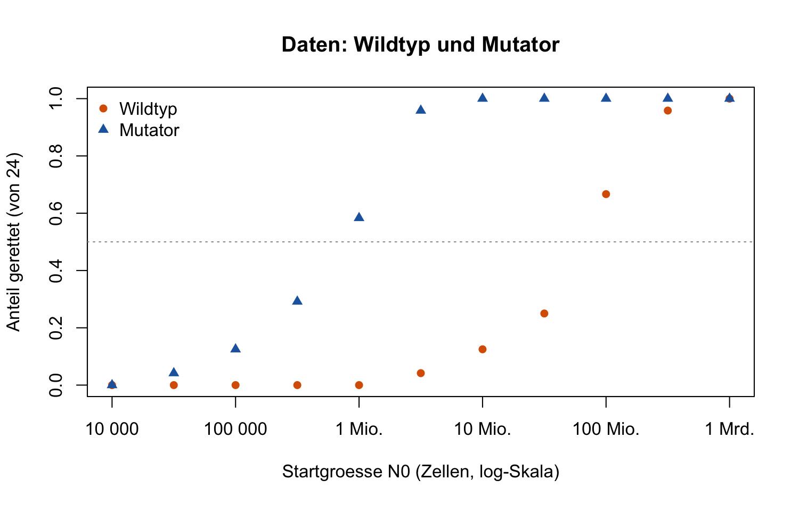
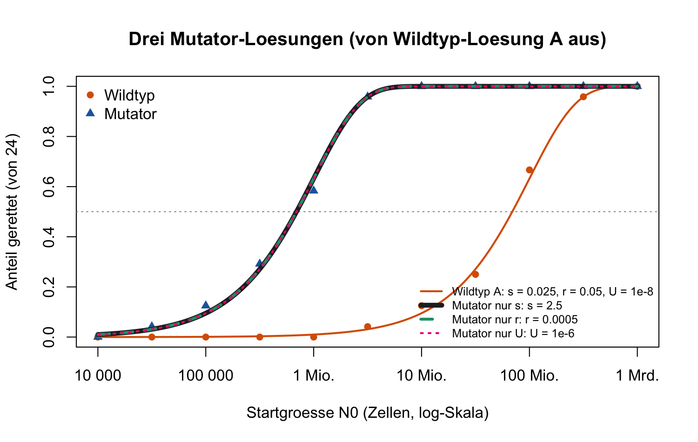
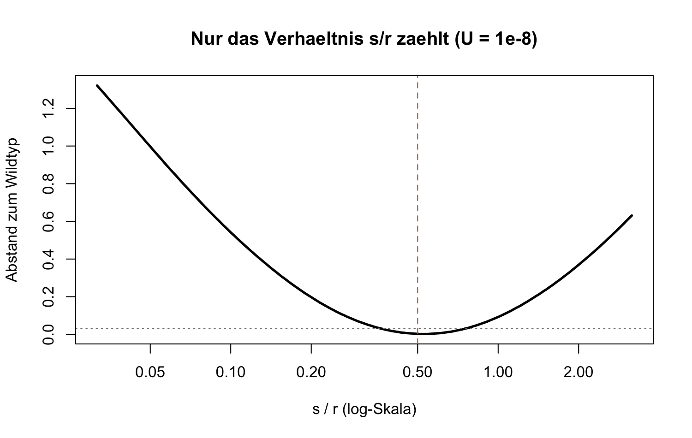

**Nicht für Studierende.** Ablauf: Wildtyp anpassen → Mutator anpassen → eine Frage (a–c). Teams bis 4 · Notebook (Quarto / Rmd / `notebook.R`) · Gespräch 1–2 Minuten pro Gruppe

**Kurz:** Der Mutator wird schon bei etwa **100-mal kleineren** Kulturen gerettet. Im Modell zählt nur $N_0 \cdot U \cdot s / r$: Mit $U$ fest heisst das, beim Wildtyp passt jedes Paar mit $s/r \approx 0.5$. Für den Mutator passt jede Änderung, die $U s / r$ **100-mal grösser** macht: $s \times 100$, $r / 100$ oder $U \times 100$. Die Daten können das nicht entscheiden. Biologisch gilt: Beide Stämme sterben gleich schnell ($r$ gleich) und tragen dieselbe Resistenzmutation ($s$ gleich). Also ist die **Mutationsrate** $U$ etwa 100-mal höher: genau das, was ein defektes Reparatur-Gen tut.

## 1 · Check (Bestanden?)

- [ ] **Eine Abbildung** gezeigt (Daten oder ein Modellplot)
- [ ] **a, b:** Wildtyp angepasst, dann Mutator; erkannt: jede der drei Zahlen kann es erklären, wenn $s$ oder $U$ etwa 100-mal grösser bzw. $r$ 100-mal kleiner wird
- [ ] **c:** $r$ und $s$ sind laut Kontrollversuch gleich, also ist es $U$, etwa 100-mal höher. Folge: Mutator-Infektionen werden viel öfter resistent, auch bei kleiner Bakterienzahl.

Bestanden, wenn die Gruppe **welcher Parameter**, **in welche Richtung** und **warum** in eigenen Worten sagen kann. Exakte Zahlen sind nicht nötig; ein Faktor zwischen etwa 50 und 200 ist in Ordnung.

## 2 · Erwartete Antworten

**Die Daten (Teil 1).** Die Hälfte der Röhrchen wird gerettet bei etwa **70 Mio.** Zellen (Wildtyp) und bei etwa **0.7 Mio.** Zellen (Mutator): zwei Zehnerschritte, Faktor 100.

{width=58%}

**Schritt 1 — Wildtyp.** Das Modell startet mit $s = 0.1$, $r = 0.05$, $U = 10^{-8}$ ($s/r = 2$, Abstand zum Wildtyp 0.369: rettet viel zu oft). Passend ist z. B. $s = 0.025$ (nur $s$ geändert) oder $r = 0.2$ (nur $r$ geändert), beide $s/r = 0.5$. Werte von $s/r$ zwischen etwa 0.4 und 0.6 liegen unter 0.03.

**Schritt 2 — Mutator, a und b.** Von der Wildtyp-Lösung aus **eine** Zahl ändern (Abstand unter 0.03 = passt):

| | $s$ | $r$ | $U$ | Abstand |
|---|---|---|---|---|
| Start | 0.1 | 0.05 | 1e-8 | Wildtyp 0.369 |
| **Wildtyp-Lösung A** (nur $s$) | 0.025 | 0.05 | 1e-8 | Wildtyp 0.003 |
| Mutator von A, nur $s$ | **2.5** | 0.05 | 1e-8 | Mutator 0.004 |
| Mutator von A, nur $r$ | 0.025 | **0.0005** | 1e-8 | Mutator 0.004 |
| Mutator von A, nur $U$ | 0.025 | 0.05 | **1e-6** | Mutator 0.004 |
| **Wildtyp-Lösung B** (nur $r$) | 0.1 | 0.2 | 1e-8 | Wildtyp 0.003 |
| Mutator von B, nur $s$ | **10** | 0.2 | 1e-8 | Mutator 0.004 |
| Mutator von B, nur $r$ | 0.1 | **0.002** | 1e-8 | Mutator 0.004 |
| Mutator von B, nur $U$ | 0.1 | 0.2 | **1e-6** | Mutator 0.004 |

- Jede Lösung ändert eine Zahl um den **Faktor 100**. Gemeinsam: $U \cdot s / r$ ist 100-mal grösser.
- **Kernaussage:** Wie in Checkpoint B (dort $m/s$) zählt nur eine Kombination der Parameter. Die drei Modellkurven liegen **exakt** übereinander:

{width=58%}

{width=58%}

**c — Biologisch.**

1. Kontrollversuch: Empfindliche Zellen beider Stämme sterben **gleich schnell**, also ist $r$ gleich. «$r$ 100-mal kleiner» hiesse ausserdem, das Antibiotikum wirkt fast nicht ($r = 0.0005$).
2. **Dieselbe** Resistenzmutation, also ist $s$ gleich. «$s = 2.5$» oder gar 10 hiesse, eine resistente Zelle hat im Antibiotikum 3.5 bzw. 11 Nachkommen pro Generation: unrealistisch.
3. Bleibt $U$: Der Mutator hat ein defektes Reparatur-Gen, macht also mehr Fehler beim Kopieren der DNA. Eine 100-fach höhere Mutationsrate ist für solche Stämme (z. B. *mutS*-Defekt bei *E. coli*) typisch.
4. Folge: Eine Mutator-Population ist so «rettbar» wie eine 100-mal grössere Wildtyp-Population. In chronischen Infektionen (z. B. *Pseudomonas aeruginosa* in der Lunge von Menschen mit Cystischer Fibrose) sind Mutatoren häufig, und Resistenz entsteht dort besonders leicht (Oliver et al. 2000).

## 3 · Häufige Probleme

- **`1e-8` falsch geändert.** `1e-6` ist **grösser** als `1e-8` (100-mal). Manche schreiben `1e-10` und wundern sich. Rat: `1e-7` ist zehnmal grösser.
- **Komma statt Punkt** (`0,025`) gibt eine Fehlermeldung. Richtig ist `0.025`.
- **Planlos mehrere Zahlen geändert.** Rat: immer von der Wildtyp-Lösung aus, nur eine Zahl.
- **«Abstand» falsch gelesen.** Kleiner heisst besser. Für die Wildtyp-Lösung zählt der Abstand zum **Wildtyp**, für die Mutator-Lösungen der zum **Mutator**. Unter etwa 0.03 gilt als «passt».
- **log-Achse:** Jeder Strich ist zehnmal mehr. «Zwei Striche weiter links» heisst Faktor 100.
- **Keine Abbildung in `notebook.R`:** Code Zeile für Zeile ausführen; die Abbildungen erscheinen im *Plots*-Fenster.
- **Hilfsfunktionen-Block nicht ausgeführt** führt zu `could not find function`. Abschnitt 0 komplett ausführen.

## 4 · Nachfragen für schnelle Gruppen

- **Wie viel grösser müsste eine Wildtyp-Kultur sein, um so oft gerettet zu werden wie der Mutator?** Etwa 100-mal: $N_0$ und $U$ stehen als Produkt in der Formel.
- **Warum sind 24 Röhrchen pro Startgrösse nötig?** Jedes Röhrchen ist ein Zufallsexperiment (Woche 9 und 10). Der Anteil gerettet schwankt; mit 24 Röhrchen ist er etwa auf $\pm 0.1$ genau.
- **Was fehlt im Modell?** Resistente Zellen, die schon **vor** dem Antibiotikum da waren (stehende Variation). Bei einer Milliarde Zellen ist das realistisch. Im Modell entstehen Mutanten nur während des Schrumpfens.
- **Wie misst man $U$ direkt?** Fluktuationstest (Luria & Delbrück 1943): viele kleine Kulturen auf Antibiotika-Platten, Resistente zählen.
- **Ist ein Mutator immer im Vorteil?** Nein: Die meisten Mutationen schaden. Ohne Antibiotikum verlieren Mutatoren oft gegen den Wildtyp.

Die Daten sind **für den Kurs erfunden** (11 Startgrössen, je 24 Röhrchen), erzeugt mit $s/r = 0.5$, $U = 10^{-8}$ (Wildtyp) und $U = 10^{-6}$ (Mutator).
