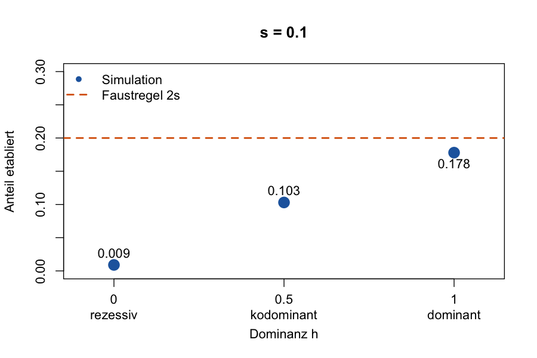

**Nicht für Studierende.** Ablauf: dominant schätzen → nur $h$ ändern → alle drei in einer Abbildung → eine Frage (a–c). Teams bis 4 · Notebook (Quarto / Rmd / `notebook.R`) · Gespräch 1–2 Minuten pro Gruppe

**Kurz:** Eine neue Mutation steckt anfangs fast nur in Heterozygoten Aa. Für ihre Etablierung zählt darum der Vorteil des **Heterozygoten**, $h\,s$: $u \approx 2hs$. Dominant ($h = 1$) gibt etwa $2s = 0.2$ wie in Woche 10, kodominant ($h = 0.5$) etwa $s = 0.1$, rezessiv ($h = 0$) fast nie, obwohl aa in allen drei Fällen 10 % im Vorteil ist.

## 1 · Check (Bestanden?)

- [ ] **Eine Abbildung** gezeigt (`zeige_h`)
- [ ] **a:** drei Werte notiert (ungefähr reicht)
- [ ] **b:** Faustregel ergänzt: $u \approx 2hs$ (oder in Worten: «2 mal der Vorteil des Heterozygoten»)
- [ ] **c:** begründet: Eine neue Mutation ist fast nur in Heterozygoten; aa gibt es am Anfang praktisch nicht.

Bestanden, wenn die Gruppe die Faustregel und **warum** in eigenen Worten sagen kann. Exakte Zahlen sind nicht nötig.

## 2 · Erwartete Antworten

**a** ($s = 0.1$, je 2000 Mutationen). Die Werte schwanken von Lauf zu Lauf:

| $h$ | Fall | typisch | Bereich (20 Läufe) | $2hs$ |
|---|---|---|---|---|
| 1 | dominant | 0.18 | 0.17–0.20 | 0.2 |
| 0.5 | kodominant | 0.10 | 0.09–0.10 | 0.1 |
| 0 | rezessiv | 0.01 | 0.007–0.014 | 0 |

{width=58%}

**b** $u \approx 2hs$. Kodominant liegt bei der Hälfte von dominant; rezessiv bei fast null. Die $2s$-Linie passt nur für dominant.

- Die Simulation liegt etwas unter $2hs$, weil das Spielzeugmodell genau $2hs/(1+hs)$ gibt (Woche 10). Für die Antwort egal.
- **Rezessiv nicht genau 0:** Jede Kopie hat dann im Mittel genau 1 Nachkommen (neutral). Etwa 1 von 100 Mutationen erreicht 100 Kopien rein durch Zufall (Drift, Woche 9). Das ist richtig, kein Fehler.

**c — Biologisch.**

1. Bei einer Häufigkeit $p$ gibt es etwa $2p$ Heterozygote, aber nur $p^2$ Homozygote (Hardy-Weinberg, Woche 5). Bei $p = 0.001$: rund 2000 Aa auf ein aa. Bei einer einzigen Kopie gibt es gar kein aa.
2. Darum entscheidet am Anfang allein die Fitness von Aa: $1 + hs$.
3. Folge: Neue vorteilhafte Mutationen, die sich durchsetzen, sind eher dominant als rezessiv (*Haldanes Sieb*, Haldane 1927). Aus **stehender** Variation, wo es schon viele Kopien gibt, ist der Sieb schwächer (Orr & Betancourt 2001).

## 3 · Häufige Probleme

- **Komma statt Punkt** (`0,5`) gibt eine Fehlermeldung. Richtig ist `0.5`.
- **Auch `s` geändert.** Rat: $s$ bleibt 0.1, nur $h$ ändern.
- **Werte anders als beim Nachbarn:** Zufall, jede Simulation ist etwas anders. Die Grössenordnung zählt.
- **Rezessiv gibt nicht genau 0** und die Gruppe ist verunsichert: siehe oben.
- **Hilfsfunktionen-Block nicht ausgeführt** führt zu `could not find function`. Abschnitt 0 komplett ausführen.
- **Keine Abbildung in `notebook.R`:** Code Zeile für Zeile ausführen; die Abbildungen erscheinen im *Plots*-Fenster.

## 4 · Nachfragen für schnelle Gruppen

- **Bonus im Notebook** (Teil 5, gut für Vierergruppen: jede Person übernimmt einen Fall):
  - **Unterdominant** (`h = -0.5`): Der Heterozygot ist schlechter als beide Homozygoten (Woche 6). Ergebnis: praktisch 0. Die Mutation kommt gar nicht erst an, obwohl aa am besten wäre. Die Faustregel $2hs$ wäre negativ, also 0.
  - **Überdominant** (`h = 2`): Der Heterozygot ist am besten (Woche 6, Sichelzellen). Ergebnis: etwa 0.3 (Spielzeugmodell $2hs/(1+hs) = 0.33$), noch öfter als dominant.
- **Warum gilt das nur am Anfang?** Wird die Mutation häufig, gibt es aa-Individuen, und dann zählt auch $s$.
- **Haploide Organismen** (Bakterien): Dort gibt es keine Dominanz, jede Kopie zeigt ihren vollen Vorteil, also $2s$ wie in Woche 10.

Die Simulation ist das Spielzeugmodell aus Woche 10 (0 oder 2 Nachkommen pro Kopie), mit $1 + hs$ statt $1 + s$; Abbruch bei 100 Kopien.
