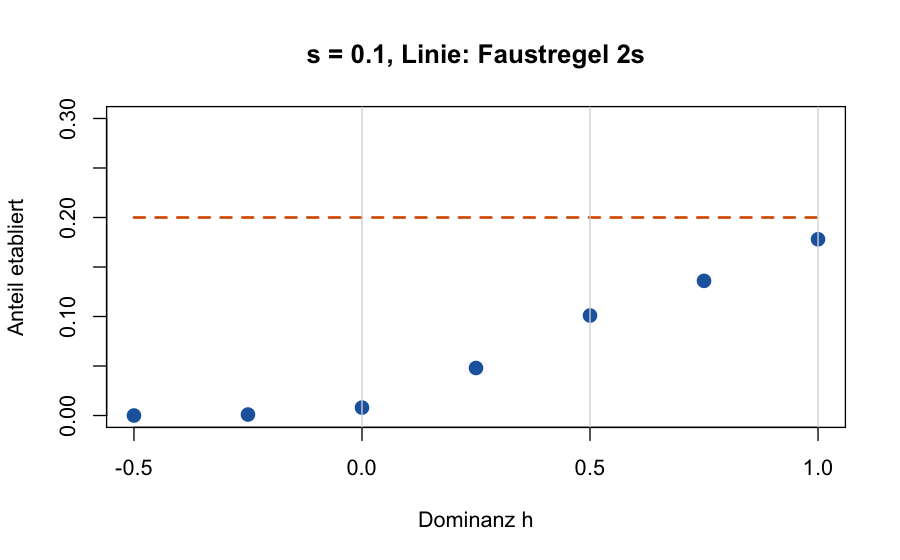
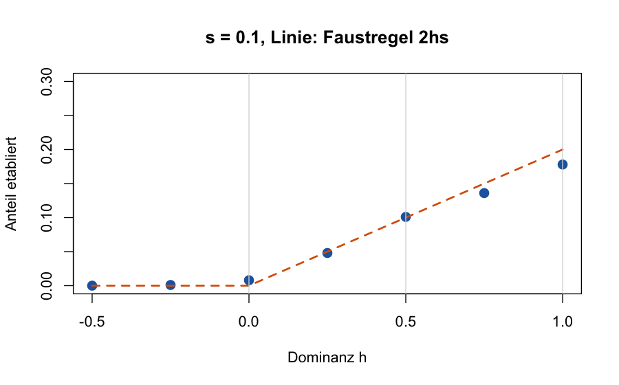

**Nicht für Studierende.** Ablauf: dominant simulieren → nur $h$ ändern → alle $h$ in einer Abbildung → eine Frage (a–c). Teams bis 4 · Notebook (Quarto / Rmd / `notebook.R`) · Gespräch 1–2 Minuten pro Gruppe

**Kurz:** Eine neue Mutation steckt anfangs fast nur in Heterozygoten Aa. Für ihre Etablierung zählt darum der Vorteil des **Heterozygoten**, $h\,s$, nicht der des Homozygoten: $u \approx 2hs$. Dominant ($h = 1$) gibt etwa $2s$ wie in Woche 10, kodominant ($h = 0.5$) etwa die Hälfte. Rezessiv ($h = 0$) etabliert sich nur selten und nur durch Zufall, unterdominant ($h < 0$) praktisch nie, obwohl aa in allen Fällen 10 % im Vorteil ist.

## 1 · Check (Bestanden?)

- [ ] **Eine Abbildung** gezeigt (Teil 1/2 oder `zeige_h`)
- [ ] **a:** Tabelle mit den vier Fällen ausgefüllt (ungefähre Werte reichen)
- [ ] **b:** erkannt, dass $2s$ nur für dominant passt und $2hs$ für alle Fälle
- [ ] **c:** begründet: Eine neue Mutation ist fast nur in Heterozygoten; aa gibt es am Anfang praktisch nicht. Folge: Rezessive Vorteile «sieht» die Selektion zu Beginn nicht.

Bestanden, wenn die Gruppe **welches $s$ zählt** und **warum** in eigenen Worten sagen kann. Exakte Zahlen sind nicht nötig.

## 2 · Erwartete Antworten

**Teile 1 und 2** ($s = 0.1$, je 2000 Mutationen; Werte schwanken um etwa $\pm 0.01$):

| $h$ | Fall | Anteil etabliert (typisch) | $2s$ | $2hs$ |
|---|---|---|---|---|
| 1 | dominant | 0.18–0.20 | 0.2 | 0.2 |
| 0.5 | kodominant | 0.09–0.10 | 0.2 | 0.1 |
| 0 | rezessiv | um 0.01 | 0.2 | 0 |
| −0.5 | unterdominant | 0 | 0.2 | −0.1, also 0 |

- Die Simulation liegt etwas unter $2hs$, weil das Spielzeugmodell genau $2hs/(1+hs)$ gibt (Woche 10). Für die Antwort egal.
- **Rezessiv:** Im Modell hat jede Kopie dann im Mittel genau 1 Nachkommen (neutral). Etwa 1 von 100 Mutationen erreicht 100 Kopien rein durch Zufall. Dass es nicht exakt 0 ist, ist richtig und ein gutes Gesprächsthema (Woche 9: Drift).
- **Unterdominant:** Jede Kopie hat im Mittel weniger als 1 Nachkommen. Die Linie stirbt fast immer in wenigen Generationen aus.

**Teil 3** (`zeige_h`): Mit der Linie $2s$ passt nur der Punkt bei $h = 1$. Mit $2hs$ liegen alle Punkte auf der Linie (unter null: Linie bei 0).

{width=55%}

{width=55%}

**c — Biologisch.**

1. Bei einer Häufigkeit $p$ gibt es etwa $2p$ Heterozygote, aber nur $p^2$ Homozygote (Hardy-Weinberg, Woche 5). Bei $p = 0.001$: rund 2000 Aa auf ein aa. Bei einer einzigen Kopie gibt es gar kein aa.
2. Darum entscheidet am Anfang allein die Fitness von Aa: $1 + hs$. Ist $hs \le 0$, wächst die Linie im Mittel nicht, egal wie gut aa wäre.
3. Folge: Neue vorteilhafte Mutationen, die sich durchsetzen, sind eher dominant als rezessiv (*Haldanes Sieb*, Haldane 1927). Aus **stehender** Variation, wo es schon viele Kopien gibt, ist der Sieb schwächer (Orr & Betancourt 2001).
4. Unterdominanz (Woche 6): Dort war das innere Gleichgewicht instabil. Hier sieht man die Folge für eine neue Mutation: Sie kommt gar nicht erst an.

## 3 · Häufige Probleme

- **Komma statt Punkt** (`0,5`) gibt eine Fehlermeldung. Richtig ist `0.5`.
- **Minuszeichen:** `h <- -0.5` (mit Leerzeichen nach `<-`). `h <--0.5` funktioniert auch, sieht aber verwirrend aus.
- **Mehr als eine Zahl geändert** (z. B. auch `s`). Rat: $s$ bleibt 0.1, nur $h$ ändern.
- **`"2hs"` ohne Anführungszeichen** gibt `object '2hs' not found`. Richtig: `regel = "2hs"`.
- **Rezessiv gibt nicht genau 0** und die Gruppe ist verunsichert: Das ist Zufall (siehe oben), kein Fehler.
- **Hilfsfunktionen-Block nicht ausgeführt** führt zu `could not find function`. Abschnitt 0 komplett ausführen.
- **Keine Abbildung in `notebook.R`:** Code Zeile für Zeile ausführen; die Abbildungen erscheinen im *Plots*-Fenster.

## 4 · Nachfragen für schnelle Gruppen

- **Überdominanz** ($h > 1$, z. B. $h = 2$): Was passiert? Die Mutation etabliert sich noch öfter, etwa $2hs$. Verbindung zu Woche 6 (Sichelzellen: der Heterozygot ist am besten).
- **Warum gilt das nur am Anfang?** Wird die Mutation häufig, gibt es aa-Individuen, und dann zählt auch $s$. Das Modell hier beschreibt nur die ersten Generationen.
- **Wie oft wäre eine rezessive Mutation erfolgreich, wenn sie schon häufig da wäre?** Viel öfter: Dann gibt es Homozygote (stehende Variation, Orr & Betancourt 2001).
- **Haploide Organismen** (Bakterien): Dort gibt es keine Dominanz, jede Kopie zeigt ihren vollen Vorteil, also $2s$ wie in Woche 10.

Die Simulation ist das Spielzeugmodell aus Woche 10 (0 oder 2 Nachkommen pro Kopie), mit $1 + hs$ statt $1 + s$; Abbruch bei 100 Kopien.
