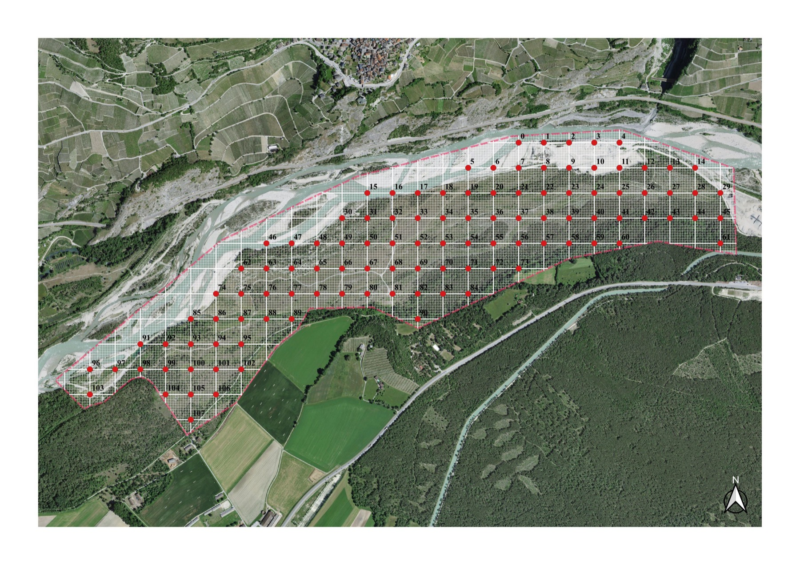

```{r}
#| include: false
source("../slides-ggplot.R")
source("../rottensand-prep.R")
```

## Übersicht

**Woche 12** von 14 · **Do., 3. Dez. 2026, 08:15–10:00**

| Teil | Dauer | Was |
|------|-------|-----|
| Vorlesung | ~45 min | Rottensand · zwei Dateien · ein Schlüssel · prüfen · kombinieren |
| Notebook | ~45 min | einlesen · eine Funktion für beide Jahre · `merge` und `rbind` |

::: aside
Pfeiltasten · **M** Menü · **E** PDF · **Esc** Übersicht
:::

## Lernziele

Nach heute können Sie …

1. sagen, was in einer Zeile einer Datentabelle steht,
2. zwei Jahre mit **derselben** Funktion aufbereiten,
3. eine Tabelle **prüfen**, bevor Sie plotten,
4. zwei Tabellen über einen **Schlüssel** kombinieren: nebeneinander und untereinander,
5. sagen, warum die Rohdaten nie von Hand geändert werden.

# Rottensand

## Eine Aue an der Rhône

{fig-alt="Luftbild Rottensand mit Raster der Plots" width="78%"}

::: aside
Rottensand, Pfynwald (Wallis). Rote Punkte: Plots mit Nummer. Luftbild swisstopo; Raster: Feldpraktikum Conservation Biology, Universität Bern
:::

## Kies, Steppe, Wald

Rottensand liegt zwischen der Rhône und dem Föhrenwald:

- **Aue** (*alluvial*): Kies und Sand, vom Fluss immer wieder umgelagert,
- **Steppe**: trocken, offener Boden, Gras und Kräuter,
- **Wald**: Föhren, Schatten, Streu.

Ein Raster aus **10 × 10 m** Plots liegt über dem ganzen Gebiet. Jeder Plot hat eine Nummer: Das wird unser **Schlüssel**.

## Was gezählt wird

Feldpraktikum der Universität Bern, Ende Juli **2019** und Ende Juli **2024**:

- Jeder Plot wird **viermal** besucht. Gezählt werden Heuschrecken und Gottesanbeterinnen, 2024 auch Eidechsen und Wespenspinnen.
- Bei jedem Besuch notiert: Temperatur, Zeit, Wind, Wolken, wer gezählt hat.
- Einmal pro Plot kartiert: Wie viel Prozent sind Gras, Kraut, Moos, offener Boden, Kies, Stein, Streu? Wie viel Baumkronen darüber?

## Sechs Arten

| Kürzel | Art | |
|---|---|---|
| `OedCae` | *Oedipoda caerulescens* | Blauflügelige Ödlandschrecke |
| `CalIta` | *Calliptamus italicus* | Italienische Schönschrecke |
| `OedGer` | *Oedipoda germanica* | Rotflügelige Ödlandschrecke |
| `SphCae` | *Sphingonotus caerulans* | Blauflügelige Sandschrecke |
| `PlaAlb` | *Platycleis albopunctata* | Westliche Beissschrecke |
| `ManRel` | *Mantis religiosa* | Gottesanbeterin |

Die Ödland- und Sandschrecken sind am Boden gut getarnt. Im Flug zeigen sie blaue oder rote Hinterflügel.

## Die Frage für zwei Wochen

> Welche Art lebt **wo**?
> Und ist das **2024** noch so wie **2019**?

Dafür brauchen wir zuerst **eine** Tabelle aus **zwei** Dateien.

# Zwei Dateien

## So sieht die Rohdatei aus

```{r}
knitr::kable(head(roh24[roh24$plot == 3, c("plot", "quarter", "temp1", "OedCae1", "OedCae2", "OedCae3", "OedCae4", "soil", "grass")], 5), row.names = FALSE)
```

- **136 Spalten** (2024) und **178 Spalten** (2019).
- Jeder Plot hat **fünf Zeilen**: vier Viertel (SW, NW, NE, SE) und das Ganze (`tot`).
- Pro Art **vier Spalten**, eine pro Besuch.

## Was ist eine Zeile?

Bevor man rechnet, muss man in einem Satz sagen können, was **eine Zeile** ist.

| Tabelle | Eine Zeile ist … |
|---|---|
| Rohdatei | ein Viertel **oder** ein ganzer Plot, in einem Jahr |
| unsere kurze Tabelle | ein ganzer, besuchter Plot, in einem Jahr |
| `beide` | ein Plot, mit 2019 **und** 2024 nebeneinander |
| `alle` | ein Plot in einem Jahr, beide Jahre untereinander |

## Rohdaten bleiben roh

```text
woche-12/
├── notebook.qmd        ← alle Schritte stehen hier
└── data/
    ├── rottensand_2019.csv   ← nie von Hand ändern
    └── rottensand_2024.csv
```

Jede Änderung steht im **Code**. Wer das Notebook laufen lässt, bekommt dieselbe Tabelle und dieselbe Abbildung.

## Excel speichert den Weg nicht

Die Daten von 2019 kamen als **Excel-Datei**. Darin steht für fehlende Werte das Wort «NA», als **Text**.

- Excel zeigt eine schöne Tabelle. Man sieht nichts.
- R liest die Datei und macht aus jeder Spalte mit einem «NA» eine **Textspalte**. Rechnen geht nicht mehr.
- Lösung: eine Option beim Einlesen, `na = "NA"`. Sie steht im Skript, das die CSV-Datei erzeugt hat.

Excel *kann* das auch. Aber den Klick, der es repariert, sieht später niemand mehr.

## Eine Funktion, zwei Jahre

```{r}
#| echo: true
#| eval: false
aufbereiten <- function(roh, jahr) {
  d <- roh[roh$quarter == "tot" & !is.na(roh$temp1), ]   # ganze, besuchte Plots
  kurz <- data.frame(plot = d$plot, jahr = jahr,
                     habitat = d$habitat.type, boden = d$soil, gras = d$grass)
  for (a in arten) kurz[[a]] <- max_besuch(d, a)          # höchste von 4 Zählungen
  kurz
}

k19 <- aufbereiten(roh19, 2019)
k24 <- aufbereiten(roh24, 2024)
```

Kein Copy-Paste: Ein Fehler wird **einmal** korrigiert, und beide Jahre sind korrigiert.

# Prüfen

## Drei Fragen an jede Tabelle

1. **Ist der Schlüssel eindeutig?** Keine Plotnummer doppelt: 2019 `r sum(duplicated(k19$plot))`, 2024 `r sum(duplicated(k24$plot))`. ✓
2. **Ergeben die Deckungen 100 %?** 2024 alle. 2019 nicht: Plot 51 hat `r k19$deckung[k19$plot == 51]` %, Plot 104 hat `r k19$deckung[k19$plot == 104]` %.
3. **Heissen die Dinge gleich?** Nächste Folie.

## Heissen die Dinge gleich?

```{r}
hab <- merge(as.data.frame(table(Lebensraum = k19$habitat)),
             as.data.frame(table(Lebensraum = k24$habitat)),
             by = "Lebensraum", all = TRUE)
names(hab) <- c("Lebensraum", "2019", "2024")
hab[is.na(hab)] <- 0
knitr::kable(hab, row.names = FALSE)
```

2024 gibt es zwei neue Namen. «rhone» und «riverbed» sind vermutlich dasselbe wie *alluvial*, aber das steht nirgends. Nachfragen, bevor man zusammenlegt.

## Echte Fehler

Die Fehler sind **echt**. Im Feld, bei 35 °C, schreibt man schnell 105 statt 100.

- Wichtig ist nicht, dass es keine Fehler gibt.
- Wichtig ist, dass man sie **findet**, bevor man Schlüsse zieht.
- Und dass im Code steht, was man mit ihnen gemacht hat.

# Kombinieren

## Nebeneinander: `merge`

Zeilen mit **demselben Schlüssel** werden zusammengelegt.

:::: columns
::: {.column width="30%"}
**2019**

| plot | OedCae |
|---|---|
| 3 | 4 |
| 5 | 0 |
| 7 | 2 |
:::
::: {.column width="30%"}
**2024**

| plot | OedCae |
|---|---|
| 3 | 9 |
| 7 | 1 |
| 60 | 3 |
:::
::: {.column width="40%"}
**`merge(by = "plot")`**

| plot | 2019 | 2024 |
|---|---|---|
| 3 | 4 | 9 |
| 7 | 2 | 1 |
:::
::::

Plots, die nur in einem Jahr da sind, fallen weg: Aus `r nrow(k19)` und `r nrow(k24)` Plots werden **`r nrow(beide)`**.

::: aside
Zahlen zur Illustration
:::

## Untereinander: `rbind`

Die Tabellen werden **gestapelt**, mit einer Spalte `jahr`.

| plot | jahr | OedCae |
|---|---|---|
| 3 | 2019 | 4 |
| 5 | 2019 | 0 |
| … | … | … |
| 3 | 2024 | 9 |
| 60 | 2024 | 3 |

Das geht nur, wenn beide Tabellen **dieselben Spalten** haben. Dafür sorgt `aufbereiten`.

## Welche Tabelle für welche Frage?

| Frage | Tabelle |
|---|---|
| Ist *Calliptamus* in der Steppe häufiger als im Wald? | `alle` (untereinander) |
| Hat ein Plot mit vielen Tieren 2019 auch 2024 viele? | `beide` (nebeneinander) |
| Wo ist eine Art neu aufgetaucht? | `beide` |
| Gibt es mehr Arten pro Plot als 2019? | `alle` |

## Gleicher Plot, zwei Jahre

```{r}
#| fig-height: 3.6
#| fig-width: 5
#| out-width: 55%
ggplot(beide, aes(OedCae_2019, OedCae_2024)) +
  geom_abline(slope = 1, intercept = 0, linetype = "dashed", colour = "grey60") +
  geom_jitter(width = 0.15, height = 0.15, colour = col_blue, size = 2, alpha = 0.8) +
  labs(x = "Anzahl 2019", y = "Anzahl 2024", title = "Oedipoda caerulescens") +
  theme_slide() +
  theme(plot.title = element_text(face = "italic"))
```

Gleicher Plot, gleiche Methode, oft ganz andere Zahlen. Zählen ist eine **Stichprobe** (Woche 9). Und vier Besuche im Juli sind nicht der ganze Sommer.

# Abschluss

## Notebook (~45 min)

**→ [Notebook Woche 12 öffnen](notebook.html)** · [Rmd](notebook.Rmd) · [R](notebook.R)

1. Beide Jahre einlesen: Was ist eine Zeile?
2. `aufbereiten`: eine Funktion für beide Jahre
3. Prüfen: Schlüssel, Deckung, Namen
4. Kombinieren: `merge` und `rbind`
5. Erste Abbildung: gleicher Plot, zwei Jahre

## Take-home

1. Erst sagen, was **eine Zeile** ist. Dann rechnen.
2. Rohdaten bleiben roh. Jede Änderung steht im Code.
3. Eine **Funktion** für alle Dateien statt Copy-Paste.
4. Vor dem Plotten **prüfen**: Schlüssel, Summen, Namen.
5. `merge` legt nebeneinander (über den Schlüssel), `rbind` stapelt.

## Nächste Woche: Farbe und Form

```{r}
#| fig-height: 3.6
#| fig-width: 9
#| out-width: 92%
ggplot(lang[lang$jahr == 2024, ], aes(x, y, size = anzahl, colour = habitat)) +
  geom_point(alpha = 0.75) +
  scale_colour_manual(values = hab_farben, name = NULL) +
  scale_size_area(max_size = 4, guide = "none") +
  facet_wrap(~ art, ncol = 3) +
  coord_equal() +
  theme_void(base_size = 13) +
  theme(strip.text = element_text(face = "italic"), legend.position = "top")
```

Dieselbe Tabelle, sechs Karten. Nächste Woche ist **Werkstatt**: von der Standard-Abbildung zu einer, die man gern anschaut.

## Daten und Dank

:::: {.lit}
- **Daten:** Feldpraktikum Conservation Biology, Universität Bern, Rottensand 2019 und 2024. Mit freundlicher Genehmigung. Die Kürzel der Beobachterinnen und Beobachter sind durch Teamcodes ersetzt.
- **Aufbereitung:** `scripts/make_rottensand_data.R` (Excel → CSV, Teamcodes). Sonst unverändert.
- **Luftbild:** swisstopo.
- Wickham, H. (2014). Tidy data. *Journal of Statistical Software* 59(10). [doi:10.18637/jss.v059.i10](https://doi.org/10.18637/jss.v059.i10)
::::

## Navigation

| | |
|---|---|
| Notebook | [Quarto](notebook.html) · [Rmd](notebook.Rmd) · [R](notebook.R) |
| Zurück | [← Woche 11](../week-11/slides.html) |
| Weiter | [Woche 13 →](../week-13/slides.html) |
| Modul | [Modul 4](../../docs/module-04-overview.html) |
| PDF | [slides.pdf](slides.pdf) · oder Taste **E**, dann Drucken |
